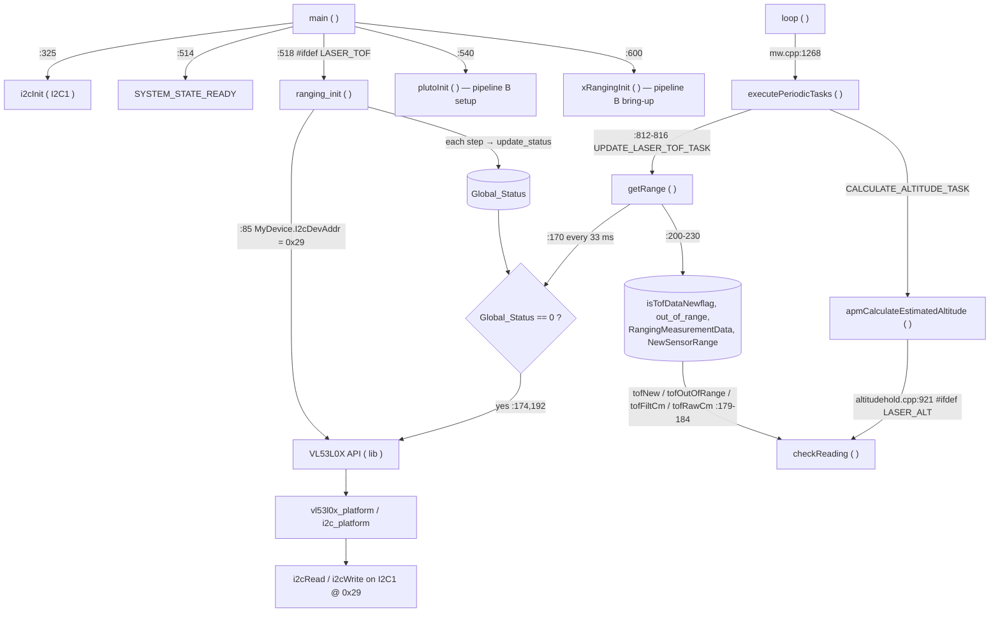
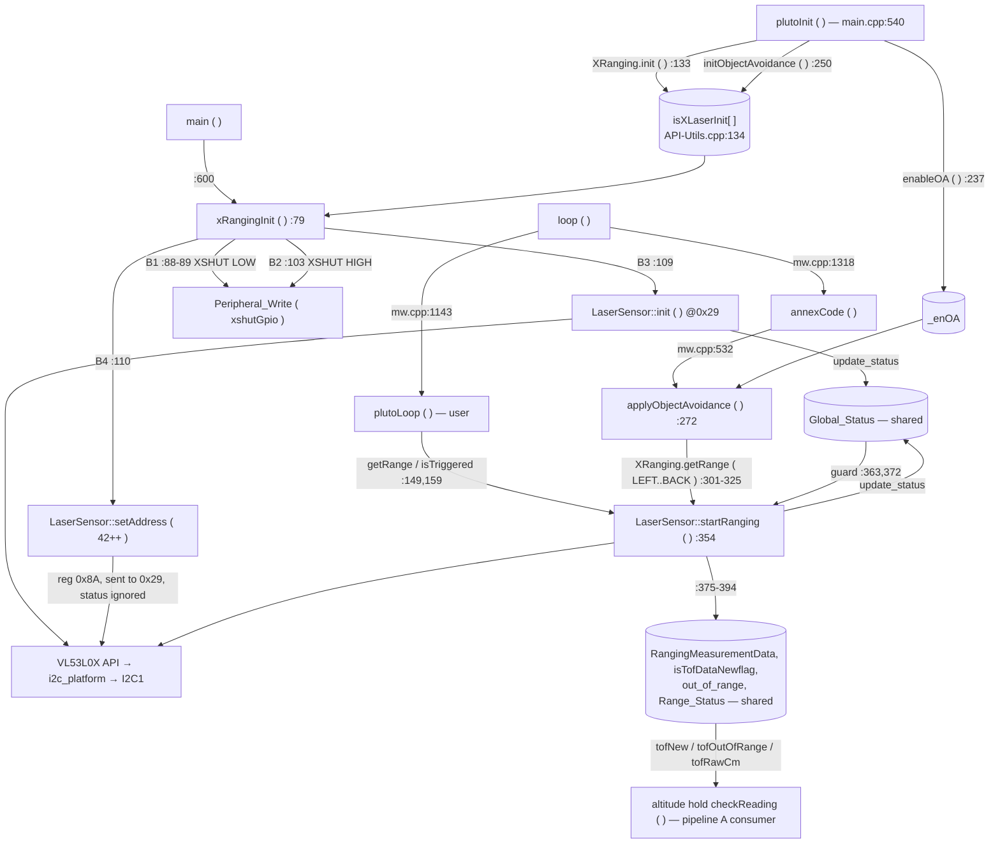

# Laser ToF Init Conflict - Investigation

[README](README.md) · [TASKS](TASKS.md) · [SCOUT](SCOUT.md) · [INVESTIGATION](INVESTIGATION.md)

## Findings

Task 6 ( 14 Oct 2026 ). This summary stands on its own; the evidence is in the sections below. It comes from code
analysis only: no bench test was run in this topic.

**Cause ( H1, confirmed in the code, independent of timing ).** The two VL53L0X bring-ups share I2C1 and the default
address 0x29, but neither knows about the other.

1. The down-laser is set up first, at 0x29 ( `ranging_init ( )`, main.cpp:518 ). It has no XSHUT, so it can never be
   held in reset.
2. XRanging then releases the first enabled side laser at 0x29, so two chips answer.
3. The side laser's init and its address change ( 0x8A = 0x2A ) reach **both** chips ( XRanging.cpp:109-110 ), so
   the down-laser moves to 0x2A together with LEFT.
4. The first down-laser read goes to the now empty 0x29. Each of its 8 writes times out, re-initialises I2C1, and
   ends as error −20.
5. The shared `Global_Status` stores the error, and nothing ever clears it.
6. That one flag guards **every** VL53L0X read, the side lasers' too, so all five lasers stop.
7. Altitude hold sees only a dropout and flies on the baro. OA sees no obstacle.

Each pipeline works alone because either nothing reads 0x29 after the bring-up, or nothing re-addresses the
down-laser.

**Ranked causes**

| Rank | | Verdict |
|---|---|---|
| 1 | H1: address collision and the shared error flag | the cause; deterministic |
| 2 | H3: side lasers awake during the down-laser's setup | confirmed for LEFT ( SPI2 SCK idles high on PB13 ) and FRONT ( PA15 reset pull-up ). It corrupts the down-laser's calibration; it does not explain the failure on its own. |
| 3 | H2: side-laser data reaches altitude hold through the shared result globals | latent today. **A flight risk the moment H1 is fixed** unless the state is split: a stale height is replayed as a good sample and the baro handover is suppressed. |
| 4 | H5: blocking side-laser reads | ~4-6 ms of I2C every 100 ms ( *estimate* ); a design constraint, not a cause |

Also found: F1 ( the I2C driver never checks NACKF ), F2 ( `setAddress ( )` ignores errors ), F3 ( fitted but disabled
lasers are never held in reset ), F4 ( the down-laser's host state is stale after the collision ), F5 ( every read
returns the previous measurement ). There are 12 doc drift items ( D1-D12 ).

**Recommendation and chosen direction ( user, 14 Oct 2026 ).** One ToF pipeline behind `XRanging` ( option B ):

- **The API.** `XRanging.initAlt ( gpio )` / `initAlt ( )` replaces `#define LASER_TOF` + `LASER_ALT` and is latched in
  `plutoInit ( )`. Without it, the firmware behaves exactly like today's baro build.
- **One bring-up** at main.cpp:600, in this order: side lasers held low → down-laser alone, released or moved off
  0x29 → side lasers one at a time.
- **Separate state.** Each laser has its own status and results. Altitude hold reads only the down-laser, and a
  failed down-laser counts as a dropout.
- **Paced reads.** The side lasers are polled one at a time, and `XRanging` calls return cached ranges.
- **Down range readable** through a new `laser_e` id.
- **Not `GPIO_5`** for the down-laser XSHUT: it is FRONT's LED. GPIO_2 is suggested.
- **VL53L1X** stays a define, and its API is the next topic.
- Full list: D1-D9 under "Chosen direction".

**Tests the fix topic runs first ( T1-T4 ).**

- T1: an I2C address scan with `Global_Status` and the I2C error count. Expected: 0x29 empty, 0x2A-0x2D present, −20,
  at least 8 errors.
- T2: leave LEFT out. Expected: the down-laser then shares RIGHT's address.
- T3: the down-laser's calibration values with the side modules unplugged, then plugged in.
- T4: after the fix, a hand in front of FRONT must not move the laser height.

**Open hardware questions** ( they do not block the fix plan ):

- Was the down-laser fitted during the "XRanging alone works" test? If so, LEFT was reading two chips.
- Do the side modules have XSHUT pull-ups? This decides whether RIGHT and BACK are on during boot.
- Which GPIO will the down-laser XSHUT use?

## Problem

With `#define LASER_TOF` and `#define LASER_ALT` in `target/PRIMUS_X2_v1/target.h`, and the user code calling
`initObjectAvoidance ( ... )` ( object-avoidance projects ) or `XRanging.init ( )` ( ranging projects ), no laser
reports a range: neither the down ( altitude ) VL53L0X nor any of the 4 side VL53L0X. Built without `LASER_TOF`, the
side lasers work. Without the XRanging calls, the down-laser works.

The user's own finding: the altitude laser is wired without an XSHUT pin, and the altitude init and the XRanging
init run separately with no central owner.

## Evidence

- User report ( 14 Oct 2026 ): all lasers dead together; each pipeline works alone.
- Hardware: 1 down + 4 side VL53L0X, all on I2C1 ( PB8 / PB9 ) with the IMU and baro. The down-laser's XSHUT is not
  connected today.
- Code: the scout's trace ( [SCOUT.md](SCOUT.md) ), to be re-verified line by line in tasks 1-3.

## Pipeline A: altitude laser ( LASER_TOF / LASER_ALT )

Traced in task 1 ( 14 Oct 2026, source at `c495d6a` ). The scout's line numbers were all confirmed.

**Enable.** `LASER_TOF` ( the VL53L0X down-laser driver ) and `LASER_ALT` ( fuse it into altitude hold ) are commented
out in [target.h:183-185](../../../../src/main/target/PRIMUS_X2_v1/target.h#L183-L185). `LASER_ALT` without a laser
is an `#error` ( [altitudehold.cpp:229](../../../../src/main/flight/altitudehold.cpp#L229) ), and so is defining both
lasers ( :108-109 ). `LASER_TOF` alone runs the driver without fusion: the range is read but only optic flow uses it.

**Boot ( once ).**

| Step | Where | What |
|---|---|---|
| A1 | [main.cpp:325](../../../../src/main/main.cpp#L325) | `i2cInit ( I2C_DEVICE )`: I2C1, the bus shared with the IMU and baro |
| A2 | [main.cpp:514](../../../../src/main/main.cpp#L514) | `systemState \|= SYSTEM_STATE_READY`. Set **before** any laser init. |
| A3 | [main.cpp:516-520](../../../../src/main/main.cpp#L516-L520) | `#ifdef LASER_TOF` → `ranging_init ( )`. No XSHUT pin is touched, and no wait for boot. |
| A4 | [ranging_vl53l0x.cpp:85-87](../../../../src/main/drivers/ranging_vl53l0x.cpp#L85-L87) | Sets the file-level `MyDevice` ( global ): `I2cDevAddr = 0x29`, 400 kHz. The address is fixed and never changed afterwards. |
| A5 | [ranging_vl53l0x.cpp:89-159](../../../../src/main/drivers/ranging_vl53l0x.cpp#L89-L159) | DataInit → StaticInit → RefSpadManagement → RefCalibration → **SINGLE_RANGING** → sigma / signal limit checks ( signal 0.1 MCPS, sigma 60 mm ) → **33 ms** timing budget → VCSEL 18 / 14. Each step runs only if `Global_Status == 0` and stores its result through `update_status ( )` ( :69-72 ). The sigma limit value ( :139 ) is the one step whose status is dropped. |
| A6 | [main.cpp:540](../../../../src/main/main.cpp#L540) | `plutoInit ( )`: user code; may call `initObjectAvoidance` / `XRanging.init` ( pipeline B ) |
| A7 | [main.cpp:600](../../../../src/main/main.cpp#L600) | `xRangingInit ( )`: pipeline B's bring-up, **after** the down-laser is already configured at 0x29 |

**Per loop.**

| Step | Where | What |
|---|---|---|
| A8 | [mw.cpp:1268](../../../../src/main/mw.cpp#L1268) | `executePeriodicTasks ( )`, only on loop passes that do not process RX |
| A9 | [mw.cpp:748-752](../../../../src/main/mw.cpp#L748-L752), [:812-816](../../../../src/main/mw.cpp#L812-L816) | Round-robin `switch`; `UPDATE_LASER_TOF_TASK` is the last slot → `getRange ( )` |
| A10 | [ranging_vl53l0x.cpp:170](../../../../src/main/drivers/ranging_vl53l0x.cpp#L170) | `rangePoll.set ( 33, true )`: runs at most every 33 ms |
| A11 | [ranging_vl53l0x.cpp:172-193](../../../../src/main/drivers/ranging_vl53l0x.cpp#L172-L193) | If `Global_Status == 0`: `VL53L0X_StartMeasurement` and then **straight away** `VL53L0X_GetRangingMeasurementData`. The data-ready check is commented out ( :180-187 ), so each read returns the result of the previous measurement ( one sample, ~33 ms, of lag ). |
| A12 | [ranging_vl53l0x.cpp:200-230](../../../../src/main/drivers/ranging_vl53l0x.cpp#L200-L230) | Writes the globals: `isTofDataNewflag = true`, `Range_Status`, `RangingMeasurementData`. If status 0 and < 2000 mm, the IIR runs ( `LASER_LPS` 0.1, float, reseedable ) → `NewSensorRange`, `out_of_range = false`. Otherwise `out_of_range = true` and a reseed. |

**Consumers.**

| Step | Where | What |
|---|---|---|
| A13 | [mw.cpp](../../../../src/main/mw.cpp) `CALCULATE_ALTITUDE_TASK` → [altitudehold.cpp:901,921](../../../../src/main/flight/altitudehold.cpp#L901) | `apmCalculateEstimatedAltitude ( )` → `checkReading ( )` ( with `LASER_ALT` ) |
| A14 | [altitudehold.cpp:179-184](../../../../src/main/flight/altitudehold.cpp#L179-L184) | Accessors: `tofNew ( )` = `isTofDataNewflag`; `tofOutOfRange ( )` = `out_of_range`; `tofFiltCm ( )` = `NewSensorRange`; `tofRawCm ( )` = `RangingMeasurementData.RangeMilliMeter`; `tofClearNew ( )` writes `isTofDataNewflag = false` |
| A15 | [altitudehold.cpp:1083-1084](../../../../src/main/flight/altitudehold.cpp#L1083-L1084), [:1276](../../../../src/main/flight/altitudehold.cpp#L1276) | Takes a sample only when it is new and not out of range. No good sample for `ALT_TOF_DROPOUT_MS` ( 120 ms ) → hands over to the baro |
| A16 | [opticflow.cpp:355-356](../../../../src/main/flight/opticflow.cpp#L355-L356) | `NewSensorRange` scales optic flow ( called only under `OPTIC_FLOW`, [mw.cpp:807-808](../../../../src/main/mw.cpp#L807-L808); off on this target ) |

Five more files include `ranging_vl53l0x.h` ( `API-Utils.h/.cpp`, `FC-Data-Sensors.cpp`, `blackbox.cpp`, `main.cpp` ), but
none of them reads the laser globals.

**State that pipeline A owns, all file-level in [ranging_vl53l0x.cpp:43-57](../../../../src/main/drivers/ranging_vl53l0x.cpp#L43-L57) and exported by [ranging_vl53l0x.h](../../../../src/main/drivers/ranging_vl53l0x.h).**

| Global | Written by A | Read by | Note for task 2 / 3 |
|---|---|---|---|
| `MyDevice` ( `VL53L0X_Dev_t` ) | A4 | the VL53L0X API on every call | `LaserSensor` declares its own `MyDevice` **member**, which shadows this global inside the class |
| `Global_Status` | A5, A11 ( `update_status` ) | A5, A11 guards | Overwritten only by an init's first step ( `DataInit` runs unguarded: :89-91 here, `LaserSensor::init` :270-272 ). **After boot nothing clears it**, so one I2C failure stops `getRange ( )` until a power cycle ( corrected in task 2 ) |
| `RangingMeasurementData` | A11 | `tofRawCm ( )` | check whether pipeline B writes it ( H2 ) |
| `isTofDataNewflag`, `out_of_range`, `Range_Status` | A12 | `tofNew ( )`, `tofOutOfRange ( )` | as above |
| `NewSensorRange`, `filteredRangeMm` ( static ), `tofReseedPending` | A12 | `tofFiltCm ( )`, optic flow | written only by `getRange ( )` |
| `rangePoll` ( `Interval` ) | A10 | - | |

**What a latched error looks like to altitude hold.** For the VL53L0X, `tofOutOfRange ( )` does **not** include
`Global_Status`. A latched error simply stops new samples: `isTofDataNewflag` stays cleared, and after 120 ms the
estimator flies on the baro as for a dropout ( A15 ). The VL53L1X differs: `isOutofRange_L1 ( )` includes its
error latch and a staleness test ( [ranging_vl53l1x.cpp:311](../../../../src/main/drivers/ranging_vl53l1x.cpp#L311) ).
In flight, a dead down-laser therefore degrades to baro hold. On the bench it looks like "the laser does not work".

**I2C path.** Every API call ends in [vl53l0x_platform.c](../../../../lib/main/VL53L0X_API/platform/src/vl53l0x_platform.c)
( `deviceAddress = Dev->I2cDevAddr` ), then [vl53l0x_i2c_platform.c](../../../../lib/main/VL53L0X_API/platform/src/vl53l0x_i2c_platform.c)
→ `i2cWrite` / `i2cWriteBuffer` / `i2cRead` on I2C1. A failed transfer returns `STATUS_FAIL`, which surfaces as a
non-zero `VL53L0X_Error` and is latched in A5 / A11. The device is addressed **only** through the address held in
the `VL53L0X_Dev_t` that is passed in. Whatever chip answers at that address receives the frame.



**Findings from task 1, for task 3.**

1. The down-laser's identity is just the number 0x29 in a global `VL53L0X_Dev_t`. No XSHUT pin, reset or ID check
   ties it to a physical chip, so any chip answering at 0x29 is "the down-laser" as far as the driver knows.
2. Pipeline A's bring-up is complete before pipeline B starts ( A3 before A7 ). Any reconfiguration by B is
   therefore never undone: there is no re-init.
3. `Global_Status` is one latch for the whole driver file. After boot nothing clears it. During boot every init's unguarded `DataInit` overwrites it, so the value left after boot is whatever the **last** init in the sequence produced ( task 2 ).
4. The four result globals are what altitude hold reads. Whether `LaserSensor` writes them is the H2 question
   for task 2.

## Pipeline B: XRanging / object avoidance

Traced in task 2 ( 14 Oct 2026, source at `c495d6a` ). Public API in [XRanging.h](../../../../src/main/API/XRanging.h),
implementation in [XRanging.cpp](../../../../src/main/API-Src/XRanging.cpp), driver class `LaserSensor` in
[ranging_vl53l0x.cpp:252-416](../../../../src/main/drivers/ranging_vl53l0x.cpp#L252-L416). It is built on every target
regardless of `LASER_TOF`, because the class sits outside that file's `#ifdef LASER_TOF` ( :74-249 ).

**Instances and table.** Five `static LaserSensor` objects ( [XRanging.cpp:29-33](../../../../src/main/API-Src/XRanging.cpp#L29-L33) ).
Each one holds its own `int16_t range` and its own `VL53L0X_Dev_t MyDevice` **member**
( [ranging_vl53l0x.h](../../../../src/main/drivers/ranging_vl53l0x.h) ), which hides the file-level `MyDevice` of pipeline A.
The table `lasers[]` ( [:54-60](../../../../src/main/API-Src/XRanging.cpp#L54-L60) ) maps `laser_e` to the LED and XSHUT pins:

| `laser_e` | LED | XSHUT ( MCU pin, PIN_MAP ) | Address after bring-up ( all 4 enabled ) |
|---|---|---|---|
| LEFT ( 0 ) | GPIO_6 | GPIO_7 ( PB13 ) | 42 = 0x2A |
| RIGHT ( 1 ) | GPIO_10 | GPIO_9 ( PA4 ) | 0x2B |
| FRONT ( 2 ) | GPIO_5 | GPIO_16 ( PA15 ) | 0x2C |
| BACK ( 3 ) | GPIO_8 | GPIO_15 ( PB3 ) | 0x2D |
| EXTERNAL ( 4 ) | none | GPIO_14 ( PA5 ) | not enabled by either entry point below |

Addresses are handed out in table order, skipping disabled lasers ( `i2cAddress++` only for enabled entries ). The
`isTriggered ( )` and OA LED writes index `lasers[laser]` directly ( :167, :303 ), which relies on the enum order
matching the table order. It does today.

**User setup ( in `plutoInit ( )`, main.cpp:540 ).** Both entry points only **record** the choice. No I2C traffic
and no pin is touched yet.

| Entry point | Where | Writes |
|---|---|---|
| `XRanging.init ( )` | [:133-142](../../../../src/main/API-Src/XRanging.cpp#L133-L142) | `isXLaserInit[LEFT..BACK] = true`, thresholds 200 mm |
| `XRanging.init ( laser, threshold )` | [:144-147](../../../../src/main/API-Src/XRanging.cpp#L144-L147) | one laser, threshold cm × 10 |
| `XRanging.initObjectAvoidance ( dist, l1..l4 )` | [:250-261](../../../../src/main/API-Src/XRanging.cpp#L250-L261) | `_objectAoidDistance = dist × 10`, `isXLaserInit[l] = true` for each `l ≥ 0`. It does **not** set `_enOA`: the user also calls `XRanging.enableOA ( )` ( :237 ). |

`isXLaserInit[5]` is a global in [API-Utils.cpp:134](../../../../src/main/API-Src/API-Utils.cpp#L134), declared in
`API-Utils.h:106`. It is the only link between the user call and the bring-up.

**Bring-up: `xRangingInit ( )` ( [:79-127](../../../../src/main/API-Src/XRanging.cpp#L79-L127), called at [main.cpp:600](../../../../src/main/main.cpp#L600) on PRIMUSX2 / PRIMUS_X2_v1 / PRIMUS_V5 ).**

| Step | Where | What |
|---|---|---|
| B1 | :84-96 | Phase 1, enabled lasers only: XSHUT → `OUTPUT`, `LOW` ( chip powered down ); LED low; 10 ms each. **Disabled entries' XSHUT pins are never driven.** |
| B2 | :99-107 | Phase 2, per enabled laser in table order: XSHUT `HIGH` ( chip boots at the default 0x29 ), LED on, 30 ms |
| B3 | :109 → [ranging_vl53l0x.cpp:252-343](../../../../src/main/drivers/ranging_vl53l0x.cpp#L252-L343) | `LaserSensor::init ( )`: `this->MyDevice.I2cDevAddr = 0x29`, then DataInit ( **unguarded**: its status overwrites `Global_Status` ) → StaticInit → SPAD → RefCal → **CONTINUOUS_RANGING** → limit checks → **20 ms** budget → VCSEL 18 / 14. Each later step is guarded by and updates the **shared** `Global_Status`. |
| B4 | :110 → [ranging_vl53l0x.cpp:345-352](../../../../src/main/drivers/ranging_vl53l0x.cpp#L345-L352) | `setAddress ( 42++ )`: `VL53L0X_SetDeviceAddress ( &MyDevice, addr × 2 )` writes register 0x8A = `addr` **to I2C address 0x29**, the address still in `MyDevice` ( [vl53l0x_api.c:310-317](../../../../lib/main/VL53L0X_API/core/src/vl53l0x_api.c#L310-L317) ). Then `I2cDevAddr = addr`. **The return status is discarded**, and `Global_Status` is not updated. |
| B5 | :112-115 | LED off, 30 ms, next laser |
| B6 | :119-126 | Phase 3: 4 × LED toggle, 75 ms each ( 300 ms ) |

The boot cost with 4 lasers is about 4 × 10 + 4 × 60 + 300 = 580 ms of `delay ( )`, plus 4 inits' I2C traffic.

**Per loop: reads.** Every read is a blocking call to `LaserSensor::startRanging ( )`
( [ranging_vl53l0x.cpp:354-410](../../../../src/main/drivers/ranging_vl53l0x.cpp#L354-L410) ). There are two callers:

| Caller | Where | Rate |
|---|---|---|
| User code: `XRanging.getRange ( l )` / `isTriggered ( l )` | [:149-171](../../../../src/main/API-Src/XRanging.cpp#L149-L171), from `plutoLoop ( )` ( [mw.cpp:1143](../../../../src/main/mw.cpp#L1143), user loop rate, 100 ms default ) | one read per call |
| `applyObjectAvoidance ( )` | [:272-382](../../../../src/main/API-Src/XRanging.cpp#L272-L382), from `annexCode ( )` ( [mw.cpp:532](../../../../src/main/mw.cpp#L532); `annexCode` runs every loop, [mw.cpp:1318](../../../../src/main/mw.cpp#L1318) ) | gated to 100 ms ( :278 ) and returns early unless `_enOA` ( :285 ); then one read per enabled laser, LEFT → BACK, all in the same pass |

`startRanging ( )`:

1. If `Global_Status == 0`: `VL53L0X_StartMeasurement ( &this->MyDevice )`. This runs on **every** read, although the chip
   is in continuous mode. The local `startNow` is always true, so the guard does nothing.
2. If still `Global_Status == 0`: `VL53L0X_GetRangingMeasurementData ( &this->MyDevice, &RangingMeasurementData )`
   **straight away**, with no data-ready check, into the **file-level** `RangingMeasurementData`.
3. Then it sets the globals `isTofDataNewflag = true` and `Range_Status`. On status 0 it sets
   `this->range = RangeMilliMeter` and `out_of_range = false`. Otherwise `this->range = -100`, and `out_of_range = true`
   only for status 2.
4. If `Global_Status != 0` it returns `-100` and does no I2C at all.

OA then does `filterDistance ( d )`. For `d ≤ 0` it returns the previous filtered value ( initially 0 ), and
`mapAvoidance ( 0 )` returns 0, so no push.

**Write table: per instance vs shared.** This answers the H2 question from task 1.

| Written by pipeline B | Instance or shared | Also read by |
|---|---|---|
| `this->MyDevice` ( address, device data ) | **per instance** | - |
| `this->range` | per instance | XRanging callers |
| `Global_Status` ( init steps, `StartMeasurement`, `GetRangingMeasurementData` ) | **shared** ( file-level ) | pipeline A's guards ( A5, A11 ) |
| `RangingMeasurementData` | **shared** | altitude hold `tofRawCm ( )` |
| `isTofDataNewflag` | **shared** | altitude hold `tofNew ( )`; cleared by `tofClearNew ( )` |
| `out_of_range` | **shared** | altitude hold `tofOutOfRange ( )` |
| `Range_Status` | **shared** | - |
| `NewSensorRange`, IIR state | not written by B | altitude hold `tofFiltCm ( )` |
| `isXLaserInit[]` | shared with user API ( intended ) | XRanging, OA |

So `LaserSensor` keeps only its **address** separate. Its error state and its results go into the same five
globals that the down-laser driver and altitude hold use. H2 is confirmed at the code level: whether altitude hold
actually consumes a side-laser sample is analysed in task 3.

**Boot order of the two pipelines.**

| Time | Pipeline A ( down-laser ) | Pipeline B ( side lasers ) | XSHUT pins | Chips at 0x29 |
|---|---|---|---|---|
| power-on → main.cpp:325 | - | - | reset state ( inputs, not driven ) | down + every side module whose XSHUT floats high ( H3, task 3 ) |
| :518 `ranging_init ( )` | full init of "the chip at 0x29": single mode, 33 ms | - | not driven | as above |
| :540 `plutoInit ( )` | - | records `isXLaserInit[]` | not driven | as above |
| :600 B1 | - | enabled XSHUT → LOW | enabled: LOW | **down-laser only** ( no XSHUT ) |
| :600 B2-B4, LEFT | - | LEFT up; `init ( )` and `setAddress ( 42 )` sent to 0x29 | LEFT HIGH | **down-laser + LEFT** both receive the init and the address write ( H1, task 3 ) |
| B2-B4, RIGHT … BACK | - | each up at 0x29 → 0x2B … 0x2D | one more HIGH each | whatever is left at 0x29 after LEFT's address write |
| loop | `getRange ( )` at **0x29**, every 33 ms | `startRanging ( )` at 0x2A-0x2D, OA every 100 ms / user loop | | |



**Findings from task 2, for task 3.**

1. **Both pipelines run the same VL53L0X bring-up against whatever answers at 0x29.** The down-laser cannot be held
   in reset, so it receives LEFT's whole `init ( )`, which switches it to continuous mode at 20 ms, and LEFT's
   address write ( 0x8A = 0x2A ).
2. **`setAddress ( )` ignores its status**, and the next laser's unguarded `DataInit` overwrites `Global_Status`.
   A failure during the side-laser bring-up can therefore be hidden at boot. The latch that survives is set by the
   first failing read in the loop, from either pipeline.
3. **`LaserSensor` keeps its address separate but shares its state.** Its error goes to the shared `Global_Status`,
   and its results go to the four shared result globals that altitude hold reads ( H2 is real in the code ).
4. **Disabled XRanging entries never have their XSHUT driven.** A fitted but disabled module would stay at 0x29
   alongside the down-laser. Not the user's case ( all 4 fitted lasers enabled, nothing on EXTERNAL ), but it is
   the same failure.
5. **Both entry points lead to the same bring-up.** `XRanging.init ( )` and `initObjectAvoidance ( … 4 lasers )`
   enable the same LEFT..BACK set, so they fail the same way. OA reads only after `enableOA ( )`; user
   `getRange ( )` reads straight away.
6. **The side-laser reads are blocking and not paced as a group.** `StartMeasurement` is restarted on every read in
   continuous mode, with no data-ready check. OA reads all 4 in one pass ( H5 ). Bus time is measured in task 3.

## Where they collide ( hypotheses )

Verified in task 3 ( 14 Oct 2026, source at `c495d6a` ). Every step below is a source line. Timings marked
*estimate* are not measured; this topic does not run bench tests ( decision log ).

### Ranking

| Rank | # | Hypothesis | Verdict | Explains "every laser dead"? |
|---|---|---|---|---|
| 1 | **H1** | The down-laser is re-addressed along with the first enabled side laser. The alt read at 0x29 then fails and sets the shared `Global_Status`, which stops all 5 lasers. | **Confirmed in code.** It happens on every boot with `LASER_TOF` and at least one XRanging laser enabled. | **Yes, on its own** |
| 2 | **H3** | Side lasers are awake at 0x29 while `ranging_init ( )` sets up the down-laser. | **Confirmed in code for LEFT and FRONT.** RIGHT and BACK depend on the modules' XSHUT pull-ups. | No. It corrupts the down-laser's calibration, but H1 overwrites that anyway. A fix must remove it. |
| 3 | **H2** | Shared result globals let side-laser samples into altitude hold. | **Confirmed in code, latent today**: the H1 error flag stops both pipelines before it can act. | No. It **becomes active as soon as H1 is fixed** unless the state is split. Flight-safety. |
| 4 | **H5** | Blocking side-laser reads load I2C1. | Real cost ( *estimate*: ~1 ms per read, ~4-6 ms per OA pass ). | No: once the error flag is set there is no laser I2C traffic at all. It is a design constraint. |
| - | H4 | VL53L1X down-laser variant | Out of scope ( decision log ). It probably fails differently: separate error flags, but VL53L0X init frames reach an L1X at 0x29. | - |

### H1: causal chain

Symptom: with `LASER_TOF` ( ± `LASER_ALT` ) and `XRanging.init ( )` or `initObjectAvoidance ( … )`, no laser
returns a range.

1. **Boot, `ranging_init ( )`** ( [main.cpp:518](../../../../src/main/main.cpp#L518) ). Pipeline A sets up "the chip at 0x29"
   ( single mode, 33 ms ) and stores the address in the file-level `MyDevice` ( [ranging_vl53l0x.cpp:85](../../../../src/main/drivers/ranging_vl53l0x.cpp#L85) ).
   Its error status ends at 0 or at the last step's error. Under H3 the setup succeeds with mixed reads; see below.
2. **`xRangingInit ( )` B1** ( [XRanging.cpp:84-96](../../../../src/main/API-Src/XRanging.cpp#L84-L96) ). Every enabled side laser
   is put in reset. The down-laser has no XSHUT, so it stays powered at 0x29.
3. **B2-B3 for the first enabled laser ( LEFT in the user's setup )** ( :103-109 ). LEFT boots at 0x29, so **two chips now
   answer at 0x29**. I2C writes reach both: both acknowledge, and both store the same bytes. I2C reads are open-drain,
   so each data bit comes back as the AND of the two chips' bits. `LaserSensor::init ( )` therefore configures
   **both** chips: continuous mode, 20 ms, and SPAD / reference calibration computed from mixed reads. No I2C error
   occurs ( every byte is acknowledged ), so the init "succeeds".
4. **B4, `setAddress ( 42 )`** ( :110 → [ranging_vl53l0x.cpp:348](../../../../src/main/drivers/ranging_vl53l0x.cpp#L348) →
   [vl53l0x_api.c:310-317](../../../../lib/main/VL53L0X_API/core/src/vl53l0x_api.c#L310-L317) ). The write of
   register 0x8A = 0x2A goes to 0x29 with no guard on `Global_Status`, so it happens **even if step 3 failed**. Both
   chips store it: **the down-laser and LEFT both move to 0x2A.** The return value is discarded.
5. **B2-B4 for RIGHT, FRONT, BACK.** Each boots alone at 0x29 ( which is now empty ) and moves cleanly to 0x2B, 0x2C, 0x2D.
   **Final bus: nothing at 0x29; down-laser + LEFT at 0x2A; RIGHT 0x2B; FRONT 0x2C; BACK 0x2D.**
6. **First loop pass, `getRange ( )`** ( [mw.cpp:816](../../../../src/main/mw.cpp#L816) → [ranging_vl53l0x.cpp:174](../../../../src/main/drivers/ranging_vl53l0x.cpp#L174) ).
   `VL53L0X_StartMeasurement` makes 8 single-byte writes to 0x29 ( [vl53l0x_api.c:1838+](../../../../lib/main/VL53L0X_API/core/src/vl53l0x_api.c#L1838) ).
   No chip acknowledges.
   - The I2C driver does not check NACKF. It waits for TXIS until `I2C_LONG_TIMEOUT` ( 40 960 polls,
     [bus_i2c_stm32f30x.c:33](../../../../src/main/drivers/bus_i2c_stm32f30x.c#L33) ), then counts an error and
     **re-initialises I2C1** ( :112-130 ).
   - It does this for each of the 8 writes: *estimate* tens of ms, once, on the bus shared with the IMU.
   - The platform layer maps the failure to `VL53L0X_ERROR_CONTROL_INTERFACE` ( −20 ) ( [vl53l0x_platform.c:120-123](../../../../lib/main/VL53L0X_API/platform/src/vl53l0x_platform.c#L120-L123) ).
   - `update_status ( )` stores −20 in the shared `Global_Status` ( [ranging_vl53l0x.cpp:175](../../../../src/main/drivers/ranging_vl53l0x.cpp#L175) ).
7. **From then on nothing clears it.** `getRange ( )` skips at :172 and :189. Every `LaserSensor::startRanging ( )` skips
   at [:363](../../../../src/main/drivers/ranging_vl53l0x.cpp#L363) and :372 and returns −100 with no I2C. OA's
   `filterDistance ( −100 )` returns its old value, initially 0, and `mapAvoidance ( 0 )` = 0. User `getRange ( )`
   gets −100 and `isTriggered ( )` gets false.
   - Side reads at 0x2A-0x2D *before* the flag is set do not themselves fail: those chips acknowledge. So the flag
     is always set by pipeline A's first read at 0x29, and the outcome does not depend on timing.
8. **What altitude hold sees.** No new samples ( `isTofDataNewflag` is never set again ). After `ALT_TOF_DROPOUT_MS`
   ( 120 ms ) it hands over to the baro. `tofOutOfRange ( )` does not include `Global_Status` ( task 1 ), so no error
   is visible anywhere.

**Why each pipeline works alone.**

- Without `LASER_TOF`: no code reads 0x29 after the bring-up, so nothing sets the error flag.
- Without XRanging: the down-laser is never re-addressed.
- One open point: if the down-laser was **physically fitted** during the "XRanging alone" test, it was still moved to
  0x2A with LEFT ( step 4 does not need `LASER_TOF` ). LEFT's readings would then be the bitwise AND of two chips
  ranging in parallel: plausible-looking but wrong. This is a question for the user.

**What the user found, mapped to the chain.**

- "The altitude laser has no XSHUT pin": steps 2-4.
- "The two inits are not centralised": steps 1, 3 and 7, where there are two owners of 0x29 and one error flag for
  both.

### H3: side lasers awake during `ranging_init ( )`

At [main.cpp:518](../../../../src/main/main.cpp#L518), no XSHUT pin has been set up by XRanging ( B1 is at :600 ).
Their states then are:

| Laser | XSHUT pin | State at :518 | Chip at :518 |
|---|---|---|---|
| LEFT | PB13 | **Driven high**: `spiInit ( SPI2 )` at [main.cpp:313](../../../../src/main/main.cpp#L313) makes PB13 the SPI2 SCK, and SCK idles high with `SPI_CPOL_High` ( [bus_spi.c:197](../../../../src/main/drivers/bus_spi.c#L197) ) | **on, at 0x29** |
| FRONT | PA15 | JTDI after reset: STM32 internal **pull-up** ( RM0316, debug pins' reset state ) | on, at 0x29 |
| RIGHT | PA4 | ADC pin or floating input | depends on the module's XSHUT pull-up |
| BACK | PB3 | JTDO after reset: floating | depends on the module's XSHUT pull-up |

So `ranging_init ( )` runs with **at least 3 chips** at 0x29 ( down, LEFT, FRONT ), and up to 5:

- Every chip receives the same configuration writes.
- The reference-SPAD and VHV / phase calibration are computed from AND-mixed reads.
- B1 later powers the side chips down, so they lose this setup and are set up again cleanly.
- The down-laser keeps the corrupted calibration until step 3 above overwrites it again.

The PB13 / SPI2 overlap belongs to the pin overlaps the user ruled out of scope. It is recorded here only because it
decides H3: LEFT cannot be held in reset while SPI2 owns PB13.

### H2: side-laser samples in altitude hold ( latent )

`LaserSensor::startRanging ( )` writes the shared `RangingMeasurementData`, `isTofDataNewflag = true`, `Range_Status`
and `out_of_range` ( [ranging_vl53l0x.cpp:375-394](../../../../src/main/drivers/ranging_vl53l0x.cpp#L375-L394) ).
`checkReading ( )` takes a sample whenever `tofNew ( ) && ! tofOutOfRange ( )` ( [altitudehold.cpp:1083](../../../../src/main/flight/altitudehold.cpp#L1083) ).
After a good side-laser read ( status 0 ) it computes:

- `ToF_Height = tofFiltCm ( )`, which is `NewSensorRange`, the down-laser's **last** filtered height, now replayed as a
  new good sample ( :1093 ).
- `rawCm = tofRawCm ( )`, which is the **side laser's** range ( :1094 ). It feeds the object-under-craft check.

**Effects once both pipelines read** ( that is, after H1 is fixed but with the state still shared ):

- The dropout timer keeps being refreshed by OA every 100 ms, so a down-laser that has gone out of range ( above
  2 m, or no surface ) never hands over to the baro. Altitude hold anchors to a stale height.
- The object check compares a wall distance with the height estimate: false objects and needless hold-offs.
- The side laser's `out_of_range = false` clears the down-laser's out-of-range flag.

Today the H1 error flag stops both pipelines first, so none of this flies. Any design must give each laser its own
status and results ( task 4 ).

### H5: I2C1 load from side-laser reads

Each `startRanging ( )` restarts the measurement ( 8 single-byte writes, [vl53l0x_api.c:1838+](../../../../lib/main/VL53L0X_API/core/src/vl53l0x_api.c#L1838) )
and then reads the result block, with no data-ready check. This adds up to about 1 ms of blocking I2C per laser
( *estimate*, 400 kHz, [bus_i2c_stm32f30x.c:180](../../../../src/main/drivers/bus_i2c_stm32f30x.c#L180) ). OA reads
all 4 in one `annexCode ( )` pass, so roughly 4-6 ms every 100 ms on the bus the IMU uses: a periodic loop-time
spike of the kind fixed for the OLED in `oled-flight-wobble`. Restarting continuous ranging on every read also throws
away the measurement in progress. Each read returns the previous result. This is not a cause of the failure; it is a
design requirement: reads must be paced and non-blocking ( task 4 ).

### Also found ( for the fix topic )

| # | Finding | Where |
|---|---|---|
| F1 | The I2C driver never checks NACKF. A missing device costs a full timeout **and an I2C1 re-init** per transfer, on the IMU's bus | [bus_i2c_stm32f30x.c:261-320](../../../../src/main/drivers/bus_i2c_stm32f30x.c#L261-L320) |
| F2 | `setAddress ( )` ignores its status and runs even after a failed init | [ranging_vl53l0x.cpp:345-352](../../../../src/main/drivers/ranging_vl53l0x.cpp#L345-L352) |
| F3 | Fitted but disabled XRanging lasers are never put in reset, so they stay at 0x29 too | [XRanging.cpp:86](../../../../src/main/API-Src/XRanging.cpp#L86) |
| F4 | The down-laser's host state ( `MyDevice` ) still says single mode, 33 ms, at 0x29 after the chip was changed by LEFT's init | step 3 |
| F5 | Both drivers read the result straight after starting a measurement ( no data-ready check ), so each value is the previous sample | [ranging_vl53l0x.cpp:174-192](../../../../src/main/drivers/ranging_vl53l0x.cpp#L174-L192), :363-375 |

### Check against ST's multi-device procedure

Checked by hand against ST's published VL53L0X datasheet ( DS11555 ) and API user manual ( UM2039 ). There is no
local copy in the repo, so the `spec-to-code-compliance` skill had no document to run against ( decision log ).

| ST requirement | Pipeline B | Pipeline A |
|---|---|---|
| Every device boots at 0x52 / 0x29; a new address is lost when XSHUT goes low or power is removed | followed ( re-addressed at every boot ) | - |
| Before re-addressing, every device not yet re-addressed must be held in hardware standby ( XSHUT low ) | **violated**: the down-laser cannot be held ( no XSHUT ), and disabled entries are not held ( F3 ) | **violated** ( H3 ): side lasers are not held during `ranging_init ( )` |
| XSHUT has no internal pull-up and must be driven or pulled up externally | driven only from :600 | n/a ( not connected ) |
| Boot time after XSHUT goes high ≤ 1.2 ms | 30 ms wait: compliant | - |

### Tests that would confirm this on hardware ( for the fix topic; not run here )

| Test | Expected if the chain holds |
|---|---|
| T1: after boot, probe I2C addresses 0x29-0x2E, and print `Global_Status` and `i2cGetErrorCounter ( )` once | 0x29 absent; 0x2A-0x2D present; `Global_Status` = −20; error counter ≥ 8 |
| T2: same build with LEFT left out ( `initObjectAvoidance ( d, RIGHT, FRONT, BACK )` ) | the down-laser now shares **0x2A with RIGHT**: the "first enabled laser" rule |
| T3: down-laser reference SPAD count and VHV with the side modules unplugged, then plugged in | values differ when plugged in ( H3 ) |
| T4: after a fix that separates the addresses, put a hand in front of FRONT on the bench | altitude hold's laser height must not react ( H2 closed ) |

## Single-pipeline design options

Written in task 4 ( 14 Oct 2026 ). These are proposals: nothing here is implemented. The user chooses in task 6,
and the fix topic carries it out.

### Requirements from tasks 1-3

| # | Requirement | Comes from |
|---|---|---|
| R1 | No second chip is ever at 0x29 while a chip is set up or re-addressed there. **Without XSHUT, the down-laser must leave 0x29 before any side laser is switched on.** | H1, ST procedure |
| R2 | Nothing is sent to 0x29 until every XSHUT-controlled laser is held in reset, so the down-laser's calibration is not computed with other chips answering | H3 |
| R3 | Each laser has its own status and results. Altitude hold reads only the down-laser's, and its "out of range" includes that laser's error. | H2, task 1 risk |
| R4 | One laser's error never stops another, and nothing re-inits in flight ( re-init only while disarmed ) | H1 step 7, `vl53l1x-error-latch-recovery` |
| R5 | Side-laser reads are paced and non-blocking: at most one laser's I2C per call, read only when data is ready | H5, F5, `pluto-rules` ( no blocking in the loop ) |
| R6 | The down-laser keeps exactly today's configuration ( single mode, 33 ms, VCSEL 18 / 14, limit checks ) and timing, because the altitude-hold constants were flight-tuned for it | `tof-althold-fusion`, `ALT_TOF_*` constants |
| R7 | `XRanging.init ( )`, `XRanging.init ( l, t )` and `initObjectAvoidance ( … )` keep their signatures | user code in the field |
| R8 | Works today ( down-laser without XSHUT ) **and** once a down-laser XSHUT is wired, with no further code change | user: XSHUT port coming |

**Why the scout's sketch A ( "keep the down-laser at 0x29, side lasers up after it" ) is dropped.** Every side chip
boots at 0x29. While a down-laser with no XSHUT sits at 0x29, every released side chip collides with it, whatever
address it is later given. That breaks R1. Without XSHUT, the only safe order is: hold every side laser in reset →
move the down-laser off 0x29 → release the side lasers one at a time.

**A trap that every option must handle: warm reset.** A chip without XSHUT keeps its new address across an MCU reset
that does not cut power ( a reflash, a USB reboot, a software reset ). After such a reset the down-laser is no longer at
0x29. The bring-up must look for it at its assigned address first, then at 0x29.

### Proposed bring-up order ( shared by options A and B )

| Step | Action | Rule served |
|---|---|---|
| 1 | Runs once, at the point where `xRangingInit ( )` runs today ( main.cpp:600, after `plutoInit ( )`, so the user's laser choice is known ). **`ranging_init ( )` no longer runs at :518**, so nothing touches 0x29 earlier. | R2 |
| 2 | Drive every enabled side laser's XSHUT low, and the down-laser's too if it has one; wait 10 ms | R1, R2 |
| 3 | Down-laser without XSHUT: probe its assigned address ( e.g. 0x30 ); if it does not answer, probe 0x29 and write 0x8A = 0x30 | R1, R8, warm reset |
| 4 | Set up the down-laser alone at its address, with today's configuration | R6 |
| 5 | Release the side lasers one at a time: boot at 0x29 alone, init, set address 0x2A, 0x2B, …; check every status | R1, F2 |
| 6 | Record a status per laser ( ok, step that failed ); never one shared flag | R3, R4 |

With an XSHUT on the down-laser, step 3 becomes the same release-and-re-address step as the side lasers ( R8 ).
On this board step 2 drives PB13 ( LEFT XSHUT ) low, taking it from SPI2. That already happens today at :600; the
flash / LEFT overlap stays out of scope.

### Option A: patch the two pipelines in place

Keep `ranging_vl53l0x.cpp`'s `ranging_init ( )` / `getRange ( )` for the down-laser and `LaserSensor` for the side lasers,
but:

- `xRangingInit ( )` takes over the order above. It calls a new `ranging_init_at ( addr )` for the down-laser between
  steps 3 and 4, and the call at main.cpp:518 is removed.
- `LaserSensor` gets its own status, result and flags as members, and stops writing the file-level globals.
- `setAddress ( )` returns its status.

| | |
|---|---|
| Files | `main.cpp`, `ranging_vl53l0x.cpp/.h`, `XRanging.cpp` |
| Flash / RAM | about +300-500 B flash, about +10 B RAM per `LaserSensor` ( *estimate* ). Today's RAM: 5 × 356 B `LaserSensor` + 1 down-laser device struct |
| Loop time | unchanged: OA still makes 4 blocking reads in one pass, about 4-6 ms every 100 ms ( H5 stays ) |
| Fixes | H1, H2, H3, F2, F3 ( if step 2 also drives disabled-but-fitted XSHUT, see below ) |
| Leaves | H5, F5 ( each read returns the previous measurement ). There are still two owners of the same chip type, with duplicated init code. |
| API | no signature change; `XRanging` behaviour unchanged |
| Risk | Low. Altitude hold's inputs are unchanged ( same globals, now written only by the down-laser ). |

### Option B: one ToF manager ( recommended )

One module, for example `drivers/tof_manager.cpp` ( added to `DRONA_DRIVERS` ), owns every VL53L0X on I2C1:

- **One table of up to 6 entries** `{ role ( DOWN, LEFT … EXTERNAL ), XSHUT pin or none, address, VL53L0X_Dev_t, status, last range, out-of-range, new-sample flag, mode / budget }`.
  - The DOWN entry exists only with `LASER_TOF`.
  - The side entries come from `isXLaserInit[]`, as today.
  - The existing 5 `LaserSensor` objects and the global `MyDevice` become the entries' device structs, so there is no
    new large allocation.
- **One bring-up**: the order above, called once from main.cpp:600.
- **One poll**, from `UPDATE_LASER_TOF_TASK` ( mw.cpp:812 ). With the bring-up, this rule set is the "single pipeline"
  the user asked for:
  - the DOWN entry keeps today's 33 ms start + read;
  - each call also serves **one** side laser in round-robin;
  - the side lasers stay in continuous mode but are read only when data is ready ( data-ready flag → result →
    clear interrupt, no restart );
  - `XRanging.getRange ( )`, `isTriggered ( )` and OA return the **cached** last range, with no I2C.
- **Altitude hold** reads the DOWN entry through the existing accessor macros ( altitudehold.cpp:179-184 ). Only the
  macro bodies change, and `tofOutOfRange ( )` gains the DOWN entry's error. The fusion code is untouched ( R6 ).

| | |
|---|---|
| Files | new `tof_manager.cpp/.h`; `ranging_vl53l0x.cpp/.h` ( becomes the per-device helpers ), `XRanging.cpp`, `main.cpp`, `mw.cpp`, `altitudehold.cpp` ( accessor macros only ), Makefile |
| Flash / RAM | about +1-1.5 KB flash ( *estimate* ); RAM about +60 B ( per-entry status and flags ), since the 356 B device structs already exist. Build headroom: 102.5 KB of 256 KB flash, 17.2 KB of 40 KB RAM ( last `PRIMUS_X2_v1` build ) |
| Loop time | Per periodic call: the down-laser read every 33 ms as today, plus at most one side laser's data-ready check ( 1 short read ) or result read ( *estimate* well under 1 ms ). This replaces OA's 4-6 ms burst. |
| Fixes | H1, H2, H3, H5, F2, F3, F4, F5 for the side lasers ( the down-laser keeps its validated timing, R6 ) |
| Leaves | F1 ( the I2C driver's missing NACKF check ). It affects every sensor on I2C1, so it gets its own fix topic. |
| API | Signatures unchanged ( R7 ). Behaviour: `XRanging.getRange ( )` returns the latest cached range ( at most ~4 poll periods old with 4 lasers ) instead of starting a read. This needs a new `docs/API/` XRanging wiki page and an `API_Version` bump. |
| Risk | Medium: new module, and altitude hold's source changes ( the accessor macros ). Needs bench tests T1-T4 and a hover with `LASER_ALT` to show the down-laser behaves as before. |

### Option C: down-laser with its own XSHUT ( hardware variant of B )

The DOWN entry gets an XSHUT pin, so step 3 ( probe and move ) is replaced by the same release-and-re-address as
the side lasers, and the warm-reset trap disappears. **This needs no separate code path if option B is built with the
pin optional** ( R8 ): "none" = probe and move, a pin = release. It is therefore not a third implementation, but the
answer to how the pin is declared.

### Down-laser XSHUT: how the API declares it ( user's open point )

| Way | How | For | Against |
|---|---|---|---|
| **1. `target.h` define ( recommended )** | `#define LASER_TOF_XSHUT GPIO_x` next to `LASER_TOF`; absent = no XSHUT ( probe and move ) | The down-laser belongs to the firmware ( altitude hold ), not to user code. Fixed per board revision. No API change. | Changing the pin means a rebuild ( it is a board property anyway ). |
| 2. User API call | e.g. `XRanging.setDownXshut ( GPIO_x )` in `plutoInit ( )`, which runs before the bring-up at :600 | Per project, no rebuild of firmware config | Altitude-hold safety would depend on user code; new public API and `API_Version` bump; a wrong pin in user code can switch the altitude laser off. |
| 3. Reuse the EXTERNAL slot | Wire the down-laser's XSHUT to GPIO_14 ( PA5 ), the EXTERNAL entry's pin; with `LASER_TOF` that entry becomes DOWN | No new pin and no new define | Users lose the EXTERNAL laser; PA5 is also ADC_7 / SPI1_SCK. |

**Pin candidates** ( for when the port is chosen; pins are not otherwise in scope ). Not used by XRanging, and not
SPI2 / SWD / WS2811 from [PIN_MAP.md](../../PIN_MAP.md):

- GPIO_2 ( PB2 ): no timer, floating at reset.
- GPIO_13 ( PB5 ): `PWM_9`.
- GPIO_12 ( PB4 ): `PWM_8`, and NJTRST with a pull-up at reset, so the laser would be on until it is driven.

A pin that floats or is pulled low at reset is preferred: the chip then stays off until the bring-up releases it,
which also covers R2 by hardware.

**Fitted but disabled side lasers ( F3 ).** Neither option can safely drive XSHUT pins the user has not enabled: user
code may use those GPIOs for something else. Step 3's probe of 0x29 after step 2 catches this case: anything still
answering is moved away. With `LASER_TOF` off, the same probe protects a down-laser that is fitted but unused ( the
open "XRanging alone" question ).

### Recommendation

**Option B, with the down-laser XSHUT optional and declared in `target.h` ( way 1 ).**

- It is the only option that fixes H5 and F5 as well as the failure, and it gives the "single pipeline" the user asked
  for.
- It works today without the XSHUT wire, and once wired with a one-line define.
- It keeps altitude hold's validated inputs ( R6 ).

Suggested split for the fix topic, each part ending in a build and a bench check:

1. Per-device state and the single bring-up ( fixes the failure, H2, H3 ). Altitude hold switches to the DOWN entry.
   Bench T1-T4.
2. Paced, non-blocking side-laser poll with cached `XRanging` reads ( H5, F5 ). Loop-time measurement with `micros ( )`.
3. Docs: XRanging API wiki, `API_Version`, pipeline docs ( task 5 list ), `PIN_MAP` once the XSHUT pin is chosen.

F1 ( NACKF in the I2C driver ) is recommended as its own small fix topic, because it changes the bus driver every
I2C1 sensor uses.

### Chosen direction ( user, 14 Oct 2026 )

Option B, with **XRanging as the only entry point**. The `LASER_TOF` / `LASER_ALT` defines are replaced by a runtime
API, and the `target.h` way of declaring the XSHUT pin is dropped.

```cpp
void plutoInit ( void ) {
  XRanging.initAlt ( GPIO_2 );        // down-laser + altitude-hold fusion; XSHUT on GPIO_2
  // XRanging.initAlt ( );            // no XSHUT wire: the firmware moves the down-laser off 0x29
  XRanging.initObjectAvoidance ( 50, LEFT, RIGHT, FRONT, BACK );   // or XRanging.init ( ) / XRanging.init ( RIGHT, 40 )
  XRanging.enableOA ( );
}
```

| Decision | Detail |
|---|---|
| D1 One init | Every `XRanging.init*` call only records the request. The single bring-up ( order above ) runs once at main.cpp:600, and nothing runs at :518. |
| D2 `initAlt ( )` = laser + fusion | It replaces `#define LASER_TOF` + `#define LASER_ALT`. There is no "laser without fusion" mode. |
| D3 Optional XSHUT | `initAlt ( gpio )` and `initAlt ( )`. A pin already used as XSHUT or LED by an enabled laser is refused. **`GPIO_5` is FRONT's LED ( XRanging.cpp:57 )**; GPIO_2 is the suggested pin. |
| D4 Latched at boot | `initAlt` has effect only inside `plutoInit ( )`. The mode never changes after boot or while armed. |
| D5 No `initAlt` = today's baro build | The 15 gates of `LASER_ALT` / `LASER_TOF` in 8 files become one boot-latched flag. Without `initAlt`, every one of them behaves as in a build without the defines: imu.cpp:51,261 accel-Z deadband, command.cpp:116 take-off height, altitudehold.cpp:918 `checkBaro ( )`, :1339 tau, `altHoldSource ( )`, the periodic task, main.cpp. |
| D6 Laser fails to start | **Fusion runs with a dropout** ( today's `LASER_ALT` behaviour ): the fusion path holds on the baro. `tofOutOfRange ( )` includes the down-laser's own error ( R3 ), and a status is readable from user code. |
| D7 Down range readable | New `laser_e` id ( e.g. `DOWN` ), so `XRanging.getRange ( DOWN )` works. The 5-entry arrays ( `isXLaserInit`, `triggerThreshold`, OA `dFilt` ) grow to 6. No `DOWN` name clash in `API/*.h`. |
| D8 VL53L1X | `LASER_TOF_L1x` stays a define in this topic. `initAlt` is refused when it is compiled in, since there can be only one down-laser. The X1Ranging API is a separate topic. |
| D9 Docs | New `docs/API/` XRanging page, `API_Version` bump, the CLAUDE.md flight-invariant line rewritten from "with `LASER_ALT`" to "with `XRanging.initAlt ( )`", and the `target.h` comments removed from all three targets. |

Cost to check in the fix topic: the fusion code is always compiled ( *estimate* a few KB of flash, a few hundred
bytes of RAM; headroom 153 KB flash, 22 KB RAM ). This direction makes the fix topic `fix` + public API work: the
follow-on is planned with `/pluto-grill fix laser-tof-init-conflict`.

## Doc drift

Task 5 ( 14 Oct 2026 ). Scope: statements about laser bring-up, addresses, laser drivers and XRanging. The fusion
internals in `Altitude_Hold_Estimator.md` were not re-checked. The code side of each row was traced in tasks 1-3.
Nothing is edited here: the fix topic writes the corrected text into its `PIPELINE_UPDATE.md`. Doc paths are
relative to `docs/fw-development-reference/`; "pipeline" = `fw-architecture-pipeline/subsystems/`.

| # | Doc:line | Says | Code does | Code:line | Verdict |
|---|---|---|---|---|---|
| D1 | pipeline/`Main_Initialization.md`:24, :36-41 | `SYSTEM_STATE_READY` is set after the motor timers, RC and PlutoPilot API init, as the last step of `init ( )` | READY is set **before** `ranging_init ( )`, `plutoInit ( )`, `pwmInit ( )` and `xRangingInit ( )` | [main.cpp:514](../../../../src/main/main.cpp#L514), :518, :540, :590, :600 | contradicted |
| D2 | pipeline/`Main_Initialization.md`:26-42 | flowchart with no laser step | down-laser init at :518 ( `LASER_TOF` ); XRanging bring-up at :600, after `plutoInit ( )` | [main.cpp:516-520](../../../../src/main/main.cpp#L516-L520), :600 | absent |
| D3 | pipeline/`Main_Initialization.md`:22 | "cannot proceed to `loop()` until every peripheral has reported a successful initialization" | neither laser init reports or stops boot; the errors only land in `Global_Status` | [ranging_vl53l0x.cpp:69-72](../../../../src/main/drivers/ranging_vl53l0x.cpp#L69-L72), [XRanging.cpp:109-110](../../../../src/main/API-Src/XRanging.cpp#L109-L110) | contradicted ( for the lasers ) |
| D4 | `PIN_MAP.md`:58-62 | "One downward laser at 0x29 on I2C1 … A user I2C device must not use 0x29 while a laser is fitted" | XRanging also boots every side laser at 0x29 and moves it to 0x2A + n, so 0x29-0x2E are in use with XRanging. Its XSHUT and LED pins are not listed. | [XRanging.cpp:54-60](../../../../src/main/API-Src/XRanging.cpp#L54-L60), :81, :110 | partial |
| D5 | `dev-guide/HARDWARE_RESOURCES.md`:24-28 | "**one** downward laser at 0x29 … the drivers poll from `UPDATE_LASER_TOF_TASK`" | as D4; the side lasers are read from `annexCode ( )` ( OA ) and `plutoLoop ( )`, not from that task | [mw.cpp:532](../../../../src/main/mw.cpp#L532), :1143 | partial |
| D6 | pipeline/`Altitude_Hold_Estimator.md`:9, :127-129 | one down-laser at 0x29, "only used by the estimator with `LASER_ALT`" | `ranging_vl53l0x.cpp` also holds the `LaserSensor` class, built on every target, which writes the same `Global_Status` and result globals the estimator reads ( H2 ) | [ranging_vl53l0x.cpp:252-410](../../../../src/main/drivers/ranging_vl53l0x.cpp#L252-L410), [altitudehold.cpp:179-184](../../../../src/main/flight/altitudehold.cpp#L179-L184) | partial |
| D7 | pipeline/`Altitude_Hold_Estimator.md`:207-210 | "A VL53L0X that simply stops reporting keeps its last reading usable … until the 120 ms timeout" ( the L1X latch is documented at :312-313 ) | true, but it leaves out that any VL53L0X I2C error sets `Global_Status` **for good** ( no recovery until a power cycle ), and that `tofOutOfRange ( )` does not include it | [ranging_vl53l0x.cpp:172,189](../../../../src/main/drivers/ranging_vl53l0x.cpp#L172), [altitudehold.cpp:181](../../../../src/main/flight/altitudehold.cpp#L181) | partial ( omission ) |
| D8 | pipeline/`Altitude_Hold_Estimator.md`:356 | edge source "mw.cpp:804-815" | `UPDATE_LASER_TOF_TASK` is at mw.cpp:812-821 | [mw.cpp:812-821](../../../../src/main/mw.cpp#L812-L821) | stale line numbers |
| D9 | pipeline/`User_Space_API.md` ( whole ) | no XRanging section; `plutoInit ( )` ( :17 ) "configures external sensors" | the public `XRanging` API ( `init`, `getRange`, `isTriggered`, `initObjectAvoidance`, `enableOA`, `disableOA` ) is not described, nor OA running from `annexCode ( )` | [XRanging.h](../../../../src/main/API/XRanging.h), [mw.cpp:532](../../../../src/main/mw.cpp#L532) | absent |
| D10 | `docs/API/` | wikis only for BMS and OLED | `XRanging.h` is a public API with no wiki | [XRanging.h](../../../../src/main/API/XRanging.h) | absent |
| D11 | pipeline/`Hardware_Bus_Pipeline.md`:25 | I2C1 is shared by "the IMU, barometer, magnetometer and the OLED ( 0x3C )" | it also carries the down-laser ( 0x29 ) and up to 5 XRanging lasers ( 0x29 during bring-up, then 0x2A + n ) | [main.cpp:518](../../../../src/main/main.cpp#L518), [XRanging.cpp:110](../../../../src/main/API-Src/XRanging.cpp#L110) | partial |
| D12 | pipeline/`Hardware_Bus_Pipeline.md`:23, :45-47 | "strict timeout and recovery … Slave ACK? No → increment error count / timeout" | the driver never checks NACKF. A missing device costs the full `I2C_LONG_TIMEOUT` per transfer, then a peripheral re-init ( F1 ). | [bus_i2c_stm32f30x.c:261-320](../../../../src/main/drivers/bus_i2c_stm32f30x.c#L261-L320), :112-130 | partial |

**Accurate today, but will change with the chosen direction ( D1-D9 of "Chosen direction" )**:

- `dev-guide/FLIGHT_INVARIANTS.md`:78-83, :103-106 and CLAUDE.md:138-140 ( "With `LASER_ALT` …", "the shipped `target.h` has the laser defines off" );
- `Altitude_Hold_Estimator.md`:4, :25-27, :444 ( `LASER_ALT?` decision );
- `dev-guide/HARDWARE_RESOURCES.md`:24-27 ( `#error` rules ).

These move from "defined at build time" to "`XRanging.initAlt ( )` at boot".

**Accurate, checked**: `dev-guide/ARCHITECTURE_OVERVIEW.md`:27 lists `XRanging.h`; `Firmware_Pipeline.md`:18
periodic Baro / ToF / Mag.

## Q&A that shaped this topic

| Question | Answer ( 14 Oct 2026 ) |
|---|---|
| Mode | `check`, so analysis first and the design chosen later |
| Target | `PRIMUS_X2_v1` |
| Done when | Causal chain + ranked causes + recommended single-pipeline design ( 2-3 options ) |
| Which sensor fails | All of them |
| Each pipeline alone | Both work alone |
| Down-laser wiring | No XSHUT today; will be connected to a port later, API to be discussed |
| Sensors fitted | 1 down + 4 side, same I2C bus |
| User code | Both `initObjectAvoidance ( ... )` and `XRanging.init ( )`, depending on the project |
| Bench test | No: code analysis only |
| Pin overlaps ( SPI2 flash, SWDIO, WS2811 ) | Known, leave out |
| Out of scope | VL53L1X, estimator fusion, avoidance behaviour, code changes |
