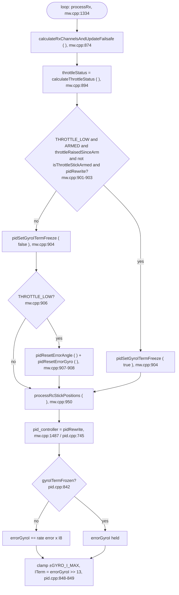

# Payload Tilt On Descent: Pipeline Update ( staged )

[README](README.md) · [TASKS](TASKS.md) · [SCOUT](SCOUT.md) · [INVESTIGATION](INVESTIGATION.md) · [CHANGES](CHANGES.md) · [TESTING](TESTING.md) · [PIPELINE_UPDATE](PIPELINE_UPDATE.md)

**Not live.** Staged on 27 Oct 2026 for the commit of the task 9 fix; `pluto-commit` applies it. Every edit below is a
replacement or an addition inside an existing doc, not a full-doc replacement. No DMA, timer, pin or public API change,
so no map or `docs/API/` update.

Source lines below are at the fix-only tree ( HEAD `a81c180` + task 9 ); re-check them at commit.

| Section | Target | Kind |
|---|---|---|
| A | `fw-architecture-pipeline/subsystems/Core_PID_Controller.md` | replace one bullet, add three function bullets, add one section with a flowchart |
| B | `fw-architecture-pipeline/subsystems/RC_Input_Pipeline.md` | add one bullet |
| C | `fw-architecture-pipeline/subsystems/Mixer_Pipeline.md` | correct one bullet ( drift ) |
| D | `fw-architecture-pipeline/subsystems/Altitude_Hold_Estimator.md` | add one paragraph |
| E | `dev-guide/FLIGHT_INVARIANTS.md` and `CLAUDE.md` | add one section and one bullet |
| F | - | drift list: what the docs said before |
| G | `CHANGELOG.md`, `Makefile` | `### Fixed` bullet in the open `[v4.0.0]` section; FW 3.15.1 → 3.15.2, API 1.8.0 unchanged |

---

## A. `subsystems/Core_PID_Controller.md`

### A1. In *Primary Functions*, after the `pidController()` bullet, add:

```markdown
- `pidRewrite()` ( `pid.cpp:745` ): the controller in use. `pidController` defaults to 1 ( `config.cpp:176` ),
  which `pidSetController()` maps to `pidRewrite`. In ANGLE mode its angle loop is P only
  ( `desiredRate = errorAngle * P8[PIDLEVEL] >> 4` ), so the rate I-term `errorGyroI` is the only integrator that
  holds a constant moment such as an off-centre CG or a payload.
- `pidResetErrorAngle()` / `pidResetErrorGyro()` ( `pid.cpp:88` / `:97` ): zero the angle and rate I-terms. Called
  by the stick-low reset in `processRx ( )` whenever the craft is not counted as airborne ( see below ), and by
  every arming path ( take-off, `Command_Arm`, chuck ).
- `pidSetGyroITermFreeze ( bool )` ( `pid.cpp:108` ): while set, `pidRewrite` holds `errorGyroI` on all three axes
  instead of integrating ( `pid.cpp:842` ); the clamp and `ITerm = errorGyroI >> 13` still run, so the held value
  keeps acting. Set by `processRx ( )`, cleared there and in `mwDisarm ( )`. Main loop only.
```

### A2. In *Data Flow & Boundaries*, replace the **I-Term Windup** bullet with:

```markdown
- **I-Term Windup**: `pidRewrite` clamps `errorGyroI` to ±`GYRO_I_MAX` 256 motor counts ( `pid.cpp:848` ). On the
  ground the stick-low reset keeps it from integrating against the floor; airborne it is frozen instead of reset
  ( see *Stick-low I-term reset and freeze* below ). Note that `pid_at_min_throttle` is 1 by default
  ( `config.cpp:369`; forced to 0 only with `retarded_arm` ), so the PID keeps acting at idle on the floor.
```

### A3. Add a section after *Data Flow & Boundaries* ( before *Heading hold* ):

````markdown
## Stick-low I-term reset and freeze ( `processRx ( )`, mw.cpp )

On every RX pass, `processRx ( )` computes `throttleStatus` from the raw `rcData[THROTTLE]`: THROTTLE_LOW below
`mincheck` 1100 ( `rc_controls.cpp:131-139` ). At that point `rcData` was just rewritten from the receiver, so it is
the pilot's value ( equal to `rcDataPilot` ), except during the 600 ms invalid-pulse hold ( `rx.cpp:528` keeps the
previous `rcData`, which LAND or user code may have written; at worst that picks freeze over reset for a frame ). What happens with THROTTLE_LOW depends on whether the craft is flying:

| State | Condition | Rate I-term |
|---|---|---|
| Airborne: after an app take-off / `Command_Arm`, or after an ARM-switch arm once altitude hold has seen the stick above 1500 or a take-off goal ran | `ARMED && throttleRaisedSinceArm && !isThrottleStickArmed` and the controller is `pidRewrite` | **frozen** at its value ( holds the payload trim ) |
| Anything else: disarmed, arming, ARM-switch ground idle, THROTTLE mode after an ARM-switch arm, other controllers | - | **reset** to 0 ( anti wind-up ) |

Why: in ANGLE mode the rate I-term carries any CG offset. Resetting it in flight on a full stick-down
( the app's bottom position is about 1004 ) left the craft held by the P terms alone, and it leaned 2-7 deg toward a
payload ( 2-3 deg toward its own trim with none ) for as long as the stick stayed down. Frozen, a full stick-down
descends as level as a partial one. See `active-development/payload-tilt-on-descent/`.

`throttleStatus` itself is unchanged: stick-arm, switch disarm, auto-disarm and the beeper still read it.



`throttleRaisedSinceArm` is set in `annexCode ( )` once the armed throttle is above `mincheck` ( `mw.cpp:405` ) and
cleared in `mwDisarm ( )`, which also clears the freeze ( `mw.cpp:573` ). `isThrottleStickArmed` is set by an ARM-switch
arm with the throttle low ( `rc_controls.cpp:175` ) and cleared by altitude hold when the stick goes above 1500
( `altitudehold.cpp:612` ), by a take-off goal ( `altitudehold.cpp:1473` ) or at disarm ( `mw.cpp:587` ).

**Known residual.** A wind-up that builds *before* the stick goes low is held, not cleared. Two ways in: a tilted
touchdown on a partial stick lets `errorGyroI` integrate against the floor and a later full stick-down freezes it; and
after `Command_Arm` with the app stick centred, `throttleRaisedSinceArm` is set at once on the floor ( `mw.cpp:405`,
1500 > 1100 ) and `isThrottleStickArmed` is not, so a stick-down on the floor freezes any floor wind-up instead of
clearing it ( `setTakeOffGoal ( )` does not reset either ). Not observed in flight on a level floor ( log-7 ); there
is no touchdown detector for a stick-down landing.
````

---

## B. `subsystems/RC_Input_Pipeline.md`

In *Data Flow & Boundaries*, after the **Signal loss timing** bullet, add:

```markdown
- **THROTTLE_LOW** ( `calculateThrottleStatus ( )`, `rc_controls.cpp:131-139` ): raw `rcData[THROTTLE]` below `mincheck`
  1100, computed once per RX pass in `processRx ( )` ( `mw.cpp:894` ). Users: the stick-low I-term reset / freeze
  ( Core_PID_Controller.md ), stick-arm and switch disarm ( `rc_controls.cpp:169`, `:198` ), the auto-disarm /
  beeper block ( `mw.cpp`, inactive without FEATURE_MOTOR_STOP ), and FrSky telemetry's RPM field
  ( `telemetry/frsky.c:201`, also only with FEATURE_MOTOR_STOP ). The app's full stick-down sends about 1004, so it is
  always THROTTLE_LOW; after 600 ms of invalid pulses the throttle falls back to 1200, which is not.
```

---

## C. `subsystems/Mixer_Pipeline.md`

In *Data Flow & Boundaries*, the **Motor Clipping** bullet. Replace:

```markdown
- **Motor Clipping**: The absolute maximum value any motor can receive is `maxthrottle` (default 2000). The absolute minimum while armed is `minthrottle` (default ~1070).
```

with:

```markdown
- **Motor Clipping**: The absolute maximum value any motor can receive is `maxthrottle` (default 2000). The absolute minimum while armed is `minthrottle` (default 1100, `config.cpp:278`). With the throttle stick below `mincheck` and `pid_at_min_throttle` 1 ( default ), the PID still acts on the motors at idle; nothing is redistributed at the low end.
```

---

## D. `subsystems/Altitude_Hold_Estimator.md`

In *Setpoint shaping*, after the paragraph that starts "A take-off on a drone at the ARM-switch ground idle", add:

```markdown
A full stick-down in flight ( raw throttle below `mincheck` 1100 ) only sets the descent rate here; it does not touch
the attitude trim. Before the payload-tilt fix, the stick-low reset in `processRx ( )` zeroed the rate I-term during it,
and the 30 cm/s shaped descent gave the resulting lean time to show. The I-term is now frozen while airborne
( Core_PID_Controller.md, *Stick-low I-term reset and freeze* ).
```

---

## E. `dev-guide/FLIGHT_INVARIANTS.md` and CLAUDE.md

### E1. `dev-guide/FLIGHT_INVARIANTS.md`: add a section after *User flight commands cannot replace a landing*

```markdown
## A stick-down in flight does not zero the attitude I-term ( app flights and ALT_HOLD )

- **Mechanism.** In ANGLE mode under `pidRewrite` the rate I-term `errorGyroI` is the only integrator holding a CG
  offset; the angle loop is P only. With the throttle stick below `mincheck` 1100, `processRx ( )` used to call
  `pidResetErrorAngle ( )` / `pidResetErrorGyro ( )` on every RX frame, armed or not.
- **What broke.** A full app stick-down ( about 1004 ) zeroed the trim in flight, and the craft leaned 2-7 deg toward a
  payload ( 2-3 deg with none ) until the stick came back above 1100. It shipped in every release since at least
  `v3.0.0`; the 100 cm/s unramped descent hid it until `2a8d59a` slowed it to 30 cm/s
  ( [`../active-development/payload-tilt-on-descent/`](../active-development/payload-tilt-on-descent/) ).
- **Rules.**
  - Airborne ( `ARMED && throttleRaisedSinceArm && !isThrottleStickArmed` ), a low stick **freezes** the `pidRewrite`
    rate I-term ( `pidSetGyroITermFreeze ( )` ). Airborne means: after an app take-off or `Command_Arm`, or after an
    ARM-switch arm once altitude hold has seen the stick above 1500 or a take-off goal ran. Everywhere else the reset
    runs as before: disarmed, at arming, in ARM-switch ground idle, **in THROTTLE mode after an ARM-switch arm** ( no
    altitude hold to clear `isThrottleStickArmed`, so a radio pilot there still gets the reset and the lean ), and with
    a controller other than `pidRewrite`.
  - Do not change `calculateThrottleStatus ( )` or `throttleStatus` to fix a stick-low behaviour: stick-arm, switch
    disarm and the beeper read it.
  - A new reason to reset the attitude I-terms must say why the craft cannot be airborne at that point.
```

### E2. CLAUDE.md: add to "Flight invariants" ( after the RC-link-loss bullet )

```markdown
- **A full stick-down in flight does not zero the attitude I-term**: below `mincheck` 1100 the `pidRewrite` rate I-term
  is frozen while airborne ( `ARMED && throttleRaisedSinceArm && !isThrottleStickArmed`: app take-off, or ALT_HOLD after
  an ARM-switch arm ) and reset otherwise ( ground, arming, ground idle, THROTTLE mode after an ARM-switch arm ).
  Zeroing it in flight leaned the craft 2-7 deg toward a payload ( `FLIGHT_INVARIANTS.md` ).
```

---

## F. Drift list: what the docs said before

| Doc | Said | Code |
|---|---|---|
| `Mixer_Pipeline.md:22` | minthrottle "default ~1070" | 1100 ( `config.cpp:278` ) |
| `Core_PID_Controller.md:27` | I-term "strictly bounded ( e.g. `pidProfile->pid[axis].I` )" | `pidRewrite` clamps `errorGyroI` to ±`GYRO_I_MAX` 256 counts; the stick-low reset was not mentioned |
| `Core_PID_Controller.md` | no mention of which controller runs | `pidController` 1 = `pidRewrite`, P-only angle loop |
| `FLIGHT_INVARIANTS.md` | nothing on in-flight I-term resets | section E1 |

---

## G. `CHANGELOG.md` entry and version ( set by `pluto-commit`; FW 3.15.1 → 3.15.2, API 1.8.0 unchanged )

Under the open `## [v4.0.0]` section, `### Fixed`:

````markdown
- A full throttle stick-down in flight ( raw throttle below `mincheck` 1100 ) no longer zeroes the `pidRewrite` rate
  I-term: it is frozen while airborne ( app take-off, or ALT_HOLD after an ARM-switch arm ) and reset only on the
  ground, at arming, in ground idle and in THROTTLE mode after an ARM-switch arm. The reset shipped since at least
  v3.0.0 and leaned the craft 2-7 deg toward an off-centre payload ( 2-3 deg toward its own trim ) for as long as the
  stick stayed down; the 30 cm/s shaped descent made it visible. Flight-validated on PRIMUS_X2_v1
  ( `active-development/payload-tilt-on-descent/` ). No public API change.
````

Extend the `- **Firmware version**` line with "3.15.2 for the stick-down I-term freeze".

