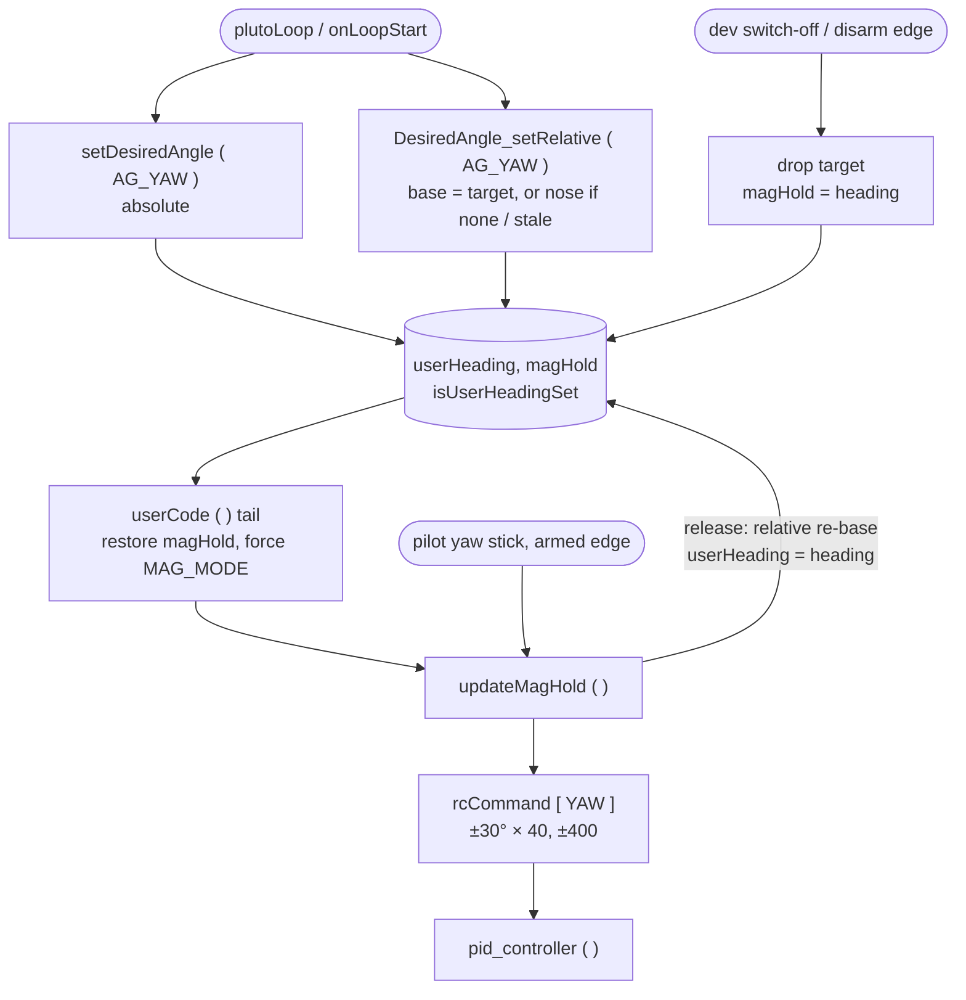
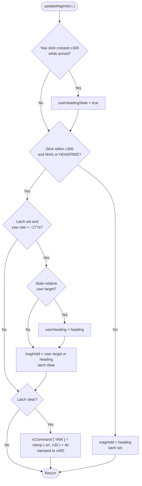

# Relative Yaw API - Pipeline update

[README](README.md) · [TASKS](TASKS.md) · [SCOUT](SCOUT.md) · [INVESTIGATION](INVESTIGATION.md) · [CHANGES](CHANGES.md) · [TESTING](TESTING.md) · [PIPELINE_UPDATE](PIPELINE_UPDATE.md)

> **Not live.** This is staged text for `fw-architecture-pipeline/`, CLAUDE.md and the CHANGELOG. `pluto-commit`
> applies it when this topic is committed. It was checked against the source on 15 Oct 2026. Every diagram edge is a
> call or data path at the lines cited:
>
> - **Loop order:** `processRx ( )` mw.cpp:1305 → `annexCode ( )` :1381 → `userCode ( )` :1387 → `updateMagHold ( )`
>   :1411 → `pid_controller ( )` :1458 → `mixTable ( )` :1460.
> - **`updateMagHold ( )`:** stick edge :703-711, re-arm and re-base :715-731, error × `P8[PIDMAG]` ( 40,
>   config.cpp:210 ) clamped to ±400 on `rcCommand[YAW]` ( :743 ).
> - **`userCode ( )`:** restore `magHold = userHeading` :1177, drop on switch-off or disarm :1217-1227, MAG forcing
>   :1239-1241.
> - Line numbers are as of this staging; refresh them when this text is applied.
> - **`heading`:** 0..359 ( imu.cpp:311-330 ).

---

## 1. `subsystems/User_Space_API.md`

### 1a. In **Data Flow & Boundaries**, replace the "Link drop stops user code" bullet with

````markdown
- **Link drop stops user code**: `plutoLoop ( )` runs only while `rxIsReceivingSignal ( )` is true. With `Rx_ESP`
  that is false **200 ms after the last `MSP_SET_RAW_RC` frame**. The firmware then runs `onLoopFinish ( )`,
  clears every user RC override and re-runs `onLoopStart ( )` when frames return. A Wi-Fi stall therefore
  restarts user code long before failsafe acts ( ~2.5 s ). A user **yaw target survives** such a restart; see
  **Yaw setpoints** below.
````

### 1b. In **Data Flow & Boundaries**, add after the "Landing owns the throttle" bullet

````markdown
- **User yaw is heading hold**: `setDesiredAngle ( AG_YAW, bearing )` and `DesiredAngle_setRelative ( AG_YAW, turn )`
  set the heading-hold target `magHold`. While one is held, the firmware engages MAG mode itself, so no app switch is
  needed. See **Yaw setpoints** below; wiki `docs/API/YAW_HEADING_API_WIKI.md` ( API 1.6.0 ).
````

### 1c. In the user-code flowchart, replace the two edges into `End`

```
    ApplyOld --> End([Return to firmware Loop])
    RunFinish --> End
```

with

````markdown
    ApplyOld --> YawTail
    RunFinish --> YawTail
    FinishCheck -- No --> YawTail
    YawTail{"Dev switch off<br/>or just disarmed?"} -- Yes --> Drop["Drop the user yaw target<br/>magHold = heading"]
    YawTail -- No --> Force
    Drop --> Force{"User yaw target held?"}
    Force -- Yes --> Mag["Force MAG_MODE<br/>unless HEADFREE"]
    Force -- No --> End([Return to firmware Loop])
    Mag --> End
````

Also remove the old `FinishCheck -- No --> End` edge. Every branch of `userCode ( )` reaches the yaw tail
( mw.cpp:1208-1242 ), including a Wi-Fi flicker, which goes through the not-running branch.

### 1d. Add a new section before **XRanging**

````markdown
## Yaw setpoints ( heading hold )

User code steers yaw by giving heading hold a target. It does not set a yaw rate. Full reference:
[YAW_HEADING_API_WIKI.md](../../../API/YAW_HEADING_API_WIKI.md) ( API 1.6.0 ).

| Call | Target | Repeated calls | After a pilot yaw |
|---|---|---|---|
| `setDesiredAngle ( AG_YAW, bearing )` | Compass bearing, 0..359 degrees ( other values wrapped ) | Each call replaces the target | The craft returns to the bearing |
| `DesiredAngle_setRelative ( AG_YAW, turn )` | The current target + `turn` ( + is clockwise ), or the nose + `turn` if no target is held | Turns add up exactly ( 4 × +90 = 360 ) | The target is re-based to the nose; there is no swing back |

Rules:
- **Heading hold is engaged automatically.** While Developer Mode is on and a target is held, `userCode ( )` enables
  MAG mode on every loop. It does not do this when the pilot has selected HEADFREE, which already holds heading, or
  when there is no magnetometer. `processRx ( )` re-derives MAG mode from AUX1 on each RX update, so the forced mode
  ends within ~20 ms of the target being dropped. Heading hold itself always sees MAG on while a target is held,
  and so does the app flip ( which needs MAG mode ), which runs after `userCode ( )`. But `processRx ( )` clears the
  flag from AUX1 earlier in the same pass, before the MSP reply ( `annexCode ( )` → `handleSerial ( )` ) and before
  `plutoLoop ( )`. So `FlightMode_Check ( MAGHOLD )` in user code and the app's BOXMAG indicator can momentarily read
  false.
- **Turns are clamped and fast.** `updateMagHold ( )` flies `( heading - magHold )`, wrapped to ±180, clamped to ±30°,
  × `P8[PIDMAG]` ( 40 ), clamped to ±400 on `rcCommand[YAW]`. Full yaw authority is reached at 10° of error. A 90°
  turn takes about 1.5-2 s and settles within ±1°. The craft takes the short way: +270 flies −90.
- **The pilot's yaw stick wins.** Past ±300 from centre it bypasses heading hold. When it is released and the yaw
  rate falls below ~17°/s, heading hold re-arms on the user target. A relative target is first re-based to the nose.
  That re-base is keyed on the armed rising edge of the stick, so the MAG mode switch-on at the first call cannot erase
  a turn. A relative call made during a stick hold clears the edge, so its call-time target stands after release.
  A `RcCommand_Set` yaw override is flown only while the re-arm latch is set; a sustained override faster than ~17°/s
  keeps the latch set, and the target is then never flown.
- **When the target is dropped.** On a real Developer Mode switch-off, and on the armed → disarmed edge, the target is
  dropped and `magHold = heading` is set, so the craft holds where it points. AUX channels hold their value through an
  RC loss ( `RX_FAILSAFE_MODE_HOLD`, the default for AUX, config.cpp:479; an `rxfail` SET value outside the dev range
  turns a stall over 600 ms into a switch-off ), so the target **survives a Wi-Fi flicker**, and also a long RC loss: heading hold keeps flying it through a
  failsafe `LAND` ( yaw only ). A target set while disarmed survives until takeoff.
- **Units.** Yaw is in whole degrees, and both setters wrap their value into 0..359. Roll and pitch in
  `setDesiredAngle` are in deci-degrees. The relative setter ignores `AG_ROLL` and `AG_PITCH`. `updateMagHold ( )`
  corrects the heading error by 360 only once, so an unwrapped target of 720 or more would never settle.


````

---

## 2. `subsystems/Core_PID_Controller.md`

### 2a. In **Primary Functions**, add after `applyGyroData()`

````markdown
- `updateMagHold()` ( `mw.cpp` ): heading hold, run every loop before the PID while a magnetometer is present. In MAG
  or HEADFREE mode, with the yaw stick within ±300, it replaces `rcCommand[YAW]` with the heading error to `magHold`.
  See **Heading hold** below.
````

### 2b. Add a new section at the end

````markdown
## Heading hold ( `updateMagHold`, mw.cpp )

Heading hold turns a target heading into a yaw-rate command. It is not part of the PID: it runs just before it in
the same loop ( `userCode ( )` → `updateMagHold ( )` → `pid_controller ( )` ) and writes `rcCommand[YAW]`, which the
rate PID then flies.

- **Target:** `magHold`, in degrees ( 0..359, like `heading` ). It is set by the pilot ( it follows the heading
  while yaw is commanded directly ), by the app ( `MSP_SET_HEAD` ), by a BOXMAG switch-on ( `magHold = heading` ), or by
  user code ( `setDesiredAngle` / `DesiredAngle_setRelative` on `AG_YAW`, restored from `userHeading` on every
  non-`plutoLoop` loop ). While disarmed with MAG or HEADFREE on, `processRx ( )` resets it to `heading`.
- **Active when** MAG or HEADFREE mode is on and `|rcData[YAW] − 1500| < 300`. Otherwise `magHold = heading` and the
  re-arm latch is set.
- **Command:** `headingError = heading − magHold`, wrapped to ±180, clamped to ±30°, then
  `rcCommand[YAW] = error × P8[PIDMAG]` ( 40 ), clamped to ±400. Full authority is reached at 10° of error.
- **Re-arm latch:** after the stick is released or the mode is switched on, no command is produced until the yaw gyro
  reads under ~17°/s ( `|gyroADC[YAW] / 4| < 70` ). The latch then re-arms on the user target if one is held,
  otherwise on the current heading. A relative user target is re-based to the heading first, but only if the yaw stick
  went out while armed since the target was set ( `userHeadingStale` ).


````

---

## 3. CLAUDE.md, **Flight invariants**: add one line

````markdown
- **User yaw ( `setDesiredAngle` / `DesiredAngle_setRelative` on `AG_YAW` ) is heading hold, which `userCode ( )`
  engages itself while a target is held** ( MAG mode forced unless HEADFREE or no magnetometer ). Without MAG or HEADFREE,
  `updateMagHold ( )` overwrites `magHold` every loop and the target is lost. The target is dropped only at a real
  dev-mode switch-off or a disarm, never on a Wi-Fi flicker ( `active-development/relative-yaw-api/` ).
````

---

## 4. `CHANGELOG.md` entry ( FW and API version set by `pluto-commit`; API 1.5.0 → 1.6.0 )

````markdown
### Added
- `DesiredAngle_setRelative ( AG_YAW, turn )`: turns the craft by `turn` degrees from its own heading. Repeated calls
  add up exactly. After a pilot yaw the target is re-based to the nose. Wiki: `docs/API/YAW_HEADING_API_WIKI.md`.

### Fixed
- A user yaw target ( `setDesiredAngle` or the relative setter ) did nothing unless the app's heading-hold switch was
  on: `updateMagHold ( )` overwrote it every loop. Heading hold is now engaged automatically while user code holds a
  yaw target ( unless HEADFREE ).
- A Wi-Fi RC flicker no longer drops the user yaw target. It is dropped at a real dev-mode switch-off ( the craft
  then holds its heading ) or a disarm.
- The heading-hold re-arm keeps the user target, so the first call is no longer lost for a loop, or entirely at fast
  user loop rates.
- `setDesiredAngle ( AG_YAW, angle )` wraps `angle` into 0..359. A value of 720 or more ( e.g. 900, written as
  deci-degrees per the old header ) or −361 or less made the drone spin without stopping.

### Known limits
- Not flight-tested yet: the hand-yaw re-base and return, dev mode off mid-turn, a turn through a flicker, no yaw at
  takeoff after a disarm, and HEADFREE ( `relative-yaw-api/TESTING.md` §3 ).
````
