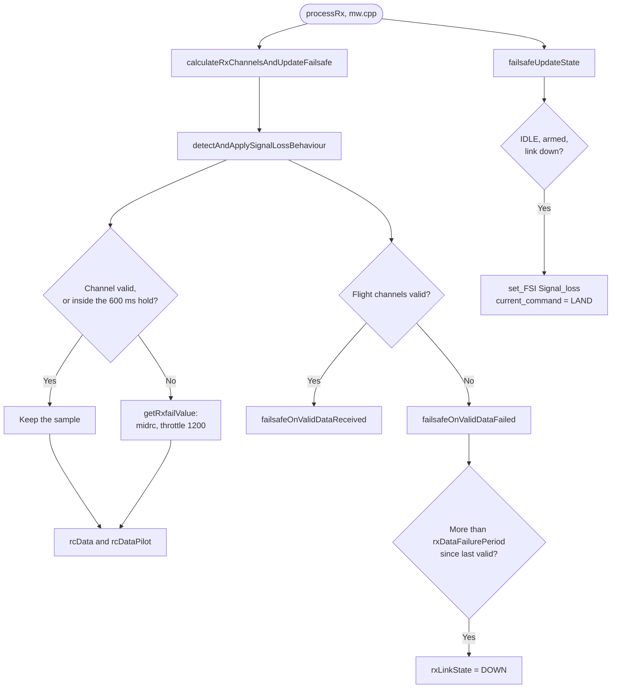

# RX Signal-Loss Tolerance - Pipeline update

[README](README.md) · [TASKS](TASKS.md) · [SCOUT](SCOUT.md) · [INVESTIGATION](INVESTIGATION.md) · [CHANGES](CHANGES.md) · [TESTING](TESTING.md)

> **Not live.** This is staged text for `fw-architecture-pipeline/`, applied by `pluto-commit` when this topic
> is committed. Each block says which doc and which part it replaces. Every flowchart edge and every line
> reference was checked against the source on 14 Oct 2026; the references are listed under each flowchart.

---

## 1. `subsystems/Failsafe_Subsystem.md`

Replace the sections **Key Data Structures**, **Primary Functions** and **Data Flow & Boundaries** ( up to the
"Crash Detector" heading ) with the text below; it ends with the new `### RC link loss` flowchart. **Delete** the
old RX-loss flowchart at the end of the file ( after the Crash Detector section ). The Crash Detector section is
unchanged.

````markdown
## Key Data Structures
- `failsafeState_t` ( `failsafe.h` ): `rxLinkState` ( UP / DOWN ), `validRxDataReceivedAt` / `validRxDataFailedAt`
  ( ms ), `rxDataFailurePeriod` ( ms ) and the `phase`. Only `FAILSAFE_IDLE` is used in flight: on link loss
  it starts `LAND` directly.
- `failsafeConfig.failsafe_delay` ( deciseconds, default **15**, effective maximum **22** = `FAILSAFE_DELAY_MAX` ):
  the guard time added to `PERIOD_RXDATA_FAILURE` ( 200 ms ). `failsafeReset ( )` sets
  `rxDataFailurePeriod = 200 + MIN ( failsafe_delay, 22 ) × 100` ms, run from `activateConfig ( )` at boot and
  after every EEPROM reload. The CLI accepts 0-200 and MSP 0-255; both read back the stored value, but the
  firmware never uses more than 22.
- `failsafe_off_delay`, `failsafe_throttle`: stored and settable, but **not used**. `failsafeActivate ( )`,
  which would apply them, is never called.

## Primary Functions
- `failsafeOnValidDataReceived ( )` / `failsafeOnValidDataFailed ( )`: called by
  `detectAndApplySignalLossBehaviour ( )` ( `rx.cpp` ) on every RX update. Valid data refreshes
  `validRxDataReceivedAt`; the link goes UP again after `PERIOD_RXDATA_RECOVERY` ( 200 ms ) of valid data. Failed
  data sets `rxLinkState` DOWN once more than `rxDataFailurePeriod` has passed since the last valid data.
- `failsafeUpdateState ( )`: called from `processRx ( )`. In `FAILSAFE_IDLE`, if the craft is armed and the link is
  down, it sets `Signal_loss` and starts `LAND`. Once the craft is disarmed and data arrives again, it clears
  `Signal_loss` and sets `Ok_to_arm`.
- `failsafeApplyControlInput ( )`: legacy and not reachable ( see `failsafe_off_delay` ).

## Data Flow & Boundaries
- **Timeline from the last `MSP_SET_RAW_RC` frame** ( `Rx_ESP` / MSP, default `failsafe_delay` 15 ):

  | After | What happens |
  |---|---|
  | 0-200 ms | The last frame is replayed; the channels count as valid |
  | 200 ms | `rxSignalReceived` drops ( `DELAY_5_HZ` ); Developer Mode stops ( `onLoopFinish ( )`, user overrides cleared ); the stick hold starts |
  | ~800 ms | The hold ends ( `MAX_INVALID_PULS_TIME` 600 ms ): roll / pitch / yaw go to midrc and throttle to 1200, into both `rcData` and `rcDataPilot`; AUX channels are held, so ARM stays on |
  | ~2.5 s | The link is declared down ( 800 ms + 200 ms + 1500 ms ) → `Signal_loss`, `LAND` |

  Budget to `LAND`: `failsafe_delay` 0 → ~1.0 s, 15 → ~2.5 s, 22 or more → ~3.2 s. Before FW 3.11.2 the delay was
  ignored and `LAND` always came at ~1.0 s. Wi-Fi / TCP stalls of 1.2-2.2 s on a healthy link are normal.
- **During the window** ( ~0.8 s to `LAND` ): throttle 1200 lowers the ALT_HOLD setpoint at ~16 cm/s; in ANGLE
  throttle mode it is below hover and the craft sinks. Throttle 1200 is above `mincheck`, so there is no auto-disarm.
- **Recovery:** frames that return before the link is declared down cancel nothing, because nothing has
  latched. The sticks go live again and Developer Mode restarts. After the link is declared down, `LAND` stays
  latched until the craft disarms.
- **Failsafe switch** ( `BOXFAILSAFE`, if mapped from the app or CLI; not mapped by default ): the sticks centre at
  once, but `LAND` starts only after 200 ms + `failsafe_delay` ( ~1.7 s ), as for link loss. Before FW 3.11.2 it was
  ~0.2 s.
- **ELRS / PPM** use a 100 ms signal timeout ( `DELAY_10_HZ` ) instead of 200 ms: hold to ~700 ms, `LAND` ~2.4 s.
- **Do not lengthen the hold** ( `MAX_INVALID_PULS_TIME`, `DELAY_5_HZ` ). During the hold the craft keeps flying the
  last stick input; `failsafe_delay` extends only the sticks-centred phase.
- **Critical battery**: `batteryCriticalAutoLand ( )` ( `mw.cpp` ) starts the same `LAND` command as the RX-loss
  path on a confirmed critical battery level; the battery code itself never disarms. See
  [Power_BMS_Pipeline.md](Power_BMS_Pipeline.md).

### RC link loss


````

**Review note, not staged text.** Edges checked:
- `processRx` → `calculateRxChannelsAndUpdateFailsafe` ( mw.cpp:839 ) → `detectAndApplySignalLossBehaviour`
  ( rx.cpp:588 ).
- The hold and rxfail branch is rx.cpp:526-532. `getRxfailValue` is at rx.cpp:431, and the copy into `rcDataPilot`
  at rx.cpp:564.
- `failsafeOnValidDataReceived` / `failsafeOnValidDataFailed` are called at rx.cpp:552 / :555. The DOWN test is
  at failsafe.cpp:212-216.
- `processRx` → `failsafeUpdateState` is mw.cpp:856; IDLE + armed + not receiving → `Signal_loss` and `LAND` is
  failsafe.cpp:246-249.

---

## 2. `subsystems/RC_Input_Pipeline.md`

Replace the `rxUpdateCheck()` bullet under **Primary Functions** ( no such function exists ) with:

````markdown
- `updateRx ( )` / `shouldProcessRx ( )`: take in new frames; RC processing runs at a 50 Hz floor. With MSP
  ( `Rx_ESP` ) each `MSP_SET_RAW_RC` sets `needRxSignalBefore = now + 200 ms` ( `DELAY_5_HZ` ), and
  `rxIsReceivingSignal ( )` stays true until then.
- `calculateRxChannelsAndUpdateFailsafe ( )` → `detectAndApplySignalLossBehaviour ( )`: per channel, an invalid
  sample keeps the last value for `MAX_INVALID_PULS_TIME` ( 600 ms ), then takes its rxfail value ( AUTO: roll /
  pitch / yaw midrc, throttle 1200; AUX: HOLD ). The result is copied into `rcDataPilot`, and the failsafe is told
  whether the flight channels are valid.
````

Add to **Data Flow & Boundaries**:

````markdown
- **Signal loss timing ( MSP )**: last frame replayed for 200 ms, held to ~800 ms, then rxfail values. Failsafe
  `LAND` at ~2.5 s with the default `failsafe_delay` 15. See [Failsafe_Subsystem.md](Failsafe_Subsystem.md).
````

---

## 3. `subsystems/User_Space_API.md`

Add to **Data Flow & Boundaries**:

````markdown
- **Link drop stops user code**: `plutoLoop ( )` runs only while `rxIsReceivingSignal ( )` is true. With `Rx_ESP`
  that is false **200 ms after the last `MSP_SET_RAW_RC` frame**. The firmware then runs `onLoopFinish ( )`,
  clears every user RC override and re-runs `onLoopStart ( )` when frames return. A Wi-Fi stall therefore
  restarts user code long before failsafe acts ( ~2.5 s ).
````
