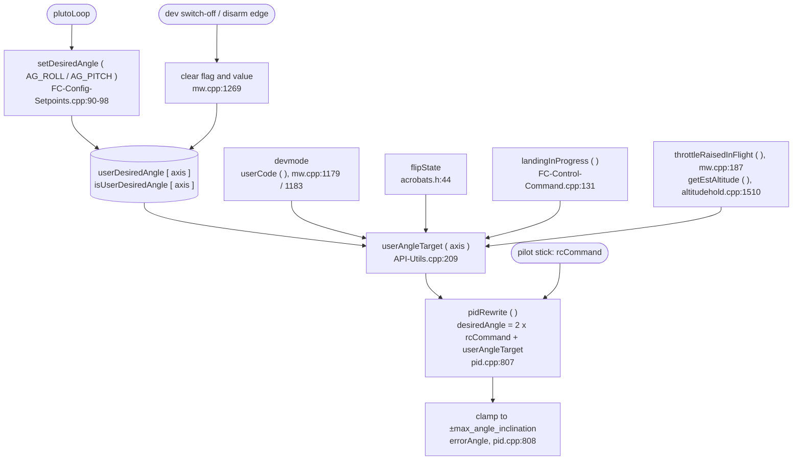

# Set desired angle roll / pitch - Pipeline update

[README](README.md) · [TASKS](TASKS.md) · [SCOUT](SCOUT.md) · [INVESTIGATION](INVESTIGATION.md) · [CHANGES](CHANGES.md) · [TESTING](TESTING.md) · [PIPELINE_UPDATE](PIPELINE_UPDATE.md)

Staged text for the pipeline docs. Apply at commit ( `pluto-commit` ); do not edit `fw-architecture-pipeline/` before.
Every line reference was checked against the working tree on 14 Nov 2026.

The references to correct ( sections 1e, 2c, 3 ) were first found by mapping each `file:line` from HEAD `ebf4e46` to
the working tree by content. That was **wrong** on its own: many of the numbers in the pipeline docs were already stale
at HEAD, and the mapping carried the staleness forward ( topic review, task 9 ). Each number below was then looked up in
the working tree by the symbol the surrounding doc text names, and the new line opened to confirm it holds that code.

## 1. `fw-architecture-pipeline/subsystems/User_Space_API.md`

### 1a. Section "Data Flow & Boundaries": new bullet, inserted after "User yaw is heading hold"

```markdown
- **User roll / pitch is an ANGLE-mode tilt**: `setDesiredAngle ( AG_ROLL | AG_PITCH, deci-degrees )` holds a tilt
  that `pidRewrite ( )` adds to the pilot's stick target. It is held until replaced and is not flown on the ground,
  outside ANGLE mode, in a flip, in a landing or in an RC stall. See **Roll / pitch setpoints** below; wiki
  `docs/API/YAW_HEADING_API_WIKI.md` ( API 1.8.6 ).
```

### 1b. Section "Data Flow & Boundaries", bullet "User yaw is heading hold"

**Replace** `wiki \`docs/API/YAW_HEADING_API_WIKI.md\` ( API 1.6.0 )` with
`wiki \`docs/API/YAW_HEADING_API_WIKI.md\` ( API 1.8.6 )`.

### 1c. Section "Yaw setpoints ( heading hold )"

**Replace** in the first paragraph `( API 1.6.0 )` with `( API 1.8.6 )`.

**Replace** the "Units" rule with:

```markdown
- **Units.** Yaw is in whole degrees, and both setters wrap their value into 0..359. Roll and pitch in
  `setDesiredAngle` are in deci-degrees and are a tilt, not a heading ( see **Roll / pitch setpoints** ). The relative
  setter ignores `AG_ROLL` and `AG_PITCH`. `updateMagHold ( )` corrects the heading error by 360 only once, so an
  unwrapped target of 720 or more would never settle.
```

### 1d. New section, inserted after "Yaw setpoints ( heading hold )" ( after its Mermaid block ) and before "Laser ranging"

````markdown
## Roll / pitch setpoints ( ANGLE tilt )

`setDesiredAngle ( AG_ROLL | AG_PITCH, angle )` tilts the craft by `angle` deci-degrees and holds the tilt until the
next call replaces it. Full reference: [YAW_HEADING_API_WIKI.md](../../../API/YAW_HEADING_API_WIKI.md), section "Roll
and pitch tilt" ( API 1.8.6 ).

- **Stored, not flown, by the setter.** The setter writes `userDesiredAngle [ axis ]`, bounded to ±1800, and sets
  `isUserDesiredAngle [ axis ]` ( `FC-Config-Setpoints.cpp:90-98` ). Before FW 3.15.8 it wrote the measured attitude
  `inclination` instead: `Estimate_Get ( Angle )` read the value back once, the next `imuUpdate ( )` overwrote it, the
  craft never tilted, and a value above 700 could trip the crash detector in the air ( API test T11 / B4,
  `active-development/set-desired-angle-roll-pitch/` ). User code must never write `inclination`.
- **Flown by `pidRewrite ( )`.** `desiredAngle [ axis ] = 2 * rcCommand [ axis ] + userAngleTarget ( axis )`
  ( `pid.cpp:807` ), then the existing clamp to ±`max_angle_inclination` ( 200, 20°; `pid.cpp:808`, `config.cpp:420` ).
  The pilot's stick adds to the tilt and the sum keeps the pilot's limit. The other PID controllers ignore it.
- **Gated by `userAngleTarget ( )`** ( `API-Utils.cpp:209-220` ), which returns the held tilt, or 0 while it is kept but
  not flown:

| Not flown while | Test | Why |
|---|---|---|
| No tilt held, or not roll / pitch | `! isUserDesiredAngle [ axis ]`, `axis > FD_PITCH` | |
| Developer Mode stopped for more than 0.6 s | `millis ( ) - last devmode > USER_ANGLE_LINK_GRACE_MS` ( `API-Utils.h:73` ) | `devmode` falls 200 ms after the last RC frame. A normal Wi-Fi flicker keeps the tilt; a longer stall levels the craft, whose sticks have centred, instead of flying it away until the failsafe landing. |
| Not ANGLE mode | `! FLIGHT_MODE ( ANGLE_MODE )` | ACRO / HORIZON fly rates. |
| A flip runs | `flipState != 0` | The flip owns roll and pitch. |
| A landing runs | `landingInProgress ( )` ( `FC-Control-Command.cpp:131` ) | User, MSP, RC-loss and battery landings; a tilt would drift the descent. |
| Not airborne | `! throttleRaisedInFlight ( )` ( `mw.cpp:187` ) or `getEstAltitude ( ) < USER_ANGLE_MIN_ALT_CM` ( 20 cm, `API-Utils.h:78` ) | A tilt on the skids would pivot the take-off. Throttle-raised alone is true at the arm instant of an app take-off. |

- **Dropped** at a real Developer Mode switch-off and on the armed → disarmed edge, next to the yaw clear
  ( `mw.cpp:1269` ). `devSwitchOn` holds through an RC loss, so a flicker does not drop it; a tilt set while disarmed
  survives to take-off and waits for the airborne test.
- **Frame.** The tilt is added after the HEADFREE rotation of `rcCommand` in `annexCode ( )` ( `mw.cpp:430` ), so it is
  relative to the craft's nose, not to the headfree heading.
- **`getDesiredAngle ( AG_ROLL | AG_PITCH )`** returns `desiredAngle [ axis ]`, the stick plus the flown tilt **before**
  the clamp ( `FC-Config-Setpoints.cpp:84` ). `desiredAngle [ YAW ]` is never written, so yaw reads 0.


````

### 1e. Line references to correct

| Line | What it points at | Replace | With |
|---|---|---|---|
| 19 | `executeCommand ( )` call | `mw.cpp:1509` | `mw.cpp:1540` |
| 62 | landing throttle in `annexCode ( )`, then after user code | `mw.cpp:390`, `:1410` | `mw.cpp:398`, `:1441` |
| 64 | `landingInProgress ( )` | `FC-Control-Command.cpp:130` | `FC-Control-Command.cpp:131` |
| 65 | `Command_Land` flip refusal | `FC-Control-Command.cpp:157` | `FC-Control-Command.cpp:158` |
| 72 | `dropUserTakeOff ( )` call | `mw.cpp:1235` | `mw.cpp:1253` |

## 2. `fw-architecture-pipeline/subsystems/Core_PID_Controller.md`

### 2a. Section "Primary Functions", the `pidRewrite()` bullet

**Append** to the bullet:

```markdown
  In every mode the roll / pitch target is `desiredAngle = 2 * rcCommand + userAngleTarget ( axis )` ( `pid.cpp:807` ),
  clamped to ±`max_angle_inclination` before the error is taken ( `pid.cpp:808` ); `userAngleTarget ( )` is 0 outside
  ANGLE mode, so only ANGLE flies the user tilt. See **User roll / pitch tilt** below.
```

### 2b. New section, inserted before "Stick-low I-term reset and freeze ( `processRx ( )`, mw.cpp )"

```markdown
## User roll / pitch tilt ( `userAngleTarget`, API-Utils.cpp )
- `setDesiredAngle ( AG_ROLL | AG_PITCH, x )` stores a held tilt in `userDesiredAngle [ ]` ( deci-degrees, ±1800 ) and
  `isUserDesiredAngle [ ]` ( `FC-Config-Setpoints.cpp:90-98` ). `pidRewrite` adds `userAngleTarget ( axis )`
  ( `API-Utils.cpp:209` ) to its stick target ( `pid.cpp:807` ), before the clamp, so the pilot's stick adds on top and
  the sum keeps `max_angle_inclination`. The helper returns 0, keeping the tilt held, unless: Developer Mode ran within
  the last 0.6 s, ANGLE mode is on, `flipState == 0`, no landing runs ( `landingInProgress ( )` ), and the craft is
  airborne ( `throttleRaisedInFlight ( )` and `getEstAltitude ( ) >= 20` cm ). `userCode ( )` clears it at a real Dev
  Mode switch-off and on the disarm edge ( `mw.cpp:1269` ); it runs before `pid_controller ( )` in the same loop
  ( `mw.cpp:1436` / `:1507` ). Only `pidRewrite` reads it. The ANGLE loop is P only, so the tilt is reached with no
  integrator wind-up: flown at 5° it settled within 0.2-0.3 s and 1° ( log-2 of
  `active-development/set-desired-angle-roll-pitch/` ).
```

### 2c. Line references to correct

Each new number was confirmed by opening the working-tree line.

| Line | What it points at | Replace | With |
|---|---|---|---|
| 41 | `if ( ! gyroITermFrozen )` | `pid.cpp:842` | `pid.cpp:848` |
| 51 | `errorGyroI` clamp | `pid.cpp:848` | `pid.cpp:854` |
| 102 | `processRx ( )` call, `calculateRxChannelsAndUpdateFailsafe ( )` | `mw.cpp:1334`, `mw.cpp:874` | `mw.cpp:1354`, `mw.cpp:881` |
| 103 | `calculateThrottleStatus ( )` | `mw.cpp:894` | `mw.cpp:901` |
| 104 | `freezeGyroITerm` condition | `mw.cpp:901-903` | `mw.cpp:908-910` |
| 105, 106 | `pidSetGyroITermFreeze ( )` | `mw.cpp:904` | `mw.cpp:911` |
| 107 | stick-low reset branch | `mw.cpp:906` | `mw.cpp:913` |
| 108 | `pidResetErrorAngle ( )` / `pidResetErrorGyro ( )` | `mw.cpp:907-908` | `mw.cpp:914-915` |
| 110 | `processRcStickPositions ( )` | `mw.cpp:950` | `mw.cpp:957` |
| 112 | `pid_controller ( )` call | `mw.cpp:1487` | `mw.cpp:1507` |
| 113 | `if ( ! gyroITermFrozen )` | `pid.cpp:842` | `pid.cpp:848` |
| 116 | `errorGyroI` clamp and `ITerm` | `pid.cpp:848-849` | `pid.cpp:854-855` |
| 120, 127 | `throttleRaisedSinceArm = true` | `mw.cpp:405` | `mw.cpp:412` |
| 121 | `pidSetGyroITermFreeze ( false )` in `mwDisarm ( )` | `mw.cpp:573` | `mw.cpp:580` |
| 123 | `isThrottleStickArmed = false` | `mw.cpp:587` | `mw.cpp:594` |

## 3. Line references to correct in the other pipeline docs ( `fw-architecture-pipeline/subsystems/` )

No content change, only these numbers. Each was looked up in the working tree by the symbol the doc text names, and
the new line was opened to confirm it. Several were already stale before this topic, so the correction is larger than
this topic's own shift.

| Doc | Line | What it points at | Replace | With |
|---|---|---|---|---|
| `Altitude_Hold_Estimator.md` | 436 | `UPDATE_LASER_TOF_TASK` case; `tofManagerPollDown ( )` | `mw.cpp:850-858`, `:854` | `mw.cpp:859-866`, `:863` |
| `Failsafe_Subsystem.md` | 84 | `failsafeOnCrash ( )` call | `mw.cpp:1424` | `mw.cpp:1536` |
| `Failsafe_Subsystem.md` | 103 | crash recovery: `crashRecoveryCheck`, `reset_FSI ( Crash )` | `mw.cpp:484-494` | `mw.cpp:496-506` |
| `Hardware_Bus_Pipeline.md` | 45 | `OledDisplayData ( )` call | `mw.cpp:1168` | `mw.cpp:1186` |
| `Hardware_Bus_Pipeline.md` | 62 | `UPDATE_LASER_TOF_TASK` case | `mw.cpp:850-858` | `mw.cpp:859-866` |
| `Power_BMS_Pipeline.md` | 44 | `VBATINTERVAL` / `IBATINTERVAL` / `BMS_UpdateInterval` | `mw.cpp:120-123` | `mw.cpp:126-129` |
| `Power_BMS_Pipeline.md` | 48 | `updateINA219Voltage ( )` | `mw.cpp:430` | `mw.cpp:442` |
| `Power_BMS_Pipeline.md` | 49 | `updateINA219Current ( )` | `mw.cpp:442` | `mw.cpp:454` |
| `Power_BMS_Pipeline.md` | 50 | `BMS_Update ( )` | `mw.cpp:452` | `mw.cpp:464` |
| `Power_BMS_Pipeline.md` | 91 | `mwArm ( )` | `mw.cpp:605` | `mw.cpp:611` |
| `Power_BMS_Pipeline.md` | 101 | `batteryCriticalAutoLand ( )` and its call | `mw.cpp:1194`, `mw.cpp:1426` | `mw.cpp:1306`, `mw.cpp:1538` |
| `Power_BMS_Pipeline.md` | 111 | landing throttle in `annexCode ( )`, then after user code | `mw.cpp:386`, `mw.cpp:1329` | `mw.cpp:398`, `mw.cpp:1441` |
| `Power_BMS_Pipeline.md` | 114 | `landingInProgress ( )` | `FC-Control-Command.cpp:130` | `FC-Control-Command.cpp:131` |
| `Power_BMS_Pipeline.md` | 130 | `crsfSetBatteryTelemetry ( )` | `mw.cpp:458` | `mw.cpp:470` |
| `Power_BMS_Pipeline.md` | 196 | the three BMS calls | `mw.cpp:430`, `:442`, `:452` | `mw.cpp:442`, `:454`, `:464` |
| `Power_BMS_Pipeline.md` | 213 | `batteryCriticalAutoLand ( )` call | `mw.cpp:1498` | `mw.cpp:1538` |
| `Power_BMS_Pipeline.md` | 214 | `batteryCriticalConfirmed ( )` test | `mw.cpp:1268` | `mw.cpp:1308` |
| `Power_BMS_Pipeline.md` | 215 | `current_command = LAND` | `mw.cpp:1282-1283` | `mw.cpp:1322` |
| `Power_BMS_Pipeline.md` | 216 | `executeCommand ( )` call | `mw.cpp:1500` | `mw.cpp:1540` |
| `RC_Input_Pipeline.md` | 34 | `calculateThrottleStatus ( )` | `mw.cpp:894` | `mw.cpp:901` |

`FC-Control-Command.cpp:130` is the one reference whose line content changed in this topic: `static bool
landingInProgress` became `bool landingInProgress` and a comment line was added above it, so the function now starts at
line 131.

## 4. Compliance table

| Statement | Source ( working tree ) |
|---|---|
| Setter stores and sets the flag, ±1800 | `FC-Config-Setpoints.cpp:90-98` |
| Target = `2 * rcCommand + userAngleTarget`, then clamp | `pid.cpp:807-808` ( `:800` in the `#ifdef GPS` branch, not compiled ) |
| Limit 200 = 20° | `config.cpp:420` |
| `userAngleTarget` gates | `API-Utils.cpp:209-220`; constants `API-Utils.h:73`, `:78` |
| `devmode` written | `mw.cpp:1179` / `:1183` ( `userCode ( )` ) |
| `landingInProgress` | `FC-Control-Command.cpp:131` |
| `throttleRaisedInFlight` | `mw.cpp:187`; the flag `mw.cpp:183`, set `:412`, reset `:579` |
| `getEstAltitude` | `altitudehold.cpp:1510` |
| `flipState` | `acrobats.h:44` |
| Clear at dev-off / disarm | `mw.cpp:1269` |
| `userCode` before `pid_controller` | `mw.cpp:1436` / `:1507` |
| HEADFREE rotation before the PID | `mw.cpp:430` ( `annexCode ( )` ) |
| `getDesiredAngle` returns `desiredAngle`; yaw never written | `FC-Config-Setpoints.cpp:84`; writes only at `pid.cpp:800` / `:807` |
| Flight result | `TESTING.md`, log-2 |
