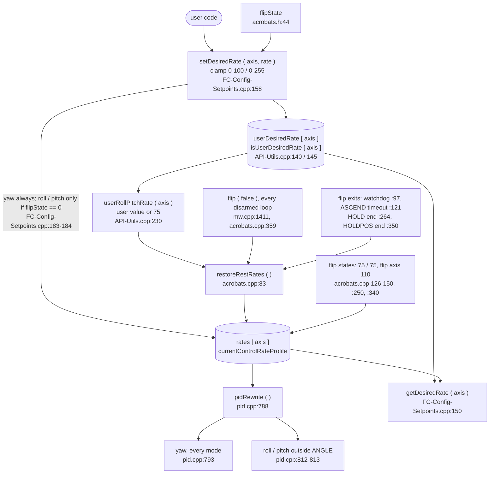

# Set desired rate API - Pipeline update

[README](README.md) · [TASKS](TASKS.md) · [SCOUT](SCOUT.md) · [INVESTIGATION](INVESTIGATION.md) · [CHANGES](CHANGES.md) · [TESTING](TESTING.md) · [PIPELINE_UPDATE](PIPELINE_UPDATE.md)

Staged text for the pipeline docs. Apply at commit ( `pluto-commit` ); do not edit `fw-architecture-pipeline/` before.
Every line reference below was looked up in the working tree on 15 Nov 2026 by the symbol it names, and the line
opened to confirm it.

## 1. `fw-architecture-pipeline/subsystems/User_Space_API.md`

### 1a. Section "Data Flow & Boundaries": new bullet, inserted after "User roll / pitch is an ANGLE-mode tilt"

```markdown
- **User stick rates hold until reboot**: `setDesiredRate ( axis, rate )` writes the live rate profile and keeps a copy
  that the flip code restores, so it survives disarm, Developer Mode off and flips. It is never dropped by the
  firmware. See **Stick rates** below; wiki `docs/API/FC_CONFIG_API_WIKI.md` ( API 1.8.7 ).
```

### 1b. Section "Data Flow & Boundaries", bullet "Landing owns the throttle and the command slot"

**Replace** `a flip ends after at\n  most 8 s ( \`acrobats.cpp:84\` )` with `a flip ends after at\n  most 8 s ( \`acrobats.cpp:94\` )`
( the watchdog moved down by the new include and `restoreRestRates ( )` ).

### 1c. New section, inserted after "Roll / pitch setpoints ( ANGLE tilt )" ( after its Mermaid block ) and before "Laser ranging"

````markdown
## Stick rates ( `setDesiredRate` / `getDesiredRate` )

`rates [ FD_ROLL / FD_PITCH / FD_YAW ]` in the live rate profile ( `currentControlRateProfile`, `uint8_t`, Cleanflight
rate units ) scale the stick into a turn rate in `pidRewrite ( )`. User code sets them with
`setDesiredRate ( axis, rate )` ( `FC-Config.h:228` ). Wiki: `docs/API/FC_CONFIG_API_WIKI.md`.

- **Setter.** `setDesiredRate ( )` ( `FC-Config-Setpoints.cpp:158` ) clamps with `constrain` to
  `CONTROL_RATE_CONFIG_ROLL_PITCH_RATE_MAX` 100 / `CONTROL_RATE_CONFIG_YAW_RATE_MAX` 255 ( `rc_controls.h:116 / 119`,
  the limits MSP_SET_RC_TUNING uses ), stores the value in `userDesiredRate [ axis ]` and sets
  `isUserDesiredRate [ axis ]` ( `API-Utils.cpp:140 / 145` ), then writes it into `rates [ axis ]` so it acts at once,
  except for roll / pitch while `flipState != 0` ( `FC-Config-Setpoints.cpp:183` ): see **A running flip keeps its
  rates** below.
  An unknown `angle_e` is ignored. `AG_*` and `FD_*` share their index ( `common/axis.h` ).
- **The flip sets its own roll / pitch rates and hands them back.** On all three targets ( `ENABLE_ACROBAT` ) `mw.cpp`
  calls `flip ( false )` on every disarmed loop ( `mw.cpp:1411` ) and `flip ( true )` while armed with a flip running
  ( `:1407` ), both before `userCode ( )` ( `:1436` ). The flip flies its own rates: 75 / 75 in ASCEND, HOLD and HOLDPOS
  ( `acrobats.cpp:126-127`, `:250-251`, `:340-341` ) and 110 on the flip axis ( `:135-150` ). Where it hands roll /
  pitch back to normal flight it calls `restoreRestRates ( )` ( `acrobats.cpp:83` ), which writes
  `userRollPitchRate ( axis )` ( `API-Utils.cpp:230` ): the held user value, or `STOCK_ROLL_PITCH_RATE` 75
  ( `API-Utils.h:83` ) when none is held. Callers: the 8 s watchdog ( `:97` ), the ASCEND 2.2 s timeout ( `:121` ), the
  HOLD end ( `:264` ), the HOLDPOS end ( `:350` ) and `flip ( false )` ( `:359` ).
- **A running flip keeps its rates.** `userCode ( )` ( `mw.cpp:1436` ) runs after `flip ( true )` ( `:1407` ) and
  before `pid_controller ( )` ( `:1507` ), and the flip writes 110 only once, at the ASCEND transition
  ( `acrobats.cpp:135-150` ); PITCHING and SLOWDOWNANDEXIT never rewrite it. A live write from user code during a flip
  would therefore replace the flip's spin rate, and a low one could trip the PITCHING 2 s timeout, which calls
  `mwDisarm ( )` in the air ( `acrobats.cpp:182-185` ) on `BACK_FLIP`, the API's only direction. So the setter holds a
  roll / pitch value but returns before the live write while `flipState != 0` ( `FC-Config-Setpoints.cpp:183` ); the
  flip's exit `restoreRestRates ( )` applies it, and `getDesiredRate ( )` already returns it. Yaw is not guarded: the
  flip never touches it. Before API 1.8.7 the setter wrote through unguarded.
- **Only `pidRewrite` ignores the rates in ANGLE mode.** `annexCode ( )` scales `dynP8 / dynI8 / dynD8` by
  `100 - rates [ axis ] * stick / 500` ( `mw.cpp:359 / 372 / 376-378` ) in every mode, and `pidMultiWii`,
  `pidMultiWii23`, `pidMultiWiiHybrid` and `pidHarakiri` read those ( `pid.cpp:299 / 317`, `:396 / 414`, `:525 / 542`,
  `:656 / 667` ). Under a non-default `pidController` ( CLI `serial_cli.cpp:487`, `MSP_SET_PID_CONTROLLER`
  `serial_msp.cpp:1437` ) a user rate therefore weakens the gains at full stick even in ANGLE mode.
- **Stock roll / pitch rate is 75, not the stored profile.** The config default is 0 ( `config.cpp:319` ), but
  `flip ( false )` writes 75 from the first disarmed loop, so 75 is the effective rate on every craft unless user code
  sets one. The app's MSP_SET_RC_TUNING roll / pitch is overwritten the same way.
- **Not restored by four abnormal flip timeouts, none of them reachable today.** SLOWDOWNANDEXIT ( left ),
  PITCHINGPOS and SLOWDOWNANDEXITPOS ( both ) set `flipState = 0` after 2 s without disarming or resetting the rates:
  the flip axis would keep 110 with ANGLE mode off until the next disarm, whose `flip ( false )` restores it. They sit
  on the LEFT / FRONT / RIGHT branches only, and `flipDirection` is only ever written 0 ( `FLIP_BACK`,
  `command.cpp:342`; the initialiser at `acrobats.cpp:63` is the same ), so every flip the firmware can start today
  ends at the watchdog or the ASCEND timeout ( both restore ) or at the PITCHING / SLOWDOWNANDEXIT 2 s timeouts
  ( both disarm, and the next `flip ( false )` restores ).
- **Never dropped.** Nothing clears `isUserDesiredRate [ ]`: a set rate holds through arm, disarm, Developer Mode off
  and Wi-Fi restarts, until reboot or the next call. Yaw is never touched by the flip.
- **Not saved by the API, but saved with the settings.** The setter writes `masterConfig`, so any later
  `saveConfigAndNotify ( )` stores it ( stick trim `mw.cpp:262`, accelerometer / compass calibration, the app's
  MSP_EEPROM_WRITE ). A profile change ( `MSP_SELECT_SETTING`, `serial_msp.cpp:1399` ) calls `writeEEPROM ( )` **before**
  `readEEPROM ( )` ( `:1405-1406` ), so it stores the user rate in the old profile too. A reload ( that, or
  `MSP_RESET_CONF`, `:1624` ) replaces the live value while `getDesiredRate ( )` keeps returning the user one; the flip
  code re-applies roll / pitch at the next disarmed loop, and yaw stays at the reloaded value.
- **Getter.** `getDesiredRate ( )` ( `FC-Config-Setpoints.cpp:150` ) returns `userDesiredRate [ axis ]` when held, else
  `rates [ axis ]`, and 0 for an unknown axis. Before API 1.8.7 it returned the PID's rate setpoint `desiredRate [ ]`.
- **Safe from `plutoInit ( )`.** `readEEPROM ( )` sets the profile pointer at `main.cpp:177`, before `plutoInit ( )`
  ( `:524` ), and nothing reloads it later in start-up.


````

## 2. `fw-architecture-pipeline/subsystems/Core_PID_Controller.md`

### 2a. Section "Primary Functions", the `pidRewrite()` bullet: append

```markdown
  The stick-to-rate scale is `rates [ axis ]` of the live rate profile ( `pid.cpp:788` ): yaw always uses it
  ( `desiredRate = ( rate + 20 ) * rcCommand >> 5`, `pid.cpp:793` ), roll / pitch only outside ANGLE mode
  ( `( rate + 20 ) * rcCommand >> 4`, `pid.cpp:812-813` ). See **Stick rates and the flip** below.
```

### 2b. New section, inserted after "User roll / pitch tilt ( `userAngleTarget`, API-Utils.cpp )" and before "Stick-low I-term reset and freeze ( `processRx ( )`, mw.cpp )"

```markdown
## Stick rates and the flip ( `rates [ ]`, acrobats.cpp )
- `rates [ FD_ROLL / FD_PITCH / FD_YAW ]` ( `uint8_t`, `rc_controls.h:145` ) are read by `pidRewrite` every loop
  ( `pid.cpp:788` ). Yaw scales the stick in every mode; roll / pitch only in ACRO / HORIZON and the flip's
  non-ANGLE states, so in ANGLE mode, the default, roll / pitch rates have no effect on `pidRewrite`. The other
  controllers also scale their dynamic P / I / D gains with the rates in every mode ( `annexCode ( )`,
  `mw.cpp:359-378` ); see `User_Space_API.md`, **Stick rates**.
- Writers: the flip ( `acrobats.cpp`, its own 75 / 110 while `flipState != 0`, then `restoreRestRates ( )` at its
  normal exits and on every disarmed loop ), `setDesiredRate ( )` ( `FC-Config-Setpoints.cpp:158`, roll / pitch not
  while a flip runs ), the app
  ( MSP_SET_RC_TUNING, `serial_msp.cpp:1516` ), in-flight adjustments ( `rc_controls.cpp:445-459` ) and the CLI
  ( `serial_cli.cpp:450-452` ).
- `restoreRestRates ( )` ( `acrobats.cpp:83` ) writes `userRollPitchRate ( )` ( `API-Utils.cpp:230` ): the
  `setDesiredRate` value when one is held, else 75 ( `STOCK_ROLL_PITCH_RATE`, `API-Utils.h:83` ). With no user rate
  this is the same 75 the flip code always wrote, so the effective roll / pitch rate is 75 on every craft ( the config
  default of 0, `config.cpp:319`, never survives the first disarmed loop ). Four abnormal 2 s flip timeouts would
  leave the flip axis at 110 until disarm, but none is reachable today ( only `FLIP_BACK` is ever commanded ); see
  `User_Space_API.md`, **Stick rates**.
```

### 2c. Line reference to correct

Section "Default gains and the API reset": **replace** `( header comment, \`FC-Config.h:95\` )` with
`( header comment, \`FC-Config.h:97\` )` ( two HISTORY rows were added to the banner ).

## 3. `fw-architecture-pipeline/subsystems/Power_BMS_Pipeline.md`

**Replace** `a flip ends after at most 8 s ( watchdog, \`acrobats.cpp:84\` )` with
`a flip ends after at most 8 s ( watchdog, \`acrobats.cpp:94\` )`.

## 4. Other line references into files this topic changed

The new `#include "flight/acrobats.h"` ( task 10 ) moved every line below it in `FC-Config-Setpoints.cpp` down by
one. **Replace**, in each place:

| Doc | Old | New |
|---|---|---|
| `User_Space_API.md`, "Roll / pitch setpoints", bullet "Stored, not flown, by the setter" | `FC-Config-Setpoints.cpp:90-98` | `FC-Config-Setpoints.cpp:91-99` |
| `User_Space_API.md`, same section, bullet "`getDesiredAngle ( AG_ROLL \| AG_PITCH )`" | `FC-Config-Setpoints.cpp:84` | `FC-Config-Setpoints.cpp:85` |
| `User_Space_API.md`, same section, Mermaid node `SA` | `FC-Config-Setpoints.cpp:90-98` | `FC-Config-Setpoints.cpp:91-99` |
| `Core_PID_Controller.md`, "User roll / pitch tilt" | `FC-Config-Setpoints.cpp:90-98` | `FC-Config-Setpoints.cpp:91-99` |

Checked on 15 Nov 2026 and **unchanged**: `API-Utils.cpp:209` and `:209-220` ( new code is after `:220` ),
`API-Utils.h:73` and `:78` ( new code is after `:78` ), `acrobats.h:44`.
