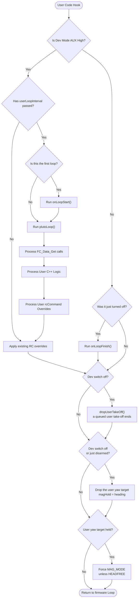

# Take-off / land command fix: Pipeline Update ( staged )

[README](README.md) · [TASKS](TASKS.md) · [SCOUT](SCOUT.md) · [INVESTIGATION](INVESTIGATION.md) · [CHANGES](CHANGES.md) · [TESTING](TESTING.md)

Staged for the commit ( task 10, `pluto-commit` ). Nothing here is applied to the pipeline folder or CLAUDE.md before
that. Line numbers are as of 16 Oct 2026, `src/main/`, with this topic in the working tree.

| Part | Goes to |
|---|---|
| A. User space API | edits in [`subsystems/User_Space_API.md`](../../fw-architecture-pipeline/subsystems/User_Space_API.md), including one flowchart node |
| B. Power & BMS | edits in the *Low-Battery Auto-Land* section and the reference table of [`subsystems/Power_BMS_Pipeline.md`](../../fw-architecture-pipeline/subsystems/Power_BMS_Pipeline.md) |
| C. Altitude hold | one line in [`subsystems/Altitude_Hold_Estimator.md`](../../fw-architecture-pipeline/subsystems/Altitude_Hold_Estimator.md) |
| D. CLAUDE.md and dev-guide | one flight-invariant line in `CLAUDE.md`, and a section in `dev-guide/FLIGHT_INVARIANTS.md` |
| E. Drift list | what the pipeline docs claimed and the code never did |

Done in the code in this task ( comments only ): the `batteryCriticalAutoLand ( )` header ( `mw.cpp:1252-1265` ), and
the landing descent comment ( `altitudehold.cpp:412-421` ).

---

## A. `subsystems/User_Space_API.md`

**A1. Key Data Structures:** replace the `Control_Command_t` line ( `:15` ) with:

> - `current_command` / `command_status` ( `command/command.h` ): the one-slot command queue. `Command_TakeOff`,
>   `Command_Land` and `Command_Flip` write it, and `executeCommand ( )` runs it at the end of the loop
>   ( `mw.cpp:1500` ). The app's `MSP_SET_COMMAND` writes the same slot.

**A2. Primary Functions:** replace the `Command.set` and `Estimate.get` lines ( `:20-21` ) with:

> - `Command_Arm ( )`, `Command_TakeOff ( cm )`, `Command_Land ( speed )`, `Command_Flip ( BACK_FLIP )`,
>   `Command_DisArm ( )` ( `API/FC-Control.h` ): arm and fly the drone from user code. Wiki
>   `docs/API/FC_CONTROL_API_WIKI.md` ( API 1.7.0 ).
> - `Estimate_Get ( Position | Velocity | Angle | Rate, axis )` ( `API/FC-Data.h` ): `EstAlt` in cm, the Z velocity in
>   cm/s, and the angles.

**A3. Data Flow & Boundaries:** replace the *Landing owns the throttle* bullet ( `:27` ) with:

> - **Landing owns the throttle and the command slot**: while any `LAND` runs ( `Command_Land`, RX loss or the
>   critical-battery auto-land ), the landing throttle is re-applied after user code ( `mw.cpp:387`, `:1399` ), so a
>   throttle `RcCommand_Set` has no effect. `Command_TakeOff` and `Command_Flip` are refused until the landing has
>   disarmed ( `landingInProgress ( )`, `FC-Control-Command.cpp:130` ). The battery auto-land also re-asserts `LAND` as
>   a backstop. `Command_Land` is refused while a flip runs ( `FC-Control-Command.cpp:157` ), and a flip ends after at
>   most 8 s ( `acrobats.cpp:84` ).
> - **Take-off**: `Command_TakeOff` is queued. From disarmed it arms once the ARM switch is on and the throttle is
>   centred ( `altHoldStickCentred ( )`, alt-hold deadband ), and sets the climb goal. On a drone that is already armed
>   it sets the goal once per arm, within 3 s of `arm_time` or at the ARM-switch ground idle, which it releases first
>   ( `takeOff ( )`, `command.cpp:152` ). A queued take-off is dropped after 2 s of refused arming
>   ( `takeOffRefusedTick ( )`, `command.cpp:143` ). A user-code take-off is also dropped at a real Dev Mode switch-off
>   ( `dropUserTakeOff ( )`, `mw.cpp:1226` ). With the battery OK, arming is allowed again right after a landing, so a
>   re-sent take-off re-arms and climbs.

**A4. *Link drop stops user code* bullet ( `:32-36` ):** append:

> `onLoopStart ( )` and `onLoopFinish ( )` therefore run on every link drop, not only at a Dev Mode switch. A
> command placed in them is sent again at each hiccup: `Command_Land` in `onLoopFinish ( )` lands the drone at the
> first hiccup, and `Command_Arm` / `Command_TakeOff` in `onLoopStart ( )` take off again after a landing. The wiki
> advises sending flight commands from `plutoLoop ( )`, once per ARM switch-on.

**A5. Flowchart:** insert the take-off drop between the user-code branches and the yaw tail. Each edge is a source line:
`RunFinish` / `ApplyOld` / `FinishCheck -- No` all reach `mw.cpp:1224-1227` ( after the `wasArmed` edge at `:1218-1221` ),
which comes before the yaw check at `:1229`.

---

## B. `subsystems/Power_BMS_Pipeline.md`

**B1. *Low-Battery Auto-Land*, the `land ( )` bullet:** replace with:

> - `land ( )` ( `command.cpp:255` ) ramps `landThrottle` down at 40 counts/s from its start, 1300 here, to 1150. It
>   disarms on touchdown: the descent stopped for 0.3 s once the ramp is at 1200 or below **and the landing has run at
>   least 1 s** ( `LAND_CONFIRM_MIN_MS`, `command.cpp:235` ). From 1300 that is 2.8 s at the earliest, unchanged. It also
>   disarms on a firm vertical contact, or after a 30 s timeout. The crash detector can also end it at touchdown. The
>   1 s floor matters for `Command_Land ( speed )`, whose default speed 105 starts at 1200.

**B2. The *cannot be cancelled* bullet:** replace with:

> - It cannot be cancelled. `MSP_SET_COMMAND` is ignored while landing. `Command_TakeOff` and `Command_Flip` are
>   refused while a landing runs ( `landingInProgress ( )`, `FC-Control-Command.cpp:130` ). This function also
>   re-asserts `LAND` before `executeCommand ( )` as a backstop. It does not start during a flip: the flip finishes
>   first, and a flip ends after at most 8 s ( watchdog, `acrobats.cpp:84` ).

**B3. Reference table:** update these rows ( the line numbers moved ):

| Edge | Source |
|---|---|
| `loop` → `batteryCriticalAutoLand` | `mw.cpp:1498` |
| `batteryCriticalAutoLand` → `batteryCriticalConfirmed` | `mw.cpp:1268` |
| `batteryCriticalAutoLand` → `current_command = LAND` | `mw.cpp:1282-1283` |
| `loop` → `executeCommand` → `land` | `mw.cpp:1500`, `command.cpp:313` |
| `land` → `mwDisarm` ( `finishLanding` ) | `command.cpp:243-247`, called at `:283`, `:289`, `:305` |

---

## C. `subsystems/Altitude_Hold_Estimator.md`

After the goal row of the setpoint table ( `:78` ), add:

> A take-off on a drone at the ARM-switch ground idle first calls `altHoldReleaseGroundIdle ( )`
> ( `altitudehold.cpp:1440` ). It clears `isThrottleStickArmed` and `altHoldGroundIdle` together, because the controller
> runs at the top of the loop, before `applyAltHold ( )` recomputes the idle. A stale idle would reset the setpoint and
> wipe the goal. The goal is set only while `altHoldStickCentred ( )` holds ( `:1447` ), the same test as the stick-rate
> branch, so a stick request cannot cancel it on the next cycle.

---

## D. CLAUDE.md and `dev-guide/FLIGHT_INVARIANTS.md`

**D1. CLAUDE.md, *Flight invariants*:** add after the battery bullets:

> - **User commands cannot replace a landing, and a landing cannot start in a flip**: `Command_TakeOff` / `Command_Flip`
>   are refused while `landingInProgress ( )`, and `Command_Land` while `flipState != 0` ( flips end within 8 s ). Every
>   end of a take-off goes through `endTakeOff ( )`, and a queued user take-off is dropped after 2 s of refused arming
>   or at a real Dev Mode off. With the battery OK, arming is allowed again right after a landing
>   ( `docs/API/FC_CONTROL_API_WIKI.md` ).

**D2. `FLIGHT_INVARIANTS.md`:** new section *User flight commands*:

> - **Mechanism.** One command slot ( `current_command`, `command_status` ) is shared by user code, the app
>   ( `MSP_SET_COMMAND` ), the RC-loss failsafe and the battery auto-land. A flip marks itself FINISHED as soon as it
>   starts, and `isLanding` is cleared only by `finishLanding ( )` or a disarm.
> - **What broke.** A `Command_TakeOff` / `Command_Flip` during a landing stopped `land ( )` but left `isLanding` set:
>   the throttle stayed pinned and nothing disarmed after touchdown ( check topic `takeoff-api-ground-hover`, task 7 ).
>   `Command_Arm` followed by `Command_TakeOff` set no climb goal ( flight logs 1-2 of that topic ).
> - **Rules.**
>   - Never write `current_command` from user-reachable code without the landing guard.
>   - A take-off goal on an armed drone must release the ground idle first.
>   - The touchdown test must not confirm before the descent has started ( `LAND_CONFIRM_MIN_MS` ).

---

## E. Drift list

| Doc | Claim | Code |
|---|---|---|
| `User_Space_API.md:15` | `Control_Command_t` wraps the commands | No such type in `src/main`. The queue is `current_command` / `command_status` ( `command.h:40-42` ) |
| `User_Space_API.md:20` | `Command.set(CommandType)` | No such function. The API is `Command_TakeOff` / `Command_Land` / `Command_Flip` / `Command_Arm` / `Command_DisArm` |
| `User_Space_API.md:21` | `Estimate.get(State)` | The function is `Estimate_Get ( FC_Estimate_e, axis_e )` ( `FC-Data.h:103` ) |
| `User_Space_API.md:27` | "the battery auto-land also replaces `Command_TakeOff` / `Command_Flip`" | Still true, but since this topic it is a backstop: both are refused first |
| `Power_BMS_Pipeline.md` reference table | `mw.cpp:1426` / `:1428`, `command.cpp:171` / `:179` / `:252` | Moved: see B3 |
