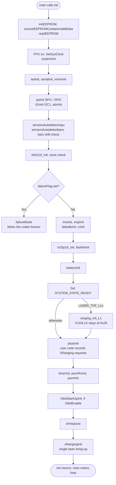
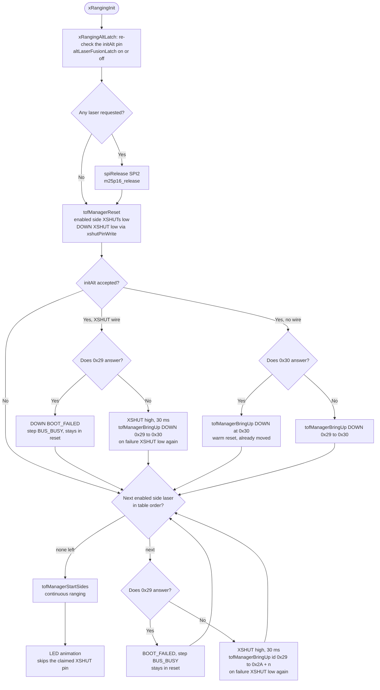
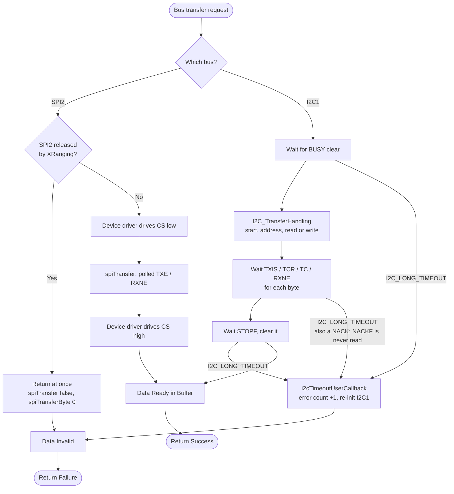
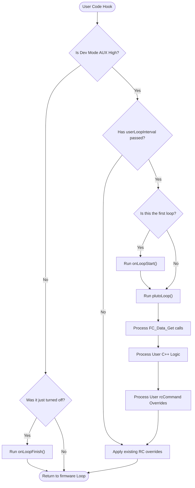
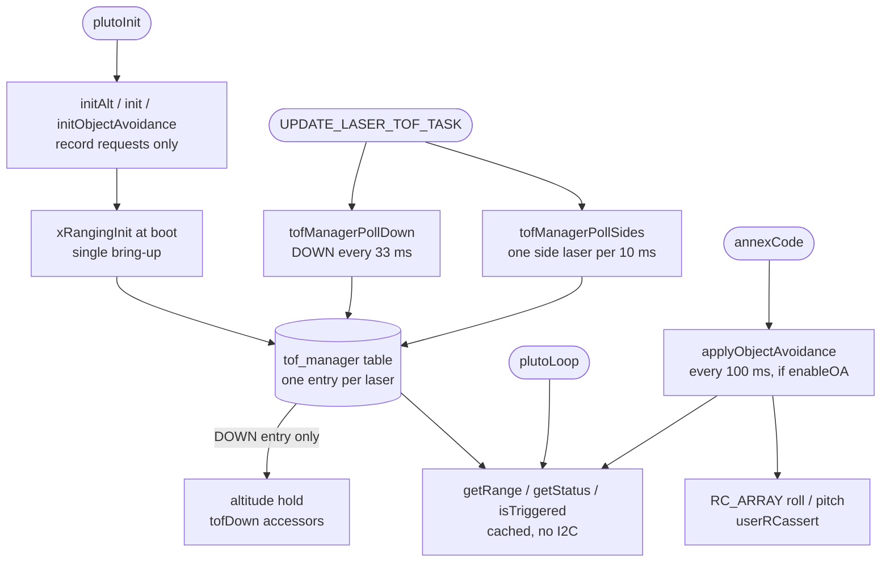
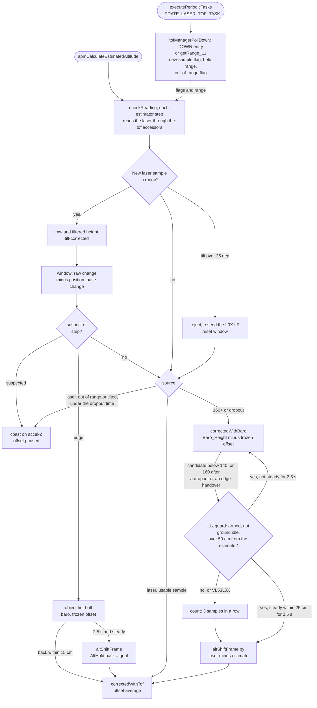

# PIPELINE_UPDATE: tof-single-pipeline

Staged for commit. Targets in `fw-architecture-pipeline/`:

| Target | How | What changed |
|---|---|---|
| `subsystems/Main_Initialization.md` | full text below | D1 ( `SYSTEM_STATE_READY` is set before `plutoInit ( )`, the motor timers and the laser bring-up, and nothing waits for it ), D2 ( the single laser bring-up `xRangingInit ( )` near the end of `init ( )`, after `plutoInit ( )`; only the UWB UART setup follows it ), D3 ( only the required sensors stop the boot; a laser reports its own status ). The flowchart is redrawn in source order ( EEPROM before the clock, INA219 before the failure check ), and a second flowchart shows the bring-up. |
| `subsystems/Hardware_Bus_Pipeline.md` | full text below | D11 ( I2C1 devices: down-laser 0x30, side lasers 0x2A + n, 0x29 only during the bring-up ), D12 ( no NACKF check, stated as a limitation; the flowchart no longer shows an ACK test ), SPI2 off whenever XRanging is used. Also corrected: the key data structures ( `I2CDevice`, `SPI_TypeDef *`, one error count per bus ) and the SPI text ( the IMU is on I2C1; SPI2 carries the flash and the user SPI API; SPI is polled, not DMA ). |
| `subsystems/User_Space_API.md` | full text below | D9: a new **XRanging** section ( `initAlt`, `init`, `initObjectAvoidance`, `enableOA` / `disableOA`, `getRange`, `isTriggered`, `getStatus`; cached reads; OA from `annexCode ( )` every 100 ms; SPI2 off; refusals; pin claim ) with its own flowchart, and a link to `docs/API/XRANGING_API_WIKI.md`. |
| `subsystems/Altitude_Hold_Estimator.md` | replacement blocks below | D6, D7, D8 and every "`LASER_ALT` / `LASER_TOF` build switch" statement. The VL53L0X fusion is switched on at boot by `XRanging.initAlt ( )` ( the latched flag `altLaserFusion ( )` ); the accessors read the DOWN entry of `drivers/tof_manager`; `tofOutOfRange ( )` includes DOWN's status; a DOWN that fails to start still runs the fusion, with a dropout to the baro ( decision D6 ); no side laser can reach the estimator. The fusion internals did not change. |
| `Firmware_Pipeline.md` | **no change** | Line 18 ( "Execute Baro/ToF/Mag" ) is still accurate: `UPDATE_LASER_TOF_TASK` is one of the periodic tasks. The "Hardware OK? → Failure Mode" step still holds for the required sensors. The doc names no build define. |

Not covered by this file: `PIN_MAP.md` ( D4 ), `dev-guide/HARDWARE_RESOURCES.md` ( D5 ) and `dev-guide/FLIGHT_INVARIANTS.md` ( the laser invariant ). They are task 11's other files. The API wiki ( D10 ) is `docs/API/XRANGING_API_WIKI.md`, written separately ( API 1.5.0; the Makefile `API_Version` / `FW_Version` bump happens at commit ).

**Validated on hardware** ( `PRIMUS_X2_v1`, details in [TESTING.md](TESTING.md) ):
- **Bench:** `Scan:158`, so DOWN is alone at 0x30, the side lasers are at 0x2A-0x2D and 0x29 is empty. **T4:** a hand at FRONT never moves `D` or the estimator's laser height.
- **Flight A/B against today's `LASER_ALT` build:** no regression ( raw laser motion sd 5.53 / 5.56 cm ). Hover A: FRONT at a wall does not reach altitude hold.
- **Hover B, baro only ( no `initAlt` ):** matches the baseline. On hardware the first tick printed `SPIoff:1` with XRanging and `SPIoff:0` without it.

## Edge check

Every diagram edge below was checked against the working tree on 15 Oct 2026, and every line re-cited against the final code ( FW 3.12.0, API 1.5.0: `xRangingAltEnabled ( )` and `tofManagerStatus ( )` removed, `initAlt` also refuses the RGB-LED slot and UART2 pins, includes dropped from `main.cpp`, `mw.cpp`, `altitudehold.cpp` and `ranging_vl53l0x.cpp` ). No edge changed. Source lines are used throughout, because the knowledge graph predates `tof_manager` and `xRangingInit ( )`. **107 edges** in total.

**Main_Initialization, boot flowchart ( 20 edges ).** All lines are in `main.cpp` unless a file is named.
- Start → EEPROM: `init ( )` is called at :619; `initEEPROM` :173, `ensureEEPROMContainsValidData` :175, `readEEPROM` :176.
- EEPROM → MCU: FPU on at :181-183, `SetSysClock` :186, `systemInit` :194.
- MCU → SER: `ledInit` :199, `serialInit` :224, `mixerInit` :234.
- SER → BUS: `spiInit ( SPI1 / SPI2 )` :311-312, `i2cInit` :324, `adcInit` :336.
- BUS → Sensors: `sensorsAutodetectmpu` :349, `sensorsAutodetectbaro` :355, `checkBaroDriftDuringStartup` :361.
- Sensors → INA: `INA219_Init` :368.
- INA → Check: :386 `if ( failureFlag != 0 )`.
- Check → Fail: :387 `failureMode ( )`, which blinks forever ( `system.c`:255, :291 ).
- Check → Core: `imuInit` :412, `mspInit` :414, `failsafeInit` :420, `rxInit` :422.
- Core → Flash: `m25p16_init` :449, `flashfsInit` :452.
- Flash → Batt: `batteryInit` :494.
- Batt → Ready: :513 `systemState |= SYSTEM_STATE_READY`.
- Ready → L1x → PlutoInit: :515-517 `ranging_init_L1 ( )` under `LASER_TOF_L1x`.
- Ready → PlutoInit ( no `LASER_TOF_L1x` ): `plutoInit` :534.
- PlutoInit → Timers: `timerInit` :543, `pwmRxInit` :582, `pwmInit` :584.
- Timers → Oled: :588-589 `OledStartUpInit ( )` if `OledEnable`.
- Oled → AdcApi: :592-593 `APIAdcInit ( )` ( all three targets ).
- AdcApi → XR: :594 `xRangingInit ( )`.
- XR → Loop: `init ( )` returns, then `while ( 1 ) loop ( )` at :628-630.

**Main_Initialization, laser bring-up flowchart ( 24 edges ).** All lines are in `API-Src/XRanging.cpp` unless a file is named.
- XR → Latch: :194 `xRangingAltLatch ( )` ( :137-148 ); :195 `altLaserFusionLatch ( altOn )`.
- Latch → Used: :200-202. Used → Rel: :202-209, which calls `spiRelease` ( :204; `bus_spi.c`:219 ) and `m25p16_release` ( :207; `flash_m25p16.cpp`:74 ).
- Used → Reset and Rel → Reset: :211 `tofManagerReset ( )`; side XSHUTs low at :215-225; DOWN XSHUT low through `xshutPinInit` / `xshutPinWrite` at :226-233.
- Reset → AltOn: :236. AltOn → Side ( no `initAlt` ): :236 is skipped and the code goes to :255.
- With an XSHUT wire:
  - AltOn → Busy1: :237-238 `vl53l0xProbe ( 0x29 )`.
  - Busy1 → BF1: :239 `tofManagerMarkFailed ( DOWN, BUS_BUSY )`.
  - Busy1 → DW: :241-243 ( release, 30 ms, `tofManagerBringUp ( DOWN, 0x29, 0x30 )` ); on failure the XSHUT goes low again at :244.
- Without a wire:
  - AltOn → P30: :247 `vl53l0xProbe ( 0x30 )`.
  - P30 → DWarm: :248. P30 → DCold: :250.
- BF1 / DW / DWarm / DCold → Side: the down block ends at :252, and :255-258 starts the side loop.
- Side → StartS ( none left ): the loop ends, then :281.
- Side → Busy2: :260. Busy2 → BF2: :261-263 ( the address still counts up, :262 ).
- Busy2 → SW: :266-274; on failure the XSHUT goes low again at :272.
- BF2 → Side and SW → Side: the loop at :256.
- StartS → Anim: :281 `tofManagerStartSides ( )` ( `tof_manager.cpp`:118-129 ), then :284-290. `ledInit` ( :126-131 ) and `ledWrite` ( :133-135 ) skip the claimed pin through `isLedUsable ( )` ( :122-124 ).

**Hardware_Bus_Pipeline flowchart ( 19 edges ).** All lines are in `bus_i2c_stm32f30x.c` unless a file is named.
- Start → BusCheck: the caller picks the bus. SPI2 is the only SPI bus enabled on the three targets ( `USE_SPI_DEVICE_2` ); I2C1 is `I2C_DEVICE`.
- BusCheck → Rel ( SPI2 ): `spiIsReleased ( )` is checked at `bus_spi.c`:301 and :325.
- Rel → SPIOff: `bus_spi.c`:301 returns 0 and :325 returns false; the flash returns early at `flash_m25p16.cpp`:89, :115, :128, :223, :238, :253, :266, :279, :286, :327; the user API at `Serial-IO-SPI.cpp`:85, :91, :143, :148, :156, :181, :204.
- Rel → SPISetup → SPIXfer → SPIRelease: the device driver's CS ( `flash_m25p16.cpp`:52-53 `ENABLE_M25P16` / `DISABLE_M25P16` ), and `spiTransfer` polling TXE / RXNE at `bus_spi.c`:331-343.
- BusCheck → I2CBusy: the BUSY wait at :261-266 ( write ) and :337 ( read ).
- I2CBusy → I2CStart: `I2C_TransferHandling` at :269 and :344.
- I2CStart → I2CXfer: the TXIS / TCR / TC / RXNE waits at :272-301 and :348-372.
- I2CXfer → I2CStop: the STOPF wait and clear at :314-322 and :392-399.
- I2CBusy / I2CXfer / I2CStop → I2CErr: every wait returns `i2cTimeoutUserCallback ( )` ( :123-131 ), which counts the error and re-initialises the peripheral ( :113-121 ).
- No `I2C_ISR_NACKF` read exists in the file ( grep ). NACKCF is only cleared, at :116.
- SPIRelease / I2CStop → Merge, I2CErr / SPIOff → MergeFail, Merge → End, MergeFail → EndFail: the return values above ( true, or false / 0 ).

**User_Space_API, XRanging flowchart ( 13 edges ).** All lines are in `API-Src/XRanging.cpp` unless a file is named.
- PI → Req: `plutoInit ( )` runs at `main.cpp`:534; the request entry points are `init` :297-313, `altRequest` / `initAlt` :316-337 and `initObjectAvoidance` :460-471.
- Req → XR: `main.cpp`:594; the requests are read at :141, :201, :217 and :258.
- XR → Tab: `tofManagerRequest` / `tofManagerBringUp` / `tofManagerMarkFailed` at :219, :227, :239, :243, :248, :250, :261, :271.
- Task → PD / PS: `mw.cpp`:812-815.
- PD → Tab: `tof_manager.cpp`:138-171. PS → Tab: `tof_manager.cpp`:173-207.
- Tab → Get: `getStatus` :339-348 and `getRange` :350-356 use `tofManagerEntry ( )`; `isTriggered` calls `getRange` at :363.
- PL → Get: `plutoLoop ( )` at `mw.cpp`:1139 ( user code calls the getters ).
- AC → OA: `mw.cpp`:532 `applyObjectAvoidance ( )`, with the 100 ms and `_enOA` gates at :488-495.
- OA → Get: `oaDistance ( )` :418-425.
- OA → RC: :560-591 ( `RC_ARRAY`, `userRCassert` ).
- Tab → Alt: the macros at `altitudehold.cpp`:228-233 call `tof_manager.cpp`:209-231, which read `tofTable [ TOF_DOWN ]` only.

**Altitude_Hold_Estimator, laser fusion flowchart ( 25 edges, all re-cited; the old line numbers had shifted ).** These are in the edge comment of block A9 below.

**Altitude_Hold_Estimator, estimator / controller flowchart ( 6 edges at the changed decision ).** All lines are in `altitudehold.cpp`.
- Start → Src: :945.
- Src → LF: :946.
- Src → Baro: :948 ( `checkBaro ( )` at :1339 ).
- LF → ToF: :1330.
- LF → Baro: :1335.
- LF → CF: :1332.

The other edges of that flowchart are unchanged.

## CLAUDE.md change ( applied at commit, 15 Oct 2026, in a condensed form with the allowed XSHUT pins )

In **Flight invariants**, replace the bullet that starts "**With `LASER_ALT`, one down-laser ...**" with:

> - **With `XRanging.initAlt ( )` ( VL53L0X ) or `LASER_TOF_L1x` + `LASER_ALT` ( VL53L1X ), one down-laser ( never both:
>   `initAlt` is refused in a VL53L1X build ) corrects the estimator below 160 cm and the baro above it ( back below
>   140 cm )**. The choice is latched once at boot, after `plutoInit ( )`. The return to the laser and a re-base shift
>   the whole altitude frame, so the craft does not move. A sudden surface change is held on the baro for 2.5 s before
>   re-basing. An accepted `initAlt` whose laser fails to start still runs the fusion, which drops to the baro at once
>   ( `FLIGHT_INVARIANTS.md` ).

Add after it:

> - **XRanging pins and buses.** A down-laser XSHUT wired to GPIO_5 needs `initAlt ( GPIO_5 )`. GPIO_5 is also FRONT's
>   LED, and any LOW on it resets the down-laser. SPI2 ( GPIO_5-8: the M25P16 flash and the user SPI API ) is off
>   whenever XRanging is used. Every fitted side laser must be enabled ( `init` / `initObjectAvoidance` ); otherwise it
>   sits awake at 0x29 and the down-laser is refused ( `BUS_BUSY` ). With no XSHUT wire ( `initAlt ( )` ) that
>   case cannot be detected and both chips are re-addressed together. Wiki: `docs/API/XRANGING_API_WIKI.md`.

---

## Target: subsystems/Main_Initialization.md

````markdown
# Main Initialization (`init()` in `main.cpp`)

## Overview
When the STM32F3 MCU boots, `main()` immediately calls `init()`. This phase is critical for establishing the operational baseline of the flight controller: setting up hardware peripherals (clocks, DMA, timers), allocating necessary RAM, and probing the I2C/SPI buses to check sensor health before permitting flight.

## Source Files
- **Bootloader & Main Entry**: `src/main/main.cpp`
- **Hardware Bootstrap**: `src/main/drivers/system_stm32f30x.c`
- **EEPROM Storage**: `src/main/config/config.cpp`
- **Boot failure codes**: `src/main/drivers/system.c` ( `failureMode ( )` )
- **Laser bring-up**: `src/main/API-Src/XRanging.cpp` ( `xRangingInit ( )` ), `src/main/drivers/tof_manager.cpp`, `src/main/drivers/ranging_vl53l0x.cpp`

## Key Data Structures
- `masterConfig`: The globally loaded configuration structure read from EEPROM. Contains settings for sensors, PID tuning, and UART configurations.
- `hw_timer_t`: Timers instantiated for PWM/Motor output and system scheduling.
- `systemState`: boot progress bits ( `CONFIG_LOADED`, `SENSORS_READY`, `MOTORS_READY`, `READY` ). Only `HardFault_Handler ( )` reads it: it stops the motors once config and motors are ready. Nothing gates the loop on it.
- `failureFlag`: one bit per required device that failed ( IMU, barometer, baro drift at start-up, INA219, external clock ).
- `tofTable` ( `drivers/tof_manager.cpp` ): one entry per VL53L0X ( LEFT, RIGHT, FRONT, BACK, EXTERNAL, DOWN ), each with its own status, filled by the laser bring-up.

## Primary Functions
- `init()`: The master bootstrapping sequence.
- `systemInit()`: Initializes the ARM Cortex-M4 FPU, sets the core clock to 72MHz, and enables the SysTick timer for `millis()` and `micros()` timing.
- `readEEPROM()`: Loads user configurations. If the checksum fails or the firmware version differs, it executes a `resetEEPROM()` to load safe defaults.
- `sensorsAutodetectmpu()` / `sensorsAutodetectbaro()`: probe the IMU and the barometer. A failure sets its bit in `failureFlag`. After the INA219 and clock checks, a non-zero `failureFlag` halts the boot in `failureMode()`, which blinks the failure codes forever.
- `xRangingInit()`: the single VL53L0X bring-up. It runs once, near the end of `init()` after `plutoInit()`; only the UWB UART setup ( `localisationType == UWB` ) follows it.

## Data Flow & Boundaries
- **Blocking Boot**: The `init()` sequence is strictly synchronous. Only the required devices stop it: a missing IMU or barometer, a baro that drifts at start-up, a missing INA219 or the internal clock end in `failureMode()`. Other devices do not stop the boot. A laser that fails is marked BOOT_FAILED in its own `tofTable` entry ( `XRanging.getStatus ( )` reports it ), and the boot carries on. Nothing is retried.
- **I2C Bus Lockups**: A common initialization failure is a locked I2C bus. The boot sequence often toggles the SCL/SDA pins manually via GPIO to flush stalled sensor lines before initializing the hardware I2C peripheral.
- **`SYSTEM_STATE_READY` is not the last step.** It is set at main.cpp:513, after the battery init but **before** `plutoInit ( )`, the motor timers ( `timerInit ( )`, `pwmInit ( )` ), the OLED start-up, `APIAdcInit ( )` and the laser bring-up. Nothing waits for it: the loop starts when `init ( )` returns ( main.cpp:628 ).
- **One laser bring-up, after `plutoInit ( )`.** `xRangingInit ( )` runs at main.cpp:594 on all three targets. Every `XRanging` request from user code is known by then: `initAlt`, `init` and `initObjectAvoidance` only record requests. In order, the bring-up:
  1. **Latches** the down-laser request and the altitude-laser fusion for the run.
  2. **Releases SPI2** if any laser is requested.
  3. **Holds every enabled laser in reset** ( XSHUT low ).
  4. **Brings up the down-laser alone** and moves it to 0x30.
  5. **Brings up the side lasers one at a time** and moves each to 0x2A + n.
  6. **Starts continuous ranging** on the side lasers.
  7. **Runs the LED animation.**

  Before each release, 0x29 must be silent; if it is not, that laser stays in reset ( BOOT_FAILED, step `BUS_BUSY` ). Each probe of an empty 0x29 costs one I2C timeout ( `Hardware_Bus_Pipeline.md` ).
- **SPI2 release.** SPI2's pins are GPIO_5-8, which XRanging uses as XSHUT and LED pins. If any laser is requested ( DOWN counts after the latch ), `spiRelease ( SPI2 )` and `m25p16_release ( )` run before any laser pin is touched:
  - SPI2 is switched off for the run, and the M25P16 flash reports size 0.
  - SPI calls in `plutoInit ( )` still work; from here on the user SPI API does nothing.
  - Without XRanging, SPI2 and the flash stay as set up at main.cpp:312 and :449.
- **VL53L1X.** With `LASER_TOF_L1x`, `ranging_init_L1 ( )` runs at main.cpp:517, before `plutoInit ( )`, and leaves the VL53L1X at 0x29. The XRanging bring-up does not change it.

Boot order ( main steps; smaller ones are left out ):



The laser bring-up ( `xRangingInit ( )` ):


````

---

## Target: subsystems/Hardware_Bus_Pipeline.md

````markdown
# Hardware Bus Pipeline (I2C & SPI)

## Overview
The Hardware Bus abstraction layer acts as the physical communication bridge between the STM32F3 microcontroller and the onboard peripherals (IMUs, Barometers, Magnetometers, Time-of-Flight sensors). I2C is **polled**: every transaction busy-waits on the peripheral's status flags ( `I2C_LONG_TIMEOUT`, then a bus recovery on timeout ) and blocks the loop until it finishes. There is no I2C DMA or interrupt. Peripherals on the shared I2C1 bus must therefore budget their bytes per loop.

## Source Files
- **I2C Drivers**: `src/main/drivers/bus_i2c.h`, `src/main/drivers/bus_i2c_stm32f30x.c`, `src/main/drivers/bus_i2c_soft.cpp`
- **SPI Drivers**: `src/main/drivers/bus_spi.h`, `src/main/drivers/bus_spi.c`
- **Peripheral Setup**: `src/main/drivers/system_stm32f30x.c`
- **Laser bus use**: `src/main/drivers/tof_manager.cpp` ( polling ), `src/main/API-Src/XRanging.cpp` ( `xRangingInit ( )`: addresses, SPI2 release )

## Key Data Structures
- `I2CDevice`: Enumerator representing the I2C buses ( `I2CDEV_1`, `I2CDEV_2` ). Every target uses `I2CDEV_1` ( `I2C_DEVICE` in `target.h` ).
- SPI buses are passed as `SPI_TypeDef *` ( `SPI1`, `SPI2` ). The three targets enable `SPI2` only ( `USE_SPI_DEVICE_2` ).
- `i2c1ErrorCount` / `i2c2ErrorCount`: one count of failed transfers per bus ( `i2cGetErrorCounter ( )` ). There is no error type: a NACK, a missing device and a stuck bus all end as a timeout.

## Primary Functions
- `i2cInit()` / `spiInit()`: configure the GPIO alternate functions and clock speeds for the bus. I2C uses no DMA. `spiInit ( SPI2 )` returns false once SPI2 is released.
- `i2cRead()` / `i2cWrite()` / `i2cWriteBuffer()`: blocking, polled I2C transactions at 400 kHz
  ( `I2C_Timing` 0x00E0257A ). A byte costs ~25 µs on the wire plus per-transaction overhead.
- `spiTransfer()` / `spiTransferByte()`: synchronous, polled SPI exchange ( TXE / RXNE, 1000-count timeout ). On these targets SPI2 carries the M25P16 flash and the user SPI API; the IMU is on I2C1. On a released SPI2 they return at once ( `false` / 0 ).
- `spiRelease ( SPI2 )` / `spiIsReleased ( )`: switch SPI2 off for the rest of the run ( see below ).

## Data Flow & Boundaries
- **I2C errors ( limitation )**: the driver never reads the NACK flag ( NACKF ). A device that does not acknowledge
  ( absent, held in reset, wrong address ) only leaves the flag the driver waits for unset. The transfer therefore
  costs the full `I2C_LONG_TIMEOUT` ( 10 × 0x1000 polling counts ). Then `i2cTimeoutUserCallback ( )` counts the
  error and re-initialises the I2C1 peripheral ( disable, clear flags, enable, `i2cInitPort ( )` ). The caller gets
  false and cannot tell a NACK from a stuck bus. Each probe of an absent device stalls the loop for one timeout. The
  laser bring-up probes 0x29 at most 6 times, at boot only.
- **SPI Constraints**: SPI is polled like I2C. The clock is bounded by the device ( `spiSetDivisor ( )` ).
- **Shared I2C1 budget**: the IMU ( ICM-20948 ), barometer, magnetometer, INA219, the OLED ( 0x3C ) and the VL53L0X
  lasers share I2C1 inside the gated loop.
  The OLED never writes the panel from the loop directly. Drawing goes to a 1 KB RAM framebuffer, and
  `oledFlushStep ( )` ( called from `OledDisplayData ( )`, `mw.cpp:1126` ) sends at most **one run of up to 16 changed
  bytes per loop** ( ~0.6 ms ), and only while the frame differs from what the panel shows. The old per-byte
  writes ( ~630 transactions, 45-60 ms every 200 ms ) made the drone twitch at 5 Hz
  ( [oled-flight-wobble](../../active-development/oled-flight-wobble/README.md) ).
- **Laser addresses on I2C1**: every VL53L0X boots at 0x29. The single bring-up ( `xRangingInit ( )`, main.cpp:594 )
  moves each one while it is alone on the bus:
  - the down-laser goes to **0x30**;
  - each side laser goes to **0x2A + n**, where n counts the enabled side lasers before it in table order ( LEFT, RIGHT,
    FRONT, BACK, EXTERNAL ).

  With VL53L0X lasers, 0x29 is in use only during the bring-up, with one exception: a fitted laser that is not
  enabled stays awake at 0x29, and every release after it is refused ( `BUS_BUSY` ). A VL53L1X ( `LASER_TOF_L1x` )
  stays at 0x29. A user I2C device must not use 0x29-0x2E or 0x30 while lasers are fitted.
- **Laser I2C load**: `UPDATE_LASER_TOF_TASK` polls the down-laser every 33 ms ( start + read ). It also polls one
  side laser per 10 ms: a data-ready read, plus the result read and the interrupt clear only when a sample is ready.
  Readers ( `XRanging.getRange ( )`, object avoidance ) use the cached sample and make no I2C call. The worst laser-task
  call measured 1.9-2.2 ms ( one down read plus one side read ), and the mean was 13 µs
  ( [tof-single-pipeline TESTING.md](../../active-development/tof-single-pipeline/TESTING.md), test 3 ).
- **Laser errors**: each laser has its own status. A failed read marks only that laser I2C_ERROR, and it is not
  polled again until a power cycle.
- **SPI2 is off whenever XRanging is used**: SPI2's pins are GPIO_5-8 ( PB15 MOSI, PB14 MISO, PB13 SCK, PB12 NSS /
  flash CS ), and XRanging uses them as XSHUT and LED pins. If user code requests any laser, `xRangingInit ( )` calls
  `spiRelease ( SPI2 )` and `m25p16_release ( )` before it touches a laser pin:
  - SPI2 is disabled and its clock stopped.
  - Pins still in SPI2's alternate function ( AF5 ) become pulled-up inputs. Pins user code already took in
    `plutoInit ( )` are left alone, and PB12 is not touched.
  - From then on `spiInit ( SPI2 )` fails, SPI2 transfers return at once, the flash reports size 0 and the user SPI
    API does nothing.

  Without XRanging, SPI2 and the flash are unchanged.
- **OLED failure**: if the panel stops answering ( 3 failed runs in a row, or more than ~1 in 5 failing ), the
  OLED is switched off, so a loose connector cannot keep stalling the loop. The 2 s start-up splash still writes
  the panel directly, at boot only.


````

---

## Target: subsystems/User_Space_API.md

````markdown
# User Space API (`PlutoPilot.cpp`)

## Overview
The `PlutoPilot` developer sandbox allows custom user C++ code to intercept the main flight loop. Developers can securely override controls, read live sensor variables, and trigger external LEDs or displays—all without breaking the real-time safety and timing of the core PID loops.

## Source Files
- **Sandbox Definition**: `PlutoPilot.cpp`, `PlutoPilot.h` (Root level developer files)
- **API Interfaces**: `src/main/API-Src/*` (e.g., `FC-Control-Command.cpp`, `FC-Data-Sensors.cpp`)
- **API Headers**: `src/main/API/*` (e.g., `FC-Control.h`, `Peripherals.h`)
- **Laser ranging**: `src/main/API/XRanging.h`, `src/main/API-Src/XRanging.cpp`, behind it `src/main/drivers/tof_manager.cpp`

## Key Data Structures
- `rcCommand[4]`: The user API often overwrites this array (Pitch, Roll, Yaw, Throttle) to fly the drone autonomously.
- `Flight_State_e`: Enumeration that the API uses to determine if the drone is Armed, in Failsafe, or Grounded.
- `Control_Command_t`: The wrapper structure the API uses to push new commands (like `TakeOff`, `Land`, or `Flip`) to the flight controller queue.

## Primary Functions
- `plutoInit()`: Called once during boot by `init()` ( main.cpp:534 ), after `SYSTEM_STATE_READY` and before the motor timers and the laser bring-up. Used by the developer to configure GPIOs, external sensors, or set up API timers. `XRanging` calls here only record requests; the lasers start after `plutoInit()` returns.
- `plutoLoop()`: The continuously executing user function. Called directly by the main control loop.
- `Command.set(CommandType)`: Exposed API function used inside `plutoLoop()` to trigger complex maneuvers or state changes natively.
- `Estimate.get(State)`: Exposed API function to pull live `EstAlt`, `EstVel`, or `Pitch/Roll` angles safely.

## Data Flow & Boundaries
- **Time Slice Strictness**: Because `plutoLoop()` executes within the high-frequency control loop, user code *must not block*. The use of `delay()` is explicitly forbidden, as it would cause the drone to instantly crash by halting the PID calculations.
- **Override Priority**: If the Failsafe mechanism activates, the firmware explicitly ignores `rcCommand` overrides originating from `plutoLoop()`. Failsafe takes ultimate precedence over the API.
- **Rate Limiting**: To prevent API logic from running unnecessarily fast (e.g., polling an ultrasonic sensor 1000 times a second), developers use the `Monitor.timer` API to schedule tasks sequentially.
- **Landing owns the throttle**: while any `LAND` runs ( `Command_Land`, RX loss or the critical-battery auto-land ), the landing throttle is re-applied after user code, so a throttle `RcCommand_Set` has no effect; the battery auto-land also replaces `Command_TakeOff` / `Command_Flip`.
- **Battery**: `Bms_Get` has `SoC`, `Warning_Level` and `Resistance` ( API 1.4.0 ); wiki `docs/API/BMS_API_WIKI.md`.
- **Link drop stops user code**: `plutoLoop ( )` runs only while `rxIsReceivingSignal ( )` is true. With `Rx_ESP`
  that is false **200 ms after the last `MSP_SET_RAW_RC` frame**. The firmware then runs `onLoopFinish ( )`,
  clears every user RC override and re-runs `onLoopStart ( )` when frames return. A Wi-Fi stall therefore
  restarts user code long before failsafe acts ( ~2.5 s ).
- **OLED is deferred**: `Oled_Update ( )` / `Oled_display_Update ( )` only queue the frame. The firmware sends the
  changed bytes to the panel at most 16 per loop, so a full screen appears in ~0.25 s. A buffer passed to
  `Oled_display_Update ( )` must stay valid ( `static` or global ). `Oled_Update ( )` works in `User` mode only, and
  `Oled_Mode ( )` starts from a blank frame. Wiki: `docs/API/OLED_API_WIKI.md`.
- **Laser ranging**: `XRanging` requests are made in `plutoInit ( )` and fixed at boot. Reads return cached values.
  Using XRanging switches SPI2 off. See **XRanging** below; wiki `docs/API/XRANGING_API_WIKI.md`.



## XRanging ( laser ranging and object avoidance )

Up to six VL53L0X lasers on I2C1: four side lasers, EXTERNAL and the downward altitude laser ( `DOWN` ). Everything
goes through the `XRanging` object ( `API/XRanging.h` ). Full reference, examples and wiring rules:
[XRANGING_API_WIKI.md](../../../API/XRANGING_API_WIKI.md) ( API 1.5.0 ).

| Call | Where | What it does |
|---|---|---|
| `initAlt ( gpio )` / `initAlt ( )` | `plutoInit ( )` only | Requests the down-laser and the altitude-laser fusion ( the estimator then corrects on the laser below 160 cm ). `gpio` is the pin wired to its XSHUT; `initAlt ( )` is for a down-laser with no XSHUT wire. Returns `false` when refused. |
| `init ( )` / `init ( laser, threshold_cm )` | `plutoInit ( )` | Enables the four side lasers ( threshold 20 cm ), or one side laser with its own threshold. |
| `initObjectAvoidance ( dist_cm, l1 … l4 )` | `plutoInit ( )` | Enables up to four side lasers and sets the avoidance distance. OA stays off until `enableOA ( )`. |
| `enableOA ( )` / `disableOA ( )` | any time | Turns object avoidance on or off; `disableOA` also turns the laser LEDs off. |
| `getRange ( laser )` | any time | The cached range in mm. −100 when the laser has no valid sample or is not running, −1 when it was not enabled. `DOWN` is allowed. |
| `isTriggered ( laser )` | any time | A side laser's range is below its threshold; drives that laser's LED. |
| `getStatus ( laser )` | any time | `LASER_OK`, `LASER_OUT_OF_RANGE`, `LASER_BOOT_FAILED`, `LASER_I2C_ERROR` or `LASER_NOT_ENABLED`, per laser, `DOWN` included. |

Rules:
- **Requests are fixed at boot.** `xRangingInit ( )` brings every requested laser up once, after `plutoInit ( )`
  ( see `Main_Initialization.md` ). A laser enabled later is not started. A laser that fails, at boot or in flight, is
  not retried until power-off; the others carry on.
- **Reads are cached.** `UPDATE_LASER_TOF_TASK` polls the chips: DOWN every 33 ms, one side laser per 10 ms in
  round-robin ( each of four side lasers every ~40 ms ). `getRange`, `isTriggered` and `getStatus` read the cached
  entry and make no I2C call, so they are safe in `plutoLoop ( )`.
- **Object avoidance runs from `annexCode ( )`**, every 100 ms while `enableOA ( )` is on, whether or not user
  code runs. It overrides roll and pitch ( `RC_ARRAY`, pilot authority 0 through `userRCassert`; the pilot's stick is
  blended in at 30 % / 20 % ). A laser that is not OK or OUT_OF_RANGE counts as "no obstacle".
- **`initAlt` is refused** in these cases:
  - outside `plutoInit ( )`, i.e. once the bring-up has run;
  - in a VL53L1X ( `LASER_TOF_L1x` ) build;
  - for an invalid pin, or any side laser's XSHUT pin ( GPIO_7, 9, 16, 15, 14 );
  - for an RGB-LED slot or UART2 pin ( GPIO_1, 3, 6, 10, 11, 12, 13, 16, 17, 18 ): those drivers can take the pin after start-up;
  - when the pin's ADC or PWM alias is in use ( GPIO_5 = ADC_2 / PWM_4 ). This is checked again after `plutoInit ( )`;
    a request refused there leaves the firmware on the baro.

  A refused call keeps an earlier accepted request. `init` and `initObjectAvoidance` take side lasers only.
- **The down-laser's XSHUT pin is claimed.** After the bring-up starts, `Peripheral_Init` / `Peripheral_Write` on that
  pin, and `Peripheral_Init` on its ADC or PWM alias, are ignored. No LED write reaches it either: on this board
  GPIO_5 is FRONT's LED and the down XSHUT, so with `initAlt ( GPIO_5 )` FRONT has no LED.
- **Every fitted laser must be enabled.** A fitted side laser that is not enabled stays awake at 0x29. Every release
  after it is then refused ( `LASER_BOOT_FAILED`, step `BUS_BUSY` ), the down-laser included.
- **SPI2 is off whenever XRanging is used.** GPIO_5-8 are SPI2's pins. SPI calls made in `plutoInit ( )` work; from
  the bring-up on, the SPI API does nothing ( `SPI_Read` returns 0 ) and the on-board flash reports size 0.
- **No side laser reaches altitude hold.** Only the DOWN entry feeds the estimator.


````

---

## Target: subsystems/Altitude_Hold_Estimator.md

Replacement blocks. The line numbers refer to the current committed doc ( 474 lines ). Apply them from the bottom up, so earlier line numbers stay valid. Everything not named here stays as it is: the barometer chain, setpoint shaping, the fusion constants and handover, the object hold-off, the VL53L1X driver and the flip interaction.

### A1. Line 4 ( Overview )

Replace the line with:

````markdown
Fuses barometric pressure (and, with a down-laser, laser Time-of-Flight: the VL53L0X switched on at boot by `XRanging.initAlt ( )`, or the VL53L1X built with `LASER_TOF_L1x` + `LASER_ALT`) with the accelerometer's Z-axis to estimate altitude and vertical velocity. When `ALT_HOLD` mode is active, it takes over the throttle channel to hold or smoothly change height.
````

### A2. Line 9 ( Source Files: Laser )

Replace the line with:

````markdown
- **Laser** ( one down-laser, used by the estimator only while the laser fusion is on, `altLaserFusion ( )` ):
  - **VL53L0X:** the DOWN entry of `src/main/drivers/tof_manager.cpp` / `.h` ( 33 ms single ranging, start + read, a 0.1 IIR of samples < 2000 mm, address 0x30 ). The per-device helpers are in `src/main/drivers/ranging_vl53l0x.cpp` / `.h`. The bring-up is `xRangingInit ( )` in `src/main/API-Src/XRanging.cpp`. User code turns it on with `XRanging.initAlt ( )` in `plutoInit ( )`.
  - **VL53L1X:** `src/main/drivers/ranging_vl53l1x.cpp` / `.h` ( `LASER_TOF_L1x`: Medium mode, 45 ms budget, 50 ms period, no filter, at 0x29 ), fused with `LASER_ALT`.
  - **Only one down-laser can be fitted.** `initAlt` is refused in a `LASER_TOF_L1x` build. `altitudehold.cpp` stops the build with an `#error` if `LASER_TOF` is still defined, or if `LASER_ALT` is defined without `LASER_TOF_L1x`.
````

### A3. Lines 25-27 ( Primary Functions: `checkBaro`, `checkReading`, `correctedWithTof` )

Replace the three lines with:

````markdown
- `checkBaro()` → `correctedWithBaro()`: barometer path, used while the laser fusion is off. Time constant `_time_constant_z` is 2 s, or 5 s above 30° of tilt.
- `checkReading()` ( laser fusion on ): chooses the correction source each estimator step: `correctedWithTof()` on the laser, `correctedWithBaro()` with a frozen offset on the baro or during an object hold-off, or no correction ( coast ) during a short gap or a suspected edge. One body serves either laser; it reads the sensor only through accessor macros and per-sensor constants. See **Laser fusion** below.
- `correctedWithTof()`: position error against the filter's own `_position_z`; one time constant `ALT_EST_TAU_S` 1.5 s for both sources while the fusion is on.
- `altLaserFusion()` / `altLaserFusionLatch()`: the boot-latched fusion flag.
  - **VL53L0X:** `xRangingInit ( )` latches it once, after `plutoInit ( )`, from the accepted `XRanging.initAlt ( )` request. When it turns on, τ becomes 1.5 s and the gains are recomputed.
  - **VL53L1X:** a `LASER_TOF_L1x` + `LASER_ALT` build has it on at compile time.
  - **What it selects:** `checkReading ( )` or `checkBaro ( )`; τ; the accel-Z deadband ( `imu.cpp` ); and the take-off height ( `command.cpp`: absolute with the laser, relative to the arming height on the baro ).
````

### A4. Lines 123-131 ( Laser fusion: heading and introduction )

Replace with:

````markdown
## Laser fusion (`altLaserFusion ( )`: VL53L0X with `XRanging.initAlt ( )`, or VL53L1X with `LASER_ALT`)

With a downward laser, altitude hold means height above the surface under the craft: gentle
terrain is followed. `checkReading()` decides each estimator step what corrects the complementary
filter. The fusion runs while `altLaserFusion ( )` is true:

- **VL53L0X:** the flag is latched once at boot by `xRangingInit ( )`, from an accepted `XRanging.initAlt ( )`. It
  never changes while the craft runs. Without `initAlt`, or with a refused one, the estimator is exactly the
  baro build.
- **VL53L1X:** the flag is on at build time with `LASER_TOF_L1x` + `LASER_ALT`.

One fusion body serves both lasers. Only one laser can be fitted, because both would write the same estimator
state, so `initAlt` is refused in a VL53L1X build. The two sensors differ only in the accessors and constants below,
plus a return guard that only the VL53L1X has.

**A down-laser that fails to start still runs the fusion.** An accepted `initAlt` turns the fusion on even if the
laser then ends BOOT_FAILED: no answer, a failed init step, or 0x29 busy at its release ( `BUS_BUSY` ). Then:
- the estimator starts on the laser source, finds no usable sample, and hands over to the baro on its first tick
  ( `ALT_TOF_DROPOUT_MS` has already passed since boot );
- it stays on the baro with the frozen offset;
- it keeps the laser tuning: τ 1.5 s, accel-Z deadband 0, absolute take-off height;
- `XRanging.getStatus ( DOWN )` reports the failure.

**No side laser reaches the estimator.** Every laser has its own entry in `drivers/tof_manager`. The side lasers are
polled into their own entries ( `tofManagerPollSides ( )` ), and the estimator's accessors read the DOWN entry
only. Before this, the side lasers' bring-up and reads wrote the same globals the estimator read.
````

### A5. Lines 133-154 ( Sensor interface and the validity table )

Replace from "**Sensor interface.**" through the end of the validity table ( line 154 ) with:

````markdown
**Sensor interface.** The body reads the sensor only through six accessor macros, chosen with
`#if defined( LASER_TOF_L1x ) / #else` near the top of `altitudehold.cpp`. The VL53L0X accessors are
functions of `drivers/tof_manager` that read the DOWN entry only:

| Accessor | Meaning | VL53L0X ( DOWN entry ) | VL53L1X |
|---|---|---|---|
| `tofNew()` | a new result is waiting | `tofDownNew()` | `isTofDataNew_L1()` |
| `tofClearNew()` | mark it consumed | `tofDownClearNew()` | `isTofDataNewflag_L1 = false` |
| `tofOutOfRange()` | no valid reading now | `tofDownOutOfRange()`: the last sample was invalid, **or DOWN's status is not OK** | `isOutofRange_L1()` |
| `tofReseed()` | restart the driver's range filter | `tofDownReseed()` | nothing ( no filter ) |
| `tofFiltCm()` | filtered range, cm, before the tilt correction | `tofDownFiltMm()` ( the 0.1 IIR ) / 10 | `NewSensorRange_L1` / 10 |
| `tofRawCm()` | unfiltered range, cm | `tofDownRawMm()` / 10 | `NewSensorRange_L1` / 10 |

The down poll ( `tofManagerPollDown ( )`, from `UPDATE_LASER_TOF_TASK` ) keeps the former VL53L0X driver's
values on the success path: the same 33 ms start + read, IIR, rounding, `< 2000 mm` test and reseed.

What counts as a valid reading is decided in each driver:

| | VL53L0X | VL53L1X |
|---|---|---|
| Valid sample | range status 0 and < 2000 mm | range status 0 and `L1X_MIN_VALID_MM` 15 ≤ range < 4500 mm |
| Held range | the DOWN entry's IIR of valid samples ( `tofDownFiltMm()` ) | `NewSensorRange_L1`: the last valid sample |
| `tofOutOfRange()` also true | while DOWN's status is not OK: not started, BOOT_FAILED, or I2C_ERROR after a failed read ( never retried ) | on a latched ST error ( `Global_Status_L1` ), or no new result for `L1X_STALE_MS` = 3P + 10 = 160 ms |
````

### A6. Lines 156-160 ( Accelerometer input, first part )

Replace from "**Accelerometer input.** Under `LASER_ALT`," through "Baro-only builds keep `accDeadband.z`." with:

````markdown
**Accelerometer input.** With the fusion on ( `altLaserFusion ( )` ), `accSum[Z]` is built without a deadband
( `ALT_EST_ACC_Z_DEADBAND` 0 counts, a compile-time constant, so a saved profile cannot bring the old
value back ). The profile's 40-count Z deadband ( ~9.6 cm/s² ) removed most of a hover's vertical
acceleration: `VelocityZ` read 0.3-0.4 × the real speed, the velocity loop had a third of its
damping, and the craft bobbed 30 cm at ~4 s. With the fusion off, `accSum[Z]` keeps `accDeadband.z`.
````

The rest of the paragraph ( "`accSum[Z]` also reaches the velocity loop's D term …" ) stays.

### A7. Lines 171-176 ( the VL53L0X IIR paragraph )

Replace with:

````markdown
The VL53L0X IIR ( in `tofManagerPollDown ( )`, DOWN entry ) keeps float state. It is reseeded from the raw sample
after an out-of-range sample, after a rejected tilted sample, and at every object detection, cancel and re-base
( `tofDownReseed()` ). It lags ~0.3 s ( `ALT_TOF_IIR_LAG_S` ), so the laser is advanced by `VelocityZ × 0.3 s` for
the baro-offset average and the return shift; the object test advances the estimate by the same amount instead. The
estimator correction itself uses the IIR reading as it is. The VL53L1X has no driver filter: its lag is 0 and its
reseed does nothing.
````

### A8. Lines 207-210 ( Short gaps )

Replace with:

````markdown
Short gaps: out-of-range and tilted samples coast on the accelerometer ( no correction ) until the
dropout timeout. A VL53L0X read that fails marks DOWN I2C_ERROR for the rest of the run ( never
retried ). `tofOutOfRange()` is then true, so the estimator coasts, hands over to the baro at the 120 ms
timeout, and stays on the baro until a power cycle. A silent VL53L1X keeps its last reading usable for
160 ms ( `L1X_STALE_MS` ), then coasts until the 185 ms timeout.
````

### A9. Lines 326-365 ( the laser fusion flowchart and its edge comment )

Replace the flowchart and the comment after it with the block below. Only the `Task` / `Drv` node changed; the edge sources are re-cited because the line numbers had shifted ( D8 ).

````markdown


<!-- Edge sources ( 15 Oct 2026, source lines; the graph predates drivers/tof_manager ):
Task -> Drv: mw.cpp:812-820 executePeriodicTasks ( ) UPDATE_LASER_TOF_TASK calls tofManagerPollDown ( ) ( :814 )
  and, with LASER_TOF_L1x, getRange_L1 ( ) ( :819 ).
Est -> Tick: altitudehold.cpp:945-946 ( if ( altLaserFusion ( ) ) checkReading ( ) ).
Drv -.-> Tick: tof_manager.cpp:152-170 sets the DOWN entry's newSample / rawMm / outOfRange and the IIR, read via the
  accessors altitudehold.cpp:228-233 -> tof_manager.cpp:209-231; ranging_vl53l1x.cpp:287-296 sets
  isTofDataNewflag_L1 / NewSensorRange_L1 / out_of_range_L1, read via altitudehold.cpp:207-212.
Tick -> New: altitudehold.cpp:1109.  New -> Rej: :1114-1117.  New -> Raw: :1118-1123.  Raw -> Win: :1144 tofWindowMismatch ( ).
Win -> Sus: :1154-1155 ( suspect ), :1202-1204 ( step ).  Sus -> Hold: :1204.  Hold -> Laser ( cancel ): :1228-1229.
Hold -> Rebase: :1232-1245 altShiftFrame ( ) :1238.  Sus -> Coast / Band -> Coast: :1328-1332.  Band -> Laser: :1330.
Band -> BaroP: :1299-1304 ( handover ), :1335 correctedWithBaro ( ).  BaroP -> Guard: :1261-1262 ( L1x only, :1250 ).
Guard -> BaroP: :1307-1308 ( returnHeld resets the count ).  Guard -> Ret ( steady exit ): :1263-1274.
Guard -> Cnt -> Ret: :1310-1315.  Ret -> Laser: :1317. -->
````

### A10. Line 440 ( ToF vs Baro )

Replace with:

````markdown
- **ToF vs Baro**: with the laser fusion on, the laser corrects the estimator below the handover band and the barometer above it ( **Laser fusion** above ). The fusion is on for the VL53L0X with `XRanging.initAlt ( )`, latched at boot, and for the VL53L1X with `LASER_TOF_L1x` + `LASER_ALT`. With it off, the estimator is barometer and accel-Z only. A VL53L1X built without `LASER_ALT`, and every XRanging side laser, are read for user code or logging and never affect altitude. `XRanging.getRange ( DOWN )` gives user code the down-laser's cached range.
````

### A11. Line 444 ( the estimator / controller flowchart: source decision )

Replace the line `Start([Altitude task]) --> Src{LASER_ALT?}` ( keep its 4-space indent ) with:

````markdown
    Start([Altitude task]) --> Src{altLaserFusion?}
````

And add after the closing fence of that flowchart ( after line 474 ):

````markdown

<!-- Edge sources at the source decision ( 15 Oct 2026 ): Start -> Src: altitudehold.cpp:945. Src -> LF: :946 checkReading ( ).
Src -> Baro: :948 checkBaro ( ) ( :1339 ). LF -> ToF: :1330 correctedWithTof ( ). LF -> Baro: :1335 correctedWithBaro (
Baro_Height - baro_offset ). LF -> CF: :1332 ( no correction ). The other edges are unchanged. -->
````
