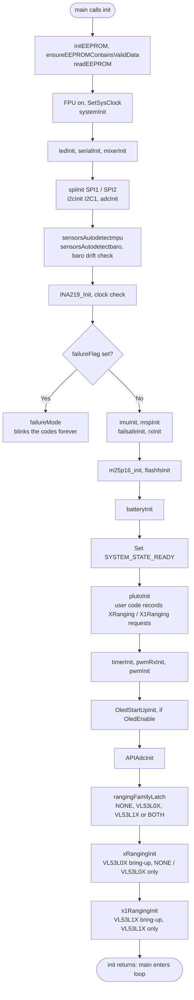
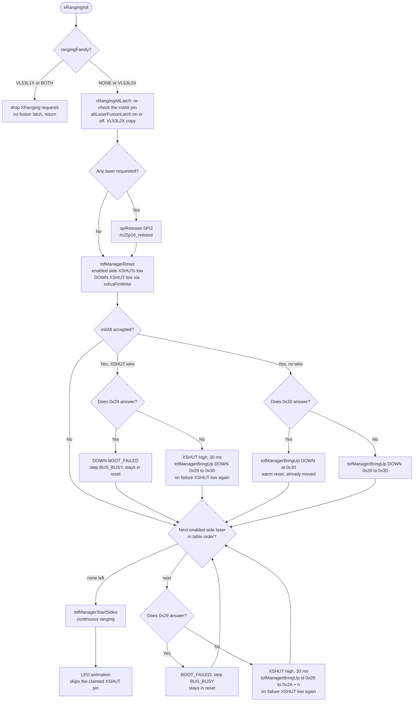
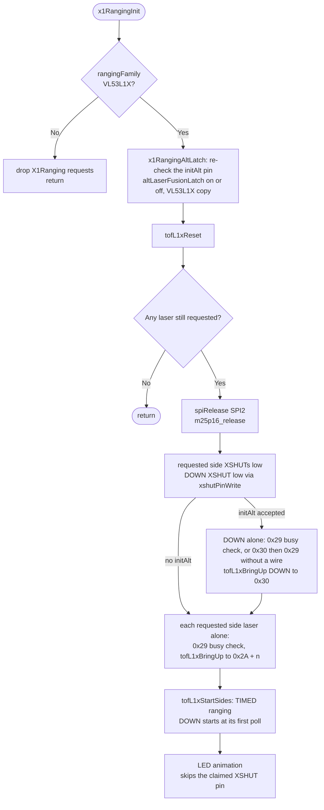
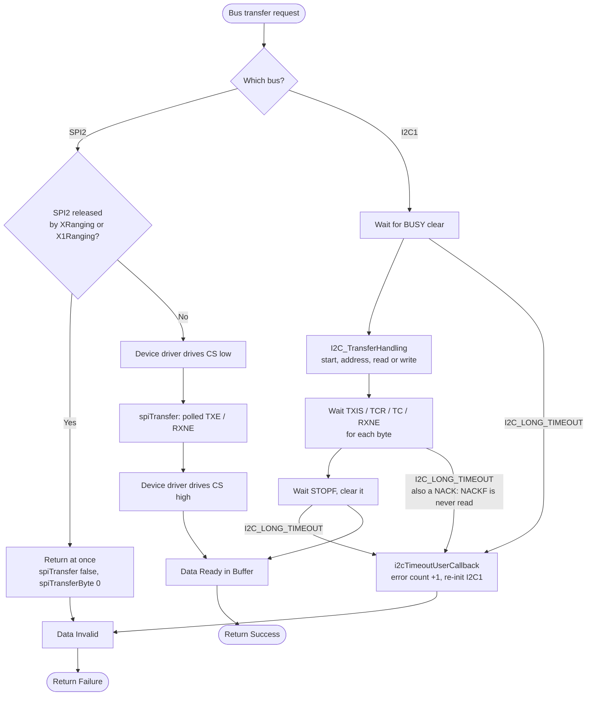
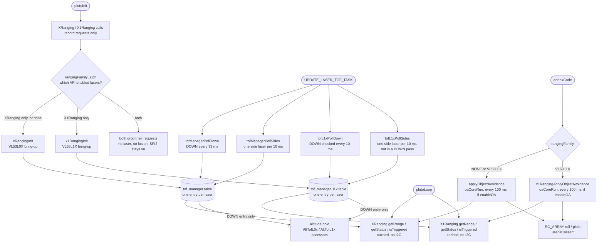
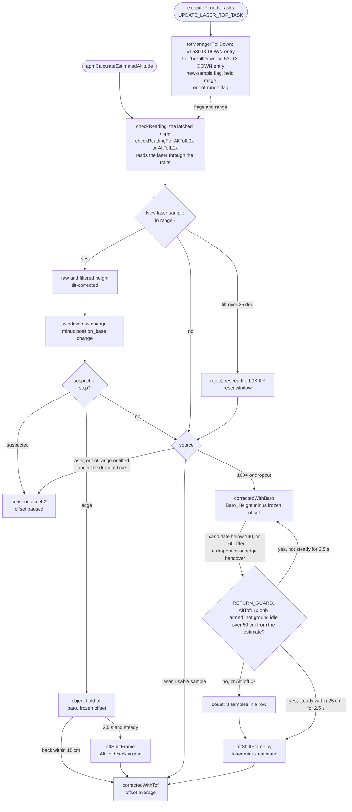

# PIPELINE_UPDATE: vl53l1x-xranging-api

Staged for commit. Targets in `fw-architecture-pipeline/`:

| Target | How | What changed |
|---|---|---|
| `subsystems/Main_Initialization.md` | full text below | The laser start-up is now `rangingFamilyLatch ( )` → `xRangingInit ( )` → `x1RangingInit ( )` after `plutoInit ( )` ( main.cpp:584-586 ). The family is NONE / VL53L0X / VL53L1X / BOTH, and with BOTH both APIs are refused. `ranging_init_L1 ( )` is gone. The boot flowchart loses the `LASER_TOF_L1x` branch. The `xRangingInit ( )` flowchart gains the family check, and a new flowchart shows `x1RangingInit ( )`. Every line is re-cited ( `main.cpp` and `XRanging.cpp` shifted ). |
| `subsystems/Hardware_Bus_Pipeline.md` | full text below | I2C1 carries the lasers of one family per boot: up to five VL53L1X at 0x30 / 0x2A + n through `tof_manager_l1x`, with at most one VL53L1X's I2C per pass. Also covered: the shared device area `tofDevArea`, BUS_BUSY for both families, SPI2 released by X1Ranging too ( and kept on with BOTH ), and the OLED call re-cited ( `mw.cpp:1168` ). The flowchart changes in one node label. |
| `subsystems/User_Space_API.md` | replacement blocks below | The XRanging section becomes **Laser ranging ( XRanging, X1Ranging )**: the family choice and the both-refused rule, the X1Ranging calls and timing, the OA dispatch by family, the `initAlt` refusal list without the `LASER_TOF_L1x` bullet, and a redrawn flowchart. Links `docs/API/X1RANGING_API_WIKI.md`. Three `mw.cpp` references are re-cited. |
| `subsystems/Altitude_Hold_Estimator.md` | replacement blocks below | X1Ranging + `tof_manager_l1x` replace `ranging_vl53l1x`. The family latch, the two compiled fusion copies ( `checkReadingFor<AltTofL0x / AltTofL1x>` ) and the `checkReading ( )` dispatch are new. The accessor table becomes the traits ( `tofFiltMm` / `tofRawMm` in mm, the body divides by 10 ) and the return guard becomes the trait `RETURN_GUARD`. The driver section is rewritten and both flowcharts are re-cited. |
| `Firmware_Pipeline.md` | **no change** | It names no laser API, driver or build define. "Execute Baro/ToF/Mag" still holds: `UPDATE_LASER_TOF_TASK` is one of the periodic tasks. |

No other file in `fw-architecture-pipeline/` mentions `LASER_TOF_L1x`, `LASER_ALT`, `ranging_vl53l1x`, `XVision`,
`ranging_init_L1`, `getRange_L1`, `NewSensorRange_L1` or `isTofDataNew_L1` ( grep, 19 Oct 2026 ). Task 11's other
files are already updated in place ( they are not pipeline docs ): `PIN_MAP.md`, `dev-guide/FLIGHT_INVARIANTS.md`,
`dev-guide/HARDWARE_RESOURCES.md`, the CLAUDE.md laser bullets and `.claude/skills/pluto-flighttest/SKILL.md`
( CHANGES.md task 11 ). `compile_commands.json` is left alone: it is a stale Linux-generated artifact ( decisions log ). The API wikis
( `docs/API/X1RANGING_API_WIKI.md`, `docs/API/XRANGING_API_WIKI.md` ) were written in task 8 ( FW 3.15.0, API 1.8.0 ).

**Size** ( PRIMUS_X2_v1, template `PlutoPilot.cpp` ): 122652 / 1316 / 19728, i.e. 121.0 KB flash and 20.5 KB RAM
( TESTING.md §4 ).

**Validated on hardware** ( `PRIMUS_X2_v1`, 1 down + 4 side VL53L1X, details in [TESTING.md](TESTING.md) §3 ):
- **log-3 and log-5** were flown on the no-flag build. All five lasers started. The laser hover held, and the
  160 / 140 cm handovers ran both ways with no movement at the frame shifts. OA pushed and braked with the right sign
  on all four sides ( log-3 ) and on FRONT ( log-5 ), and an ALT_HOLD landing was clean ( log-5 ).
- **log-4:** every laser was BOOT_FAILED after the log-3 crash, and the craft flew safely on the baro dropout path.

## Edge check

Every diagram edge below was checked against the working tree on 19 Oct 2026, from source lines. The knowledge graph
predates this topic: `graphify path` finds no node for `rangingFamilyLatch`, `tofL1xPollDown` and the other new
functions ( graph refresh is task 13 ). **137 edges** in total; the list of changed or re-cited edges is at the end of
this file ( **Edge evidence** ).

---

## Target: subsystems/Main_Initialization.md

````markdown
# Main Initialization (`init()` in `main.cpp`)

## Overview
When the STM32F3 MCU boots, `main()` immediately calls `init()`. This phase is critical for establishing the operational baseline of the flight controller: setting up hardware peripherals (clocks, DMA, timers), allocating necessary RAM, and probing the I2C/SPI buses to check sensor health before permitting flight.

## Source Files
- **Bootloader & Main Entry**: `src/main/main.cpp`
- **Hardware Bootstrap**: `src/main/drivers/system_stm32f30x.c`
- **EEPROM Storage**: `src/main/config/config.cpp`
- **Boot failure codes**: `src/main/drivers/system.c` ( `failureMode ( )` )
- **Laser start-up**: `src/main/API-Src/XRanging.cpp` ( `rangingFamilyLatch ( )`, `xRangingInit ( )` ), `src/main/API-Src/X1Ranging.cpp` ( `x1RangingInit ( )` ), `src/main/drivers/tof_manager.cpp` ( VL53L0X ), `src/main/drivers/tof_manager_l1x.cpp` ( VL53L1X ), `src/main/drivers/ranging_vl53l0x.cpp`, `src/main/drivers/tof_dev_area.cpp`

## Key Data Structures
- `masterConfig`: The globally loaded configuration structure read from EEPROM. Contains settings for sensors, PID tuning, and UART configurations.
- `hw_timer_t`: Timers instantiated for PWM/Motor output and system scheduling.
- `systemState`: boot progress bits ( `CONFIG_LOADED`, `SENSORS_READY`, `MOTORS_READY`, `READY` ). Only `HardFault_Handler ( )` reads it: it stops the motors once config and motors are ready. Nothing gates the loop on it.
- `failureFlag`: one bit per required device that failed ( IMU, barometer, baro drift at start-up, INA219, external clock ).
- `rangingFamily ( )` ( `API-Src/XRanging.cpp` ): the laser family of the run, latched once after `plutoInit ( )`: `RANGING_NONE`, `RANGING_VL53L0X` ( XRanging only ), `RANGING_VL53L1X` ( X1Ranging only ) or `RANGING_BOTH` ( both refused ).
- `tofTable`: one table per laser manager, `drivers/tof_manager.cpp` ( VL53L0X ) and `drivers/tof_manager_l1x.cpp` ( VL53L1X ). Each has one entry per laser ( LEFT, RIGHT, FRONT, BACK, EXTERNAL, DOWN ) with its own status, filled by that family's bring-up.
- `tofDevArea` ( `drivers/tof_dev_area.cpp` ): one RAM area for the ST device structs, a union of 6 × `VL53L0X_Dev_t` and 6 × `VL53L1_Dev_t` ( 5592 B ). Only the latched family's manager touches it ( `Hardware_Bus_Pipeline.md` ).

## Primary Functions
- `init()`: The master bootstrapping sequence.
- `systemInit()`: Initializes the ARM Cortex-M4 FPU, sets the core clock to 72MHz, and enables the SysTick timer for `millis()` and `micros()` timing.
- `readEEPROM()`: Loads user configurations. If the checksum fails or the firmware version differs, it executes a `resetEEPROM()` to load safe defaults.
- `sensorsAutodetectmpu()` / `sensorsAutodetectbaro()`: probe the IMU and the barometer. A failure sets its bit in `failureFlag`. After the INA219 and clock checks, a non-zero `failureFlag` halts the boot in `failureMode()`, which blinks the failure codes forever.
- `rangingFamilyLatch()`: records once which laser API user code enabled lasers with in `plutoInit()`.
- `xRangingInit()` / `x1RangingInit()`: the VL53L0X and VL53L1X bring-ups. Both are called once, near the end of `init()` after `plutoInit()`, and only the latched family's bring-up starts lasers. Only the UWB UART setup ( `localisationType == UWB` ) follows them.

## Data Flow & Boundaries
- **Blocking Boot**: The `init()` sequence is strictly synchronous. Only the required devices stop it: a missing IMU or barometer, a baro that drifts at start-up, a missing INA219 or the internal clock end in `failureMode()`. Other devices do not stop the boot. A laser that fails is marked BOOT_FAILED in its own `tofTable` entry ( `XRanging.getStatus ( )` / `X1Ranging.getStatus ( )` report it ), and the boot carries on. Nothing is retried.
- **I2C Bus Lockups**: A common initialization failure is a locked I2C bus. The boot sequence often toggles the SCL/SDA pins manually via GPIO to flush stalled sensor lines before initializing the hardware I2C peripheral.
- **`SYSTEM_STATE_READY` is not the last step.** It is set at main.cpp:509, after the battery init but **before** `plutoInit ( )`, the motor timers ( `timerInit ( )`, `pwmInit ( )` ), the OLED start-up, `APIAdcInit ( )` and the laser start-up. Nothing waits for it: the loop starts when `init ( )` returns ( main.cpp:620 ).
- **Laser family, after `plutoInit ( )`.** There is no build switch: one image drives either laser family. `XRanging` and `X1Ranging` calls in `plutoInit ( )` only record requests. A request counts when it enables a laser: `init`, `initObjectAvoidance` with a side laser, or an accepted `initAlt`. On all three targets, main.cpp:584-586 then run:
  1. `rangingFamilyLatch ( )`: NONE ( no request ), VL53L0X ( XRanging only ), VL53L1X ( X1Ranging only ) or BOTH.
  2. `xRangingInit ( )`: brings up the VL53L0X lasers for VL53L0X. For NONE it latches the fusion off and starts nothing. For VL53L1X or BOTH it drops XRanging's requests and returns.
  3. `x1RangingInit ( )`: brings up the VL53L1X lasers for VL53L1X. For any other family it drops X1Ranging's requests and returns.
- **Both APIs used ( BOTH ) → both refused.** Both bring-ups return before any pin or bus access. No laser starts and no XSHUT is driven. SPI2 and the flash stay on. Nobody latches the altitude-laser fusion, so the estimator stays on the baro ( τ 2 s ). Every getter of both APIs returns −1 / `LASER_NOT_ENABLED`, even after an `initAlt` that returned `true`, and object avoidance does not run.
- **One bring-up per family.** The VL53L0X and VL53L1X bring-ups follow the same order:
  1. **Latches** the down-laser request ( its pin re-checked ) and the altitude-laser fusion for the run.
  2. **Releases SPI2** if any laser is still requested.
  3. **Holds every requested laser in reset** ( XSHUT low ).
  4. **Brings up the down-laser alone** and moves it to 0x30.
  5. **Brings up the side lasers one at a time** and moves each to 0x2A + n.
  6. **Starts ranging** on the side lasers ( the VL53L1X down-laser starts at its first poll ).
  7. **Runs the LED animation.**

  Before each release, 0x29 must be silent; if it is not, that laser stays in reset ( BOOT_FAILED, step `BUS_BUSY` ). Each probe of an empty 0x29 costs one I2C timeout ( `Hardware_Bus_Pipeline.md` ). The VL53L1X bring-up also waits for the chip to boot ( up to 10 reads, 1 ms apart ) and moves its address before `VL53L1_DataInit` ( `Altitude_Hold_Estimator.md`, **VL53L1X down-laser** ).
- **SPI2 release.** SPI2's pins are GPIO_5-8, which both laser APIs use as XSHUT and LED pins. If any laser of the latched family is requested ( DOWN counts after the latch ), `spiRelease ( SPI2 )` and `m25p16_release ( )` run before any laser pin is touched:
  - SPI2 is switched off for the run, and the M25P16 flash reports size 0.
  - SPI calls in `plutoInit ( )` still work; from here on the user SPI API does nothing.
  - Without a laser, or with both APIs used, SPI2 and the flash stay as set up at main.cpp:313 and :445.

Boot order ( main steps; smaller ones are left out ):



The VL53L0X bring-up ( `xRangingInit ( )` ):



The VL53L1X bring-up ( `x1RangingInit ( )` ). The down-laser and side-laser steps are those of the VL53L0X chart, with
`tofL1xProbe` and `tofL1xBringUp`:


````

---

## Target: subsystems/Hardware_Bus_Pipeline.md

````markdown
# Hardware Bus Pipeline (I2C & SPI)

## Overview
The Hardware Bus abstraction layer acts as the physical communication bridge between the STM32F3 microcontroller and the onboard peripherals (IMUs, Barometers, Magnetometers, Time-of-Flight sensors). I2C is **polled**: every transaction busy-waits on the peripheral's status flags ( `I2C_LONG_TIMEOUT`, then a bus recovery on timeout ) and blocks the loop until it finishes. There is no I2C DMA or interrupt. Peripherals on the shared I2C1 bus must therefore budget their bytes per loop.

## Source Files
- **I2C Drivers**: `src/main/drivers/bus_i2c.h`, `src/main/drivers/bus_i2c_stm32f30x.c`, `src/main/drivers/bus_i2c_soft.cpp`
- **SPI Drivers**: `src/main/drivers/bus_spi.h`, `src/main/drivers/bus_spi.c`
- **Peripheral Setup**: `src/main/drivers/system_stm32f30x.c`
- **Laser bus use**: `src/main/drivers/tof_manager.cpp` ( VL53L0X polling ), `src/main/drivers/tof_manager_l1x.cpp`
  ( VL53L1X polling ), `src/main/API-Src/XRanging.cpp` ( `xRangingInit ( )` ) and `src/main/API-Src/X1Ranging.cpp`
  ( `x1RangingInit ( )` ): addresses, SPI2 release; `src/main/drivers/tof_dev_area.cpp` ( device structs )

## Key Data Structures
- `I2CDevice`: Enumerator representing the I2C buses ( `I2CDEV_1`, `I2CDEV_2` ). Every target uses `I2CDEV_1` ( `I2C_DEVICE` in `target.h` ).
- SPI buses are passed as `SPI_TypeDef *` ( `SPI1`, `SPI2` ). The three targets enable `SPI2` only ( `USE_SPI_DEVICE_2` ).
- `i2c1ErrorCount` / `i2c2ErrorCount`: one count of failed transfers per bus ( `i2cGetErrorCounter ( )` ). There is no error type: a NACK, a missing device and a stuck bus all end as a timeout.
- `tofDevArea` ( `drivers/tof_dev_area.cpp` ): `union tofDevArea_u { VL53L0X_Dev_t l0x [ 6 ]; VL53L1_Dev_t l1x [ 6 ]; }`,
  5592 B of `.bss`, the ST device structs of both laser managers. Only one family runs per boot
  ( `rangingFamily ( )` ), so the two tables share the RAM:
  - Each manager uses only its own member.
  - `tofManagerBringUp ( )` / `tofL1xBringUp ( )` return false unless the latched family is theirs.
  - Every later access ( polls, start ) needs the entry's status OK, which only that bring-up sets.
  - The status tables are separate, outside the union. With NONE or BOTH no member is touched.

## Primary Functions
- `i2cInit()` / `spiInit()`: configure the GPIO alternate functions and clock speeds for the bus. I2C uses no DMA. `spiInit ( SPI2 )` returns false once SPI2 is released.
- `i2cRead()` / `i2cWrite()` / `i2cWriteBuffer()`: blocking, polled I2C transactions at 400 kHz
  ( `I2C_Timing` 0x00E0257A ). A byte costs ~25 µs on the wire plus per-transaction overhead.
- `spiTransfer()` / `spiTransferByte()`: synchronous, polled SPI exchange ( TXE / RXNE, 1000-count timeout ). On these targets SPI2 carries the M25P16 flash and the user SPI API; the IMU is on I2C1. On a released SPI2 they return at once ( `false` / 0 ).
- `spiRelease ( SPI2 )` / `spiIsReleased ( )`: switch SPI2 off for the rest of the run ( see below ).

## Data Flow & Boundaries
- **I2C errors ( limitation )**: the driver never reads the NACK flag ( NACKF ). A device that does not acknowledge
  ( absent, held in reset, wrong address ) only leaves the flag the driver waits for unset. The transfer therefore
  costs the full `I2C_LONG_TIMEOUT` ( 10 × 0x1000 polling counts ). Then `i2cTimeoutUserCallback ( )` counts the
  error and re-initialises the I2C1 peripheral ( disable, clear flags, enable, `i2cInitPort ( )` ). The caller gets
  false and cannot tell a NACK from a stuck bus. Each probe of an absent device stalls the loop for one timeout. The
  laser bring-up probes for absent devices at most 7 times ( 6 at 0x29, 1 at 0x30 for a down-laser without an XSHUT wire ), at boot only. A VL53L1X that is enabled but does not answer also costs
  up to 10 timeouts in its boot wait ( `tofL1xWaitBooted ( )` ), at boot only.
- **SPI Constraints**: SPI is polled like I2C. The clock is bounded by the device ( `spiSetDivisor ( )` ).
- **Shared I2C1 budget**: the IMU ( ICM-20948 ), barometer, magnetometer, INA219, the OLED ( 0x3C ) and the lasers
  ( VL53L0X or VL53L1X, one family per boot ) share I2C1 inside the gated loop.
  The OLED never writes the panel from the loop directly. Drawing goes to a 1 KB RAM framebuffer, and
  `oledFlushStep ( )` ( called from `OledDisplayData ( )`, `mw.cpp:1168` ) sends at most **one run of up to 16 changed
  bytes per loop** ( ~0.6 ms ), and only while the frame differs from what the panel shows. The old per-byte
  writes ( ~630 transactions, 45-60 ms every 200 ms ) made the drone twitch at 5 Hz
  ( [oled-flight-wobble](../../active-development/oled-flight-wobble/README.md) ).
- **Laser addresses on I2C1**: every VL53L0X and every VL53L1X boots at 0x29. The bring-up of the latched family
  ( `xRangingInit ( )`, main.cpp:585, or `x1RangingInit ( )`, main.cpp:586 ) moves each laser while it is alone on
  the bus:
  - the down-laser goes to **0x30**;
  - each side laser goes to **0x2A + n**, where n counts the enabled side lasers before it in table order ( LEFT, RIGHT,
    FRONT, BACK, EXTERNAL ).

  With either family, 0x29 is in use only during the bring-up, with one exception. A fitted laser that is not enabled
  stays awake at 0x29, and every release after it is refused ( `BUS_BUSY`: `vl53l0xProbe ( 0x29 )` or
  `tofL1xProbe ( 0x29 )` answers ). The two families cannot share the bus. Both boot at 0x29, the VL53L0X probe cannot
  see a VL53L1X, and the VL53L1X probe's 16-bit index would write a register of a VL53L0X. User code that enables
  lasers through both APIs gets no laser at all ( `RANGING_BOTH` ). A user I2C device must not use 0x29-0x2E or 0x30
  while lasers are fitted.
- **Laser I2C load**: `UPDATE_LASER_TOF_TASK` calls both managers on every pass ( `mw.cpp:850-858` ). The manager of
  the family that is not latched has no laser up and returns without I2C.
  - **VL53L0X:** the down-laser every 33 ms ( start + read ), and one side laser per 10 ms: a data-ready read, plus the
    result read and the interrupt clear only when a sample is ready. The worst laser-task call measured 1.9-2.2 ms
    ( one down read plus one side read ), and the mean was 13 µs
    ( [tof-single-pipeline TESTING.md](../../active-development/tof-single-pipeline/TESTING.md), test 3 ).
  - **VL53L1X:** `tofL1xPollDown ( )` every 10 ms makes a 1-byte data-ready read. Only when a result is ready ( one
    per 50 ms ) does it add the 17-byte result read and a 1-byte interrupt clear. Its first poll also starts the
    measurement. `tofL1xPollSides ( )` serves one side laser per 10 ms the same way, and it skips any pass in which
    the down poll used the bus. So one pass carries at most one VL53L1X's I2C: one data-ready read plus at most one
    result read. A result read costs ~0.79 ms at 400 kHz, as measured on the former single-laser driver, whose read
    path the down poll keeps line for line.

  Readers ( `XRanging.getRange ( )`, `X1Ranging.getRange ( )`, object avoidance, altitude hold ) use the cached
  sample and make no I2C call.
- **Laser errors**: each laser has its own status in its manager. A failed read marks only that laser I2C_ERROR, and it
  is not polled again until the next restart.
- **SPI2 is off whenever XRanging or X1Ranging starts lasers**: SPI2's pins are GPIO_5-8 ( PB15 MOSI, PB14 MISO, PB13
  SCK, PB12 NSS / flash CS ), and both laser APIs use them as XSHUT and LED pins. If any laser of the latched family
  is requested, `xRangingInit ( )` or `x1RangingInit ( )` calls `spiRelease ( SPI2 )` and `m25p16_release ( )` before
  it touches a laser pin:
  - SPI2 is disabled and its clock stopped.
  - Pins still in SPI2's alternate function ( AF5 ) become pulled-up inputs. Pins user code already took in
    `plutoInit ( )` are left alone, and PB12 is not touched.
  - From then on `spiInit ( SPI2 )` fails, SPI2 transfers return at once, the flash reports size 0 and the user SPI
    API does nothing.

  Without lasers, and with both APIs used ( no laser starts ), SPI2 and the flash are unchanged.
- **OLED failure**: if the panel stops answering ( 3 failed runs in a row, or more than ~1 in 5 failing ), the
  OLED is switched off, so a loose connector cannot keep stalling the loop. The 2 s start-up splash still writes
  the panel directly, at boot only.


````

---

## Target: subsystems/User_Space_API.md

Replacement blocks. The line numbers refer to the current committed doc ( 212 lines ). Apply them from the bottom up,
so earlier line numbers stay valid. Everything not named here stays as it is.

### U1. Line 10 ( Source Files: Laser ranging )

Replace the line with:

````markdown
- **Laser ranging**: `src/main/API/XRanging.h`, `src/main/API-Src/XRanging.cpp` ( VL53L0X, behind it
  `src/main/drivers/tof_manager.cpp` ); `src/main/API/X1Ranging.h`, `src/main/API-Src/X1Ranging.cpp` ( VL53L1X, behind
  it `src/main/drivers/tof_manager_l1x.cpp` ); object avoidance for both: `src/main/API-Src/ObjectAvoidanceCore.h`
````

### U2. Lines 17, 20, 33 and 43 ( line references and `plutoInit` )

- Line 17: replace `mw.cpp:1500` with `mw.cpp:1509` ( `executeCommand ( )` ).
- Line 33: replace `mw.cpp:387` with `mw.cpp:390` and `:1399` with `:1410` ( the two `landThrottle` writes ).
- Line 43: replace `mw.cpp:1226` with `mw.cpp:1235` ( `dropUserTakeOff ( )` ).
- Line 20: replace the line with:

````markdown
- `plutoInit()`: Called once during boot by `init()` ( main.cpp:524 ), after `SYSTEM_STATE_READY` and before the motor timers and the laser start-up. Used by the developer to configure GPIOs, external sensors, or set up API timers. `XRanging` and `X1Ranging` calls here only record requests; the laser family is chosen and the lasers start after `plutoInit()` returns.
````

### U3. Lines 61-62 ( Data Flow: Laser ranging )

Replace the two lines with:

````markdown
- **Laser ranging**: `XRanging` ( VL53L0X ) and `X1Ranging` ( VL53L1X ) requests are made in `plutoInit ( )` and
  fixed at boot. The API that enables lasers chooses the laser family; enabling lasers through both refuses both.
  Reads return cached values. Starting lasers switches SPI2 off. See **Laser ranging** below; wikis
  `docs/API/XRANGING_API_WIKI.md` and `docs/API/X1RANGING_API_WIKI.md`.
````

### U4. Lines 151-212 ( the XRanging section and its flowchart, to the end of the file )

Replace with:

````markdown
## Laser ranging ( XRanging, X1Ranging ) and object avoidance

Up to six lasers on I2C1: four side lasers, EXTERNAL and the downward altitude laser ( `DOWN` ), all VL53L0X or all
VL53L1X. `XRanging` ( `API/XRanging.h` ) drives VL53L0X lasers, `X1Ranging` ( `API/X1Ranging.h` ) VL53L1X lasers.
Both have the same calls, the same `laser_e` / `laser_status_e` and the same pins. Full references, examples and
wiring rules: [XRANGING_API_WIKI.md](../../../API/XRANGING_API_WIKI.md) and
[X1RANGING_API_WIKI.md](../../../API/X1RANGING_API_WIKI.md) ( API 1.8.0 ).

**Choosing the family.** There is no build switch. The API whose calls enable lasers in `plutoInit ( )` chooses:
`init`, `initObjectAvoidance` with a side laser, or an accepted `initAlt`. Reads and `enableOA` / `disableOA` do not
count. `rangingFamilyLatch ( )` records the choice once, after `plutoInit ( )`.

| `plutoInit ( )` enables lasers through | Lasers started | Altitude hold with `initAlt` | Object avoidance |
|---|---|---|---|
| `XRanging` only | VL53L0X ( `xRangingInit ( )` ) | VL53L0X fusion copy | `applyObjectAvoidance ( )` |
| `X1Ranging` only | VL53L1X ( `x1RangingInit ( )` ) | VL53L1X fusion copy | `x1RangingApplyObjectAvoidance ( )` |
| neither | none | barometer | `applyObjectAvoidance ( )` ( no laser ) |
| **both** | **none: both refused** | barometer | none |

With both, every request of both APIs is dropped at start-up, even an `initAlt` that returned `true`. The getters
return −1 / `LASER_NOT_ENABLED`, no XSHUT is driven, and SPI2 and the flash stay on.

| Call | Where | What it does |
|---|---|---|
| `initAlt ( gpio )` / `initAlt ( )` | `plutoInit ( )` only | Requests the down-laser and the altitude-laser fusion ( the estimator then corrects on the laser below 160 cm ). `gpio` is the pin wired to its XSHUT; `initAlt ( )` is for a down-laser with no XSHUT wire. Returns `false` when refused. |
| `init ( )` / `init ( laser, threshold_cm )` | `plutoInit ( )` | Enables the four side lasers ( threshold 20 cm ), or one side laser with its own threshold. |
| `initObjectAvoidance ( dist_cm, l1 … l4 )` | `plutoInit ( )` | Enables up to four side lasers and sets the avoidance distance. OA stays off until `enableOA ( )`. Unused arguments default to `DOWN`, which is ignored. `EXTERNAL` is started but never avoided. |
| `enableOA ( )` / `disableOA ( )` | any time | Turns object avoidance on or off; `disableOA` also turns the laser LEDs off. |
| `getRange ( laser )` | any time | The cached range in mm. −100 when the laser has no valid sample or is not running, −1 when it was not enabled. `DOWN` is allowed. |
| `isTriggered ( laser )` | any time | A side laser's range is below its threshold; drives that laser's LED. |
| `getStatus ( laser )` | any time | `LASER_OK`, `LASER_OUT_OF_RANGE`, `LASER_BOOT_FAILED`, `LASER_I2C_ERROR` or `LASER_NOT_ENABLED`, per laser, `DOWN` included. |

Rules:
- **Requests are fixed at boot.** The latched family's bring-up starts every requested laser once, after
  `plutoInit ( )` ( see `Main_Initialization.md` ). A laser enabled later is not started. A laser that fails, at boot or
  in flight, is not retried until the next restart; the others carry on.
- **Reads are cached.** `UPDATE_LASER_TOF_TASK` polls the chips; `getRange`, `isTriggered` and `getStatus` read the
  cached entry and make no I2C call, so they are safe in `plutoLoop ( )`.
  - **VL53L0X:** DOWN every 33 ms, one side laser per 10 ms in round-robin ( each of four side lasers every ~40 ms ).
  - **VL53L1X:** every laser measures every 50 ms ( Medium mode, 45 ms budget ). DOWN is checked every 10 ms. One side
    laser is checked per 10 ms, never in the pass of a DOWN check, so each of four or five side lasers is updated
    about every 50 ms ( paced, not guaranteed ).
  - **VL53L1X status timing:** DOWN reads `LASER_OUT_OF_RANGE` until its first sample. A side laser reads `LASER_OK`
    with range −100 for up to 160 ms after start-up, before its first sample. No new sample for 160 ms, a range under
    15 mm, or one at 4500 mm or more, reads out of range.
- **Object avoidance runs from `annexCode ( )`**, every 100 ms while `enableOA ( )` is on, whether or not user
  code runs. `annexCode ( )` calls the wrapper of the latched family, and both wrappers run one shared core
  ( `oaCoreRun`, `API-Src/ObjectAvoidanceCore.h` ) with per-API state. It overrides roll and pitch ( `RC_ARRAY`, pilot
  authority 0 through `userRCassert`; the pilot's stick is blended in at 30 % / 20 % ). A laser that is not OK or
  OUT_OF_RANGE counts as "no obstacle" at once. An OUT_OF_RANGE side keeps its last distance for 2 ticks and is
  cleared on the 3rd in a row ( `OA_OOR_CLEAR_TICKS` ), so a removed obstacle is released within ~300 ms. The first
  valid sample after a clear seeds the side's filter.
- **`initAlt` is refused** ( both APIs, the same pin table and checks ) in these cases:
  - outside `plutoInit ( )`, i.e. once the bring-up has run;
  - for an invalid pin, or any side laser's XSHUT pin ( GPIO_7, 9, 16, 15, 14 );
  - for an RGB-LED slot or UART2 pin ( GPIO_1, 3, 6, 10, 11, 12, 13, 16, 17, 18 ): those drivers can take the pin after start-up;
  - when the pin's ADC or PWM alias is in use ( GPIO_5 = ADC_2 / PWM_4 ). This is checked again after `plutoInit ( )`;
    a request refused there leaves the firmware on the baro.

  A refused call keeps an earlier accepted request. `init` and `initObjectAvoidance` take side lasers only. An
  accepted request is still dropped at start-up if the other API enables a laser too ( both refused ).
- **The down-laser's XSHUT pin is claimed.** After the bring-up starts, `Peripheral_Init` / `Peripheral_Write` on that
  pin, and `Peripheral_Init` on its ADC or PWM alias, are ignored ( either API's down-laser ). No LED write reaches it
  either: on this board GPIO_5 is FRONT's LED and GPIO_8 BACK's, so `initAlt ( GPIO_5 )` leaves FRONT without an LED and
  `initAlt ( GPIO_8 )` BACK. The side lasers' XSHUT pins are not claimed.
- **Every fitted laser must be enabled.** A fitted side laser that is not enabled stays awake at 0x29. Every release
  after it is then refused ( `LASER_BOOT_FAILED`, step `BUS_BUSY` ), the down-laser included.
- **SPI2 is off whenever lasers are started.** GPIO_5-8 are SPI2's pins. SPI calls made in `plutoInit ( )` work; from
  the bring-up on, the SPI API does nothing ( `SPI_Read` returns 0 ) and the on-board flash reports size 0.
- **No side laser reaches altitude hold.** Only the DOWN entry of the latched family feeds the estimator.


````

---

## Target: subsystems/Altitude_Hold_Estimator.md

Replacement blocks. The line numbers refer to the current committed doc ( 512 lines ). Apply them from the bottom up,
so earlier line numbers stay valid. Everything not named here stays as it is: the barometer chain, setpoint shaping,
the fusion constants and handover, the object hold-off, the known VL53L1X limits and the flip interaction. No fusion
constant changed, and both fusion copies are instruction-identical to the code they replace.

### A1. Line 4 ( Overview )

Replace the line with:

````markdown
Fuses barometric pressure (and, with a down-laser, laser Time-of-Flight: a VL53L0X switched on at boot by `XRanging.initAlt ( )`, or a VL53L1X switched on by `X1Ranging.initAlt ( )`) with the accelerometer's Z-axis to estimate altitude and vertical velocity. When `ALT_HOLD` mode is active, it takes over the throttle channel to hold or smoothly change height.
````

### A2. Lines 9-12 ( Source Files: Laser )

Replace the four lines with:

````markdown
- **Laser** ( one down-laser, used by the estimator only while the laser fusion is on, `altLaserFusion ( )` ):
  - **VL53L0X:** the DOWN entry of `src/main/drivers/tof_manager.cpp` / `.h` ( 33 ms single ranging, start + read, a 0.1 IIR of samples < 2000 mm, address 0x30 ). The per-device helpers are in `src/main/drivers/ranging_vl53l0x.cpp` / `.h`. The bring-up is `xRangingInit ( )` in `src/main/API-Src/XRanging.cpp`. User code turns it on with `XRanging.initAlt ( )` in `plutoInit ( )`.
  - **VL53L1X:** the DOWN entry of `src/main/drivers/tof_manager_l1x.cpp` / `.h` ( Medium mode, 45 ms budget, 50 ms period, no filter, address 0x30 ). The bring-up is `x1RangingInit ( )` in `src/main/API-Src/X1Ranging.cpp`. User code turns it on with `X1Ranging.initAlt ( )` in `plutoInit ( )`.
  - **Laser family:** `rangingFamilyLatch ( )` ( `src/main/API-Src/XRanging.cpp` ) records once, after `plutoInit ( )`, which API enabled lasers. Only that family's bring-up runs. If both APIs enabled lasers, neither runs and the estimator stays on the baro.
  - **Device structs:** both managers keep them in one union, `src/main/drivers/tof_dev_area.cpp` / `.h`; only the latched family touches it.
  - **No build switch.** `altitudehold.cpp` stops the build with an `#error` if `LASER_TOF`, `LASER_ALT` or `LASER_TOF_L1x` is defined.
````

### A3. Lines 29-34 ( Primary Functions: `checkReading` to "What it selects" )

Replace the six lines with:

````markdown
- `checkReading()` ( laser fusion on ): runs the fusion copy of the latched family, `checkReadingFor<AltTofL0x>()` or `checkReadingFor<AltTofL1x>()`. Each estimator step the copy chooses the correction source: `correctedWithTof()` on the laser, `correctedWithBaro()` with a frozen offset on the baro or during an object hold-off, or no correction ( coast ) during a short gap or a suspected edge. One template body serves either laser; it reads the sensor only through a traits struct ( constants and accessors ). See **Laser fusion** below.
- `correctedWithTof()`: position error against the filter's own `_position_z`; one time constant `ALT_EST_TAU_S` 1.5 s for both sources while the fusion is on.
- `altLaserFusion()` / `altLaserFusionLatch ( on, vl53l1x )`: the boot-latched fusion flag, and the family whose copy runs.
  - **Who latches it:** once, after `plutoInit ( )`. `xRangingInit ( )` latches `( accepted XRanging.initAlt, false )` for the NONE or VL53L0X family, and `x1RangingInit ( )` latches `( accepted X1Ranging.initAlt, true )` for the VL53L1X family. With both APIs used nobody latches it, and the fusion stays off. The first call wins. When it turns on, τ becomes 1.5 s and the gains are recomputed.
  - **What it selects:** `checkReading ( )` or `checkBaro ( )`; τ; the accel-Z deadband ( `imu.cpp` ); and the take-off height ( `command.cpp`: absolute with the laser, relative to the arming height on the baro ).
````

### A4. Lines 83 and 85 ( line references; this topic moved them )

In line 83 replace `altitudehold.cpp:1440` with `altitudehold.cpp:1469`. In line 85 replace `` `:1447` `` with
`` `:1476` ``. The text is unchanged.

### A5. Lines 136-185 ( Laser fusion: heading to the end of the validity table )

Replace from the heading through the end of the validity table ( line 185 ) with:

````markdown
## Laser fusion (`altLaserFusion ( )`: `XRanging.initAlt ( )` for the VL53L0X, `X1Ranging.initAlt ( )` for the VL53L1X)

With a downward laser, altitude hold means height above the surface under the craft: gentle
terrain is followed. `checkReading()` decides each estimator step what corrects the complementary
filter. The fusion runs while `altLaserFusion ( )` is true. The flag is latched once at boot, after `plutoInit ( )`,
from an accepted `initAlt` of the API user code used, and it never changes while the craft runs. Without `initAlt`,
with a refused one, or with both APIs used, the estimator is exactly the baro build.

**Laser family.** There is no build switch: one image drives either laser. `rangingFamilyLatch ( )`
( `main.cpp:584` ) records which API enabled lasers in `plutoInit ( )`: `init`, `initObjectAvoidance` with a side
laser, or an accepted `initAlt`.

| Family | When | Bring-up | Fusion latch |
|---|---|---|---|
| `RANGING_NONE` | no laser requested | none | off, by `xRangingInit ( )` |
| `RANGING_VL53L0X` | XRanging only | `xRangingInit ( )` | `( initAlt accepted, false )`, by `xRangingInit ( )` |
| `RANGING_VL53L1X` | X1Ranging only | `x1RangingInit ( )` | `( initAlt accepted, true )`, by `x1RangingInit ( )` |
| `RANGING_BOTH` | both | none: both APIs drop their requests | none: the fusion stays off ( τ 2 s ) |

Only one down-laser can be fitted, and only one family runs per boot, because both would write the same estimator
state.

**Two compiled copies.** The fusion body is a template, `checkReadingFor<T> ( )` ( `noinline` ), compiled once per
laser: `T` is `AltTofL0x` or `AltTofL1x`. `checkReading ( )` runs the copy that `altLaserFusionL1x` names. The helpers
are templates too ( `altShiftFrame<T>`, `tofWindowReset / Push / Mismatch<T>` ), and each copy has its own statics
and window ring ( 24 / 14 entries ). Some state is shared, because only one copy runs per boot: `altSourceLaser`,
`altStepPending`, `ToF_Height`, the baro values and the frame values. Each copy is instruction-identical to the fusion
it replaces. The VL53L0X copy matches the former XRanging build, and the VL53L1X copy the former `LASER_TOF_L1x` +
`LASER_ALT` build ( [vl53l1x-xranging-api CHANGES.md](../../active-development/vl53l1x-xranging-api/CHANGES.md),
task 17 ). The second copy costs ~2.7 KB of flash and 232 B of RAM.

**A down-laser that fails to start still runs the fusion.** An accepted `initAlt` turns the fusion on even if the
laser then ends BOOT_FAILED: no answer, a failed init step, or 0x29 busy at its release ( `BUS_BUSY` ). Then:
- the estimator starts on the laser source, finds no usable sample, and hands over to the baro on its first tick
  ( `ALT_TOF_DROPOUT_MS` has already passed since boot );
- it stays on the baro with the frozen offset;
- it keeps the laser tuning: τ 1.5 s, accel-Z deadband 0, absolute take-off height;
- `getStatus ( DOWN )` of that API reports the failure.

**No side laser reaches the estimator.** Every laser has its own entry in its family's manager ( `drivers/tof_manager`,
`drivers/tof_manager_l1x` ). The side lasers are polled into their own entries, and the estimator's accessors read
the DOWN entry only.

**Sensor interface.** The body reads the sensor only through its traits struct, `AltTofL0x` or `AltTofL1x`
( `altitudehold.cpp:193-256` ). Each has the per-sensor constants as `static constexpr` members, six `always_inline`
accessors and the switch `RETURN_GUARD`. The range accessors return mm; the body divides by 10 before the tilt
correction ( `( float ) T::tofFiltMm ( ) / 10.0f` ).

| Accessor | Meaning | `AltTofL0x` ( `tof_manager`, DOWN entry ) | `AltTofL1x` ( `tof_manager_l1x`, DOWN entry ) |
|---|---|---|---|
| `tofNew()` | a new result is waiting | `tofDownNew()` | `tofL1xDownNew()` |
| `tofClearNew()` | mark it consumed | `tofDownClearNew()` | `tofL1xDownClearNew()` |
| `tofOutOfRange()` | no valid reading now | `tofDownOutOfRange()`: the last sample was invalid, **or DOWN's status is not OK** | `tofL1xDownOutOfRange()`: the last result was invalid, **or DOWN's status is not OK**, or no result for `L1X_STALE_MS` |
| `tofReseed()` | restart the driver's range filter | `tofDownReseed()` | nothing ( no filter ) |
| `tofFiltMm()` | filtered range, mm, before the tilt correction | `tofDownFiltMm()` ( the 0.1 IIR ) | `tofL1xDownRangeMm()`: the last valid range |
| `tofRawMm()` | unfiltered range, mm | `tofDownRawMm()` | `tofL1xDownRangeMm()` ( the same value ) |
| `RETURN_GUARD` | baro → laser return guard | `false` | `true` |

`tofL1xDownRawMm()` is the last result unchecked ( a covered window reads 0-10 mm ); it is for diagnostics only and
never feeds the fusion.

The down polls ( `tofManagerPollDown ( )` / `tofL1xPollDown ( )`, from `UPDATE_LASER_TOF_TASK` ) keep the former
drivers' values on the success path. The VL53L0X poll keeps the same 33 ms start + read, IIR, rounding, `< 2000 mm`
test and reseed. The VL53L1X poll keeps the same 10 ms data-ready poll, result read, decode and validity test as the
former `getRange_L1 ( )`.

What counts as a valid reading is decided in each manager:

| | VL53L0X | VL53L1X |
|---|---|---|
| Valid sample | range status 0 and < 2000 mm | range status 0 and `L1X_MIN_VALID_MM` 15 ≤ range < `L1X_MAX_VALID_MM` 4500 mm |
| Held range | the DOWN entry's IIR of valid samples ( `tofDownFiltMm()` ) | `tofL1xDownRangeMm()`: the last valid sample, kept across invalid results |
| `tofOutOfRange()` also true | while DOWN's status is not OK: not started, BOOT_FAILED, or I2C_ERROR after a failed read ( never retried ) | while DOWN's status is not OK ( not started, BOOT_FAILED, I2C_ERROR; never retried ), and when no new result came for `L1X_STALE_MS` = 3P + 10 = 160 ms ( also before the first result ) |
````

### A6. Lines 209-211 ( Per-sensor constants paragraph )

Replace the three lines with:

````markdown
**Per-sensor constants.** P is `L1X_SAMPLE_PERIOD_MS`, 50 ms by default ( `drivers/tof_manager_l1x.h` ). The
constants are `static constexpr` members of `AltTofL0x` / `AltTofL1x`, with the names of the former macros. The
VL53L1X counts and times are derived from P ( with `static_assert`s on the steady count, the ring span and the
dropout against `L1X_STALE_MS` ), so a target that overrides the period gets consistent values.
````

### A7. After line 269 ( end of the return guard's "Way out" paragraph )

Add:

````markdown

The guard is compiled into the VL53L1X copy only: `if constexpr ( T::RETURN_GUARD )`, and `AltTofL0x` has
`RETURN_GUARD` false. The VL53L0X copy has no guard code.
````

### A8. Lines 319-399 ( the VL53L1X driver section, the laser fusion flowchart and its edge comment )

Replace with:

````markdown
**VL53L1X down-laser** ( `drivers/tof_manager_l1x.cpp` / `.h`, through `X1Ranging` ).

- **Bring-up** ( `tofL1xBringUp ( )`, from `x1RangingInit ( )` after `plutoInit ( )`, VL53L1X family only ): DOWN is
  released alone and moved from 0x29 to 0x30 before the side lasers ( `Main_Initialization.md` ). Its steps, each only
  if the previous one succeeded:
  1. A bounded boot wait: up to 10 reads of `FIRMWARE__SYSTEM_STATUS`, 1 ms apart, because this platform's
     `VL53L1_WaitDeviceBooted` does not wait.
  2. The model ID check ( 0xEACC ).
  3. The address move, **before** `VL53L1_DataInit`, because `StartMeasurement` rewrites the address register from the
     NVM copy that `DataInit` reads.
  4. `StaticInit`.
  5. Medium distance mode, 45 ms timing budget, 50 ms inter-measurement period ( TIMED ranging ).
  6. The `TUNING_PROXY_MIN` read-back.

  A failure leaves DOWN BOOT_FAILED with its step and ST error ( `X1Ranging.getStatus ( DOWN )` ). The mode, budget
  and period are target-overridable ( `L1X_DISTANCE_MODE`, `L1X_TIMING_BUDGET_US`, `L1X_SAMPLE_PERIOD_MS` ). A
  `static_assert` requires period ≥ budget + 5 ms: ST refuses to start below budget + 4 ms, and the laser would stay
  failed for the flight.
- **DOWN starts at its first poll.** `tofL1xPollDown ( )` runs from `UPDATE_LASER_TOF_TASK` every 10 ms, and its first
  poll starts the measurement, as the former driver did. Each poll reads data-ready. On a new result the driver reads
  the 17-byte result block ( 0x0089-0x0099 ), clears the interrupt ( a 1-byte `SYSTEM__INTERRUPT_CLEAR` write ) and
  decodes the range status and range locally with the ST API's own mapping and arithmetic. It does not use
  `VL53L1_GetRangingMeasurementData` + `VL53L1_ClearInterruptAndStartMeasurement`. A sample poll costs ~0.79 ms of
  blocking I2C at 400 kHz ( 5.44 ms with the ST calls ), once per 51-53 ms ( measured on the former driver, whose read
  path this poll keeps line for line ). The LL driver's own stream-count state is left stale on purpose ( it is only
  checked in back-to-back mode ). A `VL53L1_SetDistanceMode()` after start would no longer be applied; nothing calls
  it at runtime.
- **Limit checks on the device:** sigma 90 mm and minimum signal 1.5 MCPS, the preset tuning of
  both Medium and Long. They overwrite the 18 mm / 0.25 MCPS set by `VL53L1_DataInit`.
- **Measured reach** ( matt floor, Medium 45 / 50 ): 100 % valid to ~1.8 m, 50 % at ~1.95 m, ~0 above
  2.1 m ( status 2, signal fail ). Long mode gave no more reach: at 95 / 100 ms it stopped at the same
  ~1.8-2.0 m, and at 45 / 50 ms it was worse than Medium ( wrap-target fails, 1 % valid at a 20° tilt ).
  The likely limit is the 1.5 MCPS minimum signal.
- **On the ground** the craft reads 25-28 mm ( valid ); a covered window reads 0-10 mm with status 0,
  which the 15 mm minimum rejects.
- **An error stops the laser for the run.** A failed start sets DOWN BOOT_FAILED. A failed data-ready read or result
  read sets it I2C_ERROR, and so does a failed interrupt clear, after its sample is recorded. `tofL1xDownOutOfRange()`
  then stays true and the estimator stays on the baro until the next restart. This is a safe fallback; a recovery path is
  a follow-up.
- **Negative ranges.** `VL53L1_TUNING_PROXY_MIN` ( -30 mm ) is read at bring-up. A valid result below it
  becomes invalid; one between it and 0 is clamped to 0, as the ST API does, and the 15 mm minimum then
  rejects it.
- **Public state:** each entry counts its results ( `samples`, valid or not ), and `tofL1xLastSampleMs ( id )` is
  `millis()` at the last result ( the staleness test ).
- **Build check scope.** `tof_manager_l1x.cpp` is compiled in every build, so a bad `L1X_SAMPLE_PERIOD_MS` /
  `L1X_TIMING_BUDGET_US` override in a target breaks every build of that target.
- **Side lasers** get the same set-up at 0x2A + n and start TIMED ranging together after the last bring-up. They are
  read for `X1Ranging` and object avoidance only ( `User_Space_API.md` ).
- **Removed:** `drivers/ranging_vl53l1x.cpp` / `.h`: `ranging_init_L1()`, `getRange_L1()`, the `*_L1` globals and the
  unused `LaserSensor_L1` class ( `XVision`, 964 B of RAM ).



<!-- Edge sources ( 19 Oct 2026, source lines; the graph predates drivers/tof_manager_l1x ):
Task -> Drv: mw.cpp:850-858 executePeriodicTasks ( ) UPDATE_LASER_TOF_TASK calls tofManagerPollDown ( ) ( :854 ) and
  tofL1xPollDown ( ) ( :857 ) on every pass.
Est -> Tick: altitudehold.cpp:968-969 ( if ( altLaserFusion ( ) ) checkReading ( ) ); checkReading ( ) :1360-1366 runs
  checkReadingFor<AltTofL1x> ( ) if altLaserFusionL1x, else checkReadingFor<AltTofL0x> ( ).
Drv -.-> Tick: tof_manager.cpp:161-179 sets the DOWN entry's newSample / rawMm / outOfRange and the IIR, read via the
  AltTofL0x accessors altitudehold.cpp:248-253 -> tof_manager.cpp:218-240; tof_manager_l1x.cpp:199-206
  ( tofL1xReadResult ) and :212-217 ( stale ) set the DOWN entry and downValidMm, read via the AltTofL1x accessors
  altitudehold.cpp:223-228 -> tof_manager_l1x.cpp:444-461.
Tick -> New: altitudehold.cpp:1131.  New -> Rej: :1136-1138.  New -> Raw: :1139-1142.  Raw -> Win: :1166 tofWindowMismatch<T> ( ).
Win -> Sus: :1176-1182 ( suspect ), :1224-1225 ( step ).  Sus -> Hold: :1226.  Hold -> Laser ( cancel ): :1250-1251.
Hold -> Rebase: :1254-1263 altShiftFrame<T> ( ) :1260.  Sus -> Coast / Band -> Coast: :1348-1352.  Band -> Laser: :1350.
Band -> BaroP: :1321-1326 ( handover ), :1355 correctedWithBaro ( ).  BaroP -> Guard: :1283-1284 ( only in the copy with
RETURN_GUARD, :1273; AltTofL1x :216, AltTofL0x :247 ).  Guard -> BaroP: :1328-1329 ( returnHeld resets the count ).
Guard -> Ret ( steady exit ): :1285-1295.  Guard -> Cnt -> Ret: :1330-1335.  Ret -> Laser: :1337.
Rebase -> Laser: :1266 ( altStepPending cleared ), then :1348-1350. -->
````

### A9. Line 474 ( ToF vs Baro )

Replace with:

````markdown
- **ToF vs Baro**: with the laser fusion on, the laser corrects the estimator below the handover band and the barometer above it ( **Laser fusion** above ). The fusion is on with an accepted `initAlt` of the API user code used, latched at boot: `XRanging.initAlt ( )` for the VL53L0X, `X1Ranging.initAlt ( )` for the VL53L1X. With it off ( no `initAlt`, a refused one, or both APIs used ), the estimator is barometer and accel-Z only. Every side laser of either API is read for user code and object avoidance and never affects altitude. `XRanging.getRange ( DOWN )` / `X1Ranging.getRange ( DOWN )` give user code the down-laser's cached range.
````

### A10. Line 479 and lines 510-512 ( the estimator / controller flowchart )

Replace line 479 ( keep its 4-space indent ) with:

````markdown
    Src -- Yes --> LF[checkReading: the latched copy<br/>see Laser fusion]
````

Replace the edge comment at lines 510-512 with:

````markdown
<!-- Edge sources at the source decision ( 19 Oct 2026 ): Start -> Src: altitudehold.cpp:968. Src -> LF: :969 checkReading ( ),
which runs checkReadingFor<AltTofL0x / AltTofL1x> ( ) ( :1360-1366 ). Src -> Baro: :971 checkBaro ( ) ( :1368 ).
LF -> ToF: :1350 correctedWithTof ( ). LF -> Baro: :1355 correctedWithBaro ( Baro_Height - baro_offset ). LF -> CF: :1352
( no correction ). The other edges are unchanged. -->
````

---

## Edge evidence

All lines are in the working tree on 19 Oct 2026. Files this topic did not touch keep their line numbers:
`bus_i2c_stm32f30x.c`, `bus_spi.c`, `flash_m25p16.cpp`, `system.c`, `Peripheral-GPIO.cpp`. The I2C1 citations below
were re-checked at :116, :123, :261-269.

**Main_Initialization, boot flowchart ( 20 edges, all re-cited ).** All lines are in `main.cpp` unless a file is named.
- Start → EEPROM: `init ( )` is called at :611; `initEEPROM` :174, `ensureEEPROMContainsValidData` :176, `readEEPROM` :177.
- EEPROM → MCU: FPU on at :183, `SetSysClock` :187, `systemInit` :195.
- MCU → SER: `ledInit` :200, `serialInit` :225, `mixerInit` :229-235.
- SER → BUS: `spiInit ( SPI1 / SPI2 )` :312-313, `i2cInit` :325, `adcInit` :337.
- BUS → Sensors: `sensorsAutodetectmpu` :350, `sensorsAutodetectbaro` :356, `checkBaroDriftDuringStartup` :362.
- Sensors → INA: `INA219_Init` :369.
- INA → Check: :382 `if ( failureFlag != 0 )`.
- Check → Fail: :383 `failureMode ( )`, which blinks forever ( `system.c`:255, :291 ).
- Check → Core: `imuInit` :408, `mspInit` :410, `failsafeInit` :416, `rxInit` :418.
- Core → Flash: `m25p16_init` :445, `flashfsInit` :448.
- Flash → Batt: `batteryInit` :490.
- Batt → Ready: :509 `systemState |= SYSTEM_STATE_READY`.
- **Ready → PlutoInit ( changed: the `LASER_TOF_L1x` / `ranging_init_L1` branch is gone ):** `plutoInit` :524; no
  laser call between :509 and :524.
- PlutoInit → Timers: `timerInit` :533, `pwmRxInit` :572, `pwmInit` :574.
- Timers → Oled: :578-579 `OledStartUpInit ( )` if `OledEnable`.
- Oled → AdcApi: :582-583 `APIAdcInit ( )` ( all three targets ).
- **AdcApi → Fam ( new ):** :584 `rangingFamilyLatch ( )` ( `XRanging.cpp`:202-212 ).
- **Fam → XR ( new ):** :585 `xRangingInit ( )`.
- **XR → X1 ( new ):** :586 `x1RangingInit ( )`.
- **X1 → Loop ( changed from XR → Loop ):** the UWB block :587-590, `init ( )` returns at :593, then `while ( 1 ) loop ( )`
  at :620-622.

**Main_Initialization, `xRangingInit ( )` flowchart ( 26 edges, all re-cited ).** All lines are in
`API-Src/XRanging.cpp` unless a file is named.
- **XR → FamX ( new ):** :243-244 `rangingFamily ( )`.
- **FamX → DropX ( new ):** :244-253: requests and `altRequested` cleared, `altLatched = true`, return before
  `altLaserFusionLatch`.
- **FamX → Latch ( changed from XR → Latch ):** :256 `xRangingAltLatch ( )` ( :143-154 ); :257
  `altLaserFusionLatch ( altOn, false )`.
- Latch → Used: :262-264. Used → Rel: :264-271, which calls `spiRelease` ( :266; `bus_spi.c`:219 ) and
  `m25p16_release` ( :269; `flash_m25p16.cpp`:74 ).
- Used → Reset and Rel → Reset: :273 `tofManagerReset ( )`; side XSHUTs low at :277-287; DOWN XSHUT low through
  `xshutPinInit` / `xshutPinWrite` at :288-295 ( `Peripheral-GPIO.cpp`:143, :151 ).
- Reset → AltOn: :298. AltOn → Side ( no `initAlt` ): :298 is skipped and the code goes to :317.
- With an XSHUT wire:
  - AltOn → Busy1: :299-300 `vl53l0xProbe ( 0x29 )`.
  - Busy1 → BF1: :301 `tofManagerMarkFailed ( DOWN, BUS_BUSY )`.
  - Busy1 → DW: :303-305 ( release, 30 ms, `tofManagerBringUp ( DOWN, 0x29, 0x30 )` ); on failure the XSHUT goes low
    again at :306.
- Without a wire:
  - AltOn → P30: :309 `vl53l0xProbe ( 0x30 )`.
  - P30 → DWarm: :310. P30 → DCold: :312.
- BF1 / DW / DWarm / DCold → Side: the down block ends at :314, and :317-318 starts the side loop.
- Side → StartS ( none left ): the loop ends, then :343.
- Side → Busy2: :322. Busy2 → BF2: :323-325 ( the address still counts up, :324 ).
- Busy2 → SW: :328-336; on failure the XSHUT goes low again at :334.
- BF2 → Side and SW → Side: the loop at :318.
- StartS → Anim: :343 `tofManagerStartSides ( )` ( `tof_manager.cpp`:127-138 ), then :346-352. `ledInit` ( :132-137 )
  and `ledWrite` ( :139-141 ) skip the claimed pin through `isLedUsable ( )` ( :128-130 ).
- `tofManagerBringUp ( )` refuses any other family at `tof_manager.cpp`:88.

**Main_Initialization, `x1RangingInit ( )` flowchart ( 13 edges, new ).** All lines are in `API-Src/X1Ranging.cpp`
unless a file is named.
- X1 → F1: :132 ( once ), :134 `rangingFamily ( ) != RANGING_VL53L1X`.
- F1 → Drop1: :134-145: `x1LaserInit`, `altRequested` cleared, `altLatched = true`, return; no fusion latch.
- F1 → Latch1: :147 `x1RangingAltLatch ( )` ( :90-101, pin re-check through `xRangingAltPinConflict`,
  `XRanging.cpp`:192-194 ); :148 `altLaserFusionLatch ( altOn, true )`.
- Latch1 → Reset1: :150 `tofL1xReset ( )` ( `tof_manager_l1x.cpp`:235-245 ).
- Reset1 → Any1 and Any1 → End1: :151 `if ( ! x1RangingRequested ( ) ) return;` ( :107-111 ).
- Any1 → Rel1: :155-160 `spiRelease ( SPI2 )` :156, `m25p16_release ( )` :159.
- Rel1 → Low1: side XSHUTs low at :165-175 ( `tofL1xRequest` :169 ); DOWN XSHUT low at :176-183 ( `xshutPinInit` /
  `xshutPinWrite` :179-180 ).
- Low1 → Down1 ( `initAlt` accepted ): :186-202. With a wire: `tofL1xProbe ( 0x29 )` :188 → `tofL1xMarkFailed ( DOWN,
  BUS_BUSY )` :189, else release, 30 ms, `tofL1xBringUp ( DOWN, 0x29, 0x30 )` :191-195. Without: `tofL1xProbe ( 0x30 )`
  :197 → :198 ( warm ) or :200 ( cold ).
- Low1 → Side1 ( no `initAlt` ): :186 is skipped and the code goes to :205.
- Down1 → Side1: the down block ends at :202; the side loop :205-229 ( busy probe :210-214, release :216-219,
  `tofL1xBringUp ( id, 0x29, 0x2A + n )` :221, XSHUT low on failure :222 ).
- Side1 → Start1: :231 `tofL1xStartSides ( )` ( `tof_manager_l1x.cpp`:355-368 ); DOWN starts in its first poll,
  `tof_manager_l1x.cpp`:384-394.
- Start1 → Anim1: :234-240; `ledWrite` / `isLedUsable` skip the claimed pin ( :73-88 ).
- `tofL1xBringUp ( )` refuses any other family at `tof_manager_l1x.cpp`:271.

**Hardware_Bus_Pipeline flowchart ( 19 edges; one node label changed ).** All lines are in `bus_i2c_stm32f30x.c` unless
a file is named.
- Start → BusCheck: the caller picks the bus. SPI2 is the only SPI bus enabled on the three targets
  ( `USE_SPI_DEVICE_2` ); I2C1 is `I2C_DEVICE`.
- BusCheck → Rel ( SPI2 ): `spiIsReleased ( )` is checked at `bus_spi.c`:301 and :325. **Rel label changed:**
  `spiRelease ( SPI2 )` is called by `XRanging.cpp`:266 and `X1Ranging.cpp`:156; with `RANGING_BOTH` neither is reached
  ( `XRanging.cpp`:244-253, `X1Ranging.cpp`:134-145 ).
- Rel → SPIOff: `bus_spi.c`:301 returns 0 and :325 returns false. The flash returns early after `m25p16_release ( )`
  ( `flash_m25p16.cpp`:74 ), and so does the user SPI API; both files are unchanged since tof-single-pipeline, whose
  line list stands.
- Rel → SPISetup → SPIXfer → SPIRelease, BusCheck → I2CBusy → I2CStart → I2CXfer → I2CStop, the three → I2CErr edges, and
  the Merge / MergeFail / End edges: unchanged ( tof-single-pipeline evidence; :116, :123, :261-264, :269 re-checked ).

**User_Space_API, laser flowchart ( 28 edges, 16 new ).** All lines are in `API-Src/XRanging.cpp` unless a file is
named.
- PI → Req: `plutoInit ( )` runs at `main.cpp`:524. The XRanging request entry points are `init` :362-378,
  `altRequest` / `initAlt` :381-397 and `initObjectAvoidance` :456-467. The X1Ranging ones are `init` `X1Ranging.cpp`:247-262,
  `altRequest` / `initAlt` :265-281 and `initObjectAvoidance` :328-339.
- **Req → Fam ( new ):** `main.cpp`:584; `rangingFamilyLatch ( )` :202-212 reads `altRequested` / `isXLaserInit` ( :205-206 )
  and `x1RangingRequested ( )` ( :207; `X1Ranging.cpp`:107-111 ).
- **Fam → XR ( new ):** `main.cpp`:585; `xRangingInit ( )` goes on for NONE / VL53L0X ( :243-256 ).
- **Fam → X1 ( new ):** `main.cpp`:586; `x1RangingInit ( )` goes on for VL53L1X only ( `X1Ranging.cpp`:134, :147 ).
- **Fam → Ref ( new ):** :208 `RANGING_BOTH`; both inits return before any pin or bus access ( :244-253,
  `X1Ranging.cpp`:134-145 ).
- XR → Tab: `tofManagerRequest` / `tofManagerBringUp` / `tofManagerMarkFailed` at :281, :289, :301, :305, :310, :312, :323, :333.
- **X1 → Tab1 ( new ):** `tofL1xRequest` / `tofL1xBringUp` / `tofL1xMarkFailed` at `X1Ranging.cpp`:169, :177, :189, :193,
  :198, :200, :211, :221; `tofL1xStartSides` :231.
- Task → PD / PS: `mw.cpp`:854-855. **Task → PD1 / PS1 ( new ):** `mw.cpp`:857-858.
- PD → Tab: `tof_manager.cpp`:147-180. PS → Tab: `tof_manager.cpp`:182-216.
- **PD1 → Tab1 ( new ):** `tof_manager_l1x.cpp`:377-404 ( `tofL1xReadResult` :181-209 ). **PS1 → Tab1 ( new ):**
  :406-442; the skip after a DOWN pass is :381 and :411-414.
- Tab → Get: `getStatus` :399-408 and `getRange` :410-416 use `tofManagerEntry ( )`; `isTriggered` calls `getRange` at :423.
- **Tab1 → Get1 ( new ):** `X1Ranging.cpp` `getStatus` :283-292 and `getRange` :294-300 use `tofL1xEntry ( )`; `isTriggered`
  calls `getRange` at :307.
- PL → Get and **PL → Get1 ( new )**: `plutoLoop ( )` at `mw.cpp`:1181 ( user code calls the getters ).
- **AC → OAF ( new ):** `annexCode ( )` ( `mw.cpp`:317, called at :1399 ) switches on `rangingFamily ( )` at :538-543.
- **OAF → OA ( changed from AC → OA ):** `mw.cpp`:539-540 ( NONE, VL53L0X ); `applyObjectAvoidance ( )` :474-476 →
  `oaCoreRun < OA_CORE_XRANGING >`. **OAF → OA1 ( new ):** `mw.cpp`:541; `x1RangingApplyObjectAvoidance ( )`
  `X1Ranging.cpp`:346-348 → `oaCoreRun < OA_CORE_X1RANGING >`. BOTH: :542, no call. The 100 ms and enable gates are
  `ObjectAvoidanceCore.h`:173-180.
- OA → Get and **OA1 → Get1 ( new ):** `oaCoreDistance ( )` calls `ranging.getStatus` / `ranging.getRange`
  ( `ObjectAvoidanceCore.h`:110-120 ), with `XRanging` ( :475 ) or `X1Ranging` ( `X1Ranging.cpp`:347 ).
- OA → RC and **OA1 → RC ( new )**: `ObjectAvoidanceCore.h`:240-270 ( `RC_ARRAY`, `constrain`, `userRCassert` ).
- Tab → Alt: the `AltTofL0x` accessors `altitudehold.cpp`:248-253 call `tof_manager.cpp`:218-240, which read
  `tofTable [ TOF_DOWN ]` only. **Tab1 → Alt ( new ):** the `AltTofL1x` accessors `altitudehold.cpp`:223-228 call
  `tof_manager_l1x.cpp`:444-461, which read `tofTable [ TOF_DOWN ]` and `downValidMm` only.
- Pin claim ( text ): `xRangingGpioClaimed` / `AdcClaimed` / `PwmClaimed` OR `x1RangingAltXshut ( )` at :162-181; callers
  `Peripheral-GPIO.cpp`:93, :132, `Peripheral-ADC.cpp`:77, `Peripheral-PWM.cpp`:72.

**Altitude_Hold_Estimator, laser fusion flowchart ( 25 edges, all re-cited ).** The sources are in the edge comment of
block A8. Changed: Task → Drv now names `tofL1xPollDown ( )` ( `mw.cpp`:857 ) instead of `getRange_L1 ( )`; Est → Tick
goes through the `checkReading ( )` dispatch ( `altitudehold.cpp`:1360-1366 ); Drv -.-> Tick reads the `AltTofL1x`
accessors; the Guard node is the `RETURN_GUARD` trait ( `if constexpr`, :1273 ).

**Altitude_Hold_Estimator, estimator / controller flowchart ( 6 edges at the source decision, re-cited ).** The sources
are in the comment of block A10. Only the LF node label changed.
