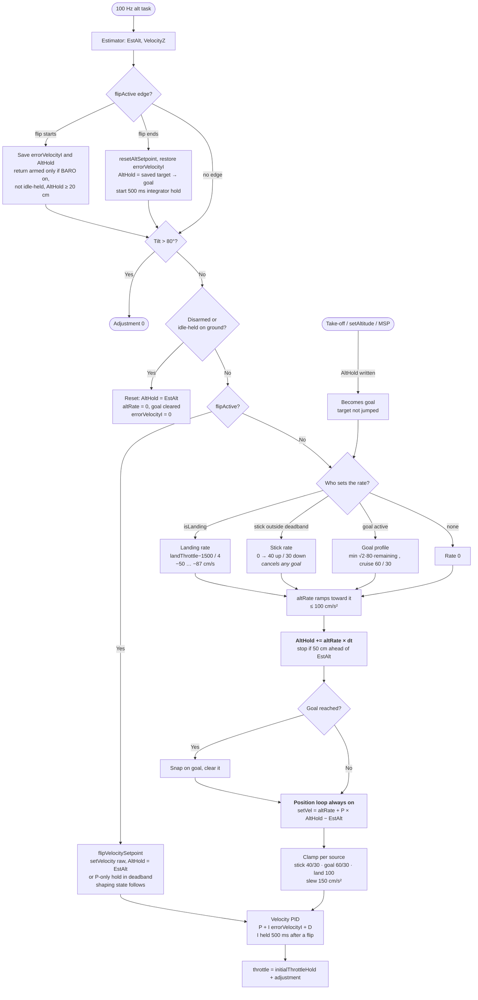
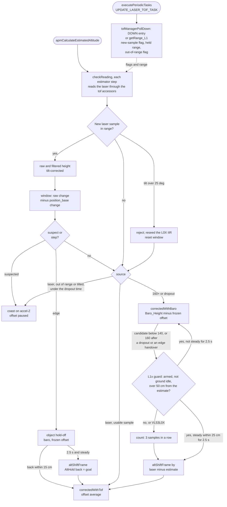
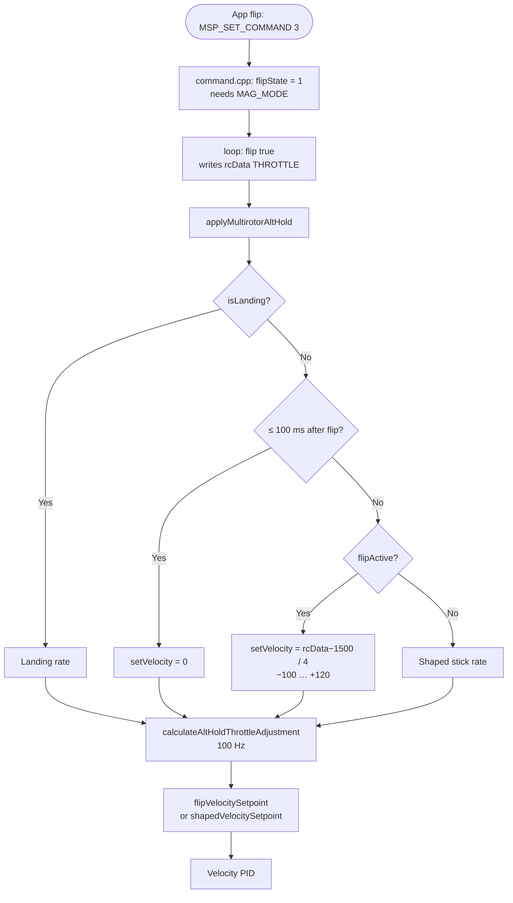
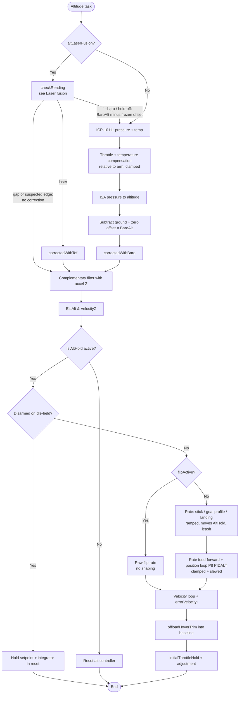

# Altitude Hold & Estimator (`altitudehold.cpp`)

## Overview
Fuses barometric pressure (and, with a down-laser, laser Time-of-Flight: the VL53L0X switched on at boot by `XRanging.initAlt ( )`, or the VL53L1X built with `LASER_TOF_L1x` + `LASER_ALT`) with the accelerometer's Z-axis to estimate altitude and vertical velocity. When `ALT_HOLD` mode is active, it takes over the throttle channel to hold or smoothly change height.

## Source Files
- **Altitude estimator and controller**: `src/main/flight/altitudehold.cpp`, `src/main/flight/altitudehold.h`
- **Barometer chain**: `src/main/sensors/barometer.cpp` (conversion, zero, compensation), `src/main/drivers/barometer_icp10111.cpp` (ICP-10111 driver)
- **Laser** ( one down-laser, used by the estimator only while the laser fusion is on, `altLaserFusion ( )` ):
  - **VL53L0X:** the DOWN entry of `src/main/drivers/tof_manager.cpp` / `.h` ( 33 ms single ranging, start + read, a 0.1 IIR of samples < 2000 mm, address 0x30 ). The per-device helpers are in `src/main/drivers/ranging_vl53l0x.cpp` / `.h`. The bring-up is `xRangingInit ( )` in `src/main/API-Src/XRanging.cpp`. User code turns it on with `XRanging.initAlt ( )` in `plutoInit ( )`.
  - **VL53L1X:** `src/main/drivers/ranging_vl53l1x.cpp` / `.h` ( `LASER_TOF_L1x`: Medium mode, 45 ms budget, 50 ms period, no filter, at 0x29 ), fused with `LASER_ALT`.
  - **Only one down-laser can be fitted.** `initAlt` is refused in a `LASER_TOF_L1x` build. `altitudehold.cpp` stops the build with an `#error` if `LASER_TOF` is still defined, or if `LASER_ALT` is defined without `LASER_TOF_L1x`.
- **Accelerometer sum**: `src/main/flight/imu.cpp` `imuCalculateAcceleration()` (builds `accSum[Z]`, the estimator's vertical acceleration)
- **Flip** (drives the throttle during a flip): `src/main/flight/acrobats.cpp`, `acrobats.h`
- **XY position** (not altitude): `src/main/flight/posEstimate.cpp`, `src/main/flight/posControl.cpp`

## Key Data Structures
- `EstAlt`: estimated altitude in cm. What the controller and `limitAltitude()` use.
- `VelocityZ`: estimated vertical velocity in cm/s.
- `BaroAlt`: compensated barometric altitude in cm, the measurement the estimator is corrected towards. Noisier than `EstAlt` by design.
- `AltHold`: the altitude setpoint. Moved by the setpoint shaping below; a write from outside becomes a goal ( `altGoal` ) rather than a step. `altTarget` is its float copy.
- `altRate`: the ramped rate moving `AltHold` ( stick rate or goal profile ), fed forward to the velocity loop.
- `initialThrottleHold`: the hover-throttle baseline. `errorVelocityI` (the only alt-hold integrator) carries the residual trim.
- `flipState` (`flight/acrobats.cpp`): non-zero while an app / `Command_Flip()` flip runs. `flipActive()` wraps it, and is always false without `ENABLE_ACROBAT`.

## Primary Functions
- `apmCalculateEstimatedAltitude()`: runs the third-order complementary filter each altitude task, integrating accel-Z and correcting towards the height measurement.
- `checkBaro()` → `correctedWithBaro()`: barometer path, used while the laser fusion is off. Time constant `_time_constant_z` is 2 s, or 5 s above 30° of tilt.
- `checkReading()` ( laser fusion on ): chooses the correction source each estimator step: `correctedWithTof()` on the laser, `correctedWithBaro()` with a frozen offset on the baro or during an object hold-off, or no correction ( coast ) during a short gap or a suspected edge. One body serves either laser; it reads the sensor only through accessor macros and per-sensor constants. See **Laser fusion** below.
- `correctedWithTof()`: position error against the filter's own `_position_z`; one time constant `ALT_EST_TAU_S` 1.5 s for both sources while the fusion is on.
- `altLaserFusion()` / `altLaserFusionLatch()`: the boot-latched fusion flag.
  - **VL53L0X:** `xRangingInit ( )` latches it once, after `plutoInit ( )`, from the accepted `XRanging.initAlt ( )` request. When it turns on, τ becomes 1.5 s and the gains are recomputed.
  - **VL53L1X:** a `LASER_TOF_L1x` + `LASER_ALT` build has it on at compile time.
  - **What it selects:** `checkReading ( )` or `checkBaro ( )`; τ; the accel-Z deadband ( `imu.cpp` ); and the take-off height ( `command.cpp`: absolute with the laser, relative to the arming height on the baro ).
- `altShiftFrame()`: moves the whole altitude frame ( estimate, its history, the smoother, the setpoint, the goal and the flip's return height ) by one amount, so a change of reference does not move the craft.
- `altHoldSource()`: 1 laser, 0 baro, 2 object hold-off ( diagnostics ).
- `applyAltHold()` → `applyMultirotorAltHold()` (main loop): turns the throttle stick into `setVelocity` (landing descent while `isLanding`, 0 for `ALT_FLIP_EXIT_IGNORE_MS` after a flip, the raw flip rate while a flip runs), sets `altHoldGroundIdle`, and writes `rcCommand[THROTTLE] = initialThrottleHold + altHoldThrottleAdjustment`.
- `calculateAltHoldThrottleAdjustment()` (100 Hz): flip edge handling, then the velocity setpoint from `shapedVelocitySetpoint()` (setpoint shaping: fed-forward rate plus the outer position loop, `P8[PIDALT]`, 128 = unity) or, during a flip, `flipVelocitySetpoint()`, feeding the inner velocity loop.
- `offloadHoverTrim()`: while settled, moves hover trim from `errorVelocityI` into `initialThrottleHold` one count per 20 ms, keeping the integrator's range free.
- `limitAltitude()`: altitude ceiling at `max_altitude - ALT_CEILING_MARGIN_CM` (25 cm).

## Barometer chain (`sensors/barometer.cpp`)

The ICP-10111 does not report the true static pressure of the air: rotor inflow and the board's heating both shift it. The chain from raw reading to `BaroAlt`:

1. **Driver** (`barometer_icp10111.cpp`): `NORMAL` measurement mode (~7 ms conversion). Die temperature is low-pass filtered (`TEMP_LPF_ALPHA`) and feeds the sensor's own compensation polynomial.
2. **Compensation** (`baroCompensationPa()`): adds back pressure lost to throttle and temperature, relative to the values latched at the arm instant, so it is zero on the first armed sample:
   - `BARO_COMP_THROTTLE_PA_PER_COUNT` = 0.0086 Pa per `rcCommand[THROTTLE]` count
   - `BARO_COMP_TEMP_PA_PER_DEGC` = 2.1 Pa per °C of die temperature (measured −2.17 to −2.42 on PRIMUS_V5)
   - total clamped to ±`BARO_COMP_LIMIT_PA` (25 Pa, ~2 m)
3. **Conversion** (`pressureToAltitude()`): ISA standard atmosphere at a fixed 288.15 K. Deliberately temperature-free, so the scale does not depend on how warm the board is. About 8.3 cm per Pa near sea level.
4. **Zero** (`baroUpdateZero()`): while disarmed, an IIR tracks the reading so warm-up before takeoff is absorbed; frozen on arm. Applied as an offset (`getBaroZeroOffset()`).

`BaroAlt = altitude(pressure + compensation) − ground altitude − zero offset`.

Rules that keep this working:
- **Never re-zero in flight.** `baroResetGroundLevel()` is only allowed before the throttle has been raised since arming (`throttleRaisedSinceArm` in `mw.cpp`).
- **Keep estimator lag low.** A slow estimate lags high during a descent and commands more descent; adding filtering to `BaroAlt` trades noise for exactly this.
- **Coefficients are per airframe.** The throttle term depends on where the FC sits relative to the rotors. Re-measure on a new frame from a log of `degC`, `PaI` and laser height over a 3+ minute hover.

## Data Flow & Boundaries
- **Stick deadband**: in `ALT_HOLD`, `alt_hold_deadband` (40 counts, stick 1460-1540) is applied to the throttle stick. Inside it the drone holds altitude; beyond it, the stick sets a climb/descent rate. There is no deadband on the position error.

## Setpoint shaping (`calculateAltHoldThrottleAdjustment()`)

ArduPilot / DJI style: the throttle stick never takes the position loop out of the chain. It moves the setpoint, and the loop tracks the moving setpoint with the rate fed forward.

Why it is built this way:
- **One controller, no mode switch.** Earlier firmware switched to a raw velocity command outside the deadband and snapped `AltHold` to `EstAlt` on return. That gave a speed step at the deadband edge and an overshoot on centring.
- **Feed-forward instead of a gap.** A P = 1 position loop needs a 60 cm error to demand 60 cm/s, so a stepped target is approached ever more slowly. Feeding the planned rate forward leaves the position term as a small correction.
- **Height stays controlled while the stick is in use**, and stick, commands and landing are all bounded by the same ramp and clamp.

The legacy flow, the full comparison and the reasoning are in [althold-setpoint-shaping/CHANGES.md](../../active-development/althold-setpoint-shaping/CHANGES.md#before--after).

| Source of `altRate` | Rate | Limits |
|---|---|---|
| **Stick** outside the deadband | Linear from 0 at the deadband edge to full stick | `ALT_MAX_CLIMB_CMS` 40 / `ALT_MAX_DESCENT_CMS` 30 cm/s |
| **Goal**: `AltHold` written from outside (take-off, `DesiredPosition_set*` / `setAltitude()`, MSP) | Trapezoid: `min(sqrt(2·a·remaining), cruise)`, stops on the goal | Cruise `ALT_CMD_MAX_CLIMB_CMS` 60 / `ALT_CMD_MAX_DESCENT_CMS` 30 cm/s, brake `ALT_GOAL_DECEL_CMSS` 80 cm/s² |
| **Landing** (`isLanding`) | `(landThrottle − 1500) / 4`: land() ramps 1300 → 1150, i.e. about −50 → −87 cm/s | Descent clamp `ALT_LAND_MAX_DESCENT_CMS` 100 |
| **Flip** (`flipActive()`) | Not shaped. `(rcData[THROTTLE] − 1500) / 4` fed straight to the velocity loop, see *Flip interaction* | `ALT_FLIP_MAX_CLIMB_CMS` 120 / `ALT_FLIP_MAX_DESCENT_CMS` 100, no ramp, slew or leash |

A take-off on a drone at the ARM-switch ground idle first calls `altHoldReleaseGroundIdle ( )`
( `altitudehold.cpp:1440` ). It clears `isThrottleStickArmed` and `altHoldGroundIdle` together, because the controller
runs at the top of the loop, before `applyAltHold ( )` recomputes the idle. A stale idle would reset the setpoint and
wipe the goal. The goal is set only while `altHoldStickCentred ( )` holds ( `:1447` ), the same test as the stick-rate
branch, so a stick request cannot cancel it on the next cycle.

Each 10 ms tick:
1. `altRate` ramps toward the source rate at `ALT_STICK_ACCEL_CMSS` (100 cm/s²). Moving the stick cancels a goal.
2. `AltHold += altRate · dt`. It stops advancing when it is `ALT_TARGET_LEASH_CM` (50) ahead of `EstAlt` in the direction of travel, e.g. while still on the ground.
3. Velocity demand = `altRate + P_ALT · (AltHold − EstAlt)`. It is clamped to the limits of the active source and slewed at `ALT_VEL_ACCEL_CMSS` (150 cm/s²), then goes to the velocity PID.

Behaviour that follows: centring the stick lets the target coast to a stop, with no snap to `EstAlt` and no overshoot. A 120 cm take-off takes about 2.7 s with no slow final approach.

Flow of `calculateAltHoldThrottleAdjustment()`:

## Laser fusion (`altLaserFusion ( )`: VL53L0X with `XRanging.initAlt ( )`, or VL53L1X with `LASER_ALT`)

With a downward laser, altitude hold means height above the surface under the craft: gentle
terrain is followed. `checkReading()` decides each estimator step what corrects the complementary
filter. The fusion runs while `altLaserFusion ( )` is true:

- **VL53L0X:** the flag is latched once at boot by `xRangingInit ( )`, from an accepted `XRanging.initAlt ( )`. It
  never changes while the craft runs. Without `initAlt`, or with a refused one, the estimator is exactly the
  baro build.
- **VL53L1X:** the flag is on at build time with `LASER_TOF_L1x` + `LASER_ALT`.

One fusion body serves both lasers. Only one laser can be fitted, because both would write the same estimator
state, so `initAlt` is refused in a VL53L1X build. The two sensors differ only in the accessors and constants below,
plus a return guard that only the VL53L1X has.

**A down-laser that fails to start still runs the fusion.** An accepted `initAlt` turns the fusion on even if the
laser then ends BOOT_FAILED: no answer, a failed init step, or 0x29 busy at its release ( `BUS_BUSY` ). Then:
- the estimator starts on the laser source, finds no usable sample, and hands over to the baro on its first tick
  ( `ALT_TOF_DROPOUT_MS` has already passed since boot );
- it stays on the baro with the frozen offset;
- it keeps the laser tuning: τ 1.5 s, accel-Z deadband 0, absolute take-off height;
- `XRanging.getStatus ( DOWN )` reports the failure.

**No side laser reaches the estimator.** Every laser has its own entry in `drivers/tof_manager`. The side lasers are
polled into their own entries ( `tofManagerPollSides ( )` ), and the estimator's accessors read the DOWN entry
only. Before this, the side lasers' bring-up and reads wrote the same globals the estimator read.

**Sensor interface.** The body reads the sensor only through six accessor macros, chosen with
`#if defined( LASER_TOF_L1x ) / #else` near the top of `altitudehold.cpp`. The VL53L0X accessors are
functions of `drivers/tof_manager` that read the DOWN entry only:

| Accessor | Meaning | VL53L0X ( DOWN entry ) | VL53L1X |
|---|---|---|---|
| `tofNew()` | a new result is waiting | `tofDownNew()` | `isTofDataNew_L1()` |
| `tofClearNew()` | mark it consumed | `tofDownClearNew()` | `isTofDataNewflag_L1 = false` |
| `tofOutOfRange()` | no valid reading now | `tofDownOutOfRange()`: the last sample was invalid, **or DOWN's status is not OK** | `isOutofRange_L1()` |
| `tofReseed()` | restart the driver's range filter | `tofDownReseed()` | nothing ( no filter ) |
| `tofFiltCm()` | filtered range, cm, before the tilt correction | `tofDownFiltMm()` ( the 0.1 IIR ) / 10 | `NewSensorRange_L1` / 10 |
| `tofRawCm()` | unfiltered range, cm | `tofDownRawMm()` / 10 | `NewSensorRange_L1` / 10 |

The down poll ( `tofManagerPollDown ( )`, from `UPDATE_LASER_TOF_TASK` ) keeps the former VL53L0X driver's
values on the success path: the same 33 ms start + read, IIR, rounding, `< 2000 mm` test and reseed.

What counts as a valid reading is decided in each driver:

| | VL53L0X | VL53L1X |
|---|---|---|
| Valid sample | range status 0 and < 2000 mm | range status 0 and `L1X_MIN_VALID_MM` 15 ≤ range < 4500 mm |
| Held range | the DOWN entry's IIR of valid samples ( `tofDownFiltMm()` ) | `NewSensorRange_L1`: the last valid sample |
| `tofOutOfRange()` also true | while DOWN's status is not OK: not started, BOOT_FAILED, or I2C_ERROR after a failed read ( never retried ) | on a latched ST error ( `Global_Status_L1` ), or no new result for `L1X_STALE_MS` = 3P + 10 = 160 ms |

**Accelerometer input.** With the fusion on ( `altLaserFusion ( )` ), `accSum[Z]` is built without a deadband
( `ALT_EST_ACC_Z_DEADBAND` 0 counts, a compile-time constant, so a saved profile cannot bring the old
value back ). The profile's 40-count Z deadband ( ~9.6 cm/s² ) removed most of a hover's vertical
acceleration: `VelocityZ` read 0.3-0.4 × the real speed, the velocity loop had a third of its
damping, and the craft bobbed 30 cm at ~4 s. With the fusion off, `accSum[Z]` keeps `accDeadband.z`. `accSum[Z]`
also reaches the velocity loop's D term through `accZ_tmp`; at the default `d_vel` 1 the term is 0
until the sum of two consecutive averages ( `accZ_tmp + accZ_old` ) reaches 512 counts, ~256 per
sample.

**Filter.** One time constant `ALT_EST_TAU_S` 1.5 s for both sources. The laser error is taken
against the filter's `_position_z`, not the smoothed integer `EstAlt`. The correction runs on every
10 ms estimator tick with the last held `ToF_Height`, so its strength does not depend on the sensor's
sample period. Laser samples taken above `ALT_TOF_MAX_TILT_DECIDEG` 25° are rejected, for both
sensors; accepted ones are multiplied by the cosine of the tilt.

The VL53L0X IIR ( in `tofManagerPollDown ( )`, DOWN entry ) keeps float state. It is reseeded from the raw sample
after an out-of-range sample, after a rejected tilted sample, and at every object detection, cancel and re-base
( `tofDownReseed()` ). It lags ~0.3 s ( `ALT_TOF_IIR_LAG_S` ), so the laser is advanced by `VelocityZ × 0.3 s` for
the baro-offset average and the return shift; the object test advances the estimate by the same amount instead. The
estimator correction itself uses the IIR reading as it is. The VL53L1X has no driver filter: its lag is 0 and its
reseed does nothing.

**Per-sensor constants.** P is `L1X_SAMPLE_PERIOD_MS`, 50 ms by default. The VL53L1X counts and
times are derived from P in macros ( with `static_assert`s on the steady count, the ring span and the
dropout against `L1X_STALE_MS` ), so a target that overrides the period gets consistent values.

| Constant | VL53L0X | VL53L1X | Meaning |
|---|---|---|---|
| Sample period | ~33 ms | P = 50 ms ( measured 51-53 ms ) | one new sample per period |
| `ALT_TOF_HANDOVER_UP_CM` / `_DOWN_CM` | 160 / 140 cm | 160 / 140 cm | laser → baro above, back below ( VL53L1X: 100 % valid to 180 cm on the test floor ) |
| `ALT_TOF_DROPOUT_MS` | 120 ms | 3P + 35 = 185 ms | no usable sample this long → baro ( 2 missed samples + poll quantisation + one estimator tick ) |
| `ALT_TOF_RETURN_SAMPLES` | 3 | 3 ( 150 ms ) | usable samples in a row to return to the laser |
| `ALT_TOF_IIR_LAG_S` | 0.3 s | 0 | driver-filter lag advanced by `VelocityZ` |
| `ALT_TOF_STEADY_SAMPLES` | 15 | 500 / P = 10 | 0.5 s steady before a re-base |
| `ALT_TOF_RING_LEN` | 24 | ceil ( 660 / P ) = 14 | window ring, ≥ 0.66 s of samples |
| `ALT_TOF_OFFSET_DT_MAX_S` | 0.05 s | 1.5 P = 0.075 s | longest step one baro-offset update weights |
| `ALT_TOF_RETURN_AGREE_CM` | - | 30 + 20 = 50 cm | return guard: largest laser-to-estimate disagreement accepted at once |
| `ALT_TOF_RETURN_STEADY_CM` | - | 25 cm | return guard: steady band of its exit |

Shared by both sensors: `ALT_EST_TAU_S` 1.5 s, `ALT_TOF_MAX_TILT_DECIDEG` 25°, `ALT_TOF_STEP_CM` 30 cm,
`ALT_TOF_STEP_HOLD_MS` 2.5 s, `ALT_TOF_STEADY_CM` 10 cm, `ALT_TOF_WINDOW_MS` 500 ms /
`ALT_TOF_WINDOW_MIN_MS` 400 ms, `ALT_TOF_SUSPECT_CM` 15 cm, `ALT_TOF_SUSPECT_MAX_MS` 1 s,
`ALT_TOF_SUSPECT_ESCALATE_CM` 20 cm, `ALT_TOF_AIRBORNE_GRACE_MS` 1 s, `ALT_BARO_OFFSET_TAU_S` 2 s.

**Handover** ( `altSourceLaser` ):

| From | To | When |
|---|---|---|
| laser | baro | the laser height ( filtered, tilt-corrected ) reads ≥ `ALT_TOF_HANDOVER_UP_CM` 160 cm; or no usable sample for `ALT_TOF_DROPOUT_MS` ( dropout, tilt, silent sensor ); or a suspected edge times out with the laser ≥ 160 cm, or an escalated edge gets no usable sample within `ALT_TOF_DROPOUT_MS` |
| baro | laser | `ALT_TOF_RETURN_SAMPLES` 3 usable samples below `ALT_TOF_HANDOVER_DOWN_CM` 140 cm after a climb above the band, otherwise below 160 cm. On the VL53L1X the return guard below can hold a sample off |

Short gaps: out-of-range and tilted samples coast on the accelerometer ( no correction ) until the
dropout timeout. A VL53L0X read that fails marks DOWN I2C_ERROR for the rest of the run ( never
retried ). `tofOutOfRange()` is then true, so the estimator coasts, hands over to the baro at the 120 ms
timeout, and stays on the baro until a power cycle. A silent VL53L1X keeps its last reading usable for
160 ms ( `L1X_STALE_MS` ), then coasts until the 185 ms timeout.

On the laser, `baro_offset` is a 2 s ( `ALT_BARO_OFFSET_TAU_S` ) average of baro minus laser, paused
during a hold-off, while a change is suspected, and for 400 ms after the window resets; the time step
of each update is clamped to `ALT_TOF_OFFSET_DT_MAX_S`, so the first sample after a pause gets a
normal weight. On the baro it is frozen. On the return, `altShiftFrame()` moves the frame by the laser
minus `_position_z` ( the baro drift since the handover, plus any change of surface ), so the numbers
change and the aircraft does not: `EstAlt` and `AltHold` move together, and the offset moves with
them. The baro ground datum ( `sensors/barometer.cpp` ) is never touched.

**Return guard ( VL53L1X only ).** On the baro nothing else checks what the laser sees: every object
test needs the laser as the source. In log-5 of this topic the VL53L1X read ceiling-fan blades below
the craft as a valid 54-57 cm for 4 samples with the craft at ~2.5 m, which would have returned to the
laser with a frame shift of about −2 m ( `E` ≈ 255 cm, readings 54-57 cm ). So, on the baro, armed and not in the pre-take-off ground
idle ( in flight and while landing ), a return candidate ( a new usable sample below the return edge )
whose laser height disagrees with `_position_z` by more than `ALT_TOF_RETURN_AGREE_CM` 50 cm
( `ALT_TOF_STEP_CM` 30 + `ALT_TOF_RETURN_BARO_CM` 20 for baro drift and noise ) is held off and resets
the return count. `_position_z` already carries the frozen offset, so the disagreement is the frame
shift the return would take.

Way out: if the disagreement ( laser minus estimate, not the raw reading, so the craft may climb,
descend or land meanwhile ) stays within `ALT_TOF_RETURN_STEADY_CM` 25 cm of its first value for
`ALT_TOF_STEP_HOLD_MS` 2.5 s, it is a new floor ( a take-off from a table, a long baro drift, an
object frame carried onto the baro ) and the return is taken on that sample with the normal frame
shift. Any gap, agreeing or out-of-band sample restarts the run; fan blades and passing objects are
intermittent and never last 2.5 s. The band is 25 cm, not the object test's 10 cm, because the
baro-path estimate swings 20-40 cm while the craft climbs or descends ( log-12: with 10 cm the exit took
~10 s ). Disarmed or in the ground idle the guard is off.

**Object under the craft** ( `altStepPending`, armed, airborne, not landing, on the laser, below
160 cm ). The raw laser ( tilt-corrected; before the IIR on the VL53L0X ) is tested two ways:

- **Per sample:** more than `ALT_TOF_STEP_CM` 30 cm from the lag-advanced estimate.
- **Window:** the raw change over the last `ALT_TOF_WINDOW_MS` 0.5 s minus the change of
  `_position_base_z` ( the accelerometer-integrated position; the laser's position correction does not
  move it, its velocity correction reaches it weakly ). The wide cone turns an edge into a 0.5-0.8 s
  ramp that the estimate would otherwise absorb. Above `ALT_TOF_SUSPECT_CM` 15 cm the reference is
  frozen, the laser correction pauses ( coast ) and the mismatch keeps adding up: above 30 cm it is
  an edge; after `ALT_TOF_SUSPECT_MAX_MS` 1 s, above `ALT_TOF_SUSPECT_ESCALATE_CM` 20 cm it is an edge
  that the next usable sample turns into a hold-off ( the baro takes over instead if the laser reads
  ≥ 160 cm or no usable sample arrives within `ALT_TOF_DROPOUT_MS` ); at or below 20 cm it is a slope
  that is then followed. A suspect is also cleared early when the accumulated mismatch falls below
  0.5 × `ALT_TOF_SUSPECT_CM` ( 7.5 cm ): laser and accelerometer agree again. No window test for `ALT_TOF_AIRBORNE_GRACE_MS` 1 s after becoming airborne.

An edge starts the hold-off: the estimate flies the baro with the frozen offset for at least
`ALT_TOF_STEP_HOLD_MS` 2.5 s. Three samples back within 15 cm cancel it. After 2.5 s, once the raw
reading has been steady within `ALT_TOF_STEADY_CM` 10 cm for `ALT_TOF_STEADY_SAMPLES` ( 0.5 s ),
`altShiftFrame()` re-bases the estimate to the new surface and `AltHold` is written back to its old
value ( or an active goal's end point, and the flip's return height ), so setpoint shaping flies back
to the old clearance as a goal ( 60 cm/s up, 30 cm/s down, the stick cancels it ). If landing starts
during a hold-off, the frame re-bases to the laser at once, so the step does not reach the estimator
as position error and touchdown detection is not delayed.

**Limits.** An object that stays under the craft and moves up with it re-bases it again each time
( no climb cap, by choice ). A slow slide can re-base on a half-way reading that is steady for
0.5 s; later triggers correct it. What is followed depends on how much the laser disagrees with
the accelerometer: up to ~15 cm within 0.5 s is followed at once; 15-20 cm coasts for up to 1 s and
is then followed; more than 30 cm within 0.5 s, or more than 20 cm building up within ~1 s, gets the
hold-off. A slope is followed when it changes the laser by less than ~30 cm/s ( 15 cm per 0.5 s
window ); a steeper one becomes an edge within about 0.5 s of turning suspect.

Known limits on the VL53L1X ( PRIMUS_X2_v1, `vl53l1x-althold-parity` flights log-10 to log-13 ):

- **Tilt above 25° is not flight-exercised.** The largest tilts logged were 18.2° on the bench and
  16.9° in flight. The rejection is the shared code flown on the VL53L0X.
- **The 25 cm guard-exit band is not flight-tested.** In log-13 the board was never in the beam. The
  guard held and its exit returned correctly in log-12, with the earlier 10 cm band.
- **Object frame after a re-base onto a close object** ( inherited from the VL53L0X ). After a re-base
  onto a close object and the climb back to the old clearance, removing the object with the craft
  above 160 cm hands over to the baro in the object's frame ( ~1.1 m off in log-12 ). The frame is
  corrected by the return guard's exit or the return.
- **Near-field take-off blip.** At lift-off the sensor briefly reads 0-12 mm with status 0, below the
  15 mm minimum: a baro leg of 0.1-0.2 s in flight ( bench estimate up to 0.3 s ), then a return with a frame shift of a few cm. No visible
  effect in flight.
- **Margin to the reach.** On the matt test floor the valid reach is ~1.8 m, 20 cm above the 160 cm
  edge. A darker floor or bright light shortens it; the dropout then hands over earlier.

**VL53L1X driver** ( `drivers/ranging_vl53l1x.cpp` / `.h`, `LASER_TOF_L1x` ).

- **Set-up** ( `ranging_init_L1()`, from `main.cpp` ): Medium distance mode, 45 ms timing budget,
  50 ms inter-measurement period ( TIMED ranging ), each step only if the previous one succeeded; an
  error latches in `Global_Status_L1`. The mode, budget and period are target-overridable
  ( `L1X_DISTANCE_MODE`, `L1X_TIMING_BUDGET_US`, `L1X_SAMPLE_PERIOD_MS` ), and a `static_assert` requires
  period ≥ budget + 5 ms ( ST refuses to start below budget + 4 ms, and the error would latch for the
  flight ).
- **One sample per measurement** ( `getRange_L1()`, from `UPDATE_LASER_TOF_TASK` ): data-ready is
  polled every 10 ms. On a new result the driver reads the 17-byte result block ( 0x0089-0x0099 ),
  clears the interrupt ( a 1-byte `SYSTEM__INTERRUPT_CLEAR` write ) and decodes the range status and
  range locally with the ST API's own mapping and arithmetic. It does not use
  `VL53L1_GetRangingMeasurementData` + `VL53L1_ClearInterruptAndStartMeasurement`. A sample poll costs
  ~0.79 ms of blocking I2C at 400 kHz ( 5.44 ms before ), once per 51-53 ms. The LL driver's own
  stream-count state is left stale on purpose ( it is only checked in back-to-back mode ). A
  `VL53L1_SetDistanceMode()` after start would no longer be applied; nothing calls it at runtime.
- **Limit checks on the device:** sigma 90 mm and minimum signal 1.5 MCPS, the preset tuning of
  both Medium and Long. They overwrite the 18 mm / 0.25 MCPS set by `VL53L1_DataInit`.
- **Measured reach** ( matt floor, Medium 45 / 50 ): 100 % valid to ~1.8 m, 50 % at ~1.95 m, ~0 above
  2.1 m ( status 2, signal fail ). Long mode gave no more reach: at 95 / 100 ms it stopped at the same
  ~1.8-2.0 m, and at 45 / 50 ms it was worse than Medium ( wrap-target fails, 1 % valid at a 20° tilt ).
  The likely limit is the 1.5 MCPS minimum signal.
- **On the ground** the craft reads 25-28 mm ( valid ); a covered window reads 0-10 mm with status 0,
  which the 15 mm minimum rejects.
- **A latched error is not recovered.** Any ST or I2C error, in set-up or at runtime
  ( `VL53L1_GetMeasurementDataReady`, `VL53L1_ReadMulti`, `VL53L1_clear_interrupt` ), latches in
  `Global_Status_L1` and stops ranging. `isOutofRange_L1()` then stays true and the estimator stays on
  the baro until a power cycle. This is a safe fallback; a recovery path is a follow-up.
- **Negative ranges.** `VL53L1_TUNING_PROXY_MIN` ( -30 mm ) is read at init. A valid result below it
  becomes invalid; one between it and 0 is clamped to 0, as the ST API does, and the 15 mm minimum then
  rejects it.
- **Public state:** `sampleCount_L1` ( new results since boot, valid or not ) and `lastSampleMs_L1`
  ( `millis()` at the last result, used for the staleness test ) are exported in the header.
- **Build check scope.** The period ≥ budget + 5 ms `static_assert` sits outside `#ifdef LASER_TOF_L1x`,
  so a bad `L1X_SAMPLE_PERIOD_MS` / `L1X_TIMING_BUDGET_US` override in a target breaks every build of that
  target, with or without the VL53L1X.
- The older `LaserSensor_L1` class ( `XVision`, full ST API ) is still compiled in every build but is not
  used by the estimator.

<!-- Edge sources ( 15 Oct 2026, source lines; the graph predates drivers/tof_manager ):
Task -> Drv: mw.cpp:812-820 executePeriodicTasks ( ) UPDATE_LASER_TOF_TASK calls tofManagerPollDown ( ) ( :814 )
  and, with LASER_TOF_L1x, getRange_L1 ( ) ( :819 ).
Est -> Tick: altitudehold.cpp:945-946 ( if ( altLaserFusion ( ) ) checkReading ( ) ).
Drv -.-> Tick: tof_manager.cpp:152-170 sets the DOWN entry's newSample / rawMm / outOfRange and the IIR, read via the
  accessors altitudehold.cpp:228-233 -> tof_manager.cpp:209-231; ranging_vl53l1x.cpp:287-296 sets
  isTofDataNewflag_L1 / NewSensorRange_L1 / out_of_range_L1, read via altitudehold.cpp:207-212.
Tick -> New: altitudehold.cpp:1109.  New -> Rej: :1114-1117.  New -> Raw: :1118-1123.  Raw -> Win: :1144 tofWindowMismatch ( ).
Win -> Sus: :1154-1155 ( suspect ), :1202-1204 ( step ).  Sus -> Hold: :1204.  Hold -> Laser ( cancel ): :1228-1229.
Hold -> Rebase: :1232-1245 altShiftFrame ( ) :1238.  Sus -> Coast / Band -> Coast: :1328-1332.  Band -> Laser: :1330.
Band -> BaroP: :1299-1304 ( handover ), :1335 correctedWithBaro ( ).  BaroP -> Guard: :1261-1262 ( L1x only, :1250 ).
Guard -> BaroP: :1307-1308 ( returnHeld resets the count ).  Guard -> Ret ( steady exit ): :1263-1274.
Guard -> Cnt -> Ret: :1310-1315.  Ret -> Laser: :1317. -->

## Flip interaction (`flight/acrobats.cpp`)

An app back-flip (MSP `MSP_SET_COMMAND` 3, or `Command_Flip()` from user code) runs the
`flip()` state machine in `loop()` (`mw.cpp`, `flip ( true )` before `annexCode()` and
`applyAltHold()`). It needs `MAG_MODE` to start, and back flip is the only direction.

- **ALT_HOLD stays on during the flip.** `flip()` calls `DEACTIVATE_RC_MODE(BOXBARO)`, but
  that is an XOR on `rcModeActivationMask`, and `updateActivatedModes()` rebuilds the mask
  from the AUX channels on every RX frame. While the app holds AUX3 (BOXBARO), BARO_MODE
  never drops, so altitude hold flies the whole flip.
- **The flip drives `rcData[THROTTLE]` itself:** 2000 in ASCEND (state 1, until
  `VelocityZ ≥ 100 cm/s`, time-out 2.2 s) and in HOLD / HOLDPOS (states 4 / 7, a fixed
  1.5 s recovery), with no write in PITCHING / SLOWDOWN. Altitude hold reads `rcData`
  here on purpose: `flip()` writes it earlier in the same `loop()` pass. The raw branch
  is gated on `flipActive()`, so outside a flip the same `rcData` read goes through
  shaping, and a pilot's 2000 is still limited to 40 cm/s.
- **While `flipActive()`, setpoint shaping is bypassed.** `flipVelocitySetpoint()` flies
  the pre-shaping controller: outside the deadband `setVelocity = (rcData − 1500) / 4`
  (−100…+120 cm/s) goes straight to the velocity loop with `AltHold` pinned to `EstAlt`.
  Inside it, a P-only position hold runs. Through shaping, full stick is 40 cm/s and
  ASCEND never reached 100 cm/s, so the flip timed out without rotating. The shaping
  state (`altTarget`, `altRate`, goal) follows during the flip.
- **Hand-back on the flip's falling edge** (checked ahead of the tilt test):
  - `resetAltSetpoint()`: the setpoint restarts at 0. The flip's last 120 cm/s was
    otherwise slewed down slowly, and together with HOLD's integrator wind-up it drove a
    flyaway.
  - `errorVelocityI` is restored to the value saved when the flip started (0 if BARO was
    off then), which drops HOLD's wind-up.
  - `AltHold` is set to the target saved when the flip started, and becomes a goal flown
    on the goal profile (HOLD ends the flip 40-120 cm high). This is only done if BARO
    was on, the craft was not idle-held, and the target was ≥ `ALT_FLIP_RETURN_MIN_CM`
    (20 cm). Otherwise the craft holds where the flip ended. Stick input cancels it, as
    for take-off.
  - For `ALT_FLIP_EXIT_I_HOLD_MS` (500 ms) the velocity integrator is held while P brakes
    the ~120 cm/s exit climb, so no negative trim is banked. The disarm reset clears the
    window.
- **The stale exit throttle is ignored.** On its last tick the flip writes 2000 and clears
  `flipState` in the same call. For `ALT_FLIP_EXIT_IGNORE_MS` (100 ms, more than the
  ≤ 20 ms RX refresh) `applyMultirotorAltHold()` forces `setVelocity = 0`, so that sample
  cannot cancel the return goal. Landing keeps priority.

Known limits: with `alt_hold_fast_change = 1` (default 0) there is no return. A flip sent
during a take-off or `setAltitude()` goal returns to where the moving target was, not to
the goal. A second flip started within 100 ms of the previous one ending gets
`setVelocity = 0` for the rest of the exit window (ASCEND starts up to 100 ms late, well
inside its 2.2 s time-out). After the rotation the altitude estimate re-converges (a 16-42 cm transient in
`EstAlt`, and `VelocityZ` biased about −13 cm/s for a few seconds). This is not addressed.

**Ground reset:** while disarmed, or armed on the throttle stick with the motors held at 1000 (`isThrottleStickArmed` → `altHoldGroundIdle`), the setpoint, goal, rate and `errorVelocityI` are held in reset. Waiting armed on the ground therefore cannot wind the integrator down.

**Landing must keep its own descent rate.** Near the floor the barometer drifts low in the craft's own downwash. At the stick's 10-20 cm/s that drift alone met the descent demand: the craft hovered a few cm up with `EstAlt` still falling, and `land()`'s touchdown test (descent stopped) never fired.

**Not covered:** there is no general landed detector. A touchdown and re-take-off without disarming can still wind the integrator down. `limitAltitude()` only clamps the stick, and the target coasts about 8 cm past the clamp, which is inside the 25 cm margin.
- **ToF vs Baro**: with the laser fusion on, the laser corrects the estimator below the handover band and the barometer above it ( **Laser fusion** above ). The fusion is on for the VL53L0X with `XRanging.initAlt ( )`, latched at boot, and for the VL53L1X with `LASER_TOF_L1x` + `LASER_ALT`. With it off, the estimator is barometer and accel-Z only. A VL53L1X built without `LASER_ALT`, and every XRanging side laser, are read for user code or logging and never affect altitude. `XRanging.getRange ( DOWN )` gives user code the down-laser's cached range.

<!-- Edge sources at the source decision ( 15 Oct 2026 ): Start -> Src: altitudehold.cpp:945. Src -> LF: :946 checkReading ( ).
Src -> Baro: :948 checkBaro ( ) ( :1339 ). LF -> ToF: :1330 correctedWithTof ( ). LF -> Baro: :1335 correctedWithBaro (
Baro_Height - baro_offset ). LF -> CF: :1332 ( no correction ). The other edges are unchanged. -->
