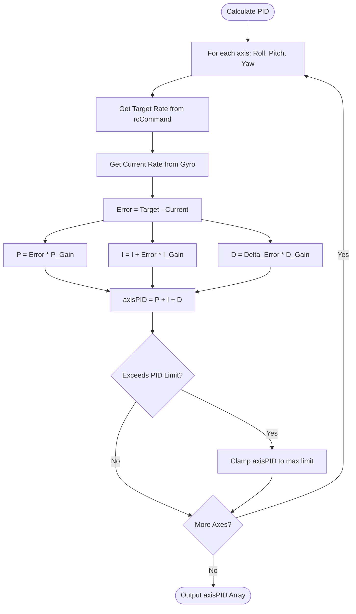
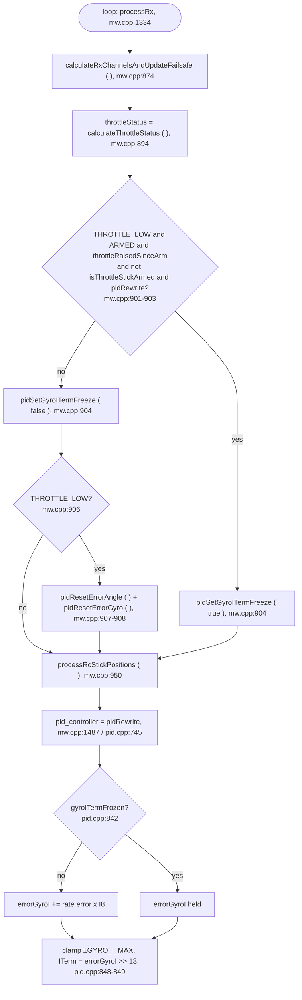
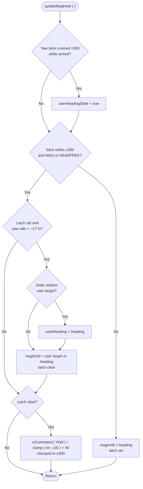

# Core PID Controller (`pid.cpp`)

## Overview
The PID (Proportional, Integral, Derivative) controller is the stabilizing brain of the drone. It compares the pilot's requested rotation rates (`rcCommand`) against the drone's actual physical rotation rates (from the IMU), and computes a mathematical error. It then outputs a correction value (`axisPID`) that is sent to the Mixer.

## Source Files
- **Controller Logic**: `src/main/flight/pid.cpp`, `src/main/flight/pid.h`
- **Profile Config**: `src/main/config/config_profile.h`
- **User API Hook**: `src/main/API-Src/FC-Config-PID.cpp`

## Key Data Structures
- `rcCommand[3]`: The target rates commanded by the user/GCS.
- `gyroADC[3]`: The current actual rotation rates in degrees per second.
- `axisPID[3]`: The final computed correction (-1000 to +1000) for Roll, Pitch, and Yaw.
- `pidProfile_t`: Holds the tuned P, I, and D multipliers.

## Primary Functions
- `pidController()`: The core execution loop. It iterates through the Roll, Pitch, and Yaw axes, computing the error and multiplying by the PID gains.
- `pidRewrite()` ( `pid.cpp:745` ): the controller in use. `pidController` defaults to 1 ( `config.cpp:176` ),
  which `pidSetController()` maps to `pidRewrite`. In ANGLE mode its angle loop is P only
  ( `desiredRate = errorAngle * P8[PIDLEVEL] >> 4` ), so the rate I-term `errorGyroI` is the only integrator that
  holds a constant moment such as an off-centre CG or a payload.
- `pidResetErrorAngle()` / `pidResetErrorGyro()` ( `pid.cpp:88` / `:97` ): zero the angle and rate I-terms. Called
  by the stick-low reset in `processRx ( )` whenever the craft is not counted as airborne ( see below ), and by
  every arming path ( take-off, `Command_Arm`, chuck ).
- `pidSetGyroITermFreeze ( bool )` ( `pid.cpp:108` ): while set, `pidRewrite` holds `errorGyroI` on all three axes
  instead of integrating ( `pid.cpp:842` ); the clamp and `ITerm = errorGyroI >> 13` still run, so the held value
  keeps acting. Set by `processRx ( )`, cleared there and in `mwDisarm ( )`. Main loop only.
- `applyGyroData()`: Injects the raw IMU data into the PID logic.
- `updateMagHold()` ( `mw.cpp` ): heading hold, run every loop before the PID while a magnetometer is present. In MAG
  or HEADFREE mode, with the yaw stick within ±300, it replaces `rcCommand[YAW]` with the heading error to `magHold`.
  See **Heading hold** below.
- `plutoLoop()` (API): If an API application is active, it may intercept `axisPID` or `rcCommand` to inject autonomous flight corrections before the Mixer.

## Data Flow & Boundaries
- **P-Term Limit**: The Proportional correction is usually clamped to prevent an instantaneous massive error (like a prop strike) from commanding 100% motor output instantly.
- **I-Term Windup**: `pidRewrite` clamps `errorGyroI` to ±`GYRO_I_MAX` 256 motor counts ( `pid.cpp:848` ). On the
  ground the stick-low reset keeps it from integrating against the floor; airborne it is frozen instead of reset
  ( see *Stick-low I-term reset and freeze* below ). Note that `pid_at_min_throttle` is 1 by default
  ( `config.cpp:369`; forced to 0 only with `retarded_arm` ), so the PID keeps acting at idle on the floor.
- **D-Term Filtering**: The Derivative term calculates the *rate of change* of the error. Because differentiation amplifies high-frequency noise, the D-term operates on heavily filtered gyro data or error deltas to prevent motor smoking.

## Stick-low I-term reset and freeze ( `processRx ( )`, mw.cpp )

On every RX pass, `processRx ( )` computes `throttleStatus` from the raw `rcData[THROTTLE]`: THROTTLE_LOW below
`mincheck` 1100 ( `rc_controls.cpp:131-139` ). At that point `rcData` was just rewritten from the receiver, so it is
the pilot's value ( equal to `rcDataPilot` ), except during the 600 ms invalid-pulse hold ( `rx.cpp:528` keeps the
previous `rcData`, which LAND or user code may have written; at worst that picks freeze over reset for a frame ). What happens with THROTTLE_LOW depends on whether the craft is flying:

| State | Condition | Rate I-term |
|---|---|---|
| Airborne: after an app take-off / `Command_Arm`, or after an ARM-switch arm once altitude hold has seen the stick above 1500 or a take-off goal ran | `ARMED && throttleRaisedSinceArm && !isThrottleStickArmed` and the controller is `pidRewrite` | **frozen** at its value ( holds the payload trim ) |
| Anything else: disarmed, arming, ARM-switch ground idle, THROTTLE mode after an ARM-switch arm, other controllers | - | **reset** to 0 ( anti wind-up ) |

Why: in ANGLE mode the rate I-term carries any CG offset. Resetting it in flight on a full stick-down
( the app's bottom position is about 1004 ) left the craft held by the P terms alone, and it leaned 2-7 deg toward a
payload ( 2-3 deg toward its own trim with none ) for as long as the stick stayed down. Frozen, a full stick-down
descends as level as a partial one. See `active-development/payload-tilt-on-descent/`.

`throttleStatus` itself is unchanged: stick-arm, switch disarm, auto-disarm and the beeper still read it.

`throttleRaisedSinceArm` is set in `annexCode ( )` once the armed throttle is above `mincheck` ( `mw.cpp:405` ) and
cleared in `mwDisarm ( )`, which also clears the freeze ( `mw.cpp:573` ). `isThrottleStickArmed` is set by an ARM-switch
arm with the throttle low ( `rc_controls.cpp:175` ) and cleared by altitude hold when the stick goes above 1500
( `altitudehold.cpp:612` ), by a take-off goal ( `altitudehold.cpp:1473` ) or at disarm ( `mw.cpp:587` ).

**Known residual.** A wind-up that builds *before* the stick goes low is held, not cleared. Two ways in: a tilted
touchdown on a partial stick lets `errorGyroI` integrate against the floor and a later full stick-down freezes it; and
after `Command_Arm` with the app stick centred, `throttleRaisedSinceArm` is set at once on the floor ( `mw.cpp:405`,
1500 > 1100 ) and `isThrottleStickArmed` is not, so a stick-down on the floor freezes any floor wind-up instead of
clearing it ( `setTakeOffGoal ( )` does not reset either ). Not observed in flight on a level floor ( log-7 ); there
is no touchdown detector for a stick-down landing.

## Heading hold ( `updateMagHold`, mw.cpp )

Heading hold turns a target heading into a yaw-rate command. It is not part of the PID: it runs just before it in
the same loop ( `userCode ( )` → `updateMagHold ( )` → `pid_controller ( )` ) and writes `rcCommand[YAW]`, which the
rate PID then flies.

- **Target:** `magHold`, in degrees ( 0..359, like `heading` ). It is set by the pilot ( it follows the heading
  while yaw is commanded directly ), by the app ( `MSP_SET_HEAD` ), by a BOXMAG switch-on ( `magHold = heading` ), or by
  user code ( `setDesiredAngle` / `DesiredAngle_setRelative` on `AG_YAW`, restored from `userHeading` on every
  non-`plutoLoop` loop ). While disarmed with MAG or HEADFREE on, `processRx ( )` resets it to `heading`.
- **Active when** MAG or HEADFREE mode is on and `|rcData[YAW] − 1500| < 300`. Otherwise `magHold = heading` and the
  re-arm latch is set.
- **Command:** `headingError = heading − magHold`, wrapped to ±180, clamped to ±30°, then
  `rcCommand[YAW] = error × P8[PIDMAG]` ( 40 ), clamped to ±400. Full authority is reached at 10° of error.
- **Re-arm latch:** after the stick is released or the mode is switched on, no command is produced until the yaw gyro
  reads under ~17°/s ( `|gyroADC[YAW] / 4| < 70` ). The latch then re-arms on the user target if one is held,
  otherwise on the current heading. A relative user target is re-based to the heading first, but only if the yaw stick
  went out while armed since the target was set ( `userHeadingStale` ).

