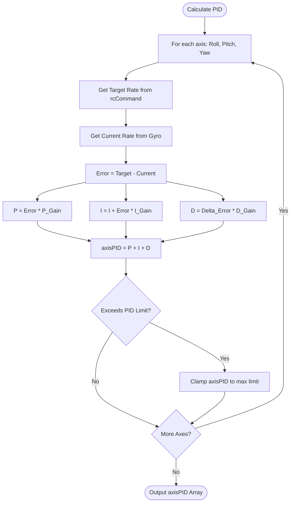
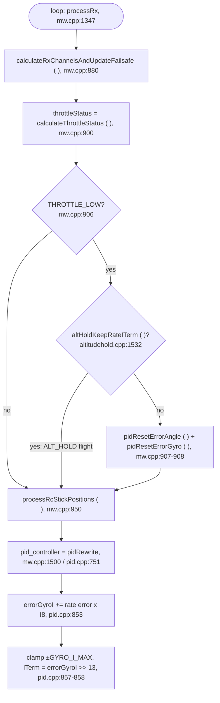
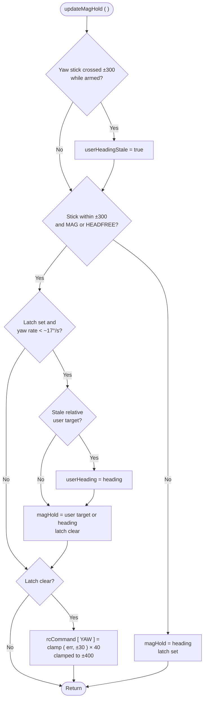

# Core PID Controller (`pid.cpp`)

## Overview
The PID (Proportional, Integral, Derivative) controller is the stabilizing brain of the drone. It compares the pilot's requested rotation rates (`rcCommand`) against the drone's actual physical rotation rates (from the IMU), and computes a mathematical error. It then outputs a correction value (`axisPID`) that is sent to the Mixer.

## Source Files
- **Controller Logic**: `src/main/flight/pid.cpp`, `src/main/flight/pid.h`
- **Default Gains**: `src/main/flight/pid_defaults.cpp` ( `pidProfileDefaultGains ( )` )
- **Profile Config**: `src/main/config/config_profile.h`
- **User API Hook**: `src/main/API-Src/FC-Config-PID.cpp` ( `get_PIDProfile`, `set_PIDProfile`, `setDefault_PIDProfile` )

## Key Data Structures
- `rcCommand[3]`: The target rates commanded by the user/GCS.
- `gyroADC[3]`: The current actual rotation rates in degrees per second.
- `axisPID[3]`: The final computed correction (-1000 to +1000) for Roll, Pitch, and Yaw.
- `pidProfile_t`: Holds the tuned P, I, and D multipliers.

## Default gains and the API reset
- `pidProfileDefaultGains ( pidProfile_t * )` ( `pid_defaults.cpp:38`, declared `pid.h:110` ) is the single source of the
  default `P8` / `I8` / `D8` for all eleven `pidIndex_e` slots. `resetPidProfile ( )` ( `config.cpp:175` ) calls it on a
  config reset ( `config.cpp:179` ) and sets the rest of the profile itself: `pidController`, the float gains, the cut
  frequencies, `A_level` / `H_level` / `H_sensitivity` and the GTUNE limits.
- `setDefault_PIDProfile ( )` ( `FC-Config-PID.cpp:155` ) restores only the five slots the PID API exposes,
  `apiSlot [] = { PIDROLL, PIDPITCH, PIDYAW, PIDALT, PIDUSER }` ( `FC-Config-PID.cpp:157` ), from a stack copy filled
  by `pidProfileDefaultGains ( )`. `PIDPOS`, `PIDPOSR`, `PIDNAVR`, `PIDLEVEL`, `PIDMAG` and `PIDVEL` are never
  written. The change is RAM only, and gains are read live every loop, so a call while armed steps the tuning in flight
  ( header comment, `FC-Config.h:97` ). Before FW 3.15.7 the function looped over all eleven slots with five-entry
  tables: it set ALT P8 to a stale 100 and overwrote the hidden gains, `PIDLEVEL` and `PIDVEL` included
  ( `active-development/set-default-pid-profile/` ).

## Primary Functions
- `pidController()`: The core execution loop. It iterates through the Roll, Pitch, and Yaw axes, computing the error and multiplying by the PID gains.
- `pidRewrite()` ( `pid.cpp:751` ): the controller in use. `pidController` defaults to 1 ( `config.cpp:176` ),
  which `pidSetController()` maps to `pidRewrite`. In ANGLE mode its angle loop is P only
  ( `desiredRate = errorAngle * P8[PIDLEVEL] >> 4` ), so the rate I-term `errorGyroI` is the only integrator that
  holds a constant moment such as an off-centre CG or a payload.
  In every mode the roll / pitch target is `desiredAngle = 2 * rcCommand + userAngleTarget ( axis )` ( `pid.cpp:813` ),
  clamped to ±`max_angle_inclination` before the error is taken ( `pid.cpp:814` ); `userAngleTarget ( )` is 0 outside
  ANGLE mode, so only ANGLE flies the user tilt. See **User roll / pitch tilt** below.
  The stick-to-rate scale is `rates [ axis ]` of the live rate profile ( `pid.cpp:794` ): yaw always uses it
  ( `desiredRate = ( rate + 20 ) * rcCommand >> 5`, `pid.cpp:799` ), roll / pitch only outside ANGLE mode
  ( `( rate + 20 ) * rcCommand >> 4`, `pid.cpp:818-819` ). See **Stick rates and the flip** below.
- `pidResetErrorAngle()` / `pidResetErrorGyro()` ( `pid.cpp:84` / `:93` ): zero the angle and rate I-terms. Called
  by the stick-low reset in `processRx ( )` unless an ALT_HOLD flight keeps them ( see below ), and by every arming
  path ( take-off, `Command_Arm`, chuck ).
- `pidGetGyroITerm ( axis )` / `pidGetGyroResetCount ( )` ( `pid.cpp:106` / `:114` ): read-only diagnostics, the rate
  I-term in axisPID units ( `pidRewrite` only; 0 under LuxFloat ) and the number of `pidResetErrorGyro ( )` calls since
  power-on ( wraps at 65535 ).
- `applyGyroData()`: Injects the raw IMU data into the PID logic.
- `updateMagHold()` ( `mw.cpp` ): heading hold, run every loop before the PID while a magnetometer is present. In MAG
  or HEADFREE mode, with the yaw stick within ±300, it replaces `rcCommand[YAW]` with the heading error to `magHold`.
  See **Heading hold** below.
- `plutoLoop()` (API): If an API application is active, it may intercept `axisPID` or `rcCommand` to inject autonomous flight corrections before the Mixer.

## Data Flow & Boundaries
- **P-Term Limit**: The Proportional correction is usually clamped to prevent an instantaneous massive error (like a prop strike) from commanding 100% motor output instantly.
- **I-Term Windup**: `pidRewrite` clamps `errorGyroI` to ±`GYRO_I_MAX` 256 motor counts ( `pid.cpp:857` ). On the
  ground the stick-low reset keeps it from integrating against the floor; in an ALT_HOLD flight the reset is skipped
  and it keeps integrating ( see *Stick-low I-term reset* below ). Note that `pid_at_min_throttle` is 1 by default
  ( `config.cpp:331`; forced to 0 only with `retarded_arm` ), so the PID keeps acting at idle on the floor.
- **D-Term Filtering**: The Derivative term calculates the *rate of change* of the error. Because differentiation amplifies high-frequency noise, the D-term operates on heavily filtered gyro data or error deltas to prevent motor smoking.

## User roll / pitch tilt ( `userAngleTarget`, API-Utils.cpp )
- `setDesiredAngle ( AG_ROLL | AG_PITCH, x )` stores a held tilt in `userDesiredAngle [ ]` ( deci-degrees, ±1800 ) and
  `isUserDesiredAngle [ ]` ( `FC-Config-Setpoints.cpp:91-99` ). `pidRewrite` adds `userAngleTarget ( axis )`
  ( `API-Utils.cpp:209` ) to its stick target ( `pid.cpp:813` ), before the clamp, so the pilot's stick adds on top and
  the sum keeps `max_angle_inclination`. The helper returns 0, keeping the tilt held, unless: Developer Mode ran within
  the last 0.6 s, ANGLE mode is on, `flipState == 0`, no landing runs ( `landingInProgress ( )` ), and the craft is
  airborne ( `throttleRaisedInFlight ( )` and `getEstAltitude ( ) >= 20` cm ). `userCode ( )` clears it at a real Dev
  Mode switch-off and on the disarm edge ( `mw.cpp:1262` ); it runs before `pid_controller ( )` in the same loop
  ( `mw.cpp:1429` / `:1500` ). Only `pidRewrite` reads it. The ANGLE loop is P only, so the tilt is reached with no
  integrator wind-up: flown at 5° it settled within 0.2-0.3 s and 1° ( log-2 of
  `active-development/set-desired-angle-roll-pitch/` ).

## Stick rates and the flip ( `rates [ ]`, acrobats.cpp )
- `rates [ FD_ROLL / FD_PITCH / FD_YAW ]` ( `uint8_t`, `rc_controls.h:145` ) are read by `pidRewrite` every loop
  ( `pid.cpp:794` ). Yaw scales the stick in every mode; roll / pitch only in ACRO / HORIZON and the flip's
  non-ANGLE states, so in ANGLE mode, the default, roll / pitch rates have no effect on `pidRewrite`. The other
  controllers also scale their dynamic P / I / D gains with the rates in every mode ( `annexCode ( )`,
  `mw.cpp:359-378` ); see `User_Space_API.md`, **Stick rates**.
- Writers: the flip ( `acrobats.cpp`, its own 75 / 110 while `flipState != 0`, then `restoreRestRates ( )` at its
  normal exits and on every disarmed loop ), `setDesiredRate ( )` ( `FC-Config-Setpoints.cpp:158`, roll / pitch not
  while a flip runs ), the app
  ( MSP_SET_RC_TUNING, `serial_msp.cpp:1516` ), in-flight adjustments ( `rc_controls.cpp:445-459` ) and the CLI
  ( `serial_cli.cpp:450-452` ).
- `restoreRestRates ( )` ( `acrobats.cpp:83` ) writes `userRollPitchRate ( )` ( `API-Utils.cpp:230` ): the
  `setDesiredRate` value when one is held, else 75 ( `STOCK_ROLL_PITCH_RATE`, `API-Utils.h:83` ). With no user rate
  this is the same 75 the flip code always wrote, so the effective roll / pitch rate is 75 on every craft ( the config
  default of 0, `config.cpp:319`, never survives the first disarmed loop ). Four abnormal 2 s flip timeouts would
  leave the flip axis at 110 until disarm, but none is reachable today ( only `FLIP_BACK` is ever commanded ); see
  `User_Space_API.md`, **Stick rates**.

## Stick-low I-term reset ( `processRx ( )`, mw.cpp )

On every RX pass, `processRx ( )` computes `throttleStatus` from the raw `rcData[THROTTLE]`: THROTTLE_LOW below
`mincheck` 1100 ( `rc_controls.cpp:131-139` ). At that point `rcData` was just rewritten from the receiver, so it is
the pilot's value ( equal to `rcDataPilot` ), except during the 600 ms invalid-pulse hold ( `rx.cpp:528` keeps the
previous `rcData`, which LAND or user code may have written ). With THROTTLE_LOW the angle and rate I-terms are zeroed
( `mw.cpp:906-908` ) unless `altHoldKeepRateITerm ( )` ( `altitudehold.cpp:1532` ) reports an ALT_HOLD flight:

| State | Condition | I-terms |
|---|---|---|
| ALT_HOLD flight | `ARMED && BARO_MODE && !altHoldGroundIdle && !altStickTouchdown && EstAlt >= 20 cm` ( `ALT_ITERM_KEEP_MIN_CM` ) | **kept**, and still integrating ( they hold the payload trim ) |
| Anything else: disarmed, THROTTLE mode, ARM-switch ground idle, below 20 cm, after a stick-descent touchdown | - | **reset** to 0 ( anti wind-up ) |

The touchdown latch is `updateStickTouchdown ( )` ( `altitudehold.cpp:560`, run every alt-hold pass at `:654` ). It sets
`altStickTouchdown` once a descent request of at least 15 cm/s ( `ALT_TOUCHDOWN_MIN_REQ_CMS` ) has been seen moving
below -8 cm/s and then stays arrested for 300 ms ( `ALT_TOUCHDOWN_VEL_CMS`, `ALT_TOUCHDOWN_MS`: the same test `land ( )`
uses ), and clears it when the request ends, at disarm or at ground idle. Only a fast request is watched ( the
stick-low band asks 23-30 cm/s ), so a slow partial descent cannot latch it in the air. With `alt_hold_fast_change` 1
( not the default ) the stick never sets `setVelocity`, the latch never fires, and only the 20 cm floor guards the reset.

Why: in ANGLE mode the rate I-term carries any CG offset. Zeroing it on a full stick-down ( the app's bottom position
is about 1004 ) left the craft held by the P terms alone, and it leaned toward an off-centre payload ( about 10 deg
with a 9 g servo, hover trim about -103 ) for the whole descent. See `active-development/cg-offset-takeoff-tilt/`
( `de9eef7`, shipped in v3.9.0 ). The freeze designed for the same lean in `active-development/payload-tilt-on-descent/`
( `a7f398d` ) is not in this firmware.

`throttleStatus` itself is unchanged: stick-arm, switch disarm, auto-disarm and the beeper still read it.

**Known limits.** The kept I-term goes on integrating while the stick is low. After a stick-down touchdown it winds
against the surface until the latch fires, 300 ms after the descent stops; the latch does not read `EstAlt`, so it
fires at any height. It never fires in two cases, and then the I-term winds until the stick comes up or the craft
disarms whenever `EstAlt` reads 20 cm or more ( a table above the arm point, or the 10-20 cm the baro reads high after a
warm flight ): the stick went fully down only after the craft had stopped ( set down with a partial stick, whose request
is under the 15 cm/s watch threshold, or nudged up after a touchdown, which clears the latch ), or `alt_hold_fast_change`
is 1. Against a surface the integrator reaches its ±`GYRO_I_MAX` clamp within about 1 s, and a roll / pitch tilt held
by user code ( `userAngleTarget ( )`, which also only checks `EstAlt` ) is still commanded there, which makes the
wind-up larger. THROTTLE mode still resets on a stick-down and leans. The `cg-offset-takeoff-tilt` topic logged the
cause but no validation flight of this change ( its task 8 ), and its take-off items ( hover-snapshot seed, take-off
I boost, tasks 5-6 ) are not implemented.

## Heading hold ( `updateMagHold`, mw.cpp )

Heading hold turns a target heading into a yaw-rate command. It is not part of the PID: it runs just before it in
the same loop ( `userCode ( )` → `updateMagHold ( )` → `pid_controller ( )` ) and writes `rcCommand[YAW]`, which the
rate PID then flies.

- **Target:** `magHold`, in degrees ( 0..359, like `heading` ). It is set by the pilot ( it follows the heading
  while yaw is commanded directly ), by the app ( `MSP_SET_HEAD` ), by a BOXMAG switch-on ( `magHold = heading` ), or by
  user code ( `setDesiredAngle` / `DesiredAngle_setRelative` on `AG_YAW`, restored from `userHeading` on every
  non-`plutoLoop` loop ). While disarmed with MAG or HEADFREE on, `processRx ( )` resets it to `heading`.
- **Active when** MAG or HEADFREE mode is on and `|rcData[YAW] − 1500| < 300`. Otherwise `magHold = heading` and the
  re-arm latch is set.
- **Command:** `headingError = heading − magHold`, wrapped to ±180, clamped to ±30°, then
  `rcCommand[YAW] = error × P8[PIDMAG]` ( 40 ), clamped to ±400. Full authority is reached at 10° of error.
- **Re-arm latch:** after the stick is released or the mode is switched on, no command is produced until the yaw gyro
  reads under ~17°/s ( `|gyroADC[YAW] / 4| < 70` ). The latch then re-arms on the user target if one is held,
  otherwise on the current heading. A relative user target is re-based to the heading first, but only if the yaw stick
  went out while armed since the target was set ( `userHeadingStale` ).

