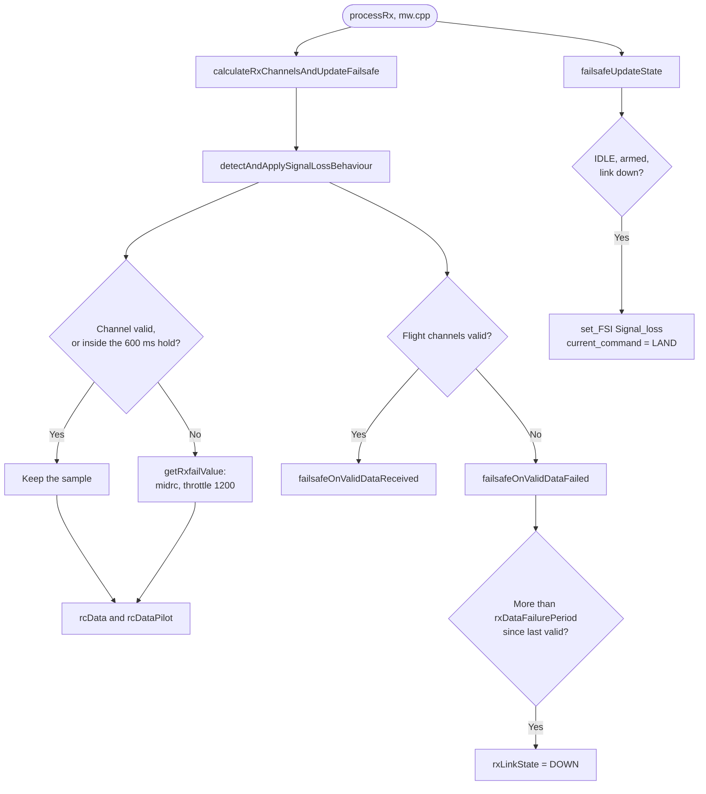

# Failsafe Subsystem (`failsafe.cpp`)

## Overview
The Failsafe module acts as an autonomous safety net. It runs continuously to monitor the health of the RC link. If the receiver loses signal or outputs invalid pulse data, the Failsafe overrides user inputs and dictates exactly how the drone behaves (e.g., level out, slowly descend, then cut motors).

## Source Files
- **Failsafe Core Logic**: `src/main/flight/failsafe.cpp`, `src/main/flight/failsafe.h`
- **RC Monitoring Hook**: `src/main/rx/rx.cpp`
- **Mixer Hook**: `src/main/flight/mixer.cpp`

## Key Data Structures
- `failsafeState_t` ( `failsafe.h` ): `rxLinkState` ( UP / DOWN ), `validRxDataReceivedAt` / `validRxDataFailedAt`
  ( ms ), `rxDataFailurePeriod` ( ms ) and the `phase`. Only `FAILSAFE_IDLE` is used in flight: on link loss
  it starts `LAND` directly.
- `failsafeConfig.failsafe_delay` ( deciseconds, default **15**, effective maximum **22** = `FAILSAFE_DELAY_MAX` ):
  the guard time added to `PERIOD_RXDATA_FAILURE` ( 200 ms ). `failsafeReset ( )` sets
  `rxDataFailurePeriod = 200 + MIN ( failsafe_delay, 22 ) × 100` ms, run from `activateConfig ( )` at boot and
  after every EEPROM reload. The CLI accepts 0-200 and MSP 0-255; both read back the stored value, but the
  firmware never uses more than 22.
- `failsafe_off_delay`, `failsafe_throttle`: stored and settable, but **not used**. `failsafeActivate ( )`,
  which would apply them, is never called.

## Primary Functions
- `failsafeOnValidDataReceived ( )` / `failsafeOnValidDataFailed ( )`: called by
  `detectAndApplySignalLossBehaviour ( )` ( `rx.cpp` ) on every RX update. Valid data refreshes
  `validRxDataReceivedAt`; the link goes UP again after `PERIOD_RXDATA_RECOVERY` ( 200 ms ) of valid data. Failed
  data sets `rxLinkState` DOWN once more than `rxDataFailurePeriod` has passed since the last valid data.
- `failsafeUpdateState ( )`: called from `processRx ( )`. In `FAILSAFE_IDLE`, if the craft is armed and the link is
  down, it sets `Signal_loss` and starts `LAND`. Once the craft is disarmed and data arrives again, it clears
  `Signal_loss` and sets `Ok_to_arm`.
- `failsafeApplyControlInput ( )`: legacy and not reachable ( see `failsafe_off_delay` ).

## Data Flow & Boundaries
- **Timeline from the last `MSP_SET_RAW_RC` frame** ( `Rx_ESP` / MSP, default `failsafe_delay` 15 ):

  | After | What happens |
  |---|---|
  | 0-200 ms | The last frame is replayed; the channels count as valid |
  | 200 ms | `rxSignalReceived` drops ( `DELAY_5_HZ` ); Developer Mode stops ( `onLoopFinish ( )`, user overrides cleared ); the stick hold starts |
  | ~800 ms | The hold ends ( `MAX_INVALID_PULS_TIME` 600 ms ): roll / pitch / yaw go to midrc and throttle to 1200, into both `rcData` and `rcDataPilot`; AUX channels are held, so ARM stays on |
  | ~2.5 s | The link is declared down ( 800 ms + 200 ms + 1500 ms ) → `Signal_loss`, `LAND` |

  Budget to `LAND`: `failsafe_delay` 0 → ~1.0 s, 15 → ~2.5 s, 22 or more → ~3.2 s. Before FW 3.11.2 the delay was
  ignored and `LAND` always came at ~1.0 s. Wi-Fi / TCP stalls of 1.2-2.2 s on a healthy link are normal.
- **During the window** ( ~0.8 s to `LAND` ): throttle 1200 lowers the ALT_HOLD setpoint at ~16 cm/s; in ANGLE
  throttle mode it is below hover and the craft sinks. Throttle 1200 is above `mincheck`, so there is no auto-disarm.
- **Recovery:** frames that return before the link is declared down cancel nothing, because nothing has
  latched. The sticks go live again and Developer Mode restarts. After the link is declared down, `LAND` stays
  latched until the craft disarms.
- **Failsafe switch** ( `BOXFAILSAFE`, if mapped from the app or CLI; not mapped by default ): the sticks centre at
  once, but `LAND` starts only after 200 ms + `failsafe_delay` ( ~1.7 s ), as for link loss. Before FW 3.11.2 it was
  ~0.2 s.
- **ELRS / PPM** use a 100 ms signal timeout ( `DELAY_10_HZ` ) instead of 200 ms: hold to ~700 ms, `LAND` ~2.4 s.
- **Do not lengthen the hold** ( `MAX_INVALID_PULS_TIME`, `DELAY_5_HZ` ). During the hold the craft keeps flying the
  last stick input; `failsafe_delay` extends only the sticks-centred phase.
- **Critical battery**: `batteryCriticalAutoLand ( )` ( `mw.cpp` ) starts the same `LAND` command as the RX-loss
  path on a confirmed critical battery level; the battery code itself never disarms. See
  [Power_BMS_Pipeline.md](Power_BMS_Pipeline.md).

### RC link loss

## Crash Detector ( `failsafeOnCrash ( )` )

`failsafeOnCrash ( )` ( [failsafe.cpp:362](../../../../src/main/flight/failsafe.cpp#L362) ) runs once per control loop
( 3.5 ms, called from [mw.cpp:1424](../../../../src/main/mw.cpp#L1424) ). It is active only while **armed, `fsCrash` on
and in ANGLE mode**. `fsCrash` is on by default; user code can switch it with `Failsafe_enable / disable ( CRASH )`. It
disarms on **one sample** in which any of these terms is true:

| Term | Limit | In g / degrees |
|---|---|---|
| `angleTrip`: \|roll\| or \|pitch\| | > 700 deci-degrees | 70° ( commanded tilt is limited to 20° ) |
| `smoothTrip`: \|`accSmooth` X\| or \|Y\| | > 5000 LSB | 1.22 g ( filtered, `acc_1G` 4096 ) |
| `rawTrip`: \|`accADC` X\| or \|Y\| | > 8000 LSB | 1.95 g ( chip low-pass ~5.7 Hz ) |

- **Why these limits:** in flight logs a survivable bump peaks at up to ~1.3 g raw. A contact that tips the craft over
  is no bigger, and is caught by the 70° term within ~0.35 s. The accel terms catch a hard hit on the first sample,
  before the tumble. Both limits are above 1 g, so tilt alone never trips them. Before FW 3.11.1 the limits were 0.305 g
  and 0.427 g, which disarmed on light bumps. Evidence:
  [crash-detect-false-trigger](../../active-development/crash-detect-false-trigger/INVESTIGATION.md).
- **During a flip** ( `flipState >= 1`, `ENABLE_ACROBAT` ) the detector returns without acting.
- **On a trip:** `set_FSI ( Crash )` then `mwDisarm ( )`. The craft disarms; it does not land and does not halt the
  board.
- **Flag clear:** about 300 ms after the trip, once the craft is level ( `SMALL_ANGLE` ), `Crash` is cleared
  ( [mw.cpp:484-494](../../../../src/main/mw.cpp#L484) ) and the craft can be armed again. While `Crash` is set,
  arming by gesture is blocked ( [rc_controls.cpp:183](../../../../src/main/io/rc_controls.cpp#L183) ).
- **Not detected:**
  - a craft pinned upright against a wall;
  - a ceiling hit or an upright drop ( Z is not checked );
  - a craft caught by a hand or a curtain;
  - a craft resting tilted at 20-69°;
  - any crash outside ANGLE mode.

  The pilot's ARM switch covers these. Follow-up: Planned topic
  [crash-stuck-detection](../../active-development/crash-stuck-detection/README.md).

