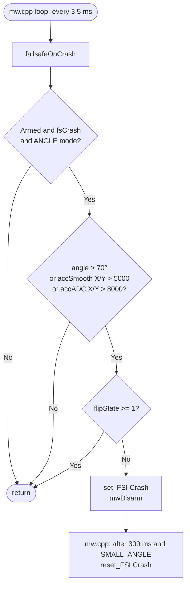
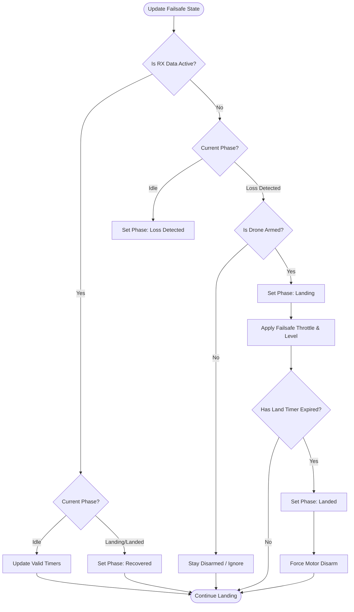

# Failsafe Subsystem (`failsafe.cpp`)

## Overview
The Failsafe module acts as an autonomous safety net. It runs continuously to monitor the health of the RC link. If the receiver loses signal or outputs invalid pulse data, the Failsafe overrides user inputs and dictates exactly how the drone behaves (e.g., level out, slowly descend, then cut motors).

## Source Files
- **Failsafe Core Logic**: `src/main/flight/failsafe.cpp`, `src/main/flight/failsafe.h`
- **RC Monitoring Hook**: `src/main/rx/rx.cpp`
- **Mixer Hook**: `src/main/flight/mixer.cpp`

## Key Data Structures
- `failsafeState_t`: Tracks the current state machine (`FAILSAFE_IDLE`, `FAILSAFE_RX_LOSS_DETECTED`, `FAILSAFE_LANDING`, `FAILSAFE_LANDED`).
- `failsafeConfig()->failsafe_delay`: The required time (e.g., 10 deciseconds) of continuous signal loss before triggering the landing sequence.
- `rcCommand[THROTTLE]`: Overwritten during a failsafe landing to `failsafeConfig()->failsafe_throttle`.

## Primary Functions
- `failsafeUpdateState()`: Polled continuously by the main loop. It checks the `rxData` validity timestamps and transitions the state machine if the signal timeout is exceeded.
- `failsafeApplyControlInput()`: If failsafe is actively landing, this function intercepts the PID pipeline. It zeroes out user Pitch/Roll (forcing the drone to auto-level) and applies a pre-configured low throttle value to descend.
- `mwDisarm()`: Called to instantly stop the motors once the `FAILSAFE_LANDED` timer expires or if the drone wasn't armed to begin with.

## Data Flow & Boundaries
- **Detection Delays**: Brief dropouts (< 0.5s) are usually smoothed over and ignored. The `failsafe_delay` boundary must be crossed to transition from `IDLE` to `LOSS_DETECTED`.
- **Landing Timer**: The `failsafe_off_delay` specifies how long the drone is allowed to execute its auto-level descent (e.g., 15 seconds) before it forcefully disarms to prevent burning motors on the ground.
- **Override Strictness**: When `failsafeApplyControlInput()` is active, the User API (`PlutoPilot`) and Pilot inputs are completely ignored. The Failsafe dictates the `rcCommand` struct exclusively.
- **Critical battery**: `batteryCriticalAutoLand ( )` ( `mw.cpp` ) starts the same `LAND` command as the RX-loss path on a confirmed critical battery level; the battery code itself never disarms. See [Power_BMS_Pipeline.md](Power_BMS_Pipeline.md).

## Crash Detector ( `failsafeOnCrash ( )` )

`failsafeOnCrash ( )` ( [failsafe.cpp:362](../../../../src/main/flight/failsafe.cpp#L362) ) runs once per control loop
( 3.5 ms, called from [mw.cpp:1424](../../../../src/main/mw.cpp#L1424) ). It is active only while **armed, `fsCrash` on
and in ANGLE mode**. `fsCrash` is on by default; user code can switch it with `Failsafe_enable / disable ( CRASH )`. It
disarms on **one sample** in which any of these terms is true:

| Term | Limit | In g / degrees |
|---|---|---|
| `angleTrip`: \|roll\| or \|pitch\| | > 700 deci-degrees | 70° ( commanded tilt is limited to 20° ) |
| `smoothTrip`: \|`accSmooth` X\| or \|Y\| | > 5000 LSB | 1.22 g ( filtered, `acc_1G` 4096 ) |
| `rawTrip`: \|`accADC` X\| or \|Y\| | > 8000 LSB | 1.95 g ( chip low-pass ~5.7 Hz ) |

- **Why these limits:** in flight logs a survivable bump peaks at up to ~1.3 g raw. A contact that tips the craft over
  is no bigger, and is caught by the 70° term within ~0.35 s. The accel terms catch a hard hit on the first sample,
  before the tumble. Both limits are above 1 g, so tilt alone never trips them. Before FW 3.11.1 the limits were 0.305 g
  and 0.427 g, which disarmed on light bumps. Evidence:
  [crash-detect-false-trigger](../../active-development/crash-detect-false-trigger/INVESTIGATION.md).
- **During a flip** ( `flipState >= 1`, `ENABLE_ACROBAT` ) the detector returns without acting.
- **On a trip:** `set_FSI ( Crash )` then `mwDisarm ( )`. The craft disarms; it does not land and does not halt the
  board.
- **Flag clear:** about 300 ms after the trip, once the craft is level ( `SMALL_ANGLE` ), `Crash` is cleared
  ( [mw.cpp:484-494](../../../../src/main/mw.cpp#L484) ) and the craft can be armed again. While `Crash` is set,
  arming by gesture is blocked ( [rc_controls.cpp:183](../../../../src/main/io/rc_controls.cpp#L183) ).
- **Not detected:**
  - a craft pinned upright against a wall;
  - a ceiling hit or an upright drop ( Z is not checked );
  - a craft caught by a hand or a curtain;
  - a craft resting tilted at 20-69°;
  - any crash outside ANGLE mode.

  The pilot's ARM switch covers these. Follow-up: Planned topic
  [crash-stuck-detection](../../active-development/crash-stuck-detection/README.md).

