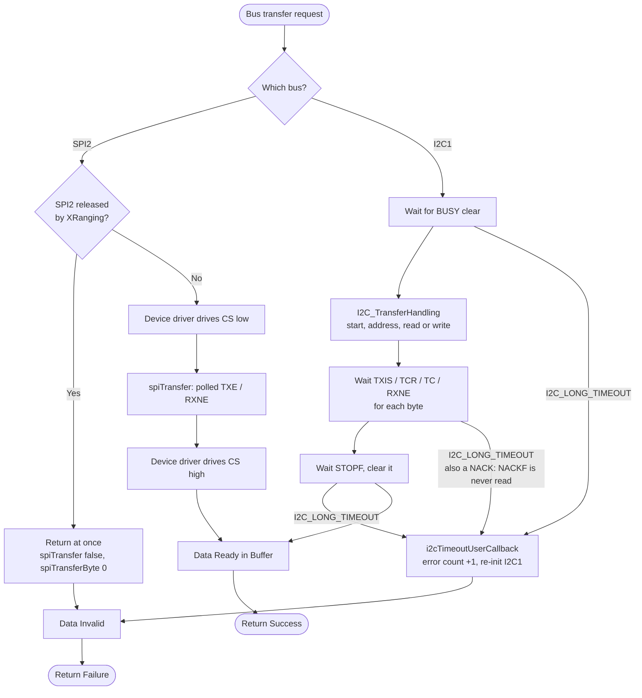

# Hardware Bus Pipeline (I2C & SPI)

## Overview
The Hardware Bus abstraction layer acts as the physical communication bridge between the STM32F3 microcontroller and the onboard peripherals (IMUs, Barometers, Magnetometers, Time-of-Flight sensors). I2C is **polled**: every transaction busy-waits on the peripheral's status flags ( `I2C_LONG_TIMEOUT`, then a bus recovery on timeout ) and blocks the loop until it finishes. There is no I2C DMA or interrupt. Peripherals on the shared I2C1 bus must therefore budget their bytes per loop.

## Source Files
- **I2C Drivers**: `src/main/drivers/bus_i2c.h`, `src/main/drivers/bus_i2c_stm32f30x.c`, `src/main/drivers/bus_i2c_soft.cpp`
- **SPI Drivers**: `src/main/drivers/bus_spi.h`, `src/main/drivers/bus_spi.c`
- **Peripheral Setup**: `src/main/drivers/system_stm32f30x.c`
- **Laser bus use**: `src/main/drivers/tof_manager.cpp` ( polling ), `src/main/API-Src/XRanging.cpp` ( `xRangingInit ( )`: addresses, SPI2 release )

## Key Data Structures
- `I2CDevice`: Enumerator representing the I2C buses ( `I2CDEV_1`, `I2CDEV_2` ). Every target uses `I2CDEV_1` ( `I2C_DEVICE` in `target.h` ).
- SPI buses are passed as `SPI_TypeDef *` ( `SPI1`, `SPI2` ). The three targets enable `SPI2` only ( `USE_SPI_DEVICE_2` ).
- `i2c1ErrorCount` / `i2c2ErrorCount`: one count of failed transfers per bus ( `i2cGetErrorCounter ( )` ). There is no error type: a NACK, a missing device and a stuck bus all end as a timeout.

## Primary Functions
- `i2cInit()` / `spiInit()`: configure the GPIO alternate functions and clock speeds for the bus. I2C uses no DMA. `spiInit ( SPI2 )` returns false once SPI2 is released.
- `i2cRead()` / `i2cWrite()` / `i2cWriteBuffer()`: blocking, polled I2C transactions at 400 kHz
  ( `I2C_Timing` 0x00E0257A ). A byte costs ~25 µs on the wire plus per-transaction overhead.
- `spiTransfer()` / `spiTransferByte()`: synchronous, polled SPI exchange ( TXE / RXNE, 1000-count timeout ). On these targets SPI2 carries the M25P16 flash and the user SPI API; the IMU is on I2C1. On a released SPI2 they return at once ( `false` / 0 ).
- `spiRelease ( SPI2 )` / `spiIsReleased ( )`: switch SPI2 off for the rest of the run ( see below ).

## Data Flow & Boundaries
- **I2C errors ( limitation )**: the driver never reads the NACK flag ( NACKF ). A device that does not acknowledge
  ( absent, held in reset, wrong address ) only leaves the flag the driver waits for unset. The transfer therefore
  costs the full `I2C_LONG_TIMEOUT` ( 10 × 0x1000 polling counts ). Then `i2cTimeoutUserCallback ( )` counts the
  error and re-initialises the I2C1 peripheral ( disable, clear flags, enable, `i2cInitPort ( )` ). The caller gets
  false and cannot tell a NACK from a stuck bus. Each probe of an absent device stalls the loop for one timeout. The
  laser bring-up probes 0x29 at most 6 times, at boot only.
- **SPI Constraints**: SPI is polled like I2C. The clock is bounded by the device ( `spiSetDivisor ( )` ).
- **Shared I2C1 budget**: the IMU ( ICM-20948 ), barometer, magnetometer, INA219, the OLED ( 0x3C ) and the VL53L0X
  lasers share I2C1 inside the gated loop.
  The OLED never writes the panel from the loop directly. Drawing goes to a 1 KB RAM framebuffer, and
  `oledFlushStep ( )` ( called from `OledDisplayData ( )`, `mw.cpp:1126` ) sends at most **one run of up to 16 changed
  bytes per loop** ( ~0.6 ms ), and only while the frame differs from what the panel shows. The old per-byte
  writes ( ~630 transactions, 45-60 ms every 200 ms ) made the drone twitch at 5 Hz
  ( [oled-flight-wobble](../../active-development/oled-flight-wobble/README.md) ).
- **Laser addresses on I2C1**: every VL53L0X boots at 0x29. The single bring-up ( `xRangingInit ( )`, main.cpp:594 )
  moves each one while it is alone on the bus:
  - the down-laser goes to **0x30**;
  - each side laser goes to **0x2A + n**, where n counts the enabled side lasers before it in table order ( LEFT, RIGHT,
    FRONT, BACK, EXTERNAL ).

  With VL53L0X lasers, 0x29 is in use only during the bring-up, with one exception: a fitted laser that is not
  enabled stays awake at 0x29, and every release after it is refused ( `BUS_BUSY` ). A VL53L1X ( `LASER_TOF_L1x` )
  stays at 0x29. A user I2C device must not use 0x29-0x2E or 0x30 while lasers are fitted.
- **Laser I2C load**: `UPDATE_LASER_TOF_TASK` polls the down-laser every 33 ms ( start + read ). It also polls one
  side laser per 10 ms: a data-ready read, plus the result read and the interrupt clear only when a sample is ready.
  Readers ( `XRanging.getRange ( )`, object avoidance ) use the cached sample and make no I2C call. The worst laser-task
  call measured 1.9-2.2 ms ( one down read plus one side read ), and the mean was 13 µs
  ( [tof-single-pipeline TESTING.md](../../active-development/tof-single-pipeline/TESTING.md), test 3 ).
- **Laser errors**: each laser has its own status. A failed read marks only that laser I2C_ERROR, and it is not
  polled again until a power cycle.
- **SPI2 is off whenever XRanging is used**: SPI2's pins are GPIO_5-8 ( PB15 MOSI, PB14 MISO, PB13 SCK, PB12 NSS /
  flash CS ), and XRanging uses them as XSHUT and LED pins. If user code requests any laser, `xRangingInit ( )` calls
  `spiRelease ( SPI2 )` and `m25p16_release ( )` before it touches a laser pin:
  - SPI2 is disabled and its clock stopped.
  - Pins still in SPI2's alternate function ( AF5 ) become pulled-up inputs. Pins user code already took in
    `plutoInit ( )` are left alone, and PB12 is not touched.
  - From then on `spiInit ( SPI2 )` fails, SPI2 transfers return at once, the flash reports size 0 and the user SPI
    API does nothing.

  Without XRanging, SPI2 and the flash are unchanged.
- **OLED failure**: if the panel stops answering ( 3 failed runs in a row, or more than ~1 in 5 failing ), the
  OLED is switched off, so a loose connector cannot keep stalling the loop. The 2 s start-up splash still writes
  the panel directly, at boot only.

