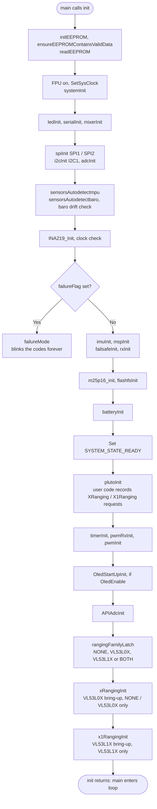
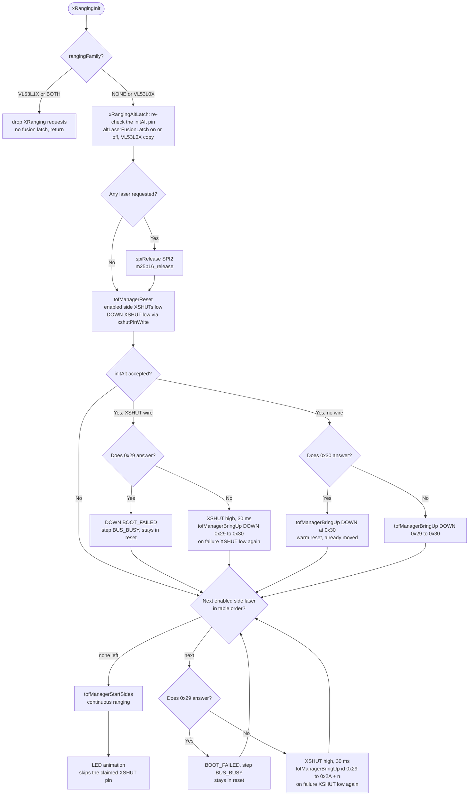
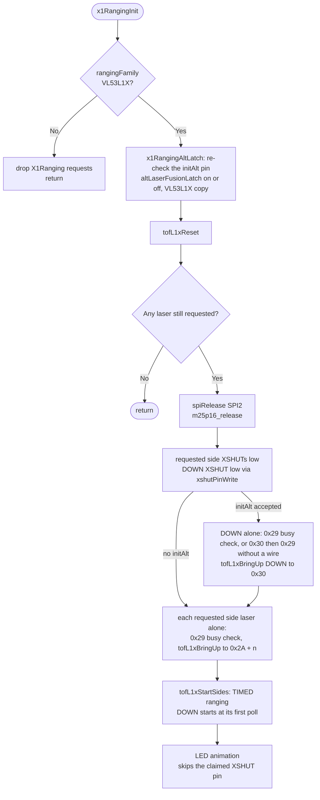

# Main Initialization (`init()` in `main.cpp`)

## Overview
When the STM32F3 MCU boots, `main()` immediately calls `init()`. This phase is critical for establishing the operational baseline of the flight controller: setting up hardware peripherals (clocks, DMA, timers), allocating necessary RAM, and probing the I2C/SPI buses to check sensor health before permitting flight.

## Source Files
- **Bootloader & Main Entry**: `src/main/main.cpp`
- **Hardware Bootstrap**: `src/main/drivers/system_stm32f30x.c`
- **EEPROM Storage**: `src/main/config/config.cpp`
- **Boot failure codes**: `src/main/drivers/system.c` ( `failureMode ( )` )
- **Laser start-up**: `src/main/API-Src/XRanging.cpp` ( `rangingFamilyLatch ( )`, `xRangingInit ( )` ), `src/main/API-Src/X1Ranging.cpp` ( `x1RangingInit ( )` ), `src/main/drivers/tof_manager.cpp` ( VL53L0X ), `src/main/drivers/tof_manager_l1x.cpp` ( VL53L1X ), `src/main/drivers/ranging_vl53l0x.cpp`, `src/main/drivers/tof_dev_area.cpp`

## Key Data Structures
- `masterConfig`: The globally loaded configuration structure read from EEPROM. Contains settings for sensors, PID tuning, and UART configurations.
- `hw_timer_t`: Timers instantiated for PWM/Motor output and system scheduling.
- `systemState`: boot progress bits ( `CONFIG_LOADED`, `SENSORS_READY`, `MOTORS_READY`, `READY` ). Only `HardFault_Handler ( )` reads it: it stops the motors once config and motors are ready. Nothing gates the loop on it.
- `failureFlag`: one bit per required device that failed ( IMU, barometer, baro drift at start-up, INA219, external clock ).
- `rangingFamily ( )` ( `API-Src/XRanging.cpp` ): the laser family of the run, latched once after `plutoInit ( )`: `RANGING_NONE`, `RANGING_VL53L0X` ( XRanging only ), `RANGING_VL53L1X` ( X1Ranging only ) or `RANGING_BOTH` ( both refused ).
- `tofTable`: one table per laser manager, `drivers/tof_manager.cpp` ( VL53L0X ) and `drivers/tof_manager_l1x.cpp` ( VL53L1X ). Each has one entry per laser ( LEFT, RIGHT, FRONT, BACK, EXTERNAL, DOWN ) with its own status, filled by that family's bring-up.
- `tofDevArea` ( `drivers/tof_dev_area.cpp` ): one RAM area for the ST device structs, a union of 6 × `VL53L0X_Dev_t` and 6 × `VL53L1_Dev_t` ( 5592 B ). Only the latched family's manager touches it ( `Hardware_Bus_Pipeline.md` ).

## Primary Functions
- `init()`: The master bootstrapping sequence.
- `systemInit()`: Initializes the ARM Cortex-M4 FPU, sets the core clock to 72MHz, and enables the SysTick timer for `millis()` and `micros()` timing.
- `readEEPROM()`: Loads user configurations. If the checksum fails or the firmware version differs, it executes a `resetEEPROM()` to load safe defaults.
- `sensorsAutodetectmpu()` / `sensorsAutodetectbaro()`: probe the IMU and the barometer. A failure sets its bit in `failureFlag`. After the INA219 and clock checks, a non-zero `failureFlag` halts the boot in `failureMode()`, which blinks the failure codes forever.
- `rangingFamilyLatch()`: records once which laser API user code enabled lasers with in `plutoInit()`.
- `xRangingInit()` / `x1RangingInit()`: the VL53L0X and VL53L1X bring-ups. Both are called once, near the end of `init()` after `plutoInit()`, and only the latched family's bring-up starts lasers. Only the UWB UART setup ( `localisationType == UWB` ) follows them.

## Data Flow & Boundaries
- **Blocking Boot**: The `init()` sequence is strictly synchronous. Only the required devices stop it: a missing IMU or barometer, a baro that drifts at start-up, a missing INA219 or the internal clock end in `failureMode()`. Other devices do not stop the boot. A laser that fails is marked BOOT_FAILED in its own `tofTable` entry ( `XRanging.getStatus ( )` / `X1Ranging.getStatus ( )` report it ), and the boot carries on. Nothing is retried.
- **I2C Bus Lockups**: A common initialization failure is a locked I2C bus. The boot sequence often toggles the SCL/SDA pins manually via GPIO to flush stalled sensor lines before initializing the hardware I2C peripheral.
- **`SYSTEM_STATE_READY` is not the last step.** It is set at main.cpp:509, after the battery init but **before** `plutoInit ( )`, the motor timers ( `timerInit ( )`, `pwmInit ( )` ), the OLED start-up, `APIAdcInit ( )` and the laser start-up. Nothing waits for it: the loop starts when `init ( )` returns ( main.cpp:620 ).
- **Laser family, after `plutoInit ( )`.** There is no build switch: one image drives either laser family. `XRanging` and `X1Ranging` calls in `plutoInit ( )` only record requests. A request counts when it enables a laser: `init`, `initObjectAvoidance` with a side laser, or an accepted `initAlt`. On all three targets, main.cpp:584-586 then run:
  1. `rangingFamilyLatch ( )`: NONE ( no request ), VL53L0X ( XRanging only ), VL53L1X ( X1Ranging only ) or BOTH.
  2. `xRangingInit ( )`: brings up the VL53L0X lasers for VL53L0X. For NONE it latches the fusion off and starts nothing. For VL53L1X or BOTH it drops XRanging's requests and returns.
  3. `x1RangingInit ( )`: brings up the VL53L1X lasers for VL53L1X. For any other family it drops X1Ranging's requests and returns.
- **Both APIs used ( BOTH ) → both refused.** Both bring-ups return before any pin or bus access. No laser starts and no XSHUT is driven. SPI2 and the flash stay on. Nobody latches the altitude-laser fusion, so the estimator stays on the baro ( τ 2 s ). Every getter of both APIs returns −1 / `LASER_NOT_ENABLED`, even after an `initAlt` that returned `true`, and object avoidance does not run.
- **One bring-up per family.** The VL53L0X and VL53L1X bring-ups follow the same order:
  1. **Latches** the down-laser request ( its pin re-checked ) and the altitude-laser fusion for the run.
  2. **Releases SPI2** if any laser is still requested.
  3. **Holds every requested laser in reset** ( XSHUT low ).
  4. **Brings up the down-laser alone** and moves it to 0x30.
  5. **Brings up the side lasers one at a time** and moves each to 0x2A + n.
  6. **Starts ranging** on the side lasers ( the VL53L1X down-laser starts at its first poll ).
  7. **Runs the LED animation.**

  Before each release, 0x29 must be silent; if it is not, that laser stays in reset ( BOOT_FAILED, step `BUS_BUSY` ). Each probe of an empty 0x29 costs one I2C timeout ( `Hardware_Bus_Pipeline.md` ). The VL53L1X bring-up also waits for the chip to boot ( up to 10 reads, 1 ms apart ) and moves its address before `VL53L1_DataInit` ( `Altitude_Hold_Estimator.md`, **VL53L1X down-laser** ).
- **SPI2 release.** SPI2's pins are GPIO_5-8, which both laser APIs use as XSHUT and LED pins. If any laser of the latched family is requested ( DOWN counts after the latch ), `spiRelease ( SPI2 )` and `m25p16_release ( )` run before any laser pin is touched:
  - SPI2 is switched off for the run, and the M25P16 flash reports size 0.
  - SPI calls in `plutoInit ( )` still work; from here on the user SPI API does nothing.
  - Without a laser, or with both APIs used, SPI2 and the flash stay as set up at main.cpp:313 and :445.

Boot order ( main steps; smaller ones are left out ):

The VL53L0X bring-up ( `xRangingInit ( )` ):

The VL53L1X bring-up ( `x1RangingInit ( )` ). The down-laser and side-laser steps are those of the VL53L0X chart, with
`tofL1xProbe` and `tofL1xBringUp`:

