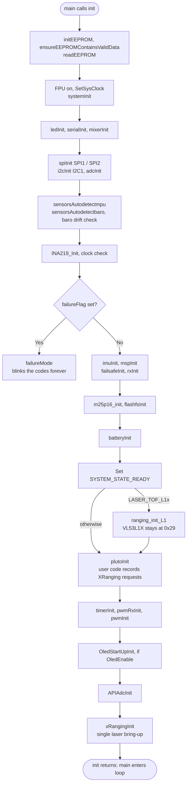
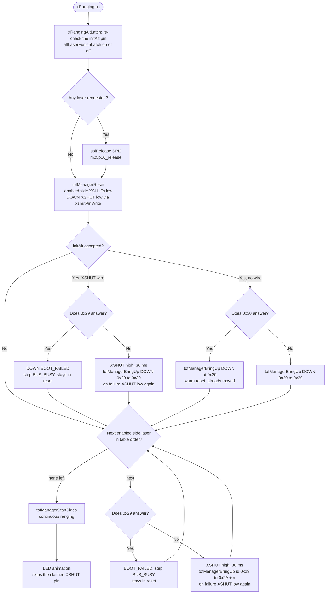

# Main Initialization (`init()` in `main.cpp`)

## Overview
When the STM32F3 MCU boots, `main()` immediately calls `init()`. This phase is critical for establishing the operational baseline of the flight controller: setting up hardware peripherals (clocks, DMA, timers), allocating necessary RAM, and probing the I2C/SPI buses to check sensor health before permitting flight.

## Source Files
- **Bootloader & Main Entry**: `src/main/main.cpp`
- **Hardware Bootstrap**: `src/main/drivers/system_stm32f30x.c`
- **EEPROM Storage**: `src/main/config/config.cpp`
- **Boot failure codes**: `src/main/drivers/system.c` ( `failureMode ( )` )
- **Laser bring-up**: `src/main/API-Src/XRanging.cpp` ( `xRangingInit ( )` ), `src/main/drivers/tof_manager.cpp`, `src/main/drivers/ranging_vl53l0x.cpp`

## Key Data Structures
- `masterConfig`: The globally loaded configuration structure read from EEPROM. Contains settings for sensors, PID tuning, and UART configurations.
- `hw_timer_t`: Timers instantiated for PWM/Motor output and system scheduling.
- `systemState`: boot progress bits ( `CONFIG_LOADED`, `SENSORS_READY`, `MOTORS_READY`, `READY` ). Only `HardFault_Handler ( )` reads it: it stops the motors once config and motors are ready. Nothing gates the loop on it.
- `failureFlag`: one bit per required device that failed ( IMU, barometer, baro drift at start-up, INA219, external clock ).
- `tofTable` ( `drivers/tof_manager.cpp` ): one entry per VL53L0X ( LEFT, RIGHT, FRONT, BACK, EXTERNAL, DOWN ), each with its own status, filled by the laser bring-up.

## Primary Functions
- `init()`: The master bootstrapping sequence.
- `systemInit()`: Initializes the ARM Cortex-M4 FPU, sets the core clock to 72MHz, and enables the SysTick timer for `millis()` and `micros()` timing.
- `readEEPROM()`: Loads user configurations. If the checksum fails or the firmware version differs, it executes a `resetEEPROM()` to load safe defaults.
- `sensorsAutodetectmpu()` / `sensorsAutodetectbaro()`: probe the IMU and the barometer. A failure sets its bit in `failureFlag`. After the INA219 and clock checks, a non-zero `failureFlag` halts the boot in `failureMode()`, which blinks the failure codes forever.
- `xRangingInit()`: the single VL53L0X bring-up. It runs once, near the end of `init()` after `plutoInit()`; only the UWB UART setup ( `localisationType == UWB` ) follows it.

## Data Flow & Boundaries
- **Blocking Boot**: The `init()` sequence is strictly synchronous. Only the required devices stop it: a missing IMU or barometer, a baro that drifts at start-up, a missing INA219 or the internal clock end in `failureMode()`. Other devices do not stop the boot. A laser that fails is marked BOOT_FAILED in its own `tofTable` entry ( `XRanging.getStatus ( )` reports it ), and the boot carries on. Nothing is retried.
- **I2C Bus Lockups**: A common initialization failure is a locked I2C bus. The boot sequence often toggles the SCL/SDA pins manually via GPIO to flush stalled sensor lines before initializing the hardware I2C peripheral.
- **`SYSTEM_STATE_READY` is not the last step.** It is set at main.cpp:513, after the battery init but **before** `plutoInit ( )`, the motor timers ( `timerInit ( )`, `pwmInit ( )` ), the OLED start-up, `APIAdcInit ( )` and the laser bring-up. Nothing waits for it: the loop starts when `init ( )` returns ( main.cpp:628 ).
- **One laser bring-up, after `plutoInit ( )`.** `xRangingInit ( )` runs at main.cpp:594 on all three targets. Every `XRanging` request from user code is known by then: `initAlt`, `init` and `initObjectAvoidance` only record requests. In order, the bring-up:
  1. **Latches** the down-laser request and the altitude-laser fusion for the run.
  2. **Releases SPI2** if any laser is requested.
  3. **Holds every enabled laser in reset** ( XSHUT low ).
  4. **Brings up the down-laser alone** and moves it to 0x30.
  5. **Brings up the side lasers one at a time** and moves each to 0x2A + n.
  6. **Starts continuous ranging** on the side lasers.
  7. **Runs the LED animation.**

  Before each release, 0x29 must be silent; if it is not, that laser stays in reset ( BOOT_FAILED, step `BUS_BUSY` ). Each probe of an empty 0x29 costs one I2C timeout ( `Hardware_Bus_Pipeline.md` ).
- **SPI2 release.** SPI2's pins are GPIO_5-8, which XRanging uses as XSHUT and LED pins. If any laser is requested ( DOWN counts after the latch ), `spiRelease ( SPI2 )` and `m25p16_release ( )` run before any laser pin is touched:
  - SPI2 is switched off for the run, and the M25P16 flash reports size 0.
  - SPI calls in `plutoInit ( )` still work; from here on the user SPI API does nothing.
  - Without XRanging, SPI2 and the flash stay as set up at main.cpp:312 and :449.
- **VL53L1X.** With `LASER_TOF_L1x`, `ranging_init_L1 ( )` runs at main.cpp:517, before `plutoInit ( )`, and leaves the VL53L1X at 0x29. The XRanging bring-up does not change it.

Boot order ( main steps; smaller ones are left out ):

The laser bring-up ( `xRangingInit ( )` ):

