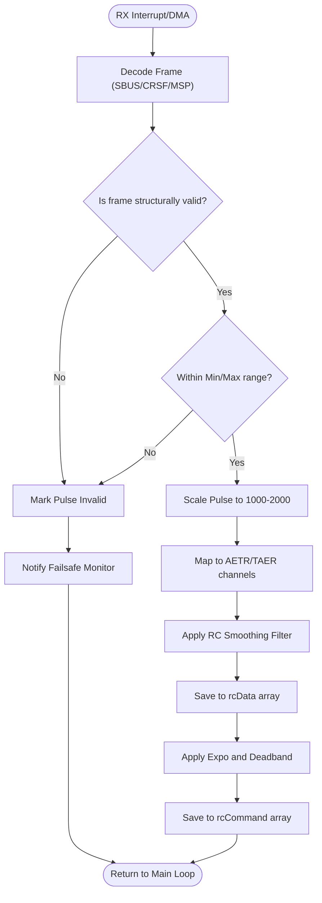

# RC Input Pipeline (`rx.cpp`)

## Overview
The receiver subsystem fetches external control data, validates it, smooths it, and maps it to the internal `rcCommand` array which drives the drone. This subsystem also hooks directly into the Failsafe mechanism if invalid pulses or connection drops are detected.

## Source Files
- **Core Logic**: `src/main/rx/rx.cpp`, `src/main/rx/rx.h`
- **RC Mapping Curves**: `src/main/io/rc_curves.cpp`
- **Protocol Drivers**: `src/main/rx/crsf.c`, `src/main/rx/sbus.c`, `src/main/rx/msp.c`

## Key Data Structures
- `rcData[MAX_SUPPORTED_RC_CHANNEL_COUNT]`: The raw, smoothed pulse width data (scaled to roughly 1000-2000).
- `rcCommand[4]`: The finalized, mapped stick commands for Roll, Pitch, Yaw, and Throttle.
- `rxRuntimeConfig`: Tracks the active RC protocol, channel mapping (e.g., AETR1234), and min/max pulse boundaries.

## Primary Functions
- `computeRC()`: The main entry point called periodically in the loop. It reads the latest frame, applies jitter filtering, and maps it to `rcData`.
- `updateRx ( )` / `shouldProcessRx ( )`: take in new frames; RC processing runs at a 50 Hz floor. With MSP
  ( `Rx_ESP` ) each `MSP_SET_RAW_RC` sets `needRxSignalBefore = now + 200 ms` ( `DELAY_5_HZ` ), and
  `rxIsReceivingSignal ( )` stays true until then.
- `calculateRxChannelsAndUpdateFailsafe ( )` → `detectAndApplySignalLossBehaviour ( )`: per channel, an invalid
  sample keeps the last value for `MAX_INVALID_PULS_TIME` ( 600 ms ), then takes its rxfail value ( AUTO: roll /
  pitch / yaw midrc, throttle 1200; AUX: HOLD ). The result is copied into `rcDataPilot`, and the failsafe is told
  whether the flight channels are valid.
- `rcCurve()`: Applies Expo and Deadband transformations to `rcData` to populate `rcCommand`.

## Data Flow & Boundaries
- **Raw Pulse Constraints**: Incoming signals are expected between `1000` (min) and `2000` (max) microseconds. Midpoint is exactly `1500`.
- **Invalid Pulses**: If a channel reports `< 885` or `> 2115` (default `rx_min_usec` / `rx_max_usec`), the pulse is marked invalid and failsafe logic may increment.
- **Filtering**: A multi-point moving average filter (`rx_smoothing`) prevents sudden, physically impossible jumps in RC commands from reaching the PID loop.
- **Signal loss timing ( MSP )**: last frame replayed for 200 ms, held to ~800 ms, then rxfail values. Failsafe
  `LAND` at ~2.5 s with the default `failsafe_delay` 15. See [Failsafe_Subsystem.md](Failsafe_Subsystem.md).
- **THROTTLE_LOW** ( `calculateThrottleStatus ( )`, `rc_controls.cpp:131-139` ): raw `rcData[THROTTLE]` below `mincheck`
  1100, computed once per RX pass in `processRx ( )` ( `mw.cpp:894` ). Users: the stick-low I-term reset / freeze
  ( Core_PID_Controller.md ), stick-arm and switch disarm ( `rc_controls.cpp:169`, `:198` ), the auto-disarm /
  beeper block ( `mw.cpp`, inactive without FEATURE_MOTOR_STOP ), and FrSky telemetry's RPM field
  ( `telemetry/frsky.c:201`, also only with FEATURE_MOTOR_STOP ). The app's full stick-down sends about 1004, so it is
  always THROTTLE_LOW; after 600 ms of invalid pulses the throttle falls back to 1200, which is not.

