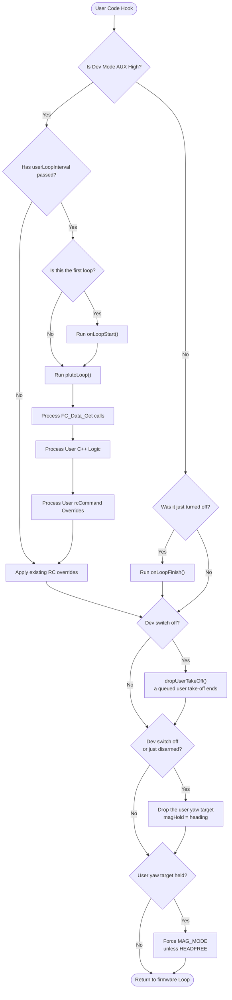
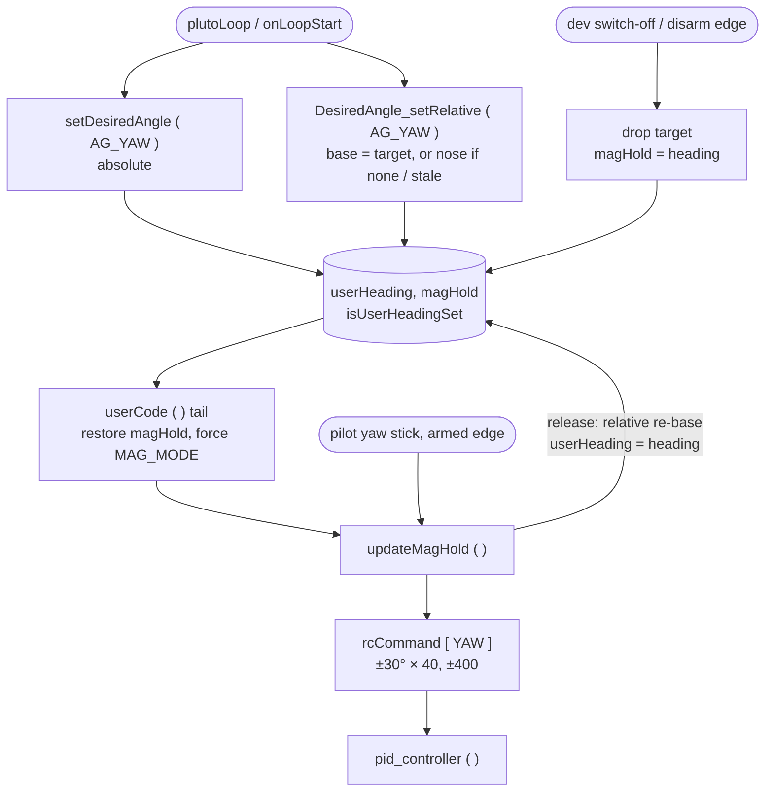
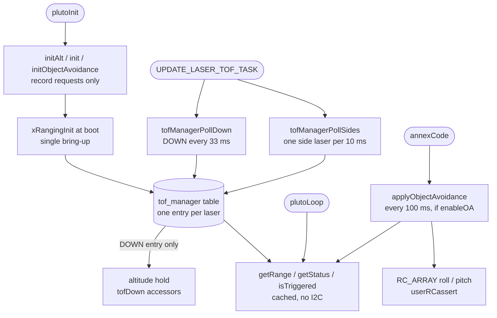

# User Space API (`PlutoPilot.cpp`)

## Overview
The `PlutoPilot` developer sandbox allows custom user C++ code to intercept the main flight loop. Developers can securely override controls, read live sensor variables, and trigger external LEDs or displays—all without breaking the real-time safety and timing of the core PID loops.

## Source Files
- **Sandbox Definition**: `PlutoPilot.cpp`, `PlutoPilot.h` (Root level developer files)
- **API Interfaces**: `src/main/API-Src/*` (e.g., `FC-Control-Command.cpp`, `FC-Data-Sensors.cpp`)
- **API Headers**: `src/main/API/*` (e.g., `FC-Control.h`, `Peripherals.h`)
- **Laser ranging**: `src/main/API/XRanging.h`, `src/main/API-Src/XRanging.cpp`, behind it `src/main/drivers/tof_manager.cpp`

## Key Data Structures
- `rcCommand[4]`: The user API often overwrites this array (Pitch, Roll, Yaw, Throttle) to fly the drone autonomously.
- `Flight_State_e`: Enumeration that the API uses to determine if the drone is Armed, in Failsafe, or Grounded.
- `current_command` / `command_status` ( `command/command.h` ): the one-slot command queue. `Command_TakeOff`,
  `Command_Land` and `Command_Flip` write it, and `executeCommand ( )` runs it at the end of the loop
  ( `mw.cpp:1500` ). The app's `MSP_SET_COMMAND` writes the same slot.

## Primary Functions
- `plutoInit()`: Called once during boot by `init()` ( main.cpp:534 ), after `SYSTEM_STATE_READY` and before the motor timers and the laser bring-up. Used by the developer to configure GPIOs, external sensors, or set up API timers. `XRanging` calls here only record requests; the lasers start after `plutoInit()` returns.
- `plutoLoop()`: The continuously executing user function. Called directly by the main control loop.
- `Command_Arm ( )`, `Command_TakeOff ( cm )`, `Command_Land ( speed )`, `Command_Flip ( BACK_FLIP )`,
  `Command_DisArm ( )` ( `API/FC-Control.h` ): arm and fly the drone from user code. Wiki
  `docs/API/FC_CONTROL_API_WIKI.md` ( API 1.7.0 ).
- `Estimate_Get ( Position | Velocity | Angle | Rate, axis )` ( `API/FC-Data.h` ): `EstAlt` in cm, the Z velocity in
  cm/s, and the angles.

## Data Flow & Boundaries
- **Time Slice Strictness**: Because `plutoLoop()` executes within the high-frequency control loop, user code *must not block*. The use of `delay()` is explicitly forbidden, as it would cause the drone to instantly crash by halting the PID calculations.
- **Override Priority**: If the Failsafe mechanism activates, the firmware explicitly ignores `rcCommand` overrides originating from `plutoLoop()`. Failsafe takes ultimate precedence over the API.
- **Rate Limiting**: To prevent API logic from running unnecessarily fast (e.g., polling an ultrasonic sensor 1000 times a second), developers use the `Monitor.timer` API to schedule tasks sequentially.
- **Landing owns the throttle and the command slot**: while any `LAND` runs ( `Command_Land`, RX loss or the
  critical-battery auto-land ), the landing throttle is re-applied after user code ( `mw.cpp:387`, `:1399` ), so a
  throttle `RcCommand_Set` has no effect. `Command_TakeOff` and `Command_Flip` are refused until the landing has
  disarmed ( `landingInProgress ( )`, `FC-Control-Command.cpp:130` ). The battery auto-land also re-asserts `LAND` as
  a backstop. `Command_Land` is refused while a flip runs ( `FC-Control-Command.cpp:157` ), and a flip ends after at
  most 8 s ( `acrobats.cpp:84` ).
- **Take-off**: `Command_TakeOff` is queued. From disarmed it arms once the ARM switch is on and the throttle is
  centred ( `altHoldStickCentred ( )`, alt-hold deadband ), and sets the climb goal. On a drone that is already armed
  it sets the goal once per arm, within 3 s of `arm_time` or at the ARM-switch ground idle, which it releases first
  ( `takeOff ( )`, `command.cpp:152` ). A queued take-off is dropped after 2 s of refused arming
  ( `takeOffRefusedTick ( )`, `command.cpp:143` ). A user-code take-off is also dropped at a real Dev Mode switch-off
  ( `dropUserTakeOff ( )`, `mw.cpp:1226` ). With the battery OK, arming is allowed again right after a landing, so a
  re-sent take-off re-arms and climbs.
- **User yaw is heading hold**: `setDesiredAngle ( AG_YAW, bearing )` and `DesiredAngle_setRelative ( AG_YAW, turn )`
  set the heading-hold target `magHold`. While one is held, the firmware engages MAG mode itself, so no app switch is
  needed. See **Yaw setpoints** below; wiki `docs/API/YAW_HEADING_API_WIKI.md` ( API 1.6.0 ).
- **Battery**: `Bms_Get` has `SoC`, `Warning_Level` and `Resistance` ( API 1.4.0 ); wiki `docs/API/BMS_API_WIKI.md`.
- **Link drop stops user code**: `plutoLoop ( )` runs only while `rxIsReceivingSignal ( )` is true. With `Rx_ESP`
  that is false **200 ms after the last `MSP_SET_RAW_RC` frame**. The firmware then runs `onLoopFinish ( )`,
  clears every user RC override and re-runs `onLoopStart ( )` when frames return. A Wi-Fi stall therefore
  restarts user code long before failsafe acts ( ~2.5 s ). A user **yaw target survives** such a restart; see
  **Yaw setpoints** below. `onLoopStart ( )` and `onLoopFinish ( )` therefore run on every link drop, not only at a
  Dev Mode switch. A command placed in them is sent again at each hiccup: `Command_Land` in `onLoopFinish ( )` lands
  the drone at the first hiccup, and `Command_Arm` / `Command_TakeOff` in `onLoopStart ( )` take off again after a
  landing. The wiki advises sending flight commands from `plutoLoop ( )`, once per ARM switch-on.
- **OLED is deferred**: `Oled_Update ( )` / `Oled_display_Update ( )` only queue the frame. The firmware sends the
  changed bytes to the panel at most 16 per loop, so a full screen appears in ~0.25 s. A buffer passed to
  `Oled_display_Update ( )` must stay valid ( `static` or global ). `Oled_Update ( )` works in `User` mode only, and
  `Oled_Mode ( )` starts from a blank frame. Wiki: `docs/API/OLED_API_WIKI.md`.
- **Laser ranging**: `XRanging` requests are made in `plutoInit ( )` and fixed at boot. Reads return cached values.
  Using XRanging switches SPI2 off. See **XRanging** below; wiki `docs/API/XRANGING_API_WIKI.md`.

## Yaw setpoints ( heading hold )

User code steers yaw by giving heading hold a target. It does not set a yaw rate. Full reference:
[YAW_HEADING_API_WIKI.md](../../../API/YAW_HEADING_API_WIKI.md) ( API 1.6.0 ).

| Call | Target | Repeated calls | After a pilot yaw |
|---|---|---|---|
| `setDesiredAngle ( AG_YAW, bearing )` | Compass bearing, 0..359 degrees ( other values wrapped ) | Each call replaces the target | The craft returns to the bearing |
| `DesiredAngle_setRelative ( AG_YAW, turn )` | The current target + `turn` ( + is clockwise ), or the nose + `turn` if no target is held | Turns add up exactly ( 4 × +90 = 360 ) | The target is re-based to the nose; there is no swing back |

Rules:
- **Heading hold is engaged automatically.** While Developer Mode is on and a target is held, `userCode ( )` enables
  MAG mode on every loop. It does not do this when the pilot has selected HEADFREE, which already holds heading, or
  when there is no magnetometer. `processRx ( )` re-derives MAG mode from AUX1 on each RX update, so the forced mode
  ends within ~20 ms of the target being dropped. Heading hold itself always sees MAG on while a target is held,
  and so does the app flip ( which needs MAG mode ), which runs after `userCode ( )`. But `processRx ( )` clears the
  flag from AUX1 earlier in the same pass, before the MSP reply ( `annexCode ( )` → `handleSerial ( )` ) and before
  `plutoLoop ( )`. So `FlightMode_Check ( MAGHOLD )` in user code and the app's BOXMAG indicator can momentarily read
  false.
- **Turns are clamped and fast.** `updateMagHold ( )` flies `( heading - magHold )`, wrapped to ±180, clamped to ±30°,
  × `P8[PIDMAG]` ( 40 ), clamped to ±400 on `rcCommand[YAW]`. Full yaw authority is reached at 10° of error. A 90°
  turn takes about 1.5-2 s and settles within ±1°. The craft takes the short way: +270 flies −90.
- **The pilot's yaw stick wins.** Past ±300 from centre it bypasses heading hold. When it is released and the yaw
  rate falls below ~17°/s, heading hold re-arms on the user target. A relative target is first re-based to the nose.
  That re-base is keyed on the armed rising edge of the stick, so the MAG mode switch-on at the first call cannot erase
  a turn. A relative call made during a stick hold clears the edge, so its call-time target stands after release.
  A `RcCommand_Set` yaw override is flown only while the re-arm latch is set; a sustained override faster than ~17°/s
  keeps the latch set, and the target is then never flown.
- **When the target is dropped.** On a real Developer Mode switch-off, and on the armed → disarmed edge, the target is
  dropped and `magHold = heading` is set, so the craft holds where it points. AUX channels hold their value through an
  RC loss ( `RX_FAILSAFE_MODE_HOLD`, the default for AUX, config.cpp:479; an `rxfail` SET value outside the dev range
  turns a stall over 600 ms into a switch-off ), so the target **survives a Wi-Fi flicker**, and also a long RC loss: heading hold keeps flying it through a
  failsafe `LAND` ( yaw only ). A target set while disarmed survives until takeoff.
- **Units.** Yaw is in whole degrees, and both setters wrap their value into 0..359. Roll and pitch in
  `setDesiredAngle` are in deci-degrees. The relative setter ignores `AG_ROLL` and `AG_PITCH`. `updateMagHold ( )`
  corrects the heading error by 360 only once, so an unwrapped target of 720 or more would never settle.

## XRanging ( laser ranging and object avoidance )

Up to six VL53L0X lasers on I2C1: four side lasers, EXTERNAL and the downward altitude laser ( `DOWN` ). Everything
goes through the `XRanging` object ( `API/XRanging.h` ). Full reference, examples and wiring rules:
[XRANGING_API_WIKI.md](../../../API/XRANGING_API_WIKI.md) ( API 1.5.0 ).

| Call | Where | What it does |
|---|---|---|
| `initAlt ( gpio )` / `initAlt ( )` | `plutoInit ( )` only | Requests the down-laser and the altitude-laser fusion ( the estimator then corrects on the laser below 160 cm ). `gpio` is the pin wired to its XSHUT; `initAlt ( )` is for a down-laser with no XSHUT wire. Returns `false` when refused. |
| `init ( )` / `init ( laser, threshold_cm )` | `plutoInit ( )` | Enables the four side lasers ( threshold 20 cm ), or one side laser with its own threshold. |
| `initObjectAvoidance ( dist_cm, l1 … l4 )` | `plutoInit ( )` | Enables up to four side lasers and sets the avoidance distance. OA stays off until `enableOA ( )`. |
| `enableOA ( )` / `disableOA ( )` | any time | Turns object avoidance on or off; `disableOA` also turns the laser LEDs off. |
| `getRange ( laser )` | any time | The cached range in mm. −100 when the laser has no valid sample or is not running, −1 when it was not enabled. `DOWN` is allowed. |
| `isTriggered ( laser )` | any time | A side laser's range is below its threshold; drives that laser's LED. |
| `getStatus ( laser )` | any time | `LASER_OK`, `LASER_OUT_OF_RANGE`, `LASER_BOOT_FAILED`, `LASER_I2C_ERROR` or `LASER_NOT_ENABLED`, per laser, `DOWN` included. |

Rules:
- **Requests are fixed at boot.** `xRangingInit ( )` brings every requested laser up once, after `plutoInit ( )`
  ( see `Main_Initialization.md` ). A laser enabled later is not started. A laser that fails, at boot or in flight, is
  not retried until power-off; the others carry on.
- **Reads are cached.** `UPDATE_LASER_TOF_TASK` polls the chips: DOWN every 33 ms, one side laser per 10 ms in
  round-robin ( each of four side lasers every ~40 ms ). `getRange`, `isTriggered` and `getStatus` read the cached
  entry and make no I2C call, so they are safe in `plutoLoop ( )`.
- **Object avoidance runs from `annexCode ( )`**, every 100 ms while `enableOA ( )` is on, whether or not user
  code runs. It overrides roll and pitch ( `RC_ARRAY`, pilot authority 0 through `userRCassert`; the pilot's stick is
  blended in at 30 % / 20 % ). A laser that is not OK or OUT_OF_RANGE counts as "no obstacle".
- **`initAlt` is refused** in these cases:
  - outside `plutoInit ( )`, i.e. once the bring-up has run;
  - in a VL53L1X ( `LASER_TOF_L1x` ) build;
  - for an invalid pin, or any side laser's XSHUT pin ( GPIO_7, 9, 16, 15, 14 );
  - for an RGB-LED slot or UART2 pin ( GPIO_1, 3, 6, 10, 11, 12, 13, 16, 17, 18 ): those drivers can take the pin after start-up;
  - when the pin's ADC or PWM alias is in use ( GPIO_5 = ADC_2 / PWM_4 ). This is checked again after `plutoInit ( )`;
    a request refused there leaves the firmware on the baro.

  A refused call keeps an earlier accepted request. `init` and `initObjectAvoidance` take side lasers only.
- **The down-laser's XSHUT pin is claimed.** After the bring-up starts, `Peripheral_Init` / `Peripheral_Write` on that
  pin, and `Peripheral_Init` on its ADC or PWM alias, are ignored. No LED write reaches it either: on this board
  GPIO_5 is FRONT's LED and the down XSHUT, so with `initAlt ( GPIO_5 )` FRONT has no LED.
- **Every fitted laser must be enabled.** A fitted side laser that is not enabled stays awake at 0x29. Every release
  after it is then refused ( `LASER_BOOT_FAILED`, step `BUS_BUSY` ), the down-laser included.
- **SPI2 is off whenever XRanging is used.** GPIO_5-8 are SPI2's pins. SPI calls made in `plutoInit ( )` work; from
  the bring-up on, the SPI API does nothing ( `SPI_Read` returns 0 ) and the on-board flash reports size 0.
- **No side laser reaches altitude hold.** Only the DOWN entry feeds the estimator.

