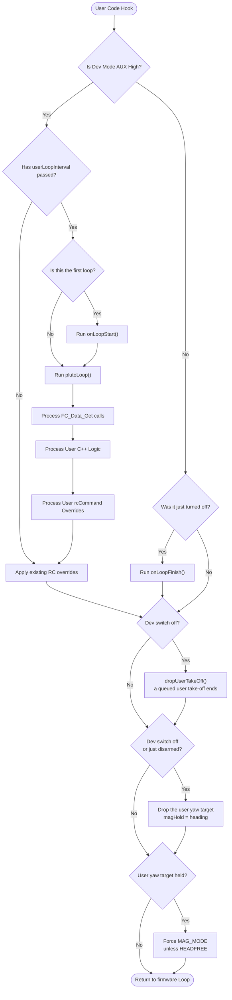
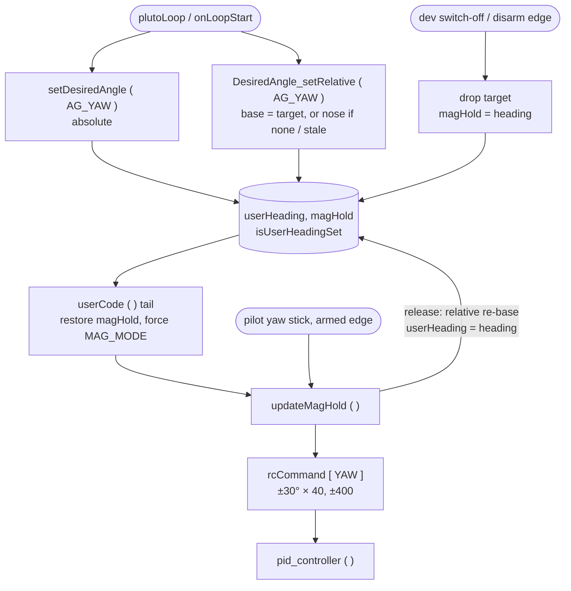
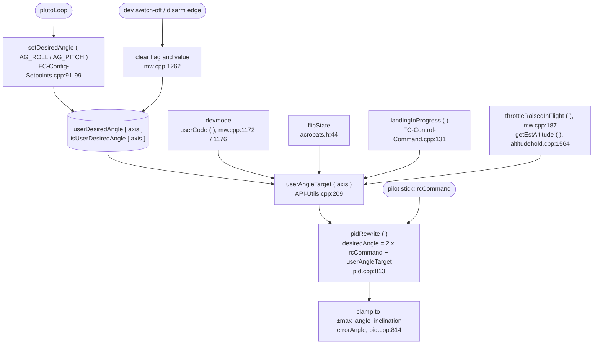
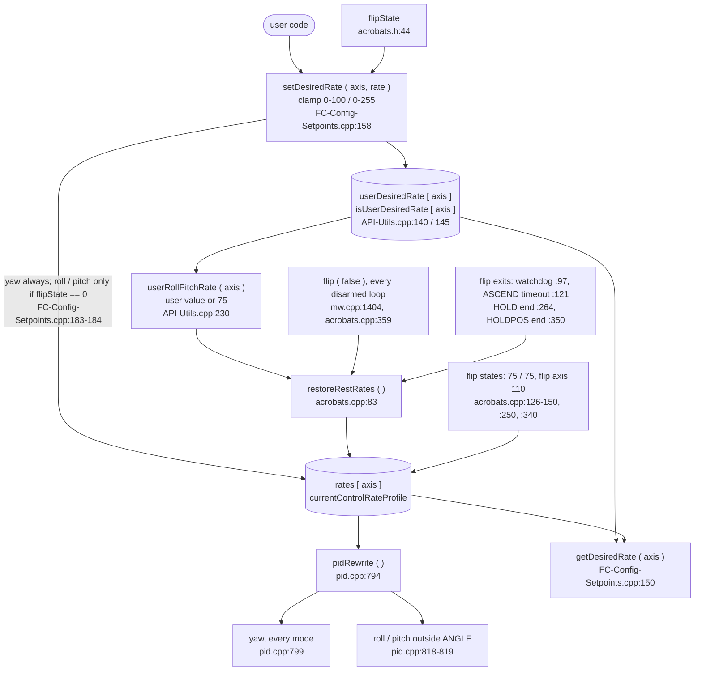
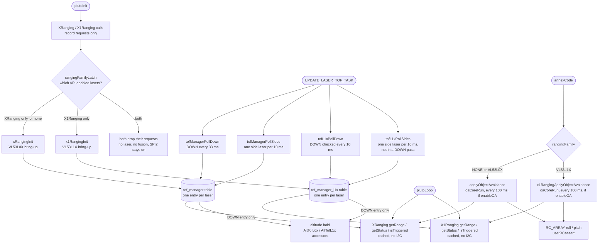

# User Space API (`PlutoPilot.cpp`)

## Overview
The `PlutoPilot` developer sandbox allows custom user C++ code to intercept the main flight loop. Developers can securely override controls, read live sensor variables, and trigger external LEDs or displays—all without breaking the real-time safety and timing of the core PID loops.

## Source Files
- **Sandbox Definition**: `PlutoPilot.cpp`, `PlutoPilot.h` (Root level developer files)
- **API Interfaces**: `src/main/API-Src/*` (e.g., `FC-Control-Command.cpp`, `FC-Data-Sensors.cpp`)
- **API Headers**: `src/main/API/*` (e.g., `FC-Control.h`, `Peripherals.h`)
- **Laser ranging**: `src/main/API/XRanging.h`, `src/main/API-Src/XRanging.cpp` ( VL53L0X, behind it
  `src/main/drivers/tof_manager.cpp` ); `src/main/API/X1Ranging.h`, `src/main/API-Src/X1Ranging.cpp` ( VL53L1X, behind
  it `src/main/drivers/tof_manager_l1x.cpp` ); object avoidance for both: `src/main/API-Src/ObjectAvoidanceCore.h`

## Key Data Structures
- `rcCommand[4]`: The user API often overwrites this array (Pitch, Roll, Yaw, Throttle) to fly the drone autonomously.
- `Flight_State_e`: Enumeration that the API uses to determine if the drone is Armed, in Failsafe, or Grounded.
- `current_command` / `command_status` ( `command/command.h` ): the one-slot command queue. `Command_TakeOff`,
  `Command_Land` and `Command_Flip` write it, and `executeCommand ( )` runs it at the end of the loop
  ( `mw.cpp:1533` ). The app's `MSP_SET_COMMAND` writes the same slot.

## Primary Functions
- `plutoInit()`: Called once during boot by `init()` ( main.cpp:524 ), after `SYSTEM_STATE_READY` and before the motor timers and the laser start-up. Used by the developer to configure GPIOs, external sensors, or set up API timers. `XRanging` and `X1Ranging` calls here only record requests; the laser family is chosen and the lasers start after `plutoInit()` returns.
- `plutoLoop()`: The continuously executing user function. Called directly by the main control loop.
- `Command_Arm ( )`, `Command_TakeOff ( cm )`, `Command_Land ( speed )`, `Command_Flip ( BACK_FLIP )`,
  `Command_DisArm ( )` ( `API/FC-Control.h` ): arm and fly the drone from user code. Wiki
  `docs/API/FC_CONTROL_API_WIKI.md` ( API 1.8.4 ).
- `FlightStatus_Get ( )` / `FlightStatus_Check ( status )` ( `API/FC-Control.h` ): the flight status from
  `flightIndicatorFlag`, one bit per internal `FlightStatus_e` ( `config/runtime_config.h` ); the lowest set bit is the
  most important ( `leastSignificantBit`, `common/maths.cpp` ). The internal enum and the public `flightstatus_e` are
  numbered differently at 2-4 ( internal Crash 2, Low_battery 3, LowBattery_inFlight 4; public FS_LOW_BATTERY 2,
  FS_INFLIGHT_LOW_BATTERY 3, FS_CRASHED 4 ), so `FC-Control-Status.cpp` translates by name through
  `flightStatusMap [ ]`, both ways; `MSP_FLIGHT_STATUS` ( `io/serial_msp.cpp` ) maps the same bit by name to
  `AppFlightStatus_e`. Never reorder the internal enum: its bit order is the priority, and `MSP_STATUS` sends the raw
  bits. Crash is cleared about 0.3 s after the crash disarm once level ( `mw.cpp` `annexCode ( )` ). Wiki section
  "Flight status" in `docs/API/FC_CONTROL_API_WIKI.md` ( API 1.8.4 ).
- `Estimate_Get ( Rate | Position | Velocity, axis )` ( `API/FC-Data.h`, `int16_t` ): `Rate` is the measured gyro rate
  in deg/s x10, `gyroADC [ axis ] / 1.64` rounded ( 16.4 counts per deg/s, the scale the DCM attitude integrates;
  `FC-Data-Estimate.cpp:74-91` ); X > 0 rolling right, Y > 0 nose down, Z > 0 turning left ( opposite to the heading ).
  `Position Z` is `EstAlt` in cm, `Velocity Z` is `VelocityZ` in cm/s ( climbing positive ); X / Y are the UWB
  position ( cm ) and velocity ( cm/s ), 0 without UWB. `Estimate_Get ( Angle, AG_ROLL | AG_PITCH | AG_YAW )`: roll and
  pitch in deci-degrees ( right side down / nose down positive ), heading in whole degrees 0-359, clockwise.
- `Sensor_Get ( Barometer, Pressure | Temperature )` ( `API/FC-Data.h` ): pressure in Pa ( = mbar x100 ), temperature
  in deg C x100 ( `3270` = 32.70 C ), both rounded to nearest ( `FC-Data-Sensors.cpp:84-100` ). The same
  `getBaroPressure ( )` / `getBaroTemperature ( )` values altitude hold reads; only the API layer scales them.
  `Sensor_Get ( Accelerometer | Gyroscope | Magnetometer, axis )`: accelerometer axes in cm/s^2, `Net_Acc` the squared
  magnitude in ( g^2 ) x100, gyro axes in deg/s x10 ( truncated; the same rate as `Estimate_Get ( Rate )` ). Wiki
  `docs/API/FC_DATA_API_WIKI.md` ( API 1.8.2 ).
- `RcCommand_Get ( )` ( `API/RC-Interface.h` ): a pointer to a file-static `int16_t [ 4 ]` refreshed on each call
  ( `RC-Interface.cpp` `rcCommandSnapshot` ): roll / pitch / yaw as `1500 + rcCommand` ( the same as
  `RcCommand_Get ( channel )` ), throttle as `rcCommand [ THROTTLE ]`, 1100-2000. User code runs after `annexCode ( )`
  and before `applyUserRcOverride ( )` and `applyAltHold ( )`: roll / pitch / yaw are the pilot's command, not its own
  `RcCommand_Set` override; throttle is the curve of `rcData [ THROTTLE ]` ( the stick, or the landing throttle, the
  altitude-limit cap, failsafe 1200 or a throttle override written there ), never the altitude-hold throttle. Yaw is inverted ( `yaw_control_direction` 1: yaw right
  reads below 1500 ). `RcData_Get ( )` ( array ) still returns NULL and `RcCommand_Get ( RC_THROTTLE )` reads 2600-3500
  ( known gaps ). Wiki `docs/API/RC_INTERFACE_API_WIKI.md` ( API 1.8.3 ).

## Data Flow & Boundaries
- **Time Slice Strictness**: Because `plutoLoop()` executes within the high-frequency control loop, user code *must not block*. The use of `delay()` is explicitly forbidden, as it would cause the drone to instantly crash by halting the PID calculations.
- **Override Priority**: If the Failsafe mechanism activates, the firmware explicitly ignores `rcCommand` overrides originating from `plutoLoop()`. Failsafe takes ultimate precedence over the API.
- **Rate Limiting**: To prevent API logic from running unnecessarily fast (e.g., polling an ultrasonic sensor 1000 times a second), developers use the `Monitor.timer` API to schedule tasks sequentially.
- **Landing owns the throttle and the command slot**: while any `LAND` runs ( `Command_Land`, RX loss or the
  critical-battery auto-land ), the landing throttle is re-applied after user code ( `mw.cpp:398`, `:1434` ), so a
  throttle `RcCommand_Set` has no effect. `Command_TakeOff` and `Command_Flip` are refused until the landing has
  disarmed ( `landingInProgress ( )`, `FC-Control-Command.cpp:131` ). The battery auto-land also re-asserts `LAND` as
  a backstop. `Command_Land` is refused while a flip runs ( `FC-Control-Command.cpp:158` ), and a flip ends after at
  most 8 s ( `acrobats.cpp:94` ).
- **Take-off**: `Command_TakeOff` is queued. From disarmed it arms once the ARM switch is on and the throttle is
  centred ( `altHoldStickCentred ( )`, alt-hold deadband ), and sets the climb goal. On a drone that is already armed
  it sets the goal once per arm, within 3 s of `arm_time` or at the ARM-switch ground idle, which it releases first
  ( `takeOff ( )`, `command.cpp:152` ). A queued take-off is dropped after 2 s of refused arming
  ( `takeOffRefusedTick ( )`, `command.cpp:143` ). A user-code take-off is also dropped at a real Dev Mode switch-off
  ( `dropUserTakeOff ( )`, `mw.cpp:1246` ). With the battery OK, arming is allowed again right after a landing, so a
  re-sent take-off re-arms and climbs.
- **User yaw is heading hold**: `setDesiredAngle ( AG_YAW, bearing )` and `DesiredAngle_setRelative ( AG_YAW, turn )`
  set the heading-hold target `magHold`. While one is held, the firmware engages MAG mode itself, so no app switch is
  needed. See **Yaw setpoints** below; wiki `docs/API/YAW_HEADING_API_WIKI.md` ( API 1.8.6 ).
- **User roll / pitch is an ANGLE-mode tilt**: `setDesiredAngle ( AG_ROLL | AG_PITCH, deci-degrees )` holds a tilt
  that `pidRewrite ( )` adds to the pilot's stick target. It is held until replaced and is not flown on the ground,
  outside ANGLE mode, in a flip, in a landing or in an RC stall. See **Roll / pitch setpoints** below; wiki
  `docs/API/YAW_HEADING_API_WIKI.md` ( API 1.8.6 ).
- **User stick rates hold until reboot**: `setDesiredRate ( axis, rate )` writes the live rate profile and keeps a copy
  that the flip code restores, so it survives disarm, Developer Mode off and flips. It is never dropped by the
  firmware. See **Stick rates** below; wiki `docs/API/FC_CONFIG_API_WIKI.md` ( API 1.8.7 ).
- **Battery**: `Bms_Get` has `SoC`, `Warning_Level` and `Resistance` ( API 1.4.0 ); wiki `docs/API/BMS_API_WIKI.md`.
- **Failsafe switches**: `Failsafe_enable / disable ( failsafe_e )` ( `FC-Config.h` ) change only the named switch,
  `ALL` all three ( API 1.8.8 ); all on at power-up, held until reboot, not saved. `INFLIGHT_LOW_BATTERY` gates every
  battery level and the critical auto-land, `CRASH` the crash disarm; `LOW_BATTERY` has no effect. Wiki
  `docs/API/FAILSAFE_API_WIKI.md` ( API 1.8.8 ).
- **Link drop stops user code**: `plutoLoop ( )` runs only while `rxIsReceivingSignal ( )` is true. With `Rx_ESP`
  that is false **200 ms after the last `MSP_SET_RAW_RC` frame**. The firmware then runs `onLoopFinish ( )`,
  clears every user RC override and re-runs `onLoopStart ( )` when frames return. A Wi-Fi stall therefore
  restarts user code long before failsafe acts ( ~2.5 s ). A user **yaw target survives** such a restart; see
  **Yaw setpoints** below. `onLoopStart ( )` and `onLoopFinish ( )` therefore run on every link drop, not only at a
  Dev Mode switch. A command placed in them is sent again at each hiccup: `Command_Land` in `onLoopFinish ( )` lands
  the drone at the first hiccup, and `Command_Arm` / `Command_TakeOff` in `onLoopStart ( )` take off again after a
  landing. The wiki advises sending flight commands from `plutoLoop ( )`, once per ARM switch-on.
- **OLED is deferred**: `Oled_Update ( )` / `Oled_display_Update ( )` only queue the frame. The firmware sends the
  changed bytes to the panel at most 16 per loop, so a full screen appears in ~0.25 s. A buffer passed to
  `Oled_display_Update ( )` must stay valid ( `static` or global ). `Oled_Update ( )` works in `User` mode only, and
  `Oled_Mode ( )` starts from a blank frame. `Oled_Print ( col, row, text )` is the one `Oled.h` function whose body
  is in a C file ( `io/oled_display.c` ), so its declaration is `extern "C"`; before FW 3.15.12 it was declared with
  C++ linkage and user code calling it could not link. It draws on the 21 x 8 text grid of the `System` screen and
  does nothing in `User` mode or outside `col` 0-20 / `row` 1-6. Wiki: `docs/API/OLED_API_WIKI.md`.
- **Debug output**: `Monitor_Print / Monitor_Println ( msg )`, `( tag, int )` and `( tag, double, precision )`
  ( `API/Debugging.h` ) send a `$D` frame to the app through `serialize8Debug ( )`, which writes into the
  same 256-byte TX ring as the MSP replies with no room check. A `Print` is one frame; a `Println` adds a second,
  5-byte `"\n"` frame. `precision` is 0 to 4 ( more prints 4 ), rounded half
  away from zero; beyond +/-4294967040 the number prints as `overflow`, NaN as `not a number`, infinity as `infinite`.
  A frame carries at most 255 payload bytes: the tag is cut so the number fits ( API 1.8.9; before, the double
  overload printed 0 after the first decimal, a 256-character string hung the main loop, and `INT_MIN` printed
  garbage ). Keep one `plutoLoop ( )` under ~130 bytes with the app connected. Wiki `docs/API/DEBUGGING_API_WIKI.md`
  ( API 1.8.9 ).
- **Laser ranging**: `XRanging` ( VL53L0X ) and `X1Ranging` ( VL53L1X ) requests are made in `plutoInit ( )` and
  fixed at boot. The API that enables lasers chooses the laser family; enabling lasers through both refuses both.
  Reads return cached values. Starting lasers switches SPI2 off. See **Laser ranging** below; wikis
  `docs/API/XRANGING_API_WIKI.md` and `docs/API/X1RANGING_API_WIKI.md`.

## Yaw setpoints ( heading hold )

User code steers yaw by giving heading hold a target. It does not set a yaw rate. Full reference:
[YAW_HEADING_API_WIKI.md](../../../API/YAW_HEADING_API_WIKI.md) ( API 1.8.6 ).

| Call | Target | Repeated calls | After a pilot yaw |
|---|---|---|---|
| `setDesiredAngle ( AG_YAW, bearing )` | Compass bearing, 0..359 degrees ( other values wrapped ) | Each call replaces the target | The craft returns to the bearing |
| `DesiredAngle_setRelative ( AG_YAW, turn )` | The current target + `turn` ( + is clockwise ), or the nose + `turn` if no target is held | Turns add up exactly ( 4 × +90 = 360 ) | The target is re-based to the nose; there is no swing back |

Rules:
- **Heading hold is engaged automatically.** While Developer Mode is on and a target is held, `userCode ( )` enables
  MAG mode on every loop. It does not do this when the pilot has selected HEADFREE, which already holds heading, or
  when there is no magnetometer. `processRx ( )` re-derives MAG mode from AUX1 on each RX update, so the forced mode
  ends within ~20 ms of the target being dropped. Heading hold itself always sees MAG on while a target is held,
  and so does the app flip ( which needs MAG mode ), which runs after `userCode ( )`. But `processRx ( )` clears the
  flag from AUX1 earlier in the same pass, before the MSP reply ( `annexCode ( )` → `handleSerial ( )` ) and before
  `plutoLoop ( )`. So `FlightMode_Check ( MAGHOLD )` in user code and the app's BOXMAG indicator can momentarily read
  false.
- **Turns are clamped and fast.** `updateMagHold ( )` flies `( heading - magHold )`, wrapped to ±180, clamped to ±30°,
  × `P8[PIDMAG]` ( 40 ), clamped to ±400 on `rcCommand[YAW]`. Full yaw authority is reached at 10° of error. A 90°
  turn takes about 1.5-2 s and settles within ±1°. The craft takes the short way: +270 flies −90.
- **The pilot's yaw stick wins.** Past ±300 from centre it bypasses heading hold. When it is released and the yaw
  rate falls below ~17°/s, heading hold re-arms on the user target. A relative target is first re-based to the nose.
  That re-base is keyed on the armed rising edge of the stick, so the MAG mode switch-on at the first call cannot erase
  a turn. A relative call made during a stick hold clears the edge, so its call-time target stands after release.
  A `RcCommand_Set` yaw override is flown only while the re-arm latch is set; a sustained override faster than ~17°/s
  keeps the latch set, and the target is then never flown.
- **When the target is dropped.** On a real Developer Mode switch-off, and on the armed → disarmed edge, the target is
  dropped and `magHold = heading` is set, so the craft holds where it points. AUX channels hold their value through an
  RC loss ( `RX_FAILSAFE_MODE_HOLD`, the default for AUX, config.cpp:441; an `rxfail` SET value outside the dev range
  turns a stall over 600 ms into a switch-off ), so the target **survives a Wi-Fi flicker**, and also a long RC loss: heading hold keeps flying it through a
  failsafe `LAND` ( yaw only ). A target set while disarmed survives until takeoff.
- **Units.** Yaw is in whole degrees, and both setters wrap their value into 0..359. Roll and pitch in
  `setDesiredAngle` are in deci-degrees and are a tilt, not a heading ( see **Roll / pitch setpoints** ). The relative
  setter ignores `AG_ROLL` and `AG_PITCH`. `updateMagHold ( )` corrects the heading error by 360 only once, so an
  unwrapped target of 720 or more would never settle.

## Roll / pitch setpoints ( ANGLE tilt )

`setDesiredAngle ( AG_ROLL | AG_PITCH, angle )` tilts the craft by `angle` deci-degrees and holds the tilt until the
next call replaces it. Full reference: [YAW_HEADING_API_WIKI.md](../../../API/YAW_HEADING_API_WIKI.md), section "Roll
and pitch tilt" ( API 1.8.6 ).

- **Stored, not flown, by the setter.** The setter writes `userDesiredAngle [ axis ]`, bounded to ±1800, and sets
  `isUserDesiredAngle [ axis ]` ( `FC-Config-Setpoints.cpp:91-99` ). Before FW 3.15.8 it wrote the measured attitude
  `inclination` instead: `Estimate_Get ( Angle )` read the value back once, the next `imuUpdate ( )` overwrote it, the
  craft never tilted, and a value above 700 could trip the crash detector in the air ( API test T11 / B4,
  `active-development/set-desired-angle-roll-pitch/` ). User code must never write `inclination`.
- **Flown by `pidRewrite ( )`.** `desiredAngle [ axis ] = 2 * rcCommand [ axis ] + userAngleTarget ( axis )`
  ( `pid.cpp:813` ), then the existing clamp to ±`max_angle_inclination` ( 200, 20°; `pid.cpp:814`, `config.cpp:420` ).
  The pilot's stick adds to the tilt and the sum keeps the pilot's limit. The other PID controllers ignore it.
- **Gated by `userAngleTarget ( )`** ( `API-Utils.cpp:209-220` ), which returns the held tilt, or 0 while it is kept but
  not flown:

| Not flown while | Test | Why |
|---|---|---|
| No tilt held, or not roll / pitch | `! isUserDesiredAngle [ axis ]`, `axis > FD_PITCH` | |
| Developer Mode stopped for more than 0.6 s | `millis ( ) - last devmode > USER_ANGLE_LINK_GRACE_MS` ( `API-Utils.h:73` ) | `devmode` falls 200 ms after the last RC frame. A normal Wi-Fi flicker keeps the tilt; a longer stall levels the craft, whose sticks have centred, instead of flying it away until the failsafe landing. |
| Not ANGLE mode | `! FLIGHT_MODE ( ANGLE_MODE )` | ACRO / HORIZON fly rates. |
| A flip runs | `flipState != 0` | The flip owns roll and pitch. |
| A landing runs | `landingInProgress ( )` ( `FC-Control-Command.cpp:131` ) | User, MSP, RC-loss and battery landings; a tilt would drift the descent. |
| Not airborne | `! throttleRaisedInFlight ( )` ( `mw.cpp:187` ) or `getEstAltitude ( ) < USER_ANGLE_MIN_ALT_CM` ( 20 cm, `API-Utils.h:78` ) | A tilt on the skids would pivot the take-off. Throttle-raised alone is true at the arm instant of an app take-off. |

- **Dropped** at a real Developer Mode switch-off and on the armed → disarmed edge, next to the yaw clear
  ( `mw.cpp:1262` ). `devSwitchOn` holds through an RC loss, so a flicker does not drop it; a tilt set while disarmed
  survives to take-off and waits for the airborne test.
- **Frame.** The tilt is added after the HEADFREE rotation of `rcCommand` in `annexCode ( )` ( `mw.cpp:430` ), so it is
  relative to the craft's nose, not to the headfree heading.
- **`getDesiredAngle ( AG_ROLL | AG_PITCH )`** returns `desiredAngle [ axis ]`, the stick plus the flown tilt **before**
  the clamp ( `FC-Config-Setpoints.cpp:85` ). `desiredAngle [ YAW ]` is never written, so yaw reads 0.

## Stick rates ( `setDesiredRate` / `getDesiredRate` )

`rates [ FD_ROLL / FD_PITCH / FD_YAW ]` in the live rate profile ( `currentControlRateProfile`, `uint8_t`, Cleanflight
rate units ) scale the stick into a turn rate in `pidRewrite ( )`. User code sets them with
`setDesiredRate ( axis, rate )` ( `FC-Config.h:228` ). Wiki: `docs/API/FC_CONFIG_API_WIKI.md`.

- **Setter.** `setDesiredRate ( )` ( `FC-Config-Setpoints.cpp:158` ) clamps with `constrain` to
  `CONTROL_RATE_CONFIG_ROLL_PITCH_RATE_MAX` 100 / `CONTROL_RATE_CONFIG_YAW_RATE_MAX` 255 ( `rc_controls.h:116 / 119`,
  the limits MSP_SET_RC_TUNING uses ), stores the value in `userDesiredRate [ axis ]` and sets
  `isUserDesiredRate [ axis ]` ( `API-Utils.cpp:140 / 145` ), then writes it into `rates [ axis ]` so it acts at once,
  except for roll / pitch while `flipState != 0` ( `FC-Config-Setpoints.cpp:183` ): see **A running flip keeps its
  rates** below.
  An unknown `angle_e` is ignored. `AG_*` and `FD_*` share their index ( `common/axis.h` ).
- **The flip sets its own roll / pitch rates and hands them back.** On all three targets ( `ENABLE_ACROBAT` ) `mw.cpp`
  calls `flip ( false )` on every disarmed loop ( `mw.cpp:1404` ) and `flip ( true )` while armed with a flip running
  ( `:1400` ), both before `userCode ( )` ( `:1429` ). The flip flies its own rates: 75 / 75 in ASCEND, HOLD and HOLDPOS
  ( `acrobats.cpp:126-127`, `:250-251`, `:340-341` ) and 110 on the flip axis ( `:135-150` ). Where it hands roll /
  pitch back to normal flight it calls `restoreRestRates ( )` ( `acrobats.cpp:83` ), which writes
  `userRollPitchRate ( axis )` ( `API-Utils.cpp:230` ): the held user value, or `STOCK_ROLL_PITCH_RATE` 75
  ( `API-Utils.h:83` ) when none is held. Callers: the 8 s watchdog ( `:97` ), the ASCEND 2.2 s timeout ( `:121` ), the
  HOLD end ( `:264` ), the HOLDPOS end ( `:350` ) and `flip ( false )` ( `:359` ).
- **A running flip keeps its rates.** `userCode ( )` ( `mw.cpp:1429` ) runs after `flip ( true )` ( `:1400` ) and
  before `pid_controller ( )` ( `:1500` ), and the flip writes 110 only once, at the ASCEND transition
  ( `acrobats.cpp:135-150` ); PITCHING and SLOWDOWNANDEXIT never rewrite it. A live write from user code during a flip
  would therefore replace the flip's spin rate, and a low one could trip the PITCHING 2 s timeout, which calls
  `mwDisarm ( )` in the air ( `acrobats.cpp:182-185` ) on `BACK_FLIP`, the API's only direction. So the setter holds a
  roll / pitch value but returns before the live write while `flipState != 0` ( `FC-Config-Setpoints.cpp:183` ); the
  flip's exit `restoreRestRates ( )` applies it, and `getDesiredRate ( )` already returns it. Yaw is not guarded: the
  flip never touches it. Before API 1.8.7 the setter wrote through unguarded.
- **Only `pidRewrite` ignores the rates in ANGLE mode.** `annexCode ( )` scales `dynP8 / dynI8 / dynD8` by
  `100 - rates [ axis ] * stick / 500` ( `mw.cpp:359 / 372 / 376-378` ) in every mode, and `pidMultiWii`,
  `pidMultiWii23`, `pidMultiWiiHybrid` and `pidHarakiri` read those ( `pid.cpp:305 / 323`, `:402 / 420`, `:531 / 548`,
  `:662 / 673` ). Under a non-default `pidController` ( CLI `serial_cli.cpp:487`, `MSP_SET_PID_CONTROLLER`
  `serial_msp.cpp:1437` ) a user rate therefore weakens the gains at full stick even in ANGLE mode.
- **Stock roll / pitch rate is 75, not the stored profile.** The config default is 0 ( `config.cpp:319` ), but
  `flip ( false )` writes 75 from the first disarmed loop, so 75 is the effective rate on every craft unless user code
  sets one. The app's MSP_SET_RC_TUNING roll / pitch is overwritten the same way.
- **Not restored by four abnormal flip timeouts, none of them reachable today.** SLOWDOWNANDEXIT ( left ),
  PITCHINGPOS and SLOWDOWNANDEXITPOS ( both ) set `flipState = 0` after 2 s without disarming or resetting the rates:
  the flip axis would keep 110 with ANGLE mode off until the next disarm, whose `flip ( false )` restores it. They sit
  on the LEFT / FRONT / RIGHT branches only, and `flipDirection` is only ever written 0 ( `FLIP_BACK`,
  `command.cpp:342`; the initialiser at `acrobats.cpp:63` is the same ), so every flip the firmware can start today
  ends at the watchdog or the ASCEND timeout ( both restore ) or at the PITCHING / SLOWDOWNANDEXIT 2 s timeouts
  ( both disarm, and the next `flip ( false )` restores ).
- **Never dropped.** Nothing clears `isUserDesiredRate [ ]`: a set rate holds through arm, disarm, Developer Mode off
  and Wi-Fi restarts, until reboot or the next call. Yaw is never touched by the flip.
- **Not saved by the API, but saved with the settings.** The setter writes `masterConfig`, so any later
  `saveConfigAndNotify ( )` stores it ( stick trim `mw.cpp:262`, accelerometer / compass calibration, the app's
  MSP_EEPROM_WRITE ). A profile change ( `MSP_SELECT_SETTING`, `serial_msp.cpp:1399` ) calls `writeEEPROM ( )` **before**
  `readEEPROM ( )` ( `:1405-1406` ), so it stores the user rate in the old profile too. A reload ( that, or
  `MSP_RESET_CONF`, `:1624` ) replaces the live value while `getDesiredRate ( )` keeps returning the user one; the flip
  code re-applies roll / pitch at the next disarmed loop, and yaw stays at the reloaded value.
- **Getter.** `getDesiredRate ( )` ( `FC-Config-Setpoints.cpp:150` ) returns `userDesiredRate [ axis ]` when held, else
  `rates [ axis ]`, and 0 for an unknown axis. Before API 1.8.7 it returned the PID's rate setpoint `desiredRate [ ]`.
- **Safe from `plutoInit ( )`.** `readEEPROM ( )` sets the profile pointer at `main.cpp:177`, before `plutoInit ( )`
  ( `:524` ), and nothing reloads it later in start-up.

## Laser ranging ( XRanging, X1Ranging ) and object avoidance

Up to six lasers on I2C1: four side lasers, EXTERNAL and the downward altitude laser ( `DOWN` ), all VL53L0X or all
VL53L1X. `XRanging` ( `API/XRanging.h` ) drives VL53L0X lasers, `X1Ranging` ( `API/X1Ranging.h` ) VL53L1X lasers.
Both have the same calls, the same `laser_e` / `laser_status_e` and the same pins. Full references, examples and
wiring rules: [XRANGING_API_WIKI.md](../../../API/XRANGING_API_WIKI.md) and
[X1RANGING_API_WIKI.md](../../../API/X1RANGING_API_WIKI.md) ( API 1.8.0 ).

**Choosing the family.** There is no build switch. The API whose calls enable lasers in `plutoInit ( )` chooses:
`init`, `initObjectAvoidance` with a side laser, or an accepted `initAlt`. Reads and `enableOA` / `disableOA` do not
count. `rangingFamilyLatch ( )` records the choice once, after `plutoInit ( )`.

| `plutoInit ( )` enables lasers through | Lasers started | Altitude hold with `initAlt` | Object avoidance |
|---|---|---|---|
| `XRanging` only | VL53L0X ( `xRangingInit ( )` ) | VL53L0X fusion copy | `applyObjectAvoidance ( )` |
| `X1Ranging` only | VL53L1X ( `x1RangingInit ( )` ) | VL53L1X fusion copy | `x1RangingApplyObjectAvoidance ( )` |
| neither | none | barometer | `applyObjectAvoidance ( )` ( no laser ) |
| **both** | **none: both refused** | barometer | none |

With both, every request of both APIs is dropped at start-up, even an `initAlt` that returned `true`. The getters
return −1 / `LASER_NOT_ENABLED`, no XSHUT is driven, and SPI2 and the flash stay on.

| Call | Where | What it does |
|---|---|---|
| `initAlt ( gpio )` / `initAlt ( )` | `plutoInit ( )` only | Requests the down-laser and the altitude-laser fusion ( the estimator then corrects on the laser below 160 cm ). `gpio` is the pin wired to its XSHUT; `initAlt ( )` is for a down-laser with no XSHUT wire. Returns `false` when refused. |
| `init ( )` / `init ( laser, threshold_cm )` | `plutoInit ( )` | Enables the four side lasers ( threshold 20 cm ), or one side laser with its own threshold. |
| `initObjectAvoidance ( dist_cm, l1 … l4 )` | `plutoInit ( )` | Enables up to four side lasers and sets the avoidance distance. OA stays off until `enableOA ( )`. Unused arguments default to `DOWN`, which is ignored. `EXTERNAL` is started but never avoided. |
| `enableOA ( )` / `disableOA ( )` | any time | Turns object avoidance on or off; `disableOA` also turns the laser LEDs off. |
| `getRange ( laser )` | any time | The cached range in mm. −100 when the laser has no valid sample or is not running, −1 when it was not enabled. `DOWN` is allowed. |
| `isTriggered ( laser )` | any time | A side laser's range is below its threshold; drives that laser's LED. |
| `getStatus ( laser )` | any time | `LASER_OK`, `LASER_OUT_OF_RANGE`, `LASER_BOOT_FAILED`, `LASER_I2C_ERROR` or `LASER_NOT_ENABLED`, per laser, `DOWN` included. |

Rules:
- **Requests are fixed at boot.** The latched family's bring-up starts every requested laser once, after
  `plutoInit ( )` ( see `Main_Initialization.md` ). A laser enabled later is not started. A laser that fails, at boot or
  in flight, is not retried until the next restart; the others carry on.
- **Reads are cached.** `UPDATE_LASER_TOF_TASK` polls the chips; `getRange`, `isTriggered` and `getStatus` read the
  cached entry and make no I2C call, so they are safe in `plutoLoop ( )`.
  - **VL53L0X:** DOWN every 33 ms, one side laser per 10 ms in round-robin ( each of four side lasers every ~40 ms ).
  - **VL53L1X:** every laser measures every 50 ms ( Medium mode, 45 ms budget ). DOWN is checked every 10 ms. One side
    laser is checked per 10 ms, never in the pass of a DOWN check, so each of four or five side lasers is updated
    about every 50 ms ( paced, not guaranteed ).
  - **VL53L1X status timing:** DOWN reads `LASER_OUT_OF_RANGE` until its first sample. A side laser reads `LASER_OK`
    with range −100 for up to 160 ms after start-up, before its first sample. No new sample for 160 ms, a range under
    15 mm, or one at 4500 mm or more, reads out of range.
- **Object avoidance runs from `annexCode ( )`**, every 100 ms while `enableOA ( )` is on, whether or not user
  code runs. `annexCode ( )` calls the wrapper of the latched family, and both wrappers run one shared core
  ( `oaCoreRun`, `API-Src/ObjectAvoidanceCore.h` ) with per-API state. It overrides roll and pitch ( `RC_ARRAY`, pilot
  authority 0 through `userRCassert`; the pilot's stick is blended in at 30 % / 20 % ). A laser that is not OK or
  OUT_OF_RANGE counts as "no obstacle" at once. An OUT_OF_RANGE side keeps its last distance for 2 ticks and is
  cleared on the 3rd in a row ( `OA_OOR_CLEAR_TICKS` ), so a removed obstacle is released within ~300 ms. The first
  valid sample after a clear seeds the side's filter.
- **`initAlt` is refused** ( both APIs, the same pin table and checks ) in these cases:
  - outside `plutoInit ( )`, i.e. once the bring-up has run;
  - for an invalid pin, or any side laser's XSHUT pin ( GPIO_7, 9, 16, 15, 14 );
  - for an RGB-LED slot or UART2 pin ( GPIO_1, 3, 6, 10, 11, 12, 13, 16, 17, 18 ): those drivers can take the pin after start-up;
  - when the pin's ADC or PWM alias is in use ( GPIO_5 = ADC_2 / PWM_4 ). This is checked again after `plutoInit ( )`;
    a request refused there leaves the firmware on the baro.

  A refused call keeps an earlier accepted request. `init` and `initObjectAvoidance` take side lasers only. An
  accepted request is still dropped at start-up if the other API enables a laser too ( both refused ).
- **The down-laser's XSHUT pin is claimed.** After the bring-up starts, `Peripheral_Init` / `Peripheral_Write` on that
  pin, and `Peripheral_Init` on its ADC or PWM alias, are ignored ( either API's down-laser ). No LED write reaches it
  either: on this board GPIO_5 is FRONT's LED and GPIO_8 BACK's, so `initAlt ( GPIO_5 )` leaves FRONT without an LED and
  `initAlt ( GPIO_8 )` BACK. The side lasers' XSHUT pins are not claimed.
- **Every fitted laser must be enabled.** A fitted side laser that is not enabled stays awake at 0x29. Every release
  after it is then refused ( `LASER_BOOT_FAILED`, step `BUS_BUSY` ), the down-laser included.
- **SPI2 is off whenever lasers are started.** GPIO_5-8 are SPI2's pins. SPI calls made in `plutoInit ( )` work; from
  the bring-up on, the SPI API does nothing ( `SPI_Read` returns 0 ) and the on-board flash reports size 0.
- **No side laser reaches altitude hold.** Only the DOWN entry of the latched family feeds the estimator.

